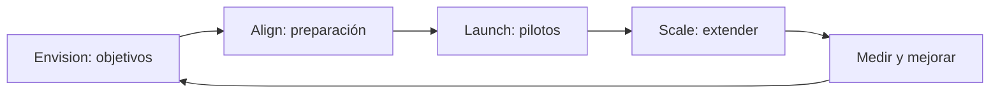
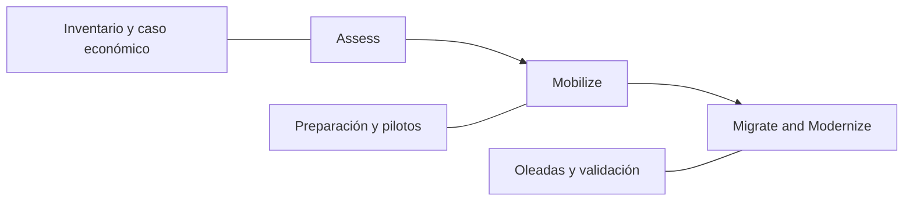
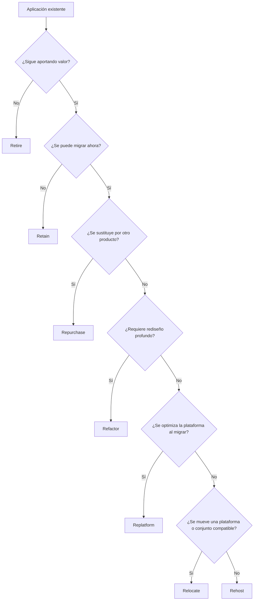

# 4. Adopción y migración a AWS

Este capítulo desarrolla el contenido docente y las ampliaciones necesarias para el dominio 1. Las figuras reproducen páginas originales, con sus notas, para que los ejemplos y diagramas conserven contexto. Los datos históricos no constituyen recomendaciones actuales de producto.

## Desarrollo complementario oficial

`[AMPLIACIÓN OFICIAL: documentación enlazada al final de cada apartado; corpus 06]`

> Este capítulo representa la **principal ampliación ausente** de T1, T2 y *Cloud Architecture*. La tarea 1.3 del CLF-C02 pide reconocer beneficios de AWS CAF, estrategias de adopción, recursos de migración y soluciones adecuadas para escenarios de transferencia y replicación de datos. El nivel requerido es **conceptual**, no configurar físicamente una migración.

### Ampliación oficial: ¿Qué es migrar a la nube?

Migrar significa trasladar aplicaciones, datos, bases de datos, servidores o procesos desde un entorno original (por ejemplo, infraestructura local) hacia recursos cloud. Puede realizarse trasladando prácticamente el mismo sistema, sustituyéndolo por una plataforma gestionada o rediseñando su arquitectura.

La **adopción de la nube** es un proceso más amplio que la migración técnica. Implica adaptar personas, procesos, organización, seguridad, gobierno, plataformas y operaciones a un nuevo modelo de entrega tecnológica. Una aplicación puede ejecutarse en AWS y, sin embargo, la organización no haber completado todavía sus cambios organizativos o de operación.

#### Beneficios potenciales

- Menor dependencia de inversiones y ciclos de compra de hardware.
- Acceso rápido a servicios administrados, escalabilidad y automatización.
- Opciones para desplegar cerca de diferentes mercados.
- Posibilidad de mejorar continuidad, seguridad y trazabilidad si se diseñan controles adecuados.
- Reducción de tareas repetitivas de administración física y oportunidad de acelerar entregas.
- Facilitar la modernización posterior de aplicaciones y servicios.

**La migración no elimina todos los riesgos:** hay que considerar el esfuerzo de transición, latencias, dependencias, cambios de licencias, soberanía de datos, formación, costes de funcionamiento paralelo y validación de seguridad.

### Ampliación oficial: AWS Cloud Adoption Framework (AWS CAF)

`[AMPLIACIÓN OFICIAL — CLF-C02, tarea 1.3]`

El **AWS Cloud Adoption Framework (AWS CAF)** es un marco de orientación que ayuda a organizaciones a identificar capacidades, evaluar su preparación, coordinar áreas de trabajo y establecer una hoja de ruta para adoptar la nube. No es un servicio de migración de servidores ni una certificación de cumplimiento.

AWS CAF orienta iniciativas hacia resultados empresariales como **reducción de riesgos**, **mejora de indicadores ESG (medioambientales, sociales y de gobierno corporativo)**, **crecimiento de ingresos** y **mejor eficiencia operativa**. Son objetivos potenciales de la transformación, no garantías universales por contratar AWS.

#### Seis perspectivas de AWS CAF

| Perspectiva | Pregunta clave | Qué comprende | Ejemplo |
|---|---|---|---|
| **Business** (negocio) | ¿Qué valor empresarial buscamos? | Estrategia, inversiones, objetivos y justificación de valor | Priorizar migraciones con impacto en clientes |
| **People** (personas) | ¿Está preparada la organización? | Capacitación, liderazgo, cultura, organización y gestión del cambio | Formar a equipos en operaciones cloud |
| **Governance** (gobernanza) | ¿Cómo decidimos y controlamos riesgos? | Políticas, finanzas, cumplimiento, cartera y prioridades | Definir presupuestos, responsables y estándares |
| **Platform** (plataforma) | ¿Sobre qué base técnica desplegamos? | Arquitectura, entornos, infraestructura, modernización y tecnologías | Preparar cuentas, conectividad y entornos |
| **Security** (seguridad) | ¿Cómo protegemos sistemas y datos? | Identidades, riesgos, protección, detección y cumplimiento | Diseñar controles IAM y cifrado |
| **Operations** (operaciones) | ¿Cómo funcionará el servicio diariamente? | Monitorización, mantenimiento, incidencias, fiabilidad y operación | Alarmas, procedimientos de guardia y recuperación |

Un fallo frecuente es confundir **Governance** y **Operations**: la primera se ocupa de reglas, control, responsabilidades y dirección; la segunda, de ejecutar y mantener servicios. **People** no es IAM: IAM es tecnología de control de identidades; People se refiere a formación, cultura, organización y competencias.

**Fuente:** [AWS CAF — seis perspectivas](https://docs.aws.amazon.com/whitepapers/latest/overview-aws-cloud-adoption-framework/foundational-capabilities.html).

#### Cuatro dominios de transformación en AWS CAF

1. **Technology:** modernizar y migrar infraestructura, aplicaciones y plataformas de datos.
2. **Process:** digitalizar y mejorar los procedimientos de operación y negocio.
3. **Organization:** cambiar cómo se coordinan los equipos y se toman decisiones para entregar valor.
4. **Product:** evolucionar la propuesta de valor, los servicios y productos ofrecidos a los clientes.

Estos **cuatro dominios de transformación** no deben confundirse con los **cuatro dominios del examen CLF-C02** ni con las **seis perspectivas AWS CAF**. Se trata de clasificaciones distintas, aunque tengan números parecidos.

**Fuente:** [AWS CAF — resultados y dominios de transformación](https://docs.aws.amazon.com/whitepapers/latest/overview-aws-cloud-adoption-framework/accelerating-business-outcomes.html).

#### Cuatro fases iterativas de AWS CAF

| Fase | Finalidad | Resultado típico |
|---|---|---|
| **Envision** (visualizar) | Relacionar la nube con oportunidades y objetivos medibles | Visión, valor esperado y prioridades |
| **Align** (alinear) | Detectar carencias en las seis perspectivas y coordinar responsables | Plan para cerrar brechas organizativas y técnicas |
| **Launch** (lanzar) | Ejecutar iniciativas piloto y comprobar su valor | Primeras soluciones operativas con aprendizaje práctico |
| **Scale** (escalar) | Extender a otras cargas y mantener los beneficios | Despliegue progresivo y adopción consolidada |

Estas fases **no son las mismas** que las fases operativas de un programa de migración de gran escala. Una organización puede recorrerlas iterativamente, revisitando decisiones conforme obtiene información.

**Fuente:** [AWS CAF — recorrido de transformación](https://docs.aws.amazon.com/whitepapers/latest/overview-aws-cloud-adoption-framework/your-cloud-transformation-journey.html).

### Ampliación oficial: Las tres fases de un programa de migración

En sus guías de grandes migraciones, AWS utiliza un modelo práctico de tres etapas:

1. **Assess (evaluar):** inventariar aplicaciones y dependencias, analizar la preparación, identificar oportunidades y construir un caso de negocio.
2. **Mobilize (movilizar):** preparar equipos, seguridad, gobierno, *landing zone*, conectividad, procesos, herramientas y pilotos; organizar el plan de ejecución.
3. **Migrate and Modernize (migrar y modernizar):** ejecutar oleadas de migración, validar resultados, efectuar cortes de servicio controlados y después optimizar o modernizar, según el plan.

**Landing zone:** entorno de partida organizado que incorpora cuentas, estructura, identidad, conectividad, controles y gobierno. Una landing zone no es una región ni una zona de disponibilidad física.

**Migration wave (oleada):** conjunto de aplicaciones o sistemas que se migran coordinadamente teniendo en cuenta dependencias, secuencias, ventanas de corte y necesidades de prueba.

**Fuente:** [AWS Prescriptive Guidance — fases de grandes migraciones](https://docs.aws.amazon.com/prescriptive-guidance/latest/large-migration-guide/phases.html).

### Ampliación oficial: Las siete estrategias de migración: 7 Rs

`[AMPLIACIÓN OFICIAL — AWS]` AWS documenta **siete** estrategias habituales. Conviene reconocerlas por su nombre en inglés, su objetivo y un ejemplo representativo.

| Estrategia | En qué consiste | Ejemplo didáctico | Idea que hay que reconocer |
|---|---|---|---|
| **Rehost** (*lift and shift*) | Trasladar una aplicación prácticamente sin cambiarla | Mover un servidor web local a EC2 | Mover primero, modificar poco |
| **Relocate** | Desplazar la carga o infraestructura manteniendo esencialmente su plataforma y arquitectura | Trasladar cargas de una plataforma de virtualización a una oferta compatible cloud | Mover plataforma/conjunto sin rediseño |
| **Replatform** (*lift and reshape*) | Introducir modificaciones limitadas para aprovechar mejor la nube | Pasar base de datos autogestionada a Amazon RDS, conservando motor y aplicación en gran medida | Optimizar sin rehacer toda la aplicación |
| **Refactor / Re-architect** | Rediseñar sustancialmente para aprovechar capacidades cloud-native | Dividir un monolito en servicios y adoptar componentes administrados | Modernización arquitectónica profunda |
| **Repurchase** (*drop and shop*) | Sustituir una aplicación por otro producto o SaaS | Cambiar CRM instalado localmente por SaaS | Reemplazar en vez de migrar el producto anterior |
| **Retain** | Mantener temporalmente o indefinidamente la carga donde está | Conservar un sistema por requisitos normativos o técnicos | No migrar por ahora |
| **Retire** | Desmantelar aplicaciones sin valor o ya no necesarias | Apagar una aplicación duplicada sin usuarios | Eliminar en lugar de migrar |

#### Rehost vs Replatform vs Refactor

- **Rehost:** máxima continuidad de la implementación original. Puede permitir migrar rápido y optimizar después.
- **Replatform:** cambia algunas piezas, por ejemplo sustituir una base de datos administrada manualmente por un servicio gestionado, manteniendo la función principal.
- **Refactor:** cambia partes significativas de la arquitectura, la estructura de la aplicación o el modelo de ejecución.

**Relocate** no es necesariamente lo mismo que rehost: suele referirse al traslado de una plataforma o conjunto de cargas sin cambiar sustancialmente su operación. El tipo exacto de destino determina la frontera entre ambas estrategias.

#### Selección de estrategias mediante preguntas

**Advertencia:** diagrama docente, no algoritmo oficial completo para seleccionar una estrategia. En una migración real intervienen costes, dependencias, criticidad, plazos y restricciones.

**Fuente:** [AWS Prescriptive Guidance — siete estrategias](https://docs.aws.amazon.com/prescriptive-guidance/latest/large-migration-guide/migration-strategies.html).

### Ampliación oficial: Migración de datos frente a migración de servidores

Hay que distinguir **qué se mueve**:

- **Servidores o aplicaciones:** máquinas, sistemas operativos, servicios de aplicación y componentes de ejecución.
- **Bases de datos:** estructuras, datos y, según la herramienta, cambios continuos producidos mientras la aplicación sigue trabajando.
- **Archivos u objetos:** grandes volúmenes de datos no necesariamente estructurados como tablas de una base de datos.
- **Entornos de operación:** redes, identidades, configuraciones, políticas, accesos y dependencias también deben planificarse aunque no sean «datos a copiar».

#### Replicación de bases de datos

Una migración puede requerir que una base de datos original siga recibiendo cambios mientras se traslada información hacia el destino. La **replicación continua** o captura de cambios (*CDC, Change Data Capture*) permite copiar cambios posteriores a una carga inicial y reducir la distancia entre fuente y destino.

Por ejemplo, una empresa que migra de PostgreSQL local a Amazon RDS for PostgreSQL puede hacer una carga inicial y replicar cambios mientras prepara el cambio de conexión de la aplicación. **CDC no garantiza sincronización instantánea**; puede existir retraso y siempre debe planificarse y verificarse el corte.

**Fuente:** [AWS DMS — documentación general](https://docs.aws.amazon.com/dms/latest/userguide/); [modos de migración de AWS DMS](https://docs.aws.amazon.com/dms/latest/userguide/data-migrations.html).

### Ampliación oficial: Servicios y herramientas que debes reconocer

#### AWS Database Migration Service (AWS DMS)

Servicio para **migrar y replicar datos de bases de datos** y otros almacenes compatibles. Admite migraciones homogéneas (mismo tipo de motor) y heterogéneas (motores diferentes) cuando están soportadas, y puede copiar una carga inicial o replicar cambios continuos. Migrar el contenido no significa que cualquier incompatibilidad de esquema, lógica o aplicación quede resuelta automáticamente.

**Caso de uso:** transferir datos de una base de datos corporativa a un servicio de bases de datos de AWS con una ventana de parada reducida.

#### AWS DMS Schema Conversion / AWS Schema Conversion Tool (SCT)

Herramientas orientadas a **evaluar y convertir esquemas y determinados objetos de código de bases de datos** cuando se cambia entre motores. Complementan a DMS: una herramienta de conversión de esquema no equivale a replicar todos los registros.

**Caso de uso:** adaptar estructuras de una base de datos Oracle a un motor PostgreSQL compatible antes de mover los datos.

#### AWS Transform MGN (anteriormente AWS Application Migration Service / AWS MGN)

Solución de **rehosting de servidores**. Utiliza replicación a nivel de bloques del origen para facilitar el traslado de servidores físicos, virtuales o alojados en otras nubes hacia AWS, reduciendo el trabajo manual y preparando su ejecución en el destino.

**Caso de uso:** mover muchos servidores Windows/Linux a EC2 con cambios mínimos en la aplicación.

**Nota de nomenclatura:** materiales antiguos y algunas guías todavía muestran el nombre *AWS Application Migration Service*. La documentación actual lo presenta como **AWS Transform MGN**. El acrónimo MGN y el caso de uso *lift and shift* siguen siendo la pista conceptual.

#### AWS DataSync

Servicio para transferir **archivos y objetos** entre almacenamiento local, AWS y determinados servicios de otras nubes. Automatiza transferencias por red, validación de integridad y operaciones recurrentes.

**Caso de uso:** copiar un NAS empresarial hacia Amazon S3 o Amazon EFS a través de la red.

#### AWS Migration Hub (histórico) y AWS Transform

**Migration Hub** se utilizaba para descubrir y planificar migraciones y centralizar el seguimiento de aplicaciones y servidores, con información procedente de distintas herramientas. **AWS Transform** es la plataforma posterior que AWS recomienda para nuevas iniciativas con capacidades de migración y modernización asistidas por automatización e IA.

`[NOTA DE ACTUALIZACIÓN 2026]` **AWS Migration Hub dejó de aceptar nuevos clientes el 7 de noviembre de 2025.** Es correcto conocerlo si aparece en guías antiguas, pero no recomendarlo sin matices como solución disponible para una cuenta nueva.

#### AWS Migration Evaluator

Herramienta de evaluación para construir un caso empresarial y económico de migración, mediante información del entorno actual y escenarios de coste. Está orientada a la **planificación económica**, no a mover por sí misma las bases de datos o servidores.

#### AWS Snow Family / AWS Snowball Edge (referencia histórica de examen)

La familia Snow ofrecía **dispositivos físicos** para transportar grandes cantidades de datos cuando la conectividad de red era insuficiente, muy cara o poco práctica. A diferencia de una transferencia de red, el proceso podía implicar recibir un dispositivo, copiar los datos y devolverlo para que se importasen a AWS.

`[NOTA DE ACTUALIZACIÓN 2026 — MUY IMPORTANTE]` La guía CLF-C02 incluye **Snowball** como ejemplo de estrategia de migración, pero **AWS Snowball Edge dejó de estar disponible para nuevos clientes en noviembre de 2025**. AWS anuncia además el **fin del soporte de los dispositivos Snowball en regiones comerciales para el 31 de diciembre de 2026**, con excepciones indicadas para ciertos entornos. **Debe distinguirse la respuesta a un examen que utiliza terminología histórica del consejo sobre qué contratar hoy.**

#### AWS Data Transfer Terminal

Instalación física de AWS preparada para transferencia de datos por red de gran capacidad: el cliente **lleva sus propios dispositivos** a una ubicación habilitada y transfiere el contenido desde allí a AWS. **No es lo mismo que Snowball**, donde tradicionalmente el dispositivo se enviaba al cliente. La documentación actual indica restricciones de acceso, como disponibilidad vinculada a Enterprise Support.

#### AWS Transfer Family y AWS Direct Connect (servicios relacionados)

- **AWS Transfer Family:** permite recibir o intercambiar archivos utilizando protocolos de transferencia administrados, como SFTP, con destinos compatibles en AWS; no es un sustituto directo de DMS para bases de datos.
- **AWS Direct Connect:** establece conectividad de red dedicada entre infraestructura del cliente y AWS. Puede ser parte de una estrategia de migración o de operación híbrida, pero por sí mismo **no replica** servidores ni bases de datos.

#### Tabla de selección: necesidad → solución

| Necesidad | Servicio/concepto que debes reconocer |
|---|---|
| Mover bases de datos y replicar cambios | **AWS DMS** |
| Convertir esquema al cambiar motor de base de datos | **DMS Schema Conversion / AWS SCT** |
| Mover servidores casi sin modificar el código | **AWS Transform MGN** (antes Application Migration Service) |
| Transferir muchos archivos/objetos entre NAS y AWS por red | **AWS DataSync** |
| Planificar económicamente una migración | **AWS Migration Evaluator** |
| Coordinación y seguimiento en material histórico | **AWS Migration Hub** (no nuevos clientes desde 2025) |
| Conocer la opción histórica de dispositivos físicos enviados para migración | **AWS Snowball / Snow Family** (retirada/transición) |
| Llevar dispositivos propios a una instalación física para subir datos | **AWS Data Transfer Terminal** (con condiciones de acceso) |
| Conectividad de red dedicada desde las instalaciones | **AWS Direct Connect** |
| Intercambio de archivos SFTP administrado | **AWS Transfer Family** |
| Evaluar preparación empresarial y organizativa | **AWS CAF** |
| Elegir qué hacer con cada aplicación | **7 Rs** |

**Fuentes oficiales de este catálogo:**

- [AWS DMS](https://docs.aws.amazon.com/es_es/dms/latest/userguide/Welcome.html).
- [AWS Transform MGN](https://docs.aws.amazon.com/mgn/latest/ug/what-is-mgn.html).
- [AWS DataSync](https://docs.aws.amazon.com/es_es/datasync/latest/userguide/what-is-datasync.html).
- [AWS Migration Hub — descripción histórica](https://docs.aws.amazon.com/migrationhub/latest/ug/whatishub.html).
- [Migration Hub — aviso de disponibilidad para nuevos clientes](https://docs.aws.amazon.com/es_es/migrationhub-strategy/latest/userguide/migrationhub-availability-change.html).
- [Snowball Edge — aviso de disponibilidad](https://docs.aws.amazon.com/snowball/latest/developer-guide/snowball-edge-availability-change.html).
- [Snowball — aviso de fin de soporte de 2026](https://aws.amazon.com/snowball/).
- [AWS Data Transfer Terminal](https://docs.aws.amazon.com/es_es/datatransferterminal/latest/userguide/what-is-dtt.html).
- [AWS Migration Evaluator](https://docs.aws.amazon.com/prescriptive-guidance/latest/migration-tools/business-case-migration-evaluator.html).

### Ampliación oficial: Qué determinar antes de migrar

Una migración debe incluir, al menos en términos conceptuales, una evaluación de:

1. **Inventario y dependencias:** aplicaciones, servidores, bases de datos, propietarios, integraciones, archivos, autenticación y requisitos de conectividad.
2. **Objetivos empresariales:** disminuir costes, reducir tiempos de despliegue, renovar tecnología, mejorar continuidad o expandir regiones.
3. **Requisitos no funcionales:** disponibilidad, rendimiento, seguridad, latencia, soberanía de datos, normas y condiciones de recuperación.
4. **Estrategia 7 Rs por aplicación:** no todas las cargas necesitan el mismo enfoque.
5. **Plan de datos:** volumen, tipo, método de transferencia, replicación, verificación de integridad y ventana de corte.
6. **Costes y licencias:** TCO actual y estimado, BYOL, gastos de transición y doble funcionamiento temporal.
7. **Pruebas y retorno:** validar comportamiento, datos, seguridad y posibilidad de revertir o contener un fallo durante el corte.
8. **Operación posterior:** observabilidad, mantenimiento, formación, roles de responsabilidad compartida y mejora continua.

No se debe memorizar un procedimiento detallado de configuración para la certificación CLF-C02: interesa reconocer las decisiones, herramientas y ventajas asociadas.

---
