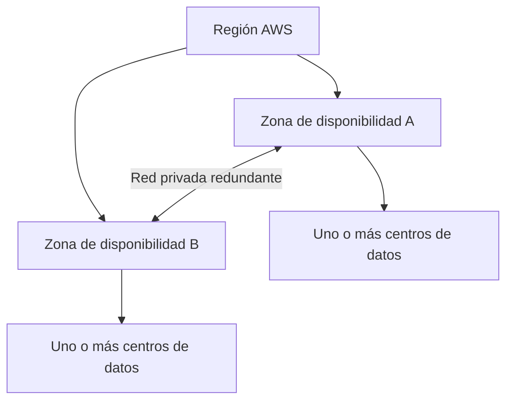

# 3. Infraestructura global y arquitectura AWS

## 3.1 Infraestructura global: regiones, AZ y centros de datos

`[FUENTE: T2 pp. 4–8]` AWS organiza su infraestructura en una jerarquía geográfica. Una **región** es un área geográfica separada; dentro de ella hay varias **zonas de disponibilidad** (Availability Zones, AZ). Una AZ contiene uno o más centros de datos con alimentación, redes y controles físicos diseñados para operar de forma independiente de otras AZ. AWS conecta las zonas de una región mediante una red privada redundante y de alta capacidad.

El cliente selecciona regiones y AZ donde desplegar recursos; no selecciona un centro de datos específico. La replicación entre AZ o regiones no ocurre automáticamente para todos los servicios: debe diseñarse y configurarse según el servicio y la necesidad de negocio. Usar varias AZ puede reducir el impacto de un fallo localizado, pero requiere que la aplicación, los datos y el tráfico admitan esa arquitectura.

`[FUENTE: T2 p. 6]` Al elegir una región se consideran cuatro factores: requisitos legales o de soberanía de datos; proximidad a los usuarios y latencia; disponibilidad regional de servicios; y coste. La lista de regiones, AZ y servicios cambia, por lo que cualquier selección debe comprobarse en el [mapa oficial de infraestructura global](https://aws.amazon.com/about-aws/global-infrastructure/).

El material incluye cifras históricas como 50.000–100.000 servidores por centro de datos y una cantidad de regiones de su época. No deben estudiarse como cifras vigentes. La decisión importante es la separación física y lógica y las opciones de despliegue; los datos de escala cambian y no son una propiedad estable del examen.

## 3.2 Edge, Points of Presence y distribución

`[FUENTE: T2 p. 9]` Los **Points of Presence (PoP)** incluyen ubicaciones de borde y cachés regionales que acercan contenido o respuestas a usuarios. CloudFront utiliza una red de distribución de contenido (CDN) para almacenar temporalmente y entregar contenido desde ubicaciones más cercanas; Route 53 aporta DNS y opciones de enrutamiento. Esto puede reducir latencia y carga en el origen, aunque el resultado depende de caché, tráfico, ubicación y diseño.

## 3.3 Propiedades arquitectónicas relacionadas

`[FUENTE: T2 p. 10; CA pp. 46–51]` No son sinónimos:

| Propiedad | Significado práctico |
|---|---|
| Escalabilidad | Aumentar recursos para soportar crecimiento previsto. |
| Elasticidad | Ajustar capacidad conforme cambia la demanda. |
| Alta disponibilidad | Diseñar para que un servicio siga accesible pese a ciertos fallos, a menudo con redundancia y failover. |
| Tolerancia a fallos | Mantener el servicio operativo aunque falle un componente, con menor interrupción perceptible. |
| Recuperabilidad | Restaurar el servicio y los datos después de un incidente o desastre. |
| Durabilidad | Probabilidad de conservar datos sin pérdida durante el tiempo. No garantiza por sí sola acceso continuo. |

La redundancia puede mejorar la disponibilidad, pero no elimina fallos; introduce coste, complejidad y requisitos de prueba. Diseñar para fallos significa detectar, limitar el impacto y practicar recuperación.

### Métricas de fiabilidad y disponibilidad

`[FUENTE: CA pp. 47–50]` **MTTF** (Mean Time To Failure) mide el tiempo medio de operación antes de fallar; **MTTR** (Mean Time To Repair/Recover) es el tiempo medio para reparar o recuperar; **MTBF** (Mean Time Between Failures) representa el tiempo medio entre fallos. En el ejemplo de la presentación, 96 horas de operación más 72 horas de recuperación dan 168 horas de ciclo. Con esas definiciones simplificadas, disponibilidad = MTTF / (MTTF + MTTR). El ejemplo conduce a 96 / 168 = 57,14 %.

La tabla docente expresa tiempos anuales aproximados de indisponibilidad: 99 % ≈ 3 días y 15 h; 99,9 % ≈ 8 h 45 min; 99,95 % ≈ 4 h 22 min; 99,99 % ≈ 52 min; 99,999 % ≈ 5 min. Son aproximaciones matemáticas para un año de 365 días, **no SLA** de ningún servicio. En sistemas distribuidos, medir disponibilidad de extremo a extremo exige definir qué considera éxito, período y dependencias.

## 3.4 Capas de servicios

`[FUENTE: T2 pp. 12–20]` El material ordena el catálogo desde la infraestructura física y la red global, pasando por cómputo, redes y almacenamiento, hasta plataformas, bases de datos y aplicaciones. Es una vista conceptual: los servicios administrados abstraen varias capas y AWS sigue operando la infraestructura física.

| Área | Servicios mostrados y función resumida |
|---|---|
| Almacenamiento | S3 almacena objetos; EBS ofrece volúmenes de bloques para EC2; EFS ofrece sistema de archivos compartido; S3 Glacier agrupa opciones de almacenamiento de archivo con tiempos y costes de recuperación distintos. |
| Cómputo y contenedores | EC2 ejecuta máquinas virtuales; Auto Scaling ajusta capacidad; ECS y EKS orquestan contenedores; ECR almacena imágenes; Elastic Beanstalk simplifica el despliegue; Lambda ejecuta funciones; Fargate ejecuta contenedores sin que el cliente administre servidores. |
| Bases de datos | RDS gestiona motores relacionales; Aurora es una base relacional compatible con MySQL/PostgreSQL; Redshift es un almacén analítico; DynamoDB es una base NoSQL administrada. |
| Redes | VPC crea una red virtual; ELB distribuye solicitudes; CloudFront entrega contenido; Transit Gateway conecta redes; Route 53 ofrece DNS; Direct Connect y VPN conectan entornos corporativos con AWS por mecanismos distintos. |
| Seguridad e identidad | IAM gestiona identidades y permisos; Organizations administra varias cuentas; Cognito gestiona identidad de usuarios de aplicaciones; Artifact da acceso a documentación e informes de cumplimiento; KMS gestiona claves criptográficas; Shield protege frente a ciertas amenazas DDoS. |
| Costes y operación | Cost and Usage Reports detallan consumo; Budgets permite establecer alertas/umbrales; Cost Explorer ayuda a analizar tendencias; CloudWatch observa métricas y alarmas; CloudTrail registra actividad de API; Config registra y evalúa configuraciones; Trusted Advisor entrega recomendaciones. |

`[EXPLICACIÓN EDITORIAL]` EKS merece definición propia porque en materiales puede aparecer solo mediante icono: **Amazon Elastic Kubernetes Service** es el servicio administrado de AWS para ejecutar Kubernetes. AWS opera parte del plano de control; el cliente sigue decidiendo cómo desplegar y operar sus clústeres y cargas según la modalidad elegida. Sirve para orquestar aplicaciones en contenedores con el ecosistema Kubernetes. No es lo mismo que ECS, la solución de orquestación propia de AWS, ni que Fargate, que puede proporcionar capacidad de ejecución subyacente.

## 3.5 Well-Architected Framework

`[FUENTE: CA pp. 2–8, 43]` El marco AWS Well-Architected ofrece un modo repetible de revisar una carga de trabajo mediante preguntas, principios y buenas prácticas. Un **workload** es el conjunto de recursos y código que presta valor de negocio; una revisión identifica decisiones y riesgos para planificar mejoras. No es una certificación automática ni un sustituto de las pruebas.

Las diapositivas de Cloud Architecture desarrollan los cinco primeros pilares; la documentación actual y la ampliación oficial incluyen el sexto, sostenibilidad. Los seis son:

| Pilar | Pregunta central | Principios de diseño desarrollados |
|---|---|---|
| **Excelencia operativa** | ¿Cómo operar, observar y mejorar continuamente la carga? | Operar como código; hacer cambios pequeños y reversibles; refinar procedimientos; anticipar fallos; aprender de los eventos operativos. |
| **Seguridad** | ¿Cómo proteger datos, sistemas y activos? | Identidad sólida y mínimo privilegio; trazabilidad; seguridad en todas las capas; automatizar controles; proteger datos en tránsito y en reposo; reducir acceso humano a datos; prepararse para incidentes. |
| **Fiabilidad** | ¿Cómo recuperarse y cumplir la función prevista? | Recuperación automática; probar procedimientos de recuperación; escalar horizontalmente; dejar de adivinar capacidad; administrar cambios mediante automatización. |
| **Eficiencia del rendimiento** | ¿Cómo usar recursos adecuados y evolucionar con la tecnología? | Democratizar tecnologías avanzadas; desplegar globalmente en minutos; usar arquitecturas serverless cuando encajen; experimentar con frecuencia; considerar la relación entre tecnología y carga. |
| **Optimización de costes** | ¿Cómo lograr valor de negocio al menor coste apropiado? | Practicar gestión financiera cloud; adoptar consumo medido; medir eficiencia global; dejar el trabajo pesado indiferenciado a servicios gestionados; analizar y atribuir gasto. |
| **Sostenibilidad** | ¿Cómo reducir impactos ambientales de las cargas cloud? | Comprender el impacto; establecer objetivos; maximizar utilización; anticipar y adoptar ofertas de hardware y software más eficientes; usar servicios gestionados más eficientes; reducir el impacto posterior. |

`[AMPLIACIÓN OFICIAL]` En preguntas de examen, el pilar se reconoce por el objetivo dominante. Seguridad trata confidencialidad, integridad y protección; fiabilidad, recuperación y funcionamiento correcto; eficiencia del rendimiento, selección y uso eficiente de recursos; optimización de costes, valor con gasto controlado; excelencia operativa, procesos y mejora; sostenibilidad, impacto y eficiencia ambiental. Puede haber solapamiento: elegir el pilar es identificar el foco descrito.

### Preguntas de revisión y caso AnyCompany

`[FUENTE: CA pp. 9–15]` Las diapositivas proponen analizar una empresa ficticia, **AnyCompany**, fundada en 2008 para crear paisajes urbanos impresos en 3D. El caso plantea que personal técnico comparte credenciales de usuario raíz: es un riesgo de seguridad y de trazabilidad. El ejercicio pide describir el estado actual, un estado deseado y recomendaciones; no ofrece una única respuesta oficial.

La empresa tiene tres procesos:

1. **Fly and Snap**: una aeronave ligera captura imágenes, vídeo y sensores; se ingieren y preprocesan los datos, se ejecuta cómputo EC2, se conservan archivos en S3 y una base relacional mapea activos y modelos 3D.
2. **Show and Sell**: un sitio web presenta los productos y tramita pedidos. ELB y EC2 Auto Scaling distribuyen el tráfico; DynamoDB mantiene información de comercio y estados de pedido; el pago lo realiza un tercero y la empresa no almacena datos de tarjetas. Los mensajes de estado se comunican de forma asíncrona.
3. **Make and Ship**: se renderizan los modelos y vídeos, se guardan archivos en S3 y el trabajo se envía a fabricantes. La diapositiva cita históricamente una instancia EC2 `g2.2xlarge`; debe tratarse como ejemplo de época, no como recomendación actual. La coordinación asíncrona comunica el progreso del pedido.

Para cada proceso, evalúa preguntas de pilares sin inventar una solución única. Por ejemplo: ¿quién necesita permisos y cómo se evita compartir la raíz?, ¿cómo se detectan errores de ingesta?, ¿qué falla si una AZ deja de estar disponible?, ¿qué datos deben respaldarse?, ¿qué recursos se usan solo en renderizado?, ¿qué eventos podrían automatizarse? Las respuestas dependen de requisitos que el ejercicio no fija.

### Cómo reconocer los pilares en las preguntas del curso

`[FUENTE: CA pp. 17–41]` Las diapositivas asocian las preguntas con áreas y códigos de práctica:

- **Excelencia operativa**: organización, preparación, operación y evolución. Se pregunta por runbooks, métricas, automatización y aprendizaje de incidentes; ejemplos de referencia OPS4, OPS5 y OPS7.
- **Seguridad**: identidad y acceso, detección, infraestructura, protección de datos y respuesta a incidentes; aparecen SEC1, SEC4 y SEC6.
- **Fiabilidad**: fundamentos, arquitectura de carga, administración de cambios y gestión de fallos; aparecen REL2, REL6 y REL9, con topología de red, monitorización y copias.
- **Eficiencia del rendimiento**: selección de arquitectura, cómputo, base de datos, almacenamiento y revisión de rendimiento; se citan PERF1, PERF2 y PERF4.
- **Optimización de costes**: gestión financiera, conocimiento del gasto, recursos rentables, gestión de demanda/oferta y optimización con el tiempo; se citan COST2, COST6 y COST7.

Los códigos y sus textos pueden cambiar en las versiones del marco; estudia el principio descrito por la pregunta. Los ejercicios de las diapositivas son actividades de análisis, no banco con respuestas oficiales únicas.

## 3.6 AWS Well-Architected Tool y Trusted Advisor

`[FUENTE: CA pp. 42, 54–60]` **AWS Well-Architected Tool** guía una revisión de una carga declarada con preguntas vinculadas al marco, ayuda a identificar riesgos y permite organizar un plan de mejora que se puede volver a revisar. La persona aporta información del workload y utiliza el resultado para decidir acciones.

**AWS Trusted Advisor** analiza señales/configuración de la cuenta y ofrece recomendaciones. No es el mismo instrumento que una revisión conversacional de Well-Architected: Trusted Advisor comprueba elementos de la cuenta y presenta hallazgos; el Well-Architected Tool facilita revisar decisiones de arquitectura frente a preguntas del marco.

El módulo docente muestra cinco categorías históricas: coste, rendimiento, seguridad, tolerancia a fallos y límites de servicio. Las categorías actuales incluyen **excelencia operativa** además de esas cinco; comprueba las funciones aplicables a la cuenta y al plan. En ejemplos de resultados, los estados ilustrativos usan indicadores como acción recomendada, investigación y sin problemas detectados. Un panel de ejemplo no representa necesariamente una cuenta real.

Las recomendaciones explicadas en clase son:

| Hallazgo ilustrativo | Riesgo y acción que propone el material |
|---|---|
| MFA ausente en usuario raíz | Añadir MFA y restringir el uso de la raíz a tareas que lo requieran. |
| Política de contraseñas IAM débil o ausente | Definir una política coherente con controles de acceso y rotación según la política adoptada. |
| Grupo de seguridad permite `0.0.0.0/0` en puertos sensibles | Revisar puertos y limitar fuentes al mínimo necesario; no abrir administración ampliamente a Internet. |
| Volumen EBS sin snapshot reciente | Definir respaldo acorde con recuperación y retención requeridas; comprobar que puede restaurarse. |
| Logging de acceso de servidor S3 desactivado | Valorar registros y controles de auditoría apropiados para el requisito; el ejercicio identifica la recomendación presentada por la herramienta. |

Estos ejemplos no sustituyen diseño ni validación: una recomendación debe evaluarse dentro de contexto. Una alerta puede requerir acción o investigación, y la ausencia de alertas no prueba por sí sola que la arquitectura sea segura o resiliente.

## 3.7 Cifrado en tránsito y en reposo: ejercicio

`[FUENTE: CA pp. 64–66]` El ejercicio plantea proteger datos en tránsito y almacenados usando balanceo ELB, EBS y S3. La respuesta de la actividad propone cifrar la conexión en el balanceador (TLS/HTTPS) y habilitar cifrado en reposo para los volúmenes EBS y los objetos S3, junto a una política adecuada de claves y permisos. La configuración exacta depende del flujo, terminación TLS, clientes, política de claves y requisitos de datos.

## 3.8 Diagramas de repaso

`[EXPLICACIÓN EDITORIAL]` Jerarquía geográfica:

Arquitectura sencilla del ejemplo T1: usuarios acceden a una aplicación en EC2 dentro de una VPC; la aplicación consulta DynamoDB y guarda objetos en S3. La VPC es la frontera de red lógica, no un centro de datos separado.

## Repaso

1. ¿Qué decide el cliente y qué abstrae AWS al elegir una región/AZ?
2. ¿Por qué varias AZ no aportan resiliencia si la aplicación depende de un único punto de fallo?
3. ¿Cómo diferencias Trusted Advisor del Well-Architected Tool?
4. ¿Qué pilar se centra en recuperación y qué otro en las prácticas de operación?

