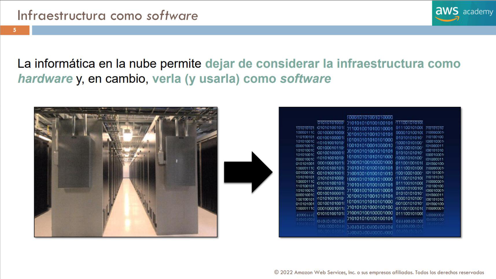
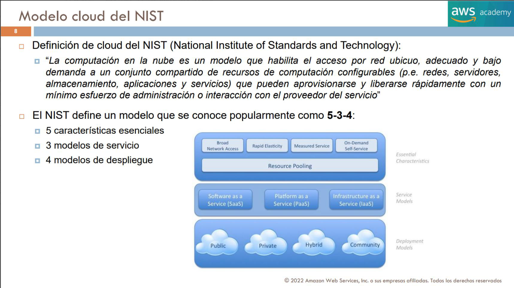
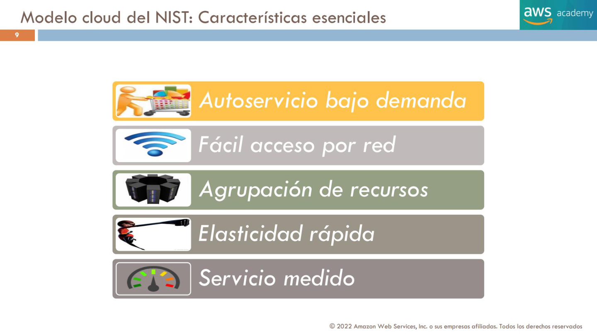
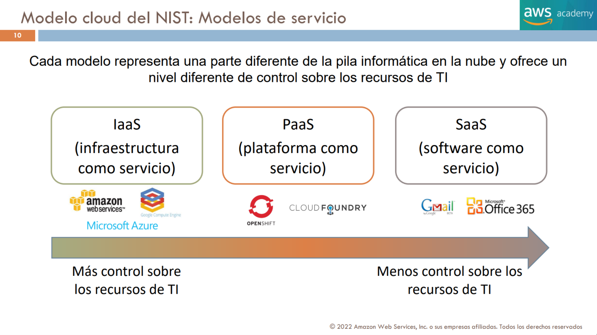
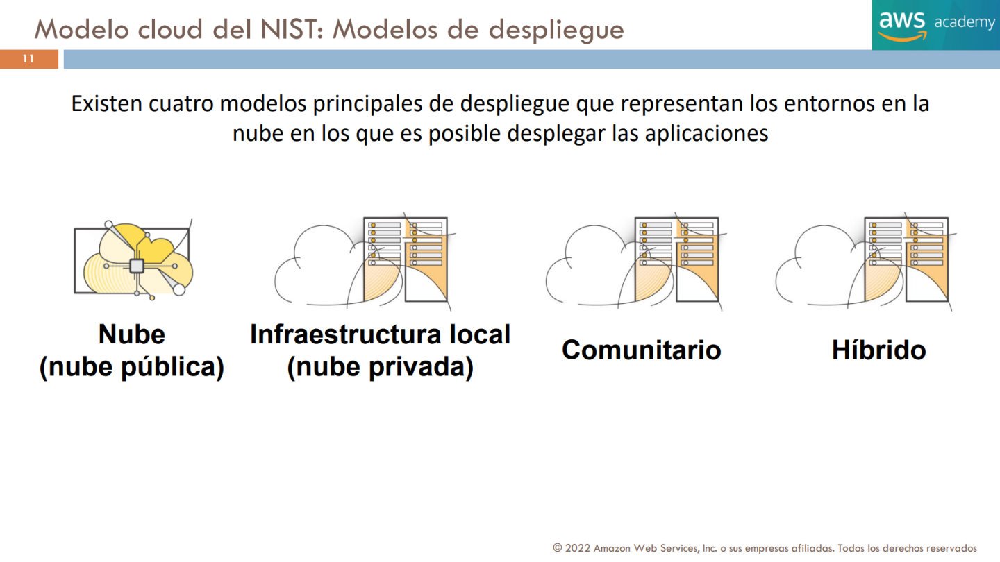
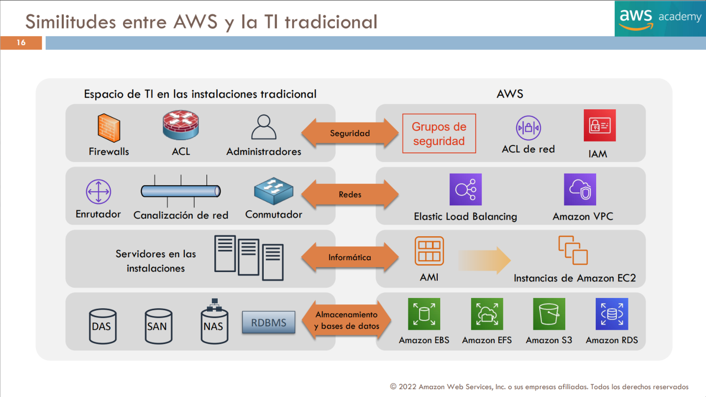
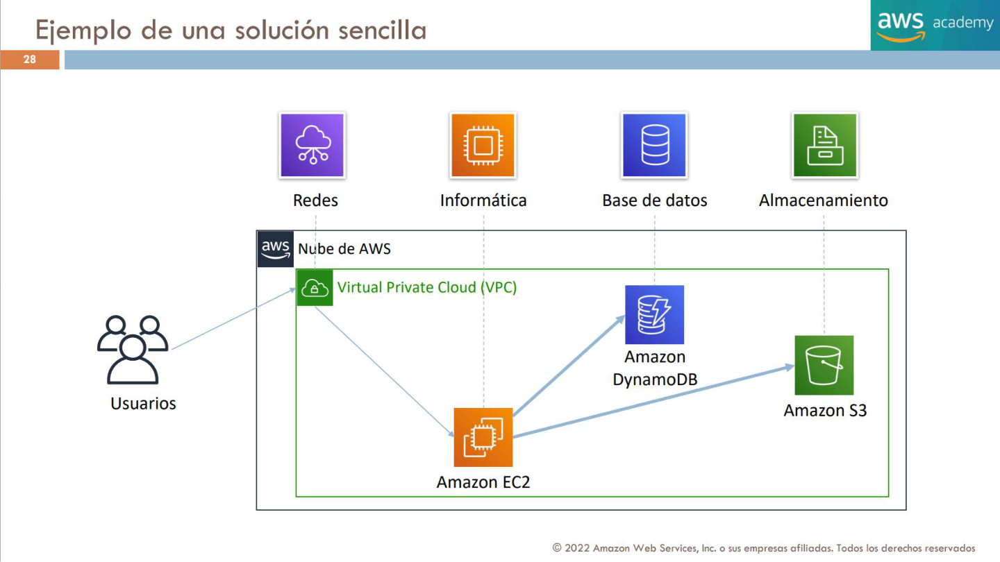
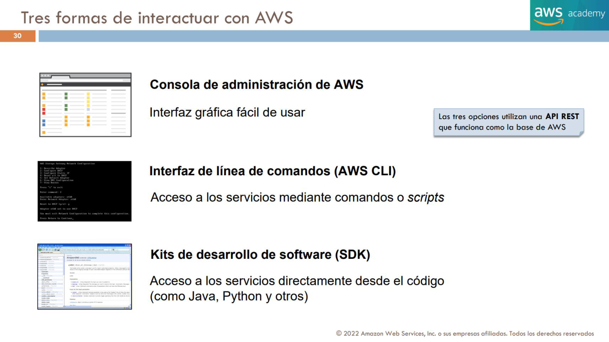

# 1. Introducción a Cloud Computing

Este capítulo desarrolla el contenido docente y las ampliaciones necesarias para el dominio 1. Las figuras reproducen páginas originales, con sus notas, para que los ejemplos y diagramas conserven contexto. Los datos históricos no constituyen recomendaciones actuales de producto.

## Concepto y características de la nube

### Definición de informática en la nube

`[FUENTE: T1 p. 4]`

La **informática en la nube** consiste en proporcionar **bajo demanda** potencia de cómputo, bases de datos, almacenamiento, aplicaciones y otros recursos de tecnologías de la información **a través de Internet**, aplicando un modelo de **precios de pago por uso**.

La presentación destaca tres ideas:

- Los recursos se ejecutan en **servidores ubicados en grandes centros de procesamiento de datos (CPD)** distribuidos por diferentes lugares del mundo.
- El **proveedor de servicios en la nube** (ejemplos citados: AWS y Azure) es el propietario de los equipos físicos que sustentan estos recursos.
- Los recursos pueden combinarse como **piezas fundamentales** para construir soluciones capaces de cumplir objetivos empresariales y requisitos tecnológicos.

**Interpretación del dibujo:** edificios de clientes conectados a una nube remota: el cómputo y otros recursos se ofrecen desde el proveedor sin que cada cliente deba instalar una infraestructura equivalente en sus instalaciones.

### Infraestructura como software

`[FUENTE: T1 p. 5]`

Una aportación fundamental de Cloud Computing es pasar de concebir la infraestructura **únicamente como hardware que se compra, instala y administra físicamente** a tratarla como **recursos que pueden solicitarse, configurarse y usarse mediante software**.

- En el enfoque tradicional predominan servidores, racks, cableado y otros dispositivos físicos de un CPD.
- En la nube, gran parte de su ciclo de vida se controla mediante interfaces, configuración y automatización.

**Mensaje del gráfico:** transición visual desde los racks físicos de un centro de datos hacia una representación de recursos digitales gobernados por software. La figura es conceptual, no una arquitectura de referencia.

*Página original conservada con sus notas para contextualizar el diagrama; material docente histórico.*

### Modelo tradicional: infraestructura como hardware

`[FUENTE: T1 p. 6]`

La infraestructura gestionada físicamente tiene varias limitaciones destacadas:

- Requiere **espacio**, **personal especializado**, **seguridad física**, **planificación** e **inversión de capital**.
- La **adquisición del hardware y su mantenimiento** suelen implicar ciclos largos.
- Es necesario **aprovisionar capacidad anticipadamente** basándose en estimaciones de los picos máximos de demanda.

**Consecuencia:** comprar demasiados servidores puede dejar recursos ociosos; comprar insuficientes puede impedir atender los picos de carga. La organización asume los costes y riesgos de capacidad.

### Modelo cloud: infraestructura como software

`[FUENTE: T1 p. 7]`

La infraestructura gestionada como software destaca por su **flexibilidad**:

- La organización selecciona los servicios que mejor se adaptan a sus necesidades.
- Puede **aprovisionar y terminar recursos bajo demanda**, pagando por su utilización según el modelo comercial aplicable.
- Puede **escalar hacia arriba y hacia abajo** de forma **elástica y/o automática**.
- Los cambios de infraestructura pueden realizarse más **rápida, sencilla y económicamente** que muchos procesos de compra y operación de hardware.
- Se reducen tareas operativas pesadas o innecesarias asociadas al aprovisionamiento tradicional.

**Matiz para los apuntes finales:** usar infraestructura programable no equivale a que todos los servicios sean automáticamente gratuitos, ni a que todo el escalado se configure solo. Son capacidades disponibles según el servicio.

### Modelo cloud del NIST: 5-3-4

`[FUENTE: T1 p. 8]`

La diapositiva recoge la definición del **NIST** (*National Institute of Standards and Technology*): Cloud Computing es un modelo que habilita acceso por red, ubicuo, cómodo y bajo demanda a un conjunto compartido de recursos de cómputo configurables (redes, servidores, almacenamiento, aplicaciones y servicios) que pueden aprovisionarse y liberarse rápidamente con un esfuerzo mínimo de administración o interacción con el proveedor.

Se representa mediante el modelo **5-3-4**:

- **5 características esenciales**.
- **3 modelos de servicio**.
- **4 modelos de despliegue**.

**Estructura del diagrama:** características esenciales en la parte superior, modelos de servicio (SaaS, PaaS, IaaS) en la zona intermedia y modelos de despliegue (público, privado, híbrido, comunitario) en la inferior.

*Página original conservada con sus notas para contextualizar el diagrama; material docente histórico.*

### Cinco características esenciales del NIST

`[FUENTE: T1 p. 9]`

1. **Autoservicio bajo demanda (On-demand self-service).** Un usuario puede aprovisionar capacidades cuando las necesita sin depender de una operación manual realizada por el proveedor.
2. **Acceso amplio por red (Broad network access).** Las capacidades están disponibles a través de la red y se accede a ellas utilizando mecanismos estandarizados.
3. **Agrupación de recursos (Resource pooling).** Los recursos del proveedor se agrupan para servir a distintos consumidores, y se asignan o reasignan dinámicamente.
4. **Elasticidad rápida (Rapid elasticity).** Los recursos pueden crecer o reducirse de manera rápida en respuesta a las necesidades.
5. **Servicio medido (Measured service).** El consumo de recursos puede monitorizarse, medirse y comunicarse; sustenta la transparencia y los modelos de cobro por uso.

**Distinción didáctica:** elasticidad no es exactamente lo mismo que escalabilidad; la primera enfatiza el ajuste dinámico de capacidad a la demanda, mientras que la segunda es la aptitud de aumentar la capacidad para atender más carga.

*Página original conservada con sus notas para contextualizar el diagrama; material docente histórico.*

## Modelos de servicio y despliegue

### Los tres modelos de servicio del NIST

`[FUENTE: T1 p. 10]`

Cada modelo representa un nivel distinto de la pila informática, y por ello ofrece **distintos grados de control sobre los recursos de TI**:

| Modelo | Nombre | Qué obtiene el cliente | Control relativo |
| --- | --- | --- | --- |
| **IaaS** | Infrastructure as a Service / Infraestructura como servicio | Infraestructura informática virtualizada: cómputo, red, almacenamiento, etc. | **Mayor** control sobre sistema operativo y software. |
| **PaaS** | Platform as a Service / Plataforma como servicio | Plataforma y entorno para crear y ejecutar aplicaciones. | Control **intermedio**; se delega parte de la plataforma. |
| **SaaS** | Software as a Service / Software como servicio | Aplicaciones terminadas que se consumen como servicio. | **Menor** control técnico sobre la infraestructura. |

- La diapositiva cita como ejemplos visuales de IaaS a **Amazon Web Services** y **Microsoft Azure**, como ejemplos de PaaS a **OpenShift** y **Cloud Foundry**, y como ejemplos de SaaS a **Gmail** y **Microsoft Office 365**.
- La flecha de la diapositiva va desde **más control** (IaaS) hasta **menos control** (SaaS).

**Matiz:** el control real y las obligaciones del cliente dependen de cada servicio concreto; no todos los servicios de AWS encajan íntegramente en una sola casilla.

*Página original conservada con sus notas para contextualizar el diagrama; material docente histórico.*

### Cuatro modelos de despliegue del NIST

`[FUENTE: T1 p. 11]`

La presentación enumera cuatro entornos en los que pueden desplegarse aplicaciones:

1. **Nube pública:** servicios cloud que proporciona un proveedor para diferentes clientes.
2. **Nube privada / infraestructura local:** recursos destinados a una organización, ya estén alojados en sus instalaciones o de otra forma.
3. **Nube comunitaria:** infraestructura compartida por organizaciones con necesidades o requisitos comunes.
4. **Nube híbrida:** combinación de dos o más entornos diferenciados conectados para satisfacer necesidades específicas.

*Página original conservada con sus notas para contextualizar el diagrama; material docente histórico.*

### Ejemplo del despliegue público

`[FUENTE: T1 p. 12]`

La figura *Public* muestra:

- **Ubicación del servidor:** infraestructura de un proveedor de nube.
- **Aprovisionamiento:** el proveedor da servicio al público general, incluida la organización que consume los recursos.
- La nube pública permite que distintos clientes consuman recursos de una plataforma común.

### Ejemplo del despliegue privado

`[FUENTE: T1 p. 13]`

La figura *Private* representa:

- **Ubicación del servidor:** el proveedor cloud o las instalaciones de la propia organización.
- **Aprovisionamiento:** uso **privado y exclusivo** por una organización.
- La característica esencial del modelo es la **exclusividad del entorno**, no necesariamente que todos los equipos estén dentro del edificio de la empresa.

### Ejemplo del despliegue comunitario

`[FUENTE: T1 p. 14]`

La figura *Community* representa:

- **Ubicación del servidor:** proveedor de nube comunitaria.
- **Aprovisionamiento:** uso exclusivo por una **comunidad concreta de organizaciones** con preocupaciones o requisitos compartidos.
- El ejemplo gráfico alude a una infraestructura configurada para una comunidad o sector particular.

### Ejemplo del despliegue híbrido

`[FUENTE: T1 p. 15]`

La figura *Hybrid* representa:

- **Ubicación del servidor:** combinación del proveedor de nube y recursos internos o de otros proveedores.
- **Aprovisionamiento:** la organización utiliza una combinación de los modelos descritos según sus necesidades.
- El propósito es integrar entornos diferenciados, por ejemplo mantener una parte de la infraestructura local y usar la nube para otras cargas.

### Similitudes entre TI tradicional y servicios AWS

**Corrección técnica:** la figura histórica agrupa seguridad de identidad y seguridad de red. IAM autoriza acciones; Security Groups y Network ACL filtran tráfico en niveles distintos. La comparación detallada al final de este capítulo sustituye cualquier equivalencia literal entre estos controles.

`[FUENTE: T1 p. 16]`

La diapositiva compara categorías de infraestructura empresarial con servicios de AWS:

| Área | TI tradicional / instalaciones | Equivalentes o alternativas AWS que aparecen en la diapositiva |
| --- | --- | --- |
| **Seguridad** | Firewalls, listas de control de acceso (ACL), administradores | **Security Groups**, **Network ACL**, **IAM** |
| **Redes** | Enrutadores, canalización/conexiones de red, conmutadores | **Elastic Load Balancing**, **Amazon VPC** |
| **Cómputo** | Servidores físicos en las instalaciones | **Amazon Machine Images (AMI)**, **instancias Amazon EC2** |
| **Almacenamiento y BBDD** | DAS, SAN, NAS, RDBMS | **Amazon EBS**, **Amazon EFS**, **Amazon S3**, **Amazon RDS** |

**Cómo interpretar la tabla:** son **correspondencias de función y de familia**, no equivalencias uno a uno. Por ejemplo, un balanceador de carga no reemplaza todas las funciones de un router; S3, EBS y EFS ofrecen modelos distintos de almacenamiento.

*Página original conservada con sus notas para contextualizar el diagrama; material docente histórico.*

## Servicios web y plataforma AWS

### ¿Qué son los servicios web?

`[FUENTE: T1 p. 25]`

La diapositiva define un **servicio web** como software accesible a través de una red, que emplea formatos estandarizados (se citan **XML** y **JSON**) en intercambios de **solicitudes y respuestas** mediante una **API** (*Application Programming Interface*).

Esquema de comunicación:

1. Un **cliente** (ilustrado con un portátil) envía un mensaje de **solicitud** mediante Internet.
2. El **servicio web** recibe, interpreta y procesa la solicitud.
3. El servicio envía un mensaje de **respuesta** hacia el cliente.

La diapositiva añade que un servicio web **no está ligado a un sistema operativo o lenguaje de programación concreto**.

**Nota editorial:** el diagrama explica un patrón de petición-respuesta y la interoperabilidad, pero no pretende decir que toda la computación en nube use exclusivamente XML/JSON ni que todas las API funcionen exactamente igual.

### ¿Qué es AWS?

`[FUENTE: T1 p. 26]`

Amazon Web Services es una **plataforma cloud** con un conjunto amplio de productos y servicios globales.

La presentación destaca:

- AWS ofrece acceso bajo demanda, a través de Internet, a **almacenamiento, redes, bases de datos** y otros recursos de TI y de administración.
- Los servicios ofrecen **flexibilidad y escalabilidad**.
- Los clientes pagan por los servicios individuales que necesitan según las condiciones y el uso.
- El uso cloud puede transformar gastos de capital (**CAPEX**) en gastos operativos (**OPEX**).
- Los servicios están diseñados para trabajar **combinados como componentes de una solución**.

### Categorías de servicios de AWS

`[FUENTE: T1 p. 27]`

La diapositiva muestra las siguientes **23 categorías** (en la terminología de la presentación):

1. Análisis.
2. Integración de aplicaciones.
3. Realidad aumentada y virtual.
4. Cadena de bloques (*blockchain*).
5. Aplicaciones empresariales.
6. Informática/cómputo.
7. Administración de costes.
8. Interacción con clientes.
9. Bases de datos.
10. Herramientas para desarrolladores.
11. Informática para usuarios finales.
12. Tecnología para juegos.
13. Internet de las cosas (IoT).
14. Aprendizaje automático (*machine learning*).
15. Administración y gobernanza.
16. Servicios multimedia.
17. Migración y transferencia.
18. Aplicaciones móviles.
19. Redes y entrega de contenido.
20. Robótica.
21. Servicios satelitales.
22. Seguridad, identidad y conformidad.
23. Almacenamiento.

> **Nota de fidelidad:** se recogen las **23 categorías visibles**, sin eliminar iconos por quedar fuera de las prioridades del examen.

### Ejemplo de una solución AWS sencilla

`[FUENTE: T1 p. 28]`

La presentación combina cuatro familias de servicios:

- **Redes:** Amazon VPC (*Virtual Private Cloud*), red virtual que delimita lógicamente los recursos.
- **Cómputo:** Amazon EC2 (*Elastic Compute Cloud*), instancia utilizada para ejecutar una aplicación o servicio.
- **Base de datos:** Amazon DynamoDB, servicio de base de datos NoSQL.
- **Almacenamiento:** Amazon S3, servicio de almacenamiento de objetos.

**Flujo del dibujo:** usuarios externos → entorno de red/VPC → instancia EC2 → consulta/uso de DynamoDB y S3. El dibujo no especifica subredes, puertas de enlace, cifrado ni permisos; esos controles dependerán de una arquitectura real.

*Página original conservada con sus notas para contextualizar el diagrama; material docente histórico.*

### Elección de un servicio de AWS

`[FUENTE: T1 p. 29]`

La diapositiva enfatiza que **la elección depende de los objetivos empresariales y de los requisitos tecnológicos**; no existe un único servicio universal para todos los casos.

Alrededor de un signo de interrogación aparecen estas alternativas de cómputo o ejecución:

- **VMware Cloud on AWS**.
- **Amazon EC2**.
- **AWS Lambda**.
- **AWS Elastic Beanstalk**.
- **Amazon Lightsail**.
- **AWS Batch**.
- **AWS Outposts**.
- **AWS Fargate**.
- **Amazon EKS** (*Elastic Kubernetes Service*).
- **Amazon ECS** (*Elastic Container Service*).

Su función concreta se desarrolla brevemente en el **Glosario de servicios citados** más adelante. La diapositiva presenta **opciones para seleccionar**, no una comparación completa de prestaciones.

### Tres formas de interactuar con AWS

`[FUENTE: T1 p. 30]`

1. **AWS Management Console:** interfaz gráfica web para administrar los servicios de AWS. Está orientada al trabajo interactivo.
2. **AWS Command Line Interface (AWS CLI):** interfaz de línea de comandos que permite acceder a los servicios con órdenes y scripts.
3. **AWS Software Development Kits (SDK):** bibliotecas para acceder a AWS desde el código de una aplicación, por ejemplo en **Java** o **Python**.

La diapositiva indica que las tres formas de acceso se apoyan en las **API** de AWS.

---

*Página original conservada con sus notas para contextualizar el diagrama; material docente histórico.*

## Desarrollo complementario oficial

`[AMPLIACIÓN OFICIAL: documentación enlazada al final de cada apartado; corpus 06]`

### Ampliación oficial: Propuesta de valor de AWS

`[AMPLIACIÓN OFICIAL — CLF-C02, tarea 1.1]`

La **propuesta de valor de AWS** no consiste solamente en alquilar servidores. Consiste en poder aprovisionar servicios de tecnología bajo demanda, con acceso a infraestructura global y opciones de automatización, ajuste de capacidad, modelos de pago por consumo y servicios gestionados. Todo ello permite disminuir determinadas tareas de gestión de infraestructura y concentrar más esfuerzo en aplicaciones y necesidades de negocio.

Esto **no implica** que usar la nube sea automáticamente más barato, más seguro o más disponible en cualquier configuración. Un recurso sobredimensionado, expuesto incorrectamente o desplegado en una sola zona de disponibilidad puede seguir generando costes elevados, riesgos de seguridad o interrupciones. La ventaja reside en las capacidades que proporciona AWS y en diseñar y administrarlas correctamente.

#### Seis beneficios clásicos de Cloud Computing presentados por AWS

1. **Cambiar inversión inicial por gastos variables.** En lugar de adquirir antes del uso servidores y equipos de red, se contrata capacidad a medida que se necesita. Es un cambio habitual desde gasto de capital (`CAPEX`) hacia gasto operativo (`OPEX`); las implicaciones contables concretas dependen del contrato y la organización.
2. **Aprovechar economías de escala.** La concentración de demanda de muchos clientes permite al proveedor operar infraestructuras a gran escala y ofrecer recursos compartidos. El ahorro para cada cliente depende del servicio, la configuración, la demanda y los contratos.
3. **Dejar de predecir manualmente la capacidad máxima.** En un centro de datos tradicional se compran recursos para una carga futura estimada. En la nube es más fácil adaptar la capacidad a la demanda observada; así se reducen los problemas de exceso de aprovisionamiento o falta de recursos.
4. **Aumentar velocidad y agilidad.** Aprovisionar recursos mediante consola, API, infraestructura como código o automatizaciones reduce el tiempo entre una necesidad y una prueba o despliegue. Permite experimentar y descartar recursos sin depender siempre de compras físicas.
5. **Reducir la dedicación a operar centros de datos físicos.** El proveedor administra las instalaciones, energía, refrigeración y buena parte de la infraestructura física. El cliente sigue responsabilizándose de las configuraciones, sistemas y datos que le corresponden según el servicio contratado.
6. **Alcanzar una escala geográfica amplia con rapidez.** AWS dispone de múltiples regiones que permiten desplegar cargas de trabajo próximas a distintos mercados. El despliegue multirregión puede mejorar la latencia o las opciones de continuidad, pero también introduce costes y complejidad, y la región debe elegirse conforme a soberanía de datos, servicios disponibles y requisitos del negocio.

**Relaciones con T1:** p. 18 (gastos de capital → variables), p. 19 (economías de escala), p. 20 (capacidad), p. 21 (agilidad), p. 22 (centros de datos), p. 23 (alcance global). Al redactar los apuntes, no repetir estas ideas: enriquecer los apartados del T1 con ejemplos y matices.

#### Caso didáctico: campaña de comercio electrónico

Una tienda recibe 1.000 usuarios simultáneos en un día normal, pero diez veces más durante una campaña. Un sistema comprado únicamente para el día normal podría saturarse durante la campaña. Otro adquirido para el pico máximo quedaría infrautilizado el resto del año. AWS permite combinar servicios como EC2 y Auto Scaling para incrementar o reducir recursos según políticas y métricas. Esto ejemplifica **elasticidad**. Que el sistema siga creciendo con un número creciente de usuarios ilustra **escalabilidad**, y desplegar componentes redundantes en varias AZ contribuye a **alta disponibilidad**.

### Ampliación oficial: Conceptos que conviene distinguir

| Concepto | Significado | Pregunta que resuelve |
|---|---|---|
| **Escalabilidad** | Capacidad para soportar una carga mayor aumentando recursos | ¿Puede crecer el sistema? |
| **Elasticidad** | Ajuste de capacidad a una demanda variable, también a la baja | ¿Puede crecer y reducirse cuando cambie la carga? |
| **Agilidad** | Rapidez para experimentar, aprovisionar y cambiar soluciones | ¿Cuánto tardamos en lanzar algo? |
| **Alta disponibilidad** | Diseño para minimizar la indisponibilidad del servicio | ¿Permanece accesible cuando ocurre un fallo? |
| **Tolerancia a fallos** | Capacidad para continuar operando ante determinados errores | ¿Puede mantener la función pese a un fallo previsto? |
| **Resiliencia** | Capacidad de soportar problemas y recuperarse | ¿Puede resistir y restablecer la operación? |
| **Durabilidad** | Capacidad para evitar la pérdida de datos durante un período | ¿Permanecen los datos íntegros y almacenados? |
| **Global reach** | Posibilidad de desplegar y atender usuarios en geografías diferentes | ¿Podemos servir a diferentes mercados? |

`[EJEMPLO DIDÁCTICO]` Una web puede ser **muy disponible** aunque falle ocasionalmente algún componente, porque tiene redundancia; un almacenamiento puede tener **alta durabilidad** aunque el servicio no sea siempre accesible; y una aplicación **elástica** no es por ello automáticamente tolerante a fallos.

**Mapa interactivo recomendado:** [AWS Global Infrastructure](https://aws.amazon.com/about-aws/global-infrastructure/). Usarlo para consultar regiones, disponibilidad geográfica y presencia actual; **no** copiar al manual cifras fijas de regiones, AZ o edge locations sin fecha.

**Fuentes:** [CLF-C02, dominio 1](https://docs.aws.amazon.com/es_es/aws-certification/latest/cloud-practitioner-02/cloud-practitioner-02-domain1.html); [How AWS Pricing Works — principios clave](https://docs.aws.amazon.com/es_es/whitepapers/latest/how-aws-pricing-works/key-principles.html).

---

## Identidad y filtrado de tráfico: corrección técnica de la analogía

`[AMPLIACIÓN OFICIAL]` La asociación visual de la diapositiva T1 p.16 agrupa controles de seguridad de distinta naturaleza. IAM decide qué identidad puede realizar una acción sobre un recurso AWS; un Security Group permite tráfico de red hacia y desde los recursos asociados; una Network ACL permite o deniega tráfico al entrar o salir de una subred. No son sustitutos: una aplicación puede necesitar autorización IAM para leer S3 aunque su conectividad de red funcione, y disponer de permisos IAM no abre un puerto TCP de una instancia.

| Control | Nivel y criterio | Ejemplo |
|---|---|---|
| IAM | Identidades, acciones y recursos; políticas de autorización | Permitir a un rol leer un bucket concreto |
| Security Group | Tráfico permitido asociado a recursos; stateful | Admitir HTTPS y restringir SSH a fuentes autorizadas |
| Network ACL | Reglas allow/deny de subred; stateless | Bloquear un rango y definir explícitamente el tráfico de retorno necesario |

Fuentes: [Security Groups](https://docs.aws.amazon.com/vpc/latest/userguide/vpc-security-groups.html), [Network ACL](https://docs.aws.amazon.com/vpc/latest/userguide/vpc-network-acls.html). La tabla histórica ilustra una categoría general de seguridad; no establece una equivalencia técnica entre IAM y un firewall.

