# 3. Infraestructura global y arquitectura AWS

Este capítulo desarrolla el contenido docente y las ampliaciones necesarias para el dominio 1. Las figuras reproducen páginas originales, con sus notas, para que los ejemplos y diagramas conserven contexto. Los datos históricos no constituyen recomendaciones actuales de producto.

## Infraestructura global y catálogo de servicios

| Unidad | Función y alcance | Decisión de arquitectura |
|---|---|---|
| Región | Área geográfica con varias AZ y catálogo regional | Elegir por soberanía, latencia, servicios y coste; planificar explícitamente la replicación entre regiones |
| AZ | Dominio de aislamiento dentro de una región, con uno o más CPD | Distribuir componentes y datos según objetivos de disponibilidad y recuperación |
| Centro de datos | Instalación física de infraestructura | El cliente elige región/AZ, no el edificio concreto |
| Edge / PoP | Acerca entrega de contenido y determinados servicios de red | Reducir latencia y carga de origen; no equivale a una región para desplegar todos los servicios |

### Infraestructura global de AWS

`[FUENTE: T2 p. 4]`

La infraestructura global de AWS está diseñada para proporcionar un entorno de cómputo **fiable, resiliente, escalable y seguro**, respaldado por una red global de calidad.

AWS actualiza continuamente su infraestructura; por tanto, un mapa de una diapositiva de 2022 **no debe interpretarse como el mapa actual**.

**Recursos enlazados en las diapositivas:**

- [Mapa de infraestructura global de AWS](https://aws.amazon.com/about-aws/global-infrastructure/).
- [Regiones y zonas de disponibilidad AWS](https://aws.amazon.com/about-aws/global-infrastructure/regions_az/).

La figura invita a seleccionar regiones en el mapa interactivo para consultar información resumida. **Utilizar los enlaces oficiales para consultar el mapa dinámico**, no copiar cifras regionales antiguas sin verificación.

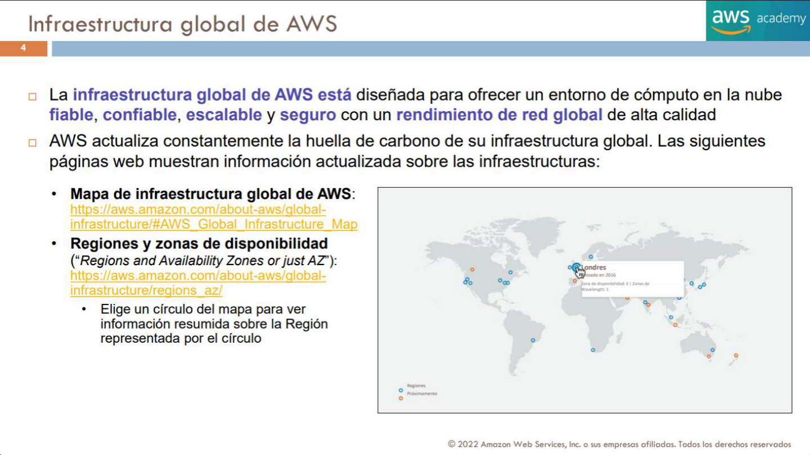

*Página original conservada con sus notas para contextualizar el diagrama; material docente histórico.*

### Regiones de AWS

`[FUENTE: T2 p. 5]`

Una **región de AWS** es una **ubicación geográfica física** en la que AWS organiza recursos e infraestructura.

Características enumeradas:

- El cliente **controla la replicación de sus datos entre distintas regiones** según la arquitectura y servicios usados.
- La comunicación entre regiones utiliza la **infraestructura de red troncal de AWS**.
- Las regiones están **aisladas unas de otras** a efectos de diseño y despliegue, lo que permite reducir impactos entre ámbitos regionales.
- Existen regiones o particiones con restricciones de acceso, como las orientadas a determinados organismos públicos (**GovCloud**).
- Cada región aporta **redundancia y conectividad** mediante varias zonas de disponibilidad.
- Una región normalmente dispone de **dos o más Availability Zones (AZ)**, según indica la diapositiva; la configuración real se consulta en AWS.

**Interpretación:** una región no equivale a un único CPD. Es una ubicación geográfica que alberga infraestructura dividida en zonas de disponibilidad.

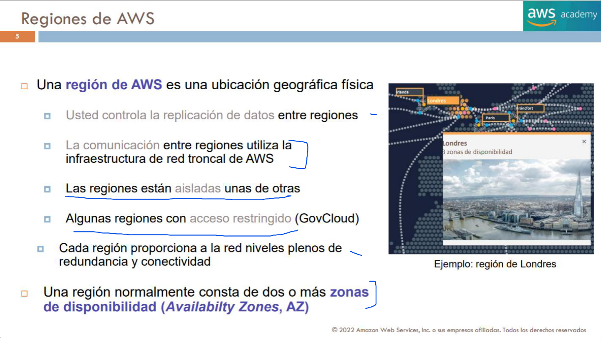

*Página original conservada con sus notas para contextualizar el diagrama; material docente histórico.*

### Selección de una región

`[FUENTE: T2 p. 6]`

La región adecuada para una aplicación o datos se decide valorando cuatro factores:

1. **Gobernanza y soberanía de datos / requisitos legales.** Localización de información y obligaciones de cumplimiento; ciertas normas pueden exigir ubicaciones específicas.
2. **Proximidad con clientes y latencia.** Una región próxima puede reducir el tiempo de comunicación y mejorar la experiencia.
3. **Disponibilidad de servicios.** No todos los servicios y funcionalidades se ofrecen necesariamente en cada región.
4. **Coste.** Los precios de algunos servicios pueden variar de una región a otra.

**Ejemplo conceptual:** una aplicación destinada a usuarios europeos podría preferir una región europea si combina baja latencia, requisitos de residencia de datos y disponibilidad del servicio; la selección depende del caso concreto.

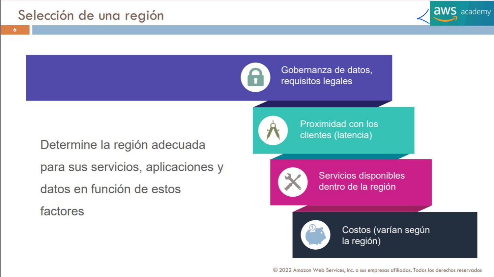

*Página original conservada con sus notas para contextualizar el diagrama; material docente histórico.*

### Zonas de disponibilidad (AZ)

`[FUENTE: T2 p. 7]`

Las **Availability Zones** son unidades de infraestructura **aisladas** dentro de una región.

La diapositiva subraya:

- Cada región contiene varias AZ.
- Una AZ constituye una partición de infraestructura físicamente separada de las demás AZ de la región.
- Las AZ incluyen **uno o varios centros de datos físicamente discretos**; en el ejemplo visual aparecen tres CPD.
- Disponen de **infraestructuras de energía independientes**, están físicamente separadas de las otras AZ y buscan el **aislamiento de errores**.
- Se conectan entre ellas por **redes privadas redundantes de alta velocidad**.
- Normalmente el usuario **elige la AZ** donde ubicar ciertos recursos, pero **no el centro de datos físico concreto** dentro de ella.
- AWS recomienda distribuir o replicar datos y recursos entre AZ para una mayor **resiliencia**.

**Relación estructural:** región → varias AZ → uno o varios CPD por AZ.

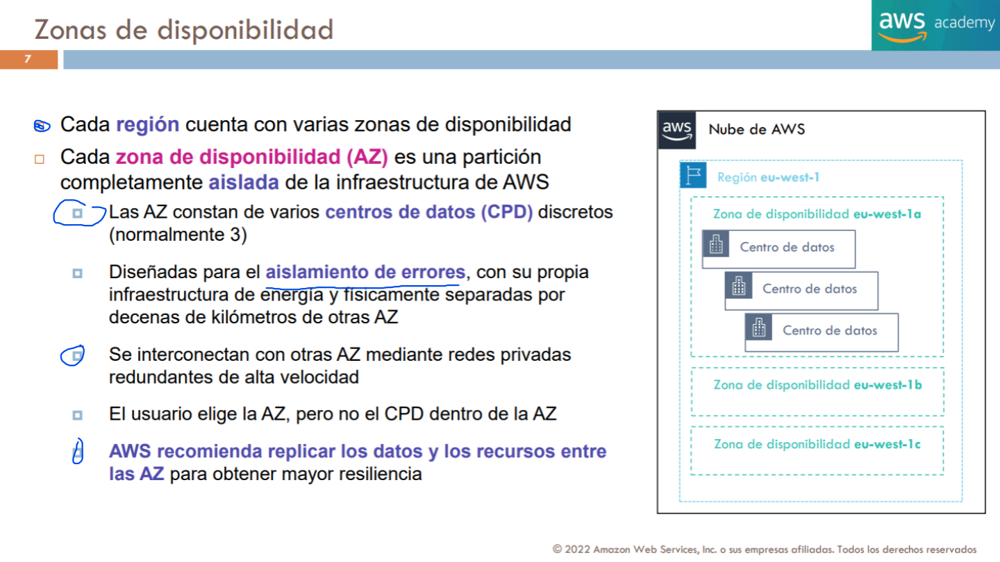

*Página original conservada con sus notas para contextualizar el diagrama; material docente histórico.*

### Centros de datos de AWS

`[FUENTE: T2 p. 8]`

Los **CPD de AWS** son instalaciones físicas que almacenan y procesan información.

- Están diseñados con medidas de **seguridad física**.
- El cliente **no selecciona directamente un CPD físico** para colocar recursos.
- En los niveles de selección disponibles para el cliente, la granularidad habitual es la **AZ** y no el CPD.
- Cada CPD utiliza mecanismos de **alimentación, conectividad y redes redundantes** y se instala en un recinto independiente.
- La diapositiva menciona como cifra indicativa que un centro de datos puede albergar **entre 50.000 y 100.000 servidores físicos**.

`⚠️ Verificar actualidad`: esa cifra procede de las diapositivas, no se presenta como capacidad vigente ni universal de los CPD de AWS.

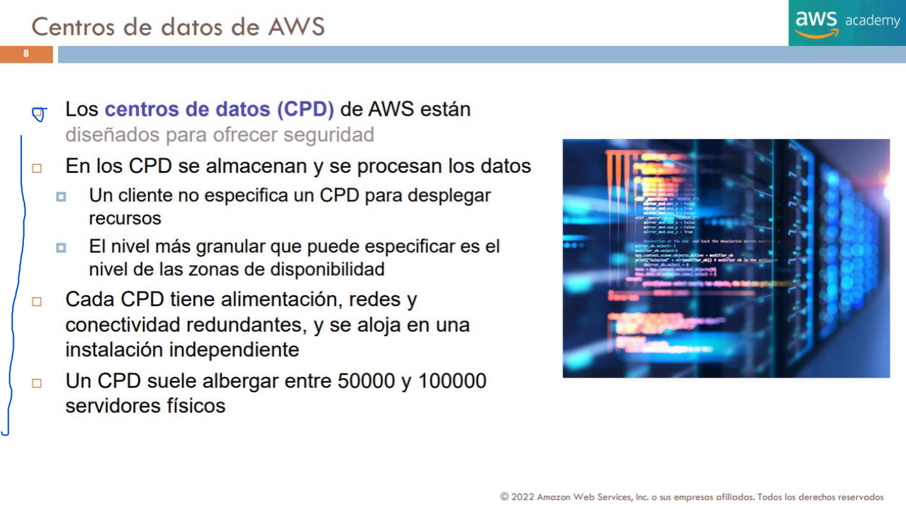

*Página original conservada con sus notas para contextualizar el diagrama; material docente histórico.*

### Puntos de presencia (PoP) y ubicaciones de borde

`[FUENTE: T2 p. 9]`

AWS mantiene ubicaciones distribuidas geográficamente cercanas a grandes núcleos de usuarios para ofrecer servicios con baja latencia.

Elementos destacados:

- **Points of Presence (PoP)** o puntos de presencia: lugares de la infraestructura global que apoyan la entrega próxima a los usuarios.
- **Edge Locations (ubicaciones periféricas/de borde):** puntos desde los que ciertos servicios pueden responder con menor latencia.
- **Regional Edge Caches (cachés de borde regionales):** capas de caché regionales, en un número más reducido que las edge locations, útiles especialmente para contenido solicitado con menos frecuencia.

Servicios citados:

- **Amazon CloudFront**: CDN (*Content Delivery Network*) global que sirve contenido desde ubicaciones cercanas a los usuarios para disminuir latencia.
- **Amazon Route 53**: servicio de DNS gestionado que ayuda a dirigir solicitudes a los recursos correspondientes.

La nota del dibujo señala que las solicitudes para CloudFront o Route 53 se encaminan automáticamente a ubicaciones apropiadas para reducir latencia.

**Diferencia conceptual importante:** **Región / AZ** son conceptos de alojamiento y resiliencia de cargas; **PoP / edge location** son conceptos de distribución y entrega de servicios cerca del usuario.

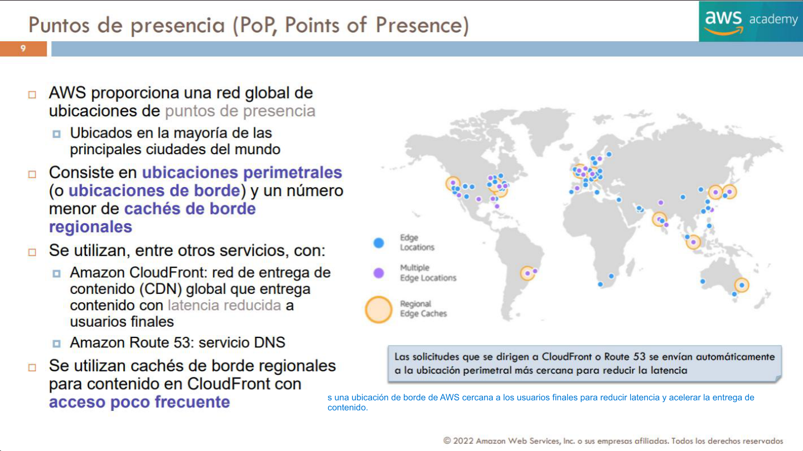

*Página original conservada con sus notas para contextualizar el diagrama; material docente histórico.*

### Funciones de la infraestructura AWS

`[FUENTE: T2 p. 10]`

### Elasticidad y escalabilidad

- **Infraestructura elástica:** permite adaptar dinámicamente la capacidad, aumentando o reduciendo recursos conforme varía la demanda.
- **Infraestructura escalable:** puede crecer para atender una mayor carga o volumen de uso.

### Tolerancia a errores

- El sistema es capaz de seguir funcionando correctamente ante determinados fallos.
- Se apoya en la **redundancia de componentes** para no depender de un único punto de fallo.

### Alta disponibilidad

- Mantiene un elevado nivel de continuidad operativa.
- **Minimiza el tiempo de inactividad**.
- El objetivo es que la operación continúe con **intervención humana mínima o nula** en las situaciones previstas por el diseño.

### Dibujo de resiliencia

La figura muestra varias AZ conectadas mediante red; representa fuentes de energía, interconectividad y generadores de respaldo como mecanismos de infraestructura resistente a fallos. **Conservarla** como representación de separación entre AZ y redundancia.

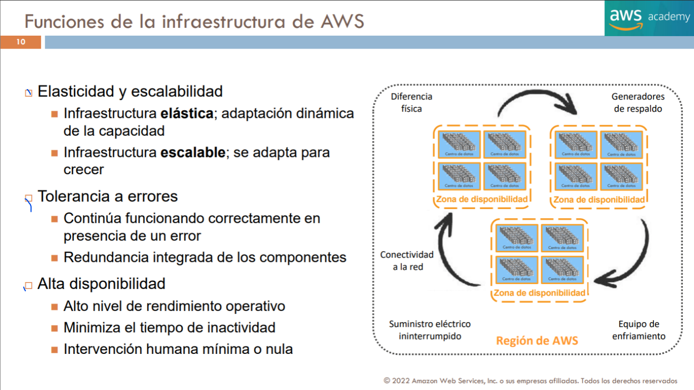

*Página original conservada con sus notas para contextualizar el diagrama; material docente histórico.*

### Capas o familias de servicios AWS

`[FUENTE: T2 p. 12]`

El gráfico ordena el ecosistema AWS en capas:

1. **Infraestructura física y global:** regiones, zonas de disponibilidad y ubicaciones periféricas.
2. **Servicios básicos (core services):** cómputo, red, almacenamiento (objeto, bloque y fichero).
3. **Servicios de plataforma:** bases de datos relacionales y NoSQL, análisis, servicios de aplicaciones, despliegue y administración, servicios móviles.
4. **Aplicaciones:** escritorios virtuales y herramientas de colaboración o uso compartido.

**Función del esquema:** mostrar que AWS ofrece desde infraestructura de bajo nivel hasta servicios administrados y aplicaciones completas. No significa que cada servicio pertenezca rígidamente a una sola capa.

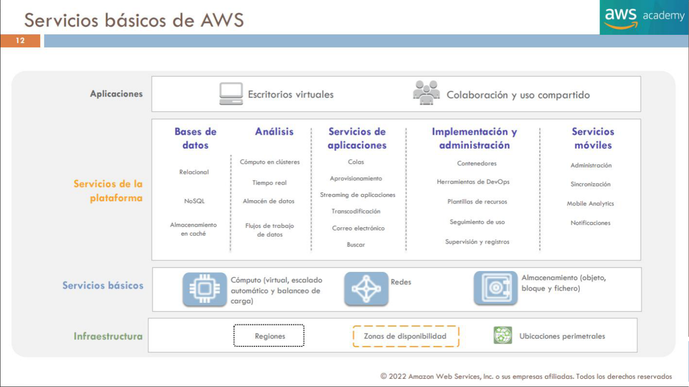

*Página original conservada con sus notas para contextualizar el diagrama; material docente histórico.*

### Categorías de servicios AWS

`[FUENTE: T2 p. 13]`

Aparecen las siguientes familias de productos:

- Análisis.
- Integración de aplicaciones.
- Realidad aumentada y realidad virtual.
- Blockchain.
- Aplicaciones empresariales.
- **Cómputo**.
- **Administración de costes**.
- Interacción con clientes.
- **Bases de datos**.
- Herramientas para desarrolladores.
- Informática para usuarios finales.
- Tecnología para juegos.
- Internet de las cosas.
- Machine learning.
- **Administración y gobernanza**.
- Servicios multimedia.
- Migración y transferencia.
- Móvil.
- **Redes y entrega de contenido**.
- Robótica.
- Satélite.
- **Identidad, seguridad y cumplimiento**.
- **Almacenamiento**.

En la imagen aparecen resaltadas con recuadros las categorías que se desarrollan a continuación: cómputo, administración de costes, bases de datos, administración y gobernanza, redes, seguridad/identidad/cumplimiento y almacenamiento.

### Familia de almacenamiento

`[FUENTE: T2 p. 14]`

La diapositiva enumera los siguientes servicios AWS:

| Servicio | Modelo o propósito resumido |
| --- | --- |
| **Amazon Simple Storage Service (Amazon S3)** | Almacenamiento de **objetos**, en buckets. |
| **Amazon Elastic Block Store (Amazon EBS)** | Almacenamiento en **bloques** para instancias EC2. |
| **Amazon Elastic File System (Amazon EFS)** | Sistema de archivos de red **administrado**. |
| **Amazon S3 Glacier** | Almacenamiento orientado a **archivado** y acceso infrecuente. |

La diapositiva presenta solo los nombres/iconos de productos. Las definiciones de esta tabla son **glosario editorial para contextualizar**, no textos literales de esta diapositiva.

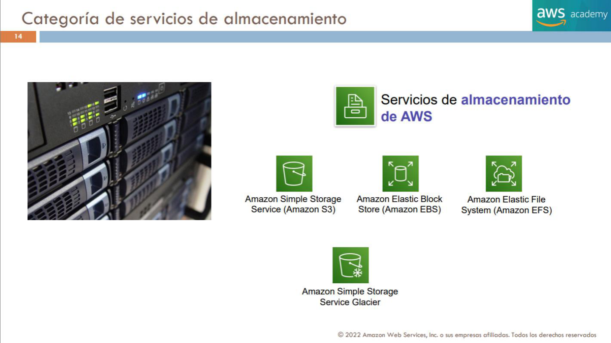

*Página original conservada con sus notas para contextualizar el diagrama; material docente histórico.*

### Familia de cómputo

`[FUENTE: T2 p. 15]`

Servicios que aparecen:

- **Amazon EC2**: máquinas virtuales administrables por el cliente.
- **Amazon EC2 Auto Scaling**: ajuste automático de la cantidad de instancias EC2 según políticas y demanda.
- **Amazon Elastic Container Service (Amazon ECS)**: orquestación administrada de contenedores.
- **Amazon EC2 Container Registry / Amazon Elastic Container Registry (Amazon ECR)**: repositorio de imágenes de contenedor.
- **AWS Elastic Beanstalk**: despliegue y operación simplificada de aplicaciones.
- **AWS Lambda**: ejecución de funciones sin administrar servidores.
- **Amazon Elastic Kubernetes Service (Amazon EKS)**: servicio administrado de Kubernetes.
- **AWS Fargate**: capacidad de cómputo serverless para contenedores compatibles.

`⚠️ Verificar actualidad`: en la diapositiva aparece una denominación histórica de ECR («EC2 Container Registry»); en los apuntes actuales debe utilizarse su denominación correspondiente y contrastar el nombre vigente.

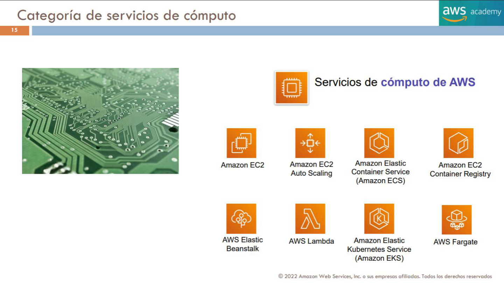

*Página original conservada con sus notas para contextualizar el diagrama; material docente histórico.*

### Familia de bases de datos

`[FUENTE: T2 p. 16]`

La diapositiva menciona:

- **Amazon Relational Database Service (Amazon RDS)**: servicio administrado de bases de datos relacionales.
- **Amazon Aurora**: motor de base de datos relacional compatible con MySQL y PostgreSQL, desarrollado para AWS.
- **Amazon Redshift**: almacenamiento de datos analíticos / *data warehousing*.
- **Amazon DynamoDB**: base de datos NoSQL administrada.

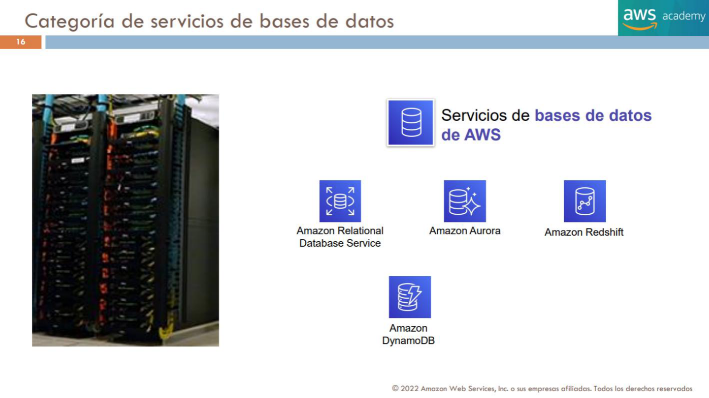

*Página original conservada con sus notas para contextualizar el diagrama; material docente histórico.*

### Redes y entrega de contenido

`[FUENTE: T2 p. 17]`

La diapositiva presenta:

- **Amazon VPC**: red virtual aislada lógicamente, definida por el cliente.
- **Elastic Load Balancing (ELB)**: distribuye tráfico entre distintos destinos disponibles.
- **Amazon CloudFront**: red global de distribución de contenido (CDN).
- **AWS Transit Gateway**: conecta redes VPC y determinadas redes locales mediante un nodo central gestionado.
- **Amazon Route 53**: servicio DNS escalable.
- **AWS Direct Connect**: conectividad de red dedicada hacia AWS.
- **AWS VPN**: conexiones privadas virtuales cifradas para conectar entornos.

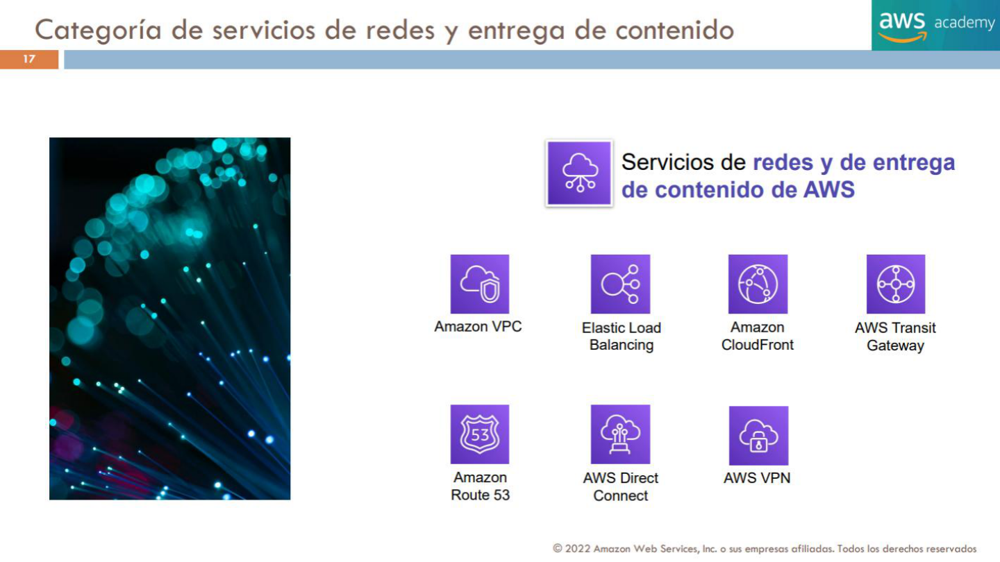

*Página original conservada con sus notas para contextualizar el diagrama; material docente histórico.*

### Seguridad, identidad y cumplimiento

`[FUENTE: T2 p. 18]`

La diapositiva contiene seis servicios:

- **AWS Identity and Access Management (IAM)**.
- **AWS Organizations**.
- **Amazon Cognito**.
- **AWS Artifact**.
- **AWS Key Management Service (AWS KMS)**.
- **AWS Shield**.

Definiciones y diferencias en el glosario. La diapositiva solamente muestra iconos y denominaciones.

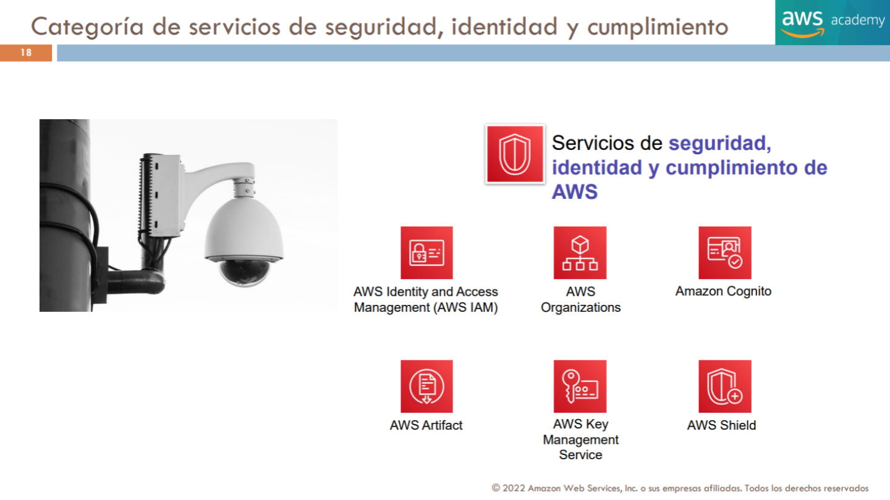

*Página original conservada con sus notas para contextualizar el diagrama; material docente histórico.*

### Administración de costes

`[FUENTE: T2 p. 19]`

La diapositiva muestra:

- **AWS Cost and Usage Report** (informe de coste y uso de AWS).
- **AWS Budgets**.
- **AWS Cost Explorer** (explorador de costes).

**Distinción general:** informes detallados de uso/coste, establecimiento de presupuestos y análisis visual del gasto, respectivamente. La diapositiva enumera herramientas, no entra en una comparación de funcionalidades.

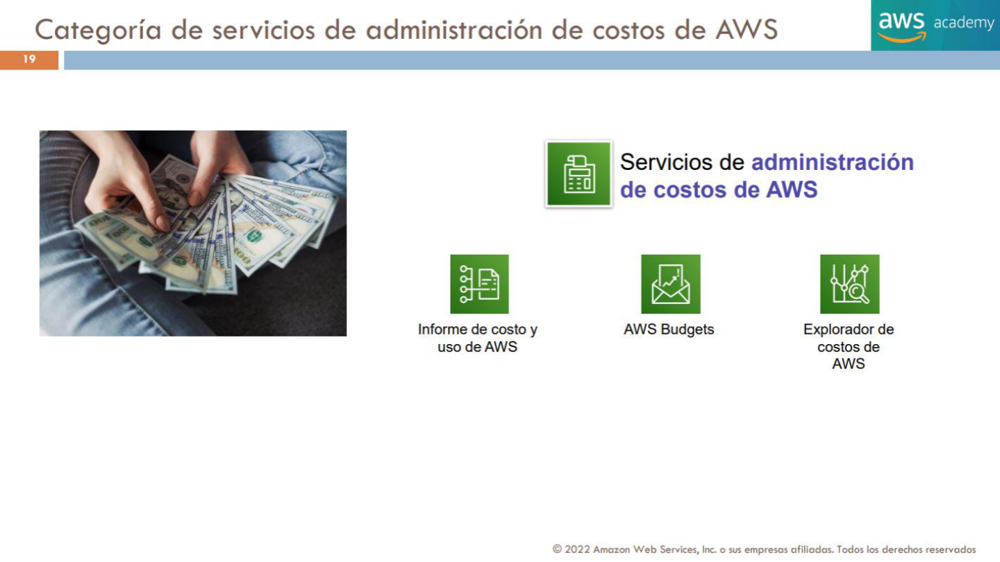

*Página original conservada con sus notas para contextualizar el diagrama; material docente histórico.*

### Administración y gobernanza

`[FUENTE: T2 p. 20]`

Servicios y herramientas enumerados:

1. **AWS Management Console**.
2. **AWS Config**.
3. **Amazon CloudWatch**.
4. **AWS Auto Scaling**.
5. **AWS Command Line Interface (AWS CLI)**.
6. **AWS Trusted Advisor**.
7. **AWS Well-Architected Tool**.
8. **AWS CloudTrail**.

La distinción clave para estudiar es separar **administración**, **observabilidad**, **seguimiento de cambios**, **auditoría**, **escalado** y **revisión de buenas prácticas**.

---

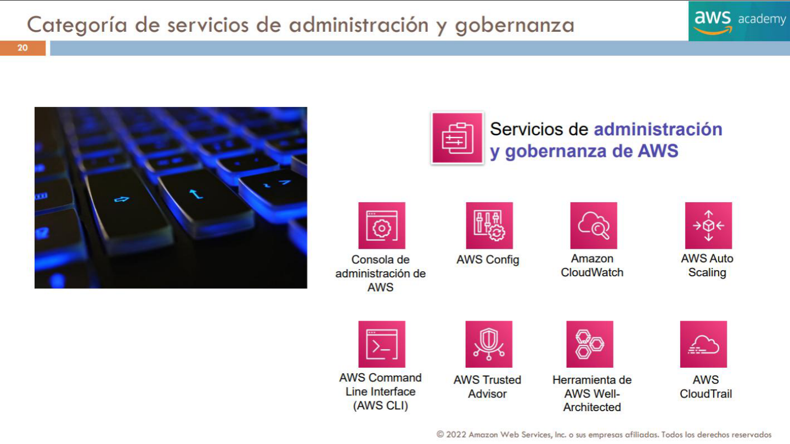

*Página original conservada con sus notas para contextualizar el diagrama; material docente histórico.*

## Objetivos y fundamentos de arquitectura

### Arquitectura: diseñar y construir

`[FUENTE: CA p. 5]`

La arquitectura se presenta mediante una analogía con la construcción: plano de una estructura → diseño realizado por arquitectos → trabajo coordinado de un equipo → estructura terminada. Igual que los edificios grandes requieren un diseño previo, los **sistemas de información complejos** necesitan arquitectura para coordinar componentes, dependencias, objetivos y requisitos.

**Responsabilidades del arquitecto cloud descritas:**

- Dialogar con quienes toman decisiones para descubrir los objetivos de negocio y las capacidades que necesitan mejora.
- Asegurarse de que las tecnologías propuestas y disponibles cumplen esos objetivos.
- Trabajar con los equipos responsables de la entrega para que las funciones y decisiones técnicas sean apropiadas.

Un diseño bien fundamentado aumenta la probabilidad de que la solución técnica contribuya al éxito del negocio. La arquitectura no se limita a dibujar servicios: debe justificar **por qué** se eligen y cómo colaboran.

### Definición de AWS Well-Architected Framework

`[FUENTE: CA p. 6]`

**AWS Well-Architected Framework** es una guía coherente para diseñar y evaluar infraestructuras y cargas de trabajo que sean **seguras, de alto rendimiento, resilientes y eficientes**. Proporciona una manera repetible de valorar arquitecturas cloud mediante **preguntas, principios de diseño y buenas prácticas**. Su contenido parte de la experiencia acumulada por AWS al revisar numerosas arquitecturas de clientes.

Las preguntas no son un examen de configuración: sirven para identificar riesgos, evaluar decisiones arquitectónicas y descubrir mejoras razonadas.

### Los seis pilares de Well-Architected

`[FUENTE: CA p. 7]`

El esquema del templo o edificio con seis columnas organiza el marco en los pilares siguientes:

| Pilar original | Nombre en español | Objetivo principal |
| --- | --- | --- |
| Operational Excellence | Excelencia operativa | Ejecutar y mejorar continuamente las operaciones para entregar valor. |
| Security | Seguridad | Proteger datos, sistemas, activos e identidades. |
| Reliability | Fiabilidad | Evitar y recuperarse de fallos y mantener la funcionalidad esperada. |
| Performance Efficiency | Eficiencia del rendimiento | Aprovechar de manera eficaz recursos de TI a medida que cambia la demanda. |
| Cost Optimization | Optimización de costes | Evitar gastos innecesarios y maximizar el valor de los recursos. |
| Sustainability | Sostenibilidad | Reducir el impacto ambiental de las cargas de trabajo. |

Los primeros cinco pilares se trataron inicialmente como núcleo del marco; el sexto, sostenibilidad, fue incorporado posteriormente. **Observación sobre la propia fuente:** el gráfico **sí incluye seis** pilares, pero la secuencia detallada de esta sección desarrolla **cinco**: Operational Excellence, Security, Reliability, Performance Efficiency y Cost Optimization. **No desarrolla con igual profundidad Sustainability**. Se deberá ampliar desde la guía oficial para cubrir bien el CLF-C02.

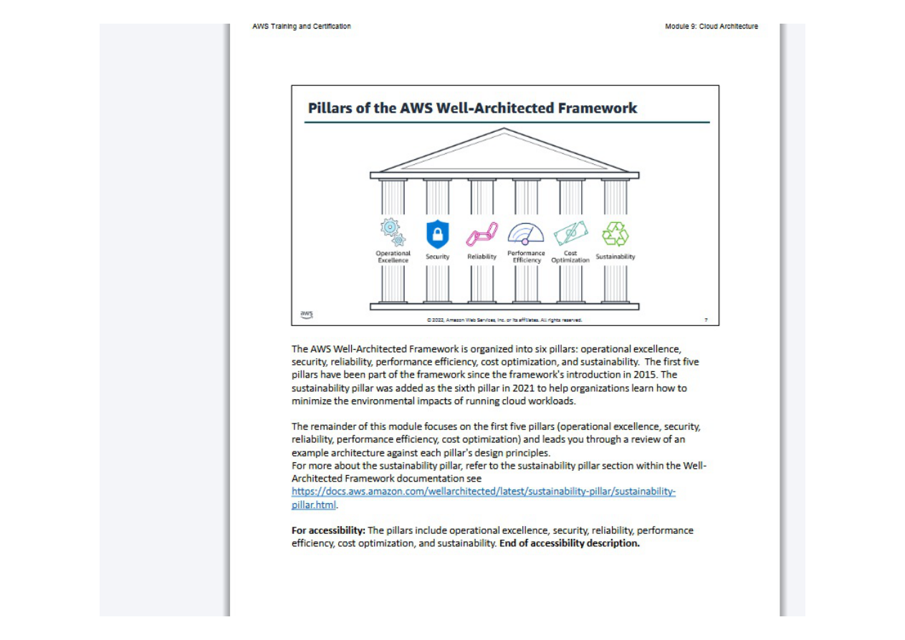

*Página original conservada con sus notas para contextualizar el diagrama; material docente histórico.*

### Estructura de un pilar y de las buenas prácticas

`[FUENTE: CA p. 8]`

Cada pilar se descompone en **principios de diseño** y **áreas de mejores prácticas**. La diapositiva utiliza como ejemplo el área **Identity and Access Management** del pilar de seguridad, y la pregunta «How do you manage credentials and authentication?».

Se enumeran prácticas de ejemplo relativas a: definir necesidades de identidades y gestión de accesos; asegurar al usuario raíz; imponer autenticación multifactor; automatizar mecanismos de acceso; integrar un proveedor de identidad centralizado; aplicar requisitos de contraseñas; rotar credenciales; auditar credenciales periódicamente.

Esta estructura ilustra cómo pasar de un pilar general a controles concretos mediante preguntas de revisión.

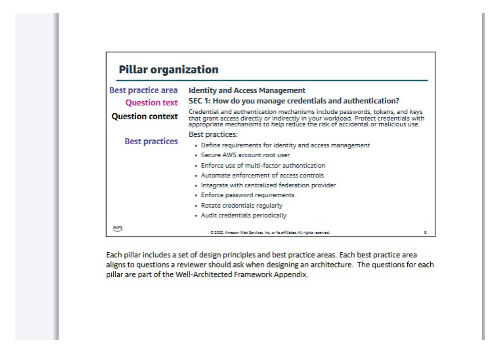

*Página original conservada con sus notas para contextualizar el diagrama; material docente histórico.*

### Introducción a la actividad de principios de diseño

`[FUENTE: CA p. 9]`

Se propone una actividad para utilizar cinco pilares contra una arquitectura ficticia: **operational excellence, security, reliability, performance efficiency, cost optimization**. La actividad se creó cuando la práctica detallada utilizaba esos cinco pilares; el diagrama de la página 7 ya mostraba los seis actuales.

## AnyCompany: negocio, arquitectura y método de análisis

### Contexto de la organización

`[FUENTE: CA p. 10]`

AnyCompany Corporation es una empresa ficticia creada en **2008** por **John Doe**, dedicada a vender **paisajes urbanos impresos en 3D** (*3D-printed cityscapes*). Está preparando una solicitud de inversión y necesita que su tecnología sea revisada como parte de la diligencia debida (*due diligence*). Nació utilizando tecnología cloud, y en el relato se indica que John creó una cuenta de AWS y lanzó su primera instancia EC2 para la empresa.

**Aspecto de seguridad expresamente mencionado en las notas:** John comparte las credenciales del usuario root de AWS con otros empleados técnicos. Este comportamiento se utiliza como ejemplo de **riesgo de identidad y de accesos**: no se deben compartir credenciales raíz y han de asignarse identidades y permisos específicos.

### Divisiones y flujo general de negocio

`[FUENTE: CA p. 11]`

AnyCompany tiene tres grandes áreas, representadas como bloques de proceso:

1. **Fly and Snap** — adquisición, preprocesado y almacenamiento de imágenes.
2. **Show and Sell** — promoción, venta y atención a clientes.
3. **Make and Ship** — fabricación de los productos y su entrega.

El bloque comercial solicita imágenes al bloque de adquisición y envía pedidos al de fabricación. El flujo global comprende la captura de imágenes, la preparación de modelos, su comercialización y la producción/expedición.

### Arquitectura Fly and Snap

`[FUENTE: CA p. 12]`

La división Fly and Snap utiliza aeronaves ligeras que llevan cámaras y otros sensores para capturar imágenes aéreas, datos geográficos y telemetría. Los dispositivos están sincronizados y cada activo incorpora información temporal. Estos datos llegan a un sistema de ingestión y se procesan en AWS.

El flujo descrito por el material consta de **captura** → entrega/ingestión de activos → **preprocesado** → conservación de datos y extracción de información → servicio de imágenes. Se mencionan máquinas de preprocesamiento en **Amazon EC2**, activos almacenados en **Amazon S3** y una base de datos relacional utilizada para relacionar los activos con la información necesaria para reconstruir un entorno 3D y generar localizaciones.

La diapositiva contiene un diagrama con componentes conectados y una zona delimitada de AWS. **La idea arquitectónica** es que la recogida de datos físicos se desacopla de los servicios cloud que almacenan, procesan y exponen esos activos.

`[FUENTE: CA p. 12 — notas cotejadas en la imagen original]`

Las notas originales especifican una secuencia de ingesta que conviene conservar. Las cámaras y videocámaras de la aeronave capturan activos con marcas de tiempo sincronizadas con su reloj, junto con datos de GPS, brújula y elevación. Los archivos llegan a una Capture machine y a un array externo. Al volver a la base se desconecta el array y se lleva a una máquina de ingesta, que crea un archivo comprimido y lo envía por FTP al preprocesador EC2. Después se escribe una copia en cinta, se limpia el array para el siguiente vuelo y un proveedor externo conserva las cintas fuera del sitio.

El preprocesador examina periódicamente conjuntos nuevos, extrae los activos, los almacena en S3 y avisa al servicio de imágenes con información del vuelo. Este calcula orientación y ubicación tridimensional por instante y correlaciona esos datos con las marcas temporales de los archivos. El índice se almacena en un RDBMS sobre EC2 con referencias a los objetos en S3. La combinación de archivos e índice es lo que permite encontrar después las imágenes de una ubicación: no basta con preservar uno de los dos componentes.

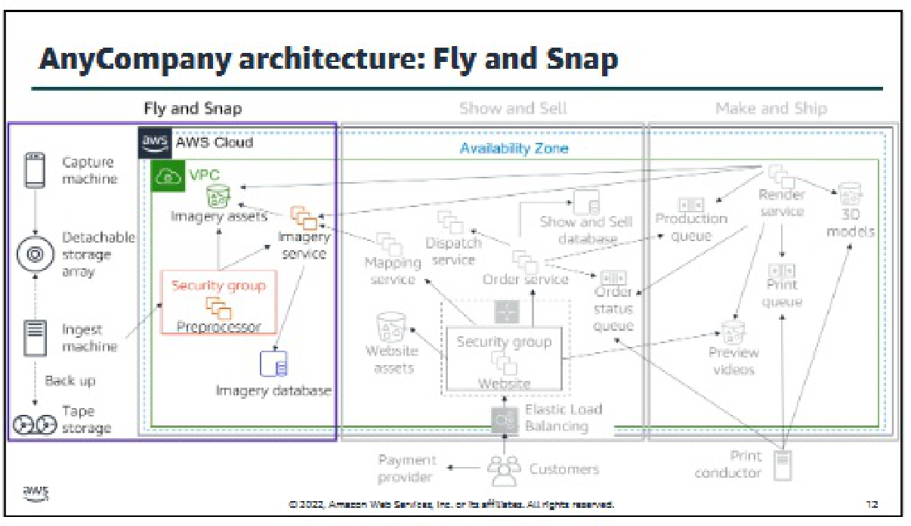

*Diagrama extraído del PDF original. [Consultar la página completa y sus notas](figuras/originales/ca_p12.png).*

### Arquitectura Show and Sell

`[FUENTE: CA p. 13]`

El sitio web permite visitar y explorar los paisajes urbanos mediante mapas, vistas previas, escenas y vídeos. La infraestructura comercial utiliza **Elastic Load Balancing** y un **Auto Scaling Group** de instancias **EC2** para repartir el tráfico entre servidores y adaptarse a la demanda. El material menciona almacenamiento de datos comerciales y de pedidos mediante **un RDBMS alojado en Amazon EC2**, así como componentes de procesamiento y comunicación entre servicios.

En el proceso de compra, los clientes seleccionan una ubicación o producto, previsualizan opciones y pagan mediante un **proveedor externo de pagos**. El texto aclara que AnyCompany **no procesa ni almacena directamente los datos de tarjeta**, lo que modifica su exposición a requisitos de seguridad y conformidad. Tras la confirmación del pago, se comunica el pedido a los servicios internos y a la etapa de producción. Se describen estados que permiten seguir el pedido.

`[FUENTE: CA p. 13 — notas cotejadas en la imagen original]`

**Corrección cotejada en la página original:** Show and Sell registra pedidos y detalles de cliente en una base relacional (RDBMS) sobre EC2. La mención a DynamoDB en la primera iteración era incorrecta para este caso, aunque DynamoDB sí aparece en T1 p.28 y T2 p.16.

La web utiliza ELB con HTTPS y un grupo de Auto Scaling de instancias EC2 que ejecutan un gestor de contenidos; los activos estáticos están en S3. El comprador selecciona ubicación, tamaño físico, color (blanco, monocromo o color completo) y, opcionalmente, iluminación LED. Mapping correlaciona la ubicación elegida con el servicio de imágenes para confirmar cobertura. El pago se procesa mediante un tercero certificado PCI y AnyCompany no procesa ni almacena datos de tarjeta. Tras la confirmación, Order registra el pedido e inicia producción.

Order coloca un mensaje en Production queue para obtener la vista previa o la impresión completa. Render avisa a Order cuando está disponible la previsualización, y Order consume mensajes de Order status queue para actualizar la base de pedidos. Dispatch intermedia el envío con un tercero. Las colas comunican etapas del proceso y permiten seguir el pedido sin mantener todas las acciones en una llamada síncrona única.

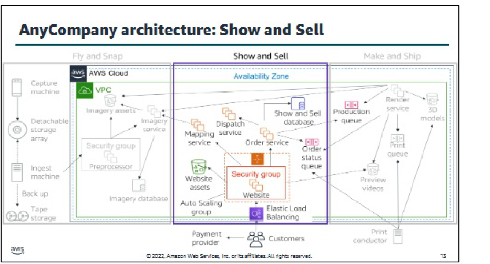

*Diagrama extraído del PDF original. [Consultar la página completa y sus notas](figuras/originales/ca_p13.png).*

### Arquitectura Make and Ship

`[FUENTE: CA p. 14]`

Para fabricar modelos tridimensionales, se utiliza un **servicio de renderizado** sobre instancias EC2 orientadas a procesamiento gráfico (la diapositiva menciona la familia **g2.2xlarge**, histórica). Se producen modelos y vistas previas; los vídeos y otros activos generados se guardan en un **bucket de S3**. Algunos activos tienen carácter temporal y pueden eliminarse una vez finalizado su uso.

Al confirmarse un pedido, un mensaje entra en una **cola de impresión** y contiene una referencia al modelo 3D. Los trabajos se envían a un contratista especializado para producir la pieza física. Una cola o mecanismo de eventos de **estado del pedido** permite actualizar a la aplicación comercial mientras el producto pasa por fabricación, controles de calidad y preparación para envío.

El caso muestra distintas necesidades de arquitectura: rendimiento de renderizado, separación entre etapas mediante colas, almacenamiento de objetos, seguimiento asíncrono de pedidos y protección de identidades y activos.

`[FUENTE: CA p. 14 — notas cotejadas en la imagen original]`

El servicio Render consume trabajos de Production queue y utiliza una flota histórica de instancias g2.2xlarge. Guarda modelos 3D en un bucket S3 y vídeos de previsualización en otro. La fuente indica que las vistas previas antiguas se eliminan una vez al año, mientras que se conservan los modelos para posibles proyectos futuros; estas son las reglas del caso, no recomendaciones universales de retención.

Al confirmar un pedido se publica en Print queue un enlace al modelo. El equipo dispone de cuatro impresoras 3D para mapas detallados en color. Una máquina local Print conductor toma trabajos y los asigna a la siguiente impresora disponible; envía estados durante el proceso a Order status queue y una actualización final cuando el producto termina, supera control de calidad y está listo para despacho. La web consume los estados para mostrar el historial del pedido.

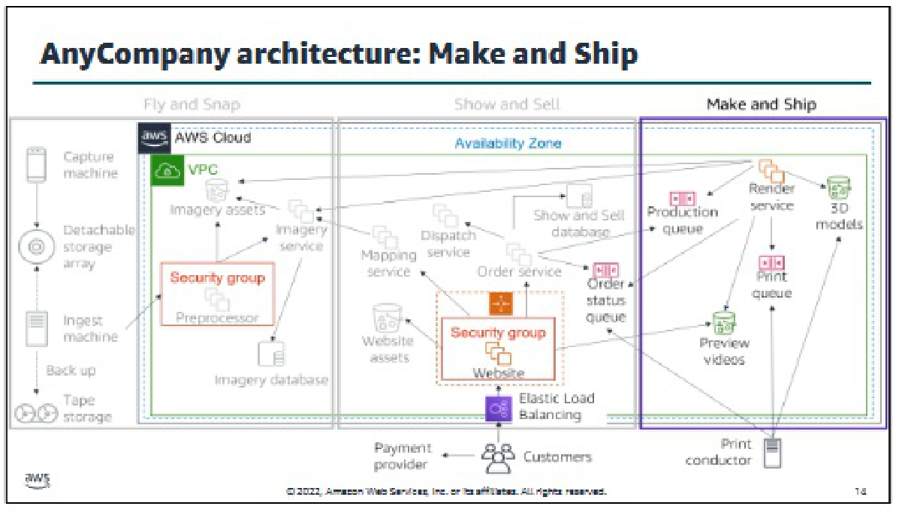

*Diagrama extraído del PDF original. [Consultar la página completa y sus notas](figuras/originales/ca_p14.png).*

### Método de la actividad

`[FUENTE: CA p. 15]`

La clase se divide en grupos para evaluar los pilares. Para cada pregunta de Well-Architected, los participantes deben:

- Determinar el **CURRENT STATE**: cómo trabaja AnyCompany actualmente.
- Proponer el **FUTURE STATE**: cómo debería actuar para mejorar.
- Acordar la principal mejora recomendada y justificarla.

Las preguntas tienen carácter orientativo; **no se pretende que todas tengan una única respuesta correcta**. Esto es un caso de evaluación arquitectónica, no una lista de soluciones prescriptivas.

## Pilar 1. Excelencia operativa

### Definición y temas clave

`[FUENTE: CA p. 17]`

**Excelencia operativa**: capacidad de ejecutar y supervisar sistemas para entregar valor de negocio y **mejorar continuamente** los procesos y procedimientos de apoyo. La explicación destaca:

- Automatizar los cambios en sistemas y aplicaciones.
- Responder a eventos e incidentes operativos.
- Definir estándares o procedimientos para gestionar las operaciones diarias.

La palabra clave es **mejora continua de las operaciones**, no simplemente tener máquinas funcionando.

### Cinco principios de diseño

`[FUENTE: CA p. 18]`

1. **Perform operations as code:** definir procedimientos y tareas operativas con código o configuraciones automatizables, de forma que puedan reproducirse y cambiarse con seguridad.
2. **Make frequent, small, reversible changes:** desplegar cambios pequeños, frecuentes y reversibles para reducir el impacto de fallos y facilitar su corrección.
3. **Refine operations procedures frequently:** revisar los procedimientos operativos periódicamente para mantenerlos adecuados al entorno y a los requisitos del negocio.
4. **Anticipate failure:** identificar riesgos, practicar respuestas a fallos y preparar procedimientos antes de que el problema llegue a producción.
5. **Learn from all operational events and failures:** extraer aprendizajes de incidentes y eventos de operación y compartirlos en el equipo y en la organización.

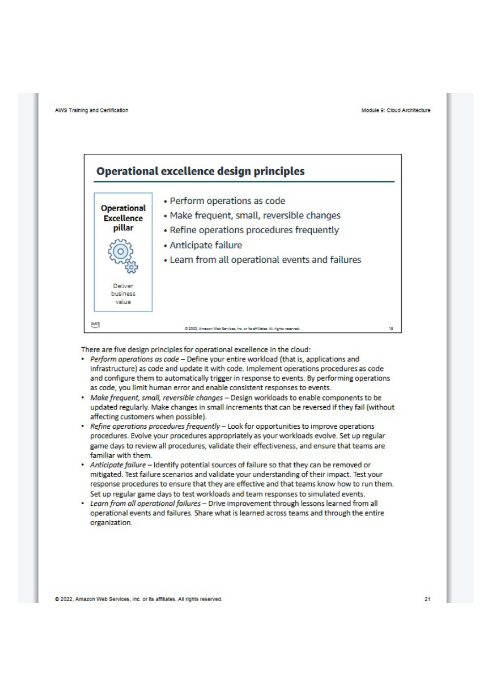

*Página original conservada con sus notas para contextualizar el diagrama; material docente histórico.*

### Preguntas de evaluación operativa

`[FUENTE: CA p. 19]`

La diapositiva organiza preguntas en cuatro áreas:

- **Organize:** cómo establecer prioridades, cómo estructurar la organización para apoyar los resultados del negocio y cómo contribuyen los aspectos culturales de la organización.
- **Prepare:** cómo diseñar cargas de trabajo para entender su estado, cómo reducir defectos y facilitar cambios, cómo mitigar riesgos de despliegue, cómo saber si se está preparado para soportar una carga.
- **Operate:** cómo comprender el estado operativo de una carga de trabajo, el estado de las operaciones y cómo administrar los eventos y sus efectos.
- **Evolve:** cómo evolucionar y mejorar las operaciones.

Las notas subrayan que el equipo debe conocer las necesidades de negocio y del cliente, comunicar prioridades, medir resultados y aprender de la experiencia operativa.

### Ejercicio de excelencia operativa con AnyCompany

`[FUENTE: CA p. 20]`

Se proporciona el diagrama general del caso y se pide aplicar tres preguntas del marco:

- **OPS 4**: cómo se diseña la carga de trabajo para entender su estado.
- **OPS 5**: cómo se mitigan los riesgos del despliegue.
- **OPS 7**: cómo se sabe que se está preparado para soportar una carga de trabajo.

El ejercicio pide describir estado actual, estado futuro y una mejora prioritaria. **No ofrece en esta página una solución cerrada**.

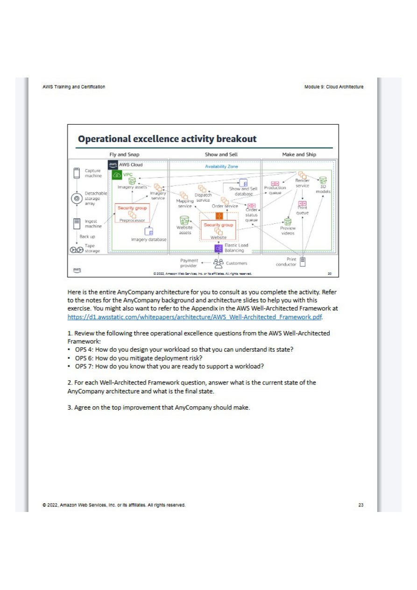

*Página original conservada con sus notas para contextualizar el diagrama; material docente histórico.*

### Aplicación razonada de excelencia operativa a AnyCompany

`[EXPLICACIÓN EDITORIAL — propuesta de trabajo, no solución oficial]`

Operar como código significa convertir una tarea repetida, como desplegar el servicio de imágenes, en un procedimiento versionado y ejecutable. Así se puede revisar qué cambió, repetir un despliegue y reconstruir el entorno sin depender de la memoria de una persona. El código operativo necesita controles, permisos y revisión igual que el código de la aplicación: automatizar una mala decisión solo hace que el error se repita más deprisa.

Los cambios pequeños y reversibles limitan cuántas causas posibles hay que investigar si algo falla. En Show and Sell, cambiar simultáneamente la web, la base de datos y el esquema de pedidos dificulta saber qué provocó una regresión; separar cambios compatibles y preparar reversión facilita recuperar servicio. La reversión debe incluir cómo tratar datos escritos con la nueva versión, no limitarse a reinstalar un binario antiguo.

Refinar procedimientos requiere probarlos y corregirlos tras cada experiencia relevante. Un documento que nadie ensaya puede omitir permisos, dependencias o pasos que ya cambiaron. Anticipar fallos lleva a preguntar qué ocurre si no llega una captura, un renderizado falla o un fabricante no responde. Aprender de los eventos implica registrar lo ocurrido, revisar causas y medidas, asignar responsables y comprobar después si la mejora redujo recurrencias.

Para OPS4, una propuesta es observar pedidos por estado, antigüedad de trabajos pendientes y fallos de ingesta/renderizado, además de CPU. Para OPS5, evaluar despliegues pequeños con comprobaciones y un procedimiento de reversión ensayado. Para OPS7, comprobar que hay responsables, alertas que llegan a alguien y procedimientos de respuesta. Una mejora prioritaria defendible sería identificar pedidos atascados: conecta la métrica técnica con una consecuencia para el cliente. El umbral concreto debe acordarse con el negocio, pues el ejercicio no lo proporciona.

## Pilar 2. Seguridad

### Objetivo y temas clave

`[FUENTE: CA p. 22]`

**Seguridad**: capacidad de proteger la información, sistemas y activos, mientras se ofrece valor de negocio mediante análisis de riesgo y estrategias de mitigación. Los asuntos destacados son:

- Confidencialidad e integridad de los datos.
- Identificar y administrar quién puede hacer qué.
- Proteger sistemas y recursos.
- Establecer controles para detectar eventos de seguridad.

### Siete principios de diseño de seguridad

`[FUENTE: CA p. 23]`

1. **Implement a strong identity foundation:** establecer identidades robustas y el principio de **mínimo privilegio**, separar permisos, centralizar la gestión de identidades cuando corresponda y evitar depender del acceso root.
2. **Enable traceability:** registrar, supervisar y auditar cambios y acciones en tiempo real, incorporando registros y alertas a los procedimientos de seguridad.
3. **Apply security at all layers:** aplicar controles en todos los niveles relevantes, como redes, instancias, sistemas operativos, aplicaciones y datos.
4. **Automate security best practices:** automatizar mecanismos de seguridad para reducir errores humanos y aplicar políticas coherentes a escala.
5. **Protect data in transit and at rest:** utilizar cifrado y controles apropiados para los datos tanto **en tránsito** como **almacenados**.
6. **Keep people away from data:** minimizar el acceso y la intervención manual directa sobre datos sensibles, utilizando mecanismos automatizados cuando sea razonable.
7. **Prepare for security events:** preparar la detección, investigación, contención y recuperación ante incidentes mediante procesos y ejercicios de respuesta.

*Página original conservada con sus notas para contextualizar el diagrama; material docente histórico.*

### Preguntas de seguridad

`[FUENTE: CA p. 24]`

Se plantean preguntas agrupadas en:

- **Security:** cómo operar de manera segura las cargas de trabajo.
- **Identity and access management:** cómo gestionar identidades de personas y máquinas, y sus permisos.
- **Detection:** cómo detectar e investigar eventos de seguridad.
- **Infrastructure protection:** cómo proteger los recursos de red y cómputo.
- **Data protection:** cómo clasificar datos y cómo protegerlos en reposo y tránsito.
- **Incident response:** cómo anticipar, responder y recuperarse ante incidentes.

Las notas insisten en disponer de controles de protección, mecanismos de detección y procedimientos de respuesta alineados con los requisitos de la organización.

### Actividad de seguridad en AnyCompany

`[FUENTE: CA p. 25]`

Preguntas de referencia:

- **SEC 1:** cómo operar de forma segura la carga de trabajo.
- **SEC 4:** cómo detectar e investigar los eventos de seguridad.
- **SEC 6:** cómo proteger los recursos informáticos.

Se reutiliza el diagrama de AnyCompany para elegir una mejora prioritaria. Las prácticas de la página 23 ayudan a reconocer debilidades como el uso compartido de credenciales de root.

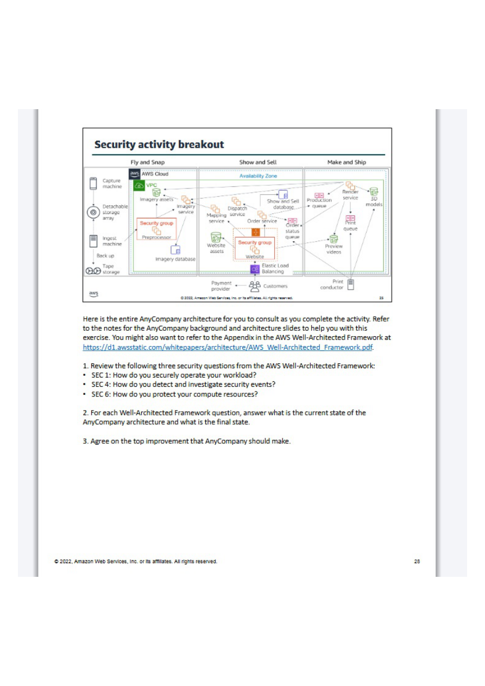

*Página original conservada con sus notas para contextualizar el diagrama; material docente histórico.*

### Aplicación razonada de seguridad a AnyCompany

`[EXPLICACIÓN EDITORIAL — propuesta de trabajo, no solución oficial]`

La base de identidad sólida empieza por dejar de compartir credenciales raíz: compartirlas impide atribuir de forma fiable cada acción y concede privilegios excesivos para tareas ordinarias. Se necesitan identidades diferenciadas, autenticación reforzada y permisos acordes con la función. El servicio que procesa imágenes puede requerir leer un conjunto de objetos y escribir derivados, sin necesitar administrar toda la cuenta.

La trazabilidad consiste en conservar señales que permitan reconstruir una acción: identidad, operación, recurso, momento y resultado. Tener registros sin retención, revisión o capacidad de consulta no resuelve por sí solo la investigación. La seguridad en todas las capas combina autorización, controles de red, protección del sistema y aplicación, y controles de datos. Un puerto cerrado no compensa una clave expuesta; una política IAM adecuada no impide por sí sola una vulnerabilidad de la aplicación web.

Automatizar buenas prácticas puede detectar una regla demasiado abierta o impedir configuraciones fuera del estándar, pero hay que controlar quién puede modificar el mecanismo de protección. Cifrar en tránsito protege el intercambio; cifrar en reposo protege datos almacenados bajo el modelo de claves y permisos adoptado. Es necesario revisar ambos trayectos y copias: el vídeo original, los modelos derivados, sus copias y la comunicación con el fabricante pueden tener requisitos distintos.

Mantener personas alejadas de datos significa reducir accesos manuales innecesarios mediante procesos controlados, no impedir toda intervención legítima. Prepararse para incidentes requiere saber cómo detectar, contener, preservar evidencia y restablecer operaciones, con acceso de emergencia protegido. En SEC1 se revisan identidad y procedimientos; en SEC4, registros y capacidad de investigación; en SEC6, protección del cómputo. El proveedor externo de pagos reduce el alcance de datos de tarjeta que almacena AnyCompany, pero no elimina los requisitos de seguridad de su web e integración.

## Pilar 3. Fiabilidad

### Objetivo y temas clave

`[FUENTE: CA p. 27]`

**Fiabilidad**: capacidad de una carga de trabajo para funcionar correctamente y de forma consistente cuando se necesita. Incluye **recuperarse de fallos** para satisfacer los requisitos del negocio. Temas destacados:

- Diseño de sistemas distribuidos.
- Planificación de la recuperación.
- Gestión de cambios.

### Cinco principios de fiabilidad

`[FUENTE: CA p. 28]`

1. **Automatically recover from failure:** detectar fallos y configurar mecanismos de recuperación automática, basados en métricas o umbrales.
2. **Test recovery procedures:** ensayar los procedimientos y planes de recuperación para verificar que permiten volver al servicio.
3. **Scale horizontally to increase aggregate workload availability:** distribuir carga entre varias instancias o componentes, reduciendo la dependencia de un único recurso.
4. **Stop guessing capacity:** observar la demanda y el uso real para dimensionar recursos, automatizando el aumento o reducción de capacidad.
5. **Manage change in automation:** introducir cambios en la infraestructura mediante procesos automatizados y controlables.

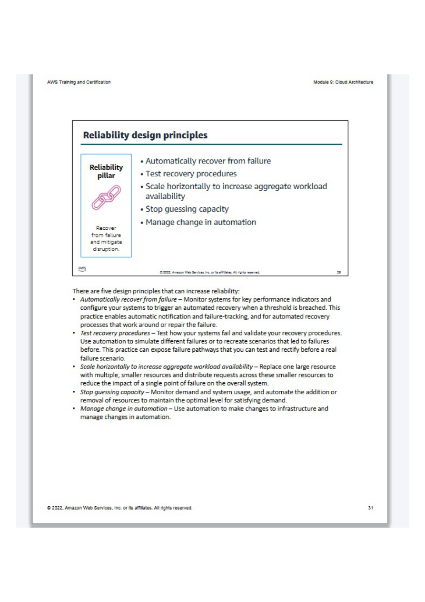

*Página original conservada con sus notas para contextualizar el diagrama; material docente histórico.*

### Preguntas de fiabilidad

`[FUENTE: CA p. 29]`

Áreas de revisión enumeradas:

- **Foundations:** cómo administrar cuotas y limitaciones de servicios; cómo planificar la topología de red.
- **Workload architecture:** cómo diseñar servicios y sistemas distribuidos para prevenir o amortiguar fallos.
- **Change management:** cómo monitorizar recursos, cambiar la carga cuando evoluciona la demanda e implementar cambios.
- **Failure management:** cómo realizar copias de seguridad, tolerar fallos de componentes, diseñar resiliencia, comprobar los mecanismos de recuperación y planificar la recuperación ante desastres.

La fiabilidad exige una base bien diseñada, seguimiento y manejo explícito de cambios y fallos; no depende de una única herramienta.

### Ejercicio de fiabilidad con AnyCompany

`[FUENTE: CA p. 30]`

Preguntas concretas:

- **REL 2:** cómo planificar la topología de red.
- **REL 6:** cómo supervisar los recursos de la carga de trabajo.
- **REL 9:** cómo realizar copias de seguridad de datos.

Se pide identificar estado actual y futuro; la diapositiva no impone una única arquitectura correcta.

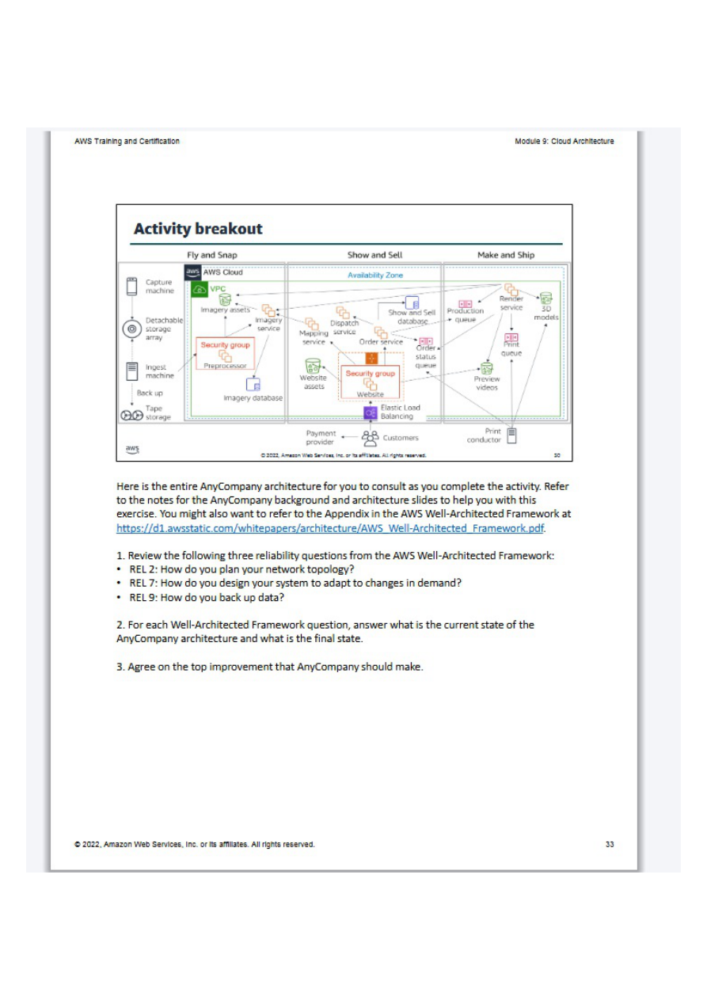

*Página original conservada con sus notas para contextualizar el diagrama; material docente histórico.*

### Aplicación razonada de fiabilidad a AnyCompany

`[EXPLICACIÓN EDITORIAL — propuesta de trabajo, no solución oficial]`

La recuperación automática exige una definición observable de fallo y una acción con límites. Reiniciar indefinidamente un componente que escribe datos corruptos no es recuperarse; un mecanismo de reemplazo debe trabajar junto con comprobaciones de salud y protección de datos. Las métricas deben detectar el resultado que importa: aceptar un pedido no basta si nunca llega a fabricación.

Probar la recuperación demuestra que las copias, permisos, dependencias y procedimientos funcionan juntos. Para Fly and Snap se puede plantear restaurar un conjunto representativo de imágenes y su correspondencia en la base relacional. Una copia de archivos sin el índice que los relaciona con modelos y pedidos puede ser insuficiente. En Make and Ship importa si un trabajo puede repetirse y cómo se evita fabricar dos veces tras una reentrega del mensaje.

Escalar horizontalmente reduce dependencia de una única máquina cuando el estado y los componentes comunes lo permiten. Varias instancias que dependen de una sola base no protegida siguen compartiendo un punto de fallo. Dejar de adivinar capacidad consiste en observar demanda y respuesta, definir políticas y considerar cuotas y límites; el escalado no es instantáneo ni puede compensar cualquier cuello de botella. Administrar cambios mediante automatización reduce variación y permite identificar qué cambio introdujo un problema.

En REL2, el equipo revisaría dominios de fallo y conectividad, y justificaría separación por AZ según requisitos. En REL6 comprobaría salud de procesos y resultados de negocio. En REL9 documentaría qué datos necesitan respaldo, retención y pruebas de restauración. El objetivo de recuperación y pérdida tolerable debe venir del negocio: sin RTO/RPO no se puede afirmar que una propuesta cumple los requisitos. Una arquitectura multi-AZ mejora respuesta a ciertos fallos y una copia recuperable resuelve otro tipo de necesidad; ninguna sustituye automáticamente a la otra.

## Pilar 4. Eficiencia del rendimiento

### Objetivo y temas clave

`[FUENTE: CA p. 32]`

La **eficiencia del rendimiento** consiste en utilizar recursos de TI y computación de manera eficiente para cubrir los requisitos del sistema, incluso cuando cambia la demanda o evolucionan las tecnologías. Temas principales:

- Seleccionar los tipos y tamaños de recursos adecuados para cada carga de trabajo.
- Monitorizar el rendimiento de forma continua.
- Adoptar decisiones informadas cuando cambian los requisitos del negocio.

### Cinco principios de diseño de rendimiento

`[FUENTE: CA p. 33]`

1. **Democratize advanced technologies:** consumir tecnologías avanzadas como servicios administrados, evitando implementar por cuenta propia toda su complejidad.
2. **Go global in minutes:** aprovechar la infraestructura global para desplegar aplicaciones cerca de usuarios y mejorar experiencias y latencia.
3. **Use serverless architectures:** utilizar servicios que reduzcan la carga operativa de administrar servidores y permitan responder a la demanda.
4. **Experiment more often:** realizar experimentos y comparativas entre configuraciones o servicios para encontrar alternativas con mejor rendimiento.
5. **Consider mechanical sympathy:** comprender patrones de acceso y características de las tecnologías subyacentes para elegir el servicio o recurso apropiado.

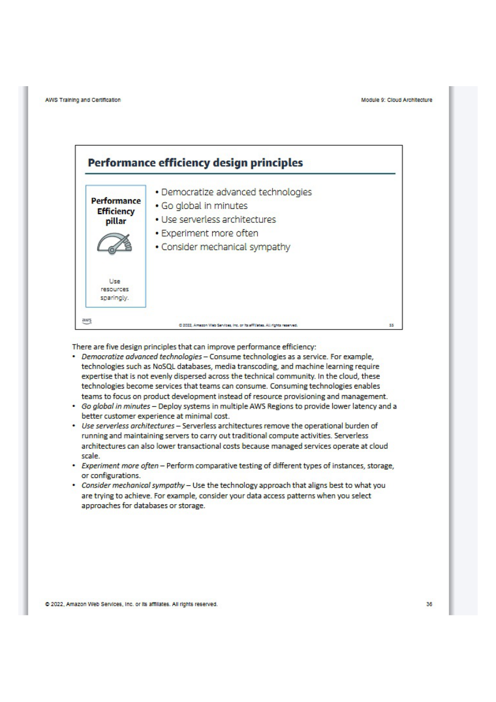

*Página original conservada con sus notas para contextualizar el diagrama; material docente histórico.*

### Preguntas de eficiencia del rendimiento

`[FUENTE: CA p. 34]`

Las preguntas se agrupan en:

- **Selection:** cómo elegir arquitectura, cómputo, almacenamiento, base de datos y red.
- **Review:** cómo revisar la arquitectura cuando aparecen tecnologías nuevas o cambian los requisitos.
- **Monitoring:** cómo saber si los recursos están dando el rendimiento esperado.
- **Trade-offs:** qué compromisos se aceptan para obtener mejoras.

Las notas destacan la toma de decisiones basada en mediciones y la revisión continua, en lugar de elegir una solución solo por costumbre.

### Actividad de rendimiento con AnyCompany

`[FUENTE: CA p. 35]`

Preguntas seleccionadas:

- **PERF 1:** cómo seleccionar la arquitectura con mejor rendimiento.
- **PERF 2:** cómo seleccionar la solución de cómputo.
- **PERF 4:** cómo seleccionar la solución de base de datos.

Se pide evaluar las decisiones actuales y proponer cambios sobre el diagrama de AnyCompany.

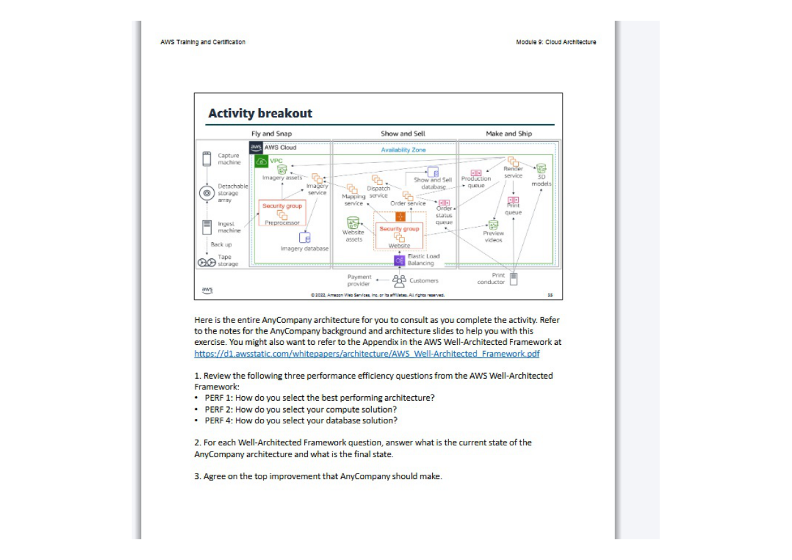

*Página original conservada con sus notas para contextualizar el diagrama; material docente histórico.*

### Aplicación razonada de eficiencia del rendimiento a AnyCompany

`[EXPLICACIÓN EDITORIAL — propuesta de trabajo, no solución oficial]`

Democratizar tecnologías avanzadas permite consumir capacidades complejas como servicios administrados, pero la selección sigue dependiendo del patrón de acceso y de los resultados medidos. No se debe elegir DynamoDB o una base relacional por familiaridad con la marca: se comparan consultas, estructura, consistencia necesaria, volumen y latencia de cada proceso.

Desplegar globalmente puede reducir latencia de interacción si los usuarios acceden a componentes cercanos. No acelera necesariamente un trabajo de renderizado limitado por CPU/GPU, y distribuir estado entre regiones añade complejidad. Usar serverless puede disminuir tareas de operación y encajar con procesos por eventos, pero debe evaluarse frente a duración de los trabajos, dependencias, requisitos y características del servicio. No todo renderizado puede trasladarse sin cambios a una función.

Experimentar requiere una carga representativa y criterios de éxito: comparar tiempo por modelo, coste por resultado, tasa de error y variabilidad aporta más información que medir solo CPU. Mechanical sympathy significa entender cómo trabaja la tecnología: lectura secuencial de archivos grandes, acceso aleatorio a datos, paralelismo y movimiento por red tienen costes y límites distintos. Si el cuello de botella es transferir imágenes, añadir CPU puede dejar el proceso igual de lento.

Para PERF1 se analiza el recorrido completo de una solicitud y de un modelo; para PERF2 se compara cómputo con datos representativos; para PERF4 se revisa el patrón de base de datos. La instancia g2.2xlarge de la fuente es una elección histórica del caso, no una recomendación vigente. Antes de sustituirla, se comprueban compatibilidad del software, aceleradores, memoria y rendimiento real. Los compromisos deben documentarse: una caché puede mejorar latencia mientras introduce retención, invalidación y consideraciones de coherencia.

## Pilar 5. Optimización de costes

### Objetivo y temas clave

`[FUENTE: CA p. 37]`

**Optimización de costes** es la capacidad de evitar gastos innecesarios. Comprende:

- Comprender y controlar en qué se gasta el presupuesto.
- Seleccionar el tipo y la cantidad de recursos más adecuados.
- Analizar la evolución del gasto.
- Escalar según lo necesario sin sobredimensionar permanentemente el sistema.

### Cinco principios de diseño de costes

`[FUENTE: CA p. 38]`

1. **Implement Cloud Financial Management:** incorporar gestión financiera cloud a decisiones, procesos, métricas y responsabilidades.
2. **Adopt a consumption model:** pagar por los recursos requeridos, aprovechar escalado dinámico y evitar mantener capacidad ociosa.
3. **Measure overall efficiency:** relacionar gastos de la carga con el resultado empresarial que produce, para comparar eficacia y costes.
4. **Stop spending money on undifferentiated heavy lifting:** evitar invertir tiempo y dinero en tareas operativas indiferenciadas que un servicio administrado puede asumir.
5. **Analyze and attribute expenditure:** analizar costes y asignarlos a equipos, productos, recursos o responsables para apoyar decisiones de ahorro.

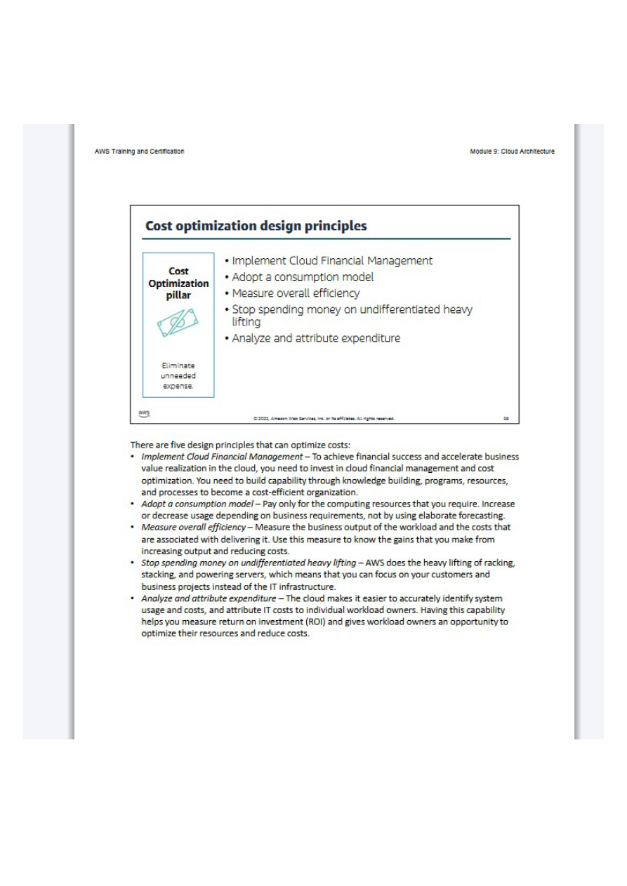

*Página original conservada con sus notas para contextualizar el diagrama; material docente histórico.*

### Preguntas de costes

`[FUENTE: CA p. 39]`

Las preguntas pertenecen a cinco áreas:

- **Practice cloud financial management:** cómo implantar la gestión financiera cloud.
- **Expenditure and usage awareness:** cómo gobernar el uso y cómo supervisar costes/consumo, incluso qué recursos deben retirarse.
- **Cost-effective resources:** cómo evaluar costes al elegir tipo y número de recursos; cómo cumplir objetivos de gasto; cómo usar modelos de precios; cómo planificar cambios en la transferencia de datos.
- **Manage demand and supply resources:** cómo administrar demanda y capacidad.
- **Optimize over time:** cómo evaluar nuevos servicios y oportunidades de optimización.

Las notas incluyen el concepto de **trade-off**: en algunas circunstancias puede priorizarse llegar antes al mercado, cumplir un plazo o desarrollar funciones frente a optimizar cada componente desde el primer momento. Los datos reales de uso permiten tomar decisiones mejor fundamentadas.

### Repetición ampliada de preguntas de costes

`[FUENTE: CA p. 40]`

El PDF repite el cuadro de la página anterior, con notas de explicación sobre compromisos entre velocidad, eficiencia y gastos. **No añade una nueva categoría**: se conserva esta referencia para trazabilidad sin duplicar literalmente la tabla.

### Actividad de costes con AnyCompany

`[FUENTE: CA p. 41]`

Preguntas de referencia:

- **COST 2:** cómo gobernar el uso.
- **COST 6:** cómo cumplir objetivos de coste al seleccionar tipos, tamaños y cantidades de recursos.
- **COST 7:** cómo utilizar modelos de precios para reducir costes.

Se pide revisar el estado de la arquitectura ficticia, proponer el estado futuro y priorizar una mejora.

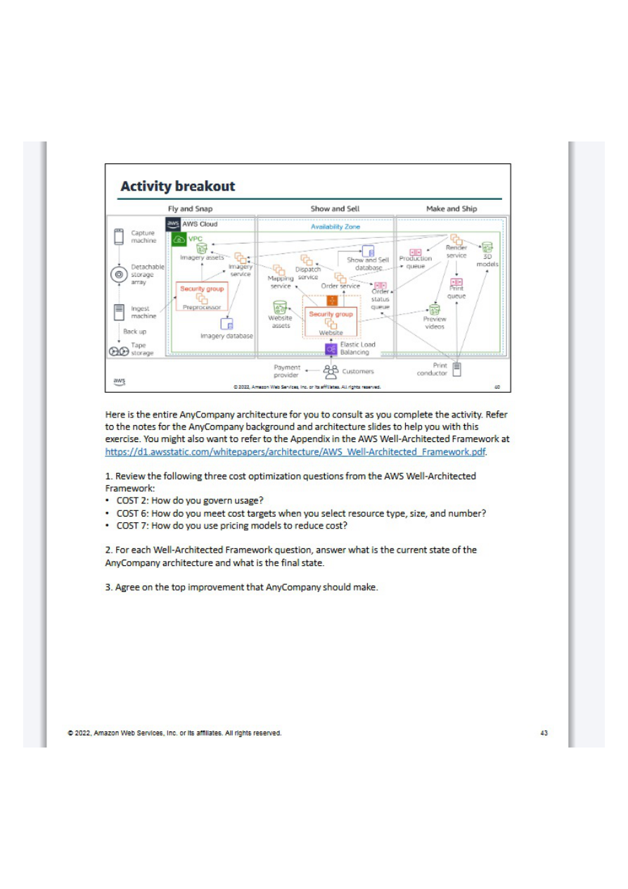

*Página original conservada con sus notas para contextualizar el diagrama; material docente histórico.*

### Aplicación razonada de optimización de costes a AnyCompany

`[EXPLICACIÓN EDITORIAL — propuesta de trabajo, no solución oficial]`

La gestión financiera cloud exige responsabilidades compartidas entre ingeniería, finanzas y propietarios de producto. Para AnyCompany sería útil distinguir gasto de captura, comercio y fabricación, y relacionarlo con imágenes procesadas, pedidos y modelos producidos. Medir solo el gasto total puede ocultar que el negocio está creciendo y mejorando su coste unitario, o que un ahorro aparente procede de procesar menos pedidos.

Adoptar consumo medido invita a retirar capacidad ociosa y ajustar oferta a demanda. El renderizado puede ser intermitente; mantener toda su capacidad activa durante horas sin trabajos genera gasto sin resultado. Sin embargo, apagar recursos sin entender tiempos de arranque y plazo de entrega podría dañar el servicio. La comparación debe incorporar la cola, el tiempo de procesamiento y la ventana aceptable para completar un pedido.

Medir eficiencia global combina gasto con valor producido. Un recurso más barato por hora puede resultar más caro por modelo si tarda mucho más, y una arquitectura administrada puede reducir trabajo operativo aunque su precio directo de infraestructura sea mayor. El trabajo pesado indiferenciado incluye tareas repetitivas de infraestructura que no distinguen el producto; delegarlas no elimina la necesidad de supervisar datos, permisos y costes.

Analizar y atribuir gasto permite detectar recursos olvidados y decidir quién puede crearlos o modificarlos. Para COST2 se puede proponer gobierno de uso con responsables y criterios de retirada; para COST6, rightsizing a partir de métricas; para COST7, revisar opciones de compra solo después de conocer estabilidad y tolerancia a interrupciones de la carga. Una mejora inmediata posible es revisar recursos ociosos del renderizado; no se puede afirmar una cifra de ahorro sin inventario, patrón de uso y precios aplicables. La fuente reconoce compromisos entre velocidad de entrega y optimización: deben ser decisiones explícitas y revisables.

## Pilar 6. Sostenibilidad: definición, principios y prácticas

`[AMPLIACIÓN OFICIAL — AWS]` Esta es la laguna más visible del módulo *Cloud Architecture*: nombra los seis pilares en su gráfico, pero profundiza en los principios de diseño de los cinco primeros. **No se debe atribuir este desarrollo adicional a sus diapositivas.**

### Definición y objetivo

El pilar de **sostenibilidad ambiental** busca reducir, de manera continuada, el impacto de las cargas de trabajo, incluido el consumo de energía y recursos, a la vez que se entrega valor a los usuarios. La medida adecuada no siempre es el consumo absoluto: también es útil evaluar el **impacto por unidad de trabajo**, como energía o emisiones estimadas por transacción completada o usuario atendido.

No significa elegir automáticamente la opción más barata. Coste, rendimiento, disponibilidad, residencia de datos y sostenibilidad pueden implicar compromisos que deben evaluarse conjuntamente.

### Seis principios de diseño del pilar Sustainability

1. **Comprender el impacto (*Understand your impact*).** Medir el consumo de recursos y las repercusiones de la carga, y definir indicadores relevantes para compararlos a lo largo del tiempo. Importa el ciclo de vida, no solo una instantánea de CPU.
2. **Establecer objetivos de sostenibilidad (*Establish sustainability goals*).** Fijar objetivos verificables, como disminuir recursos por transacción o reducir el almacenamiento de datos que ya no son necesarios, y revisarlos durante el crecimiento del sistema.
3. **Maximizar la utilización (*Maximize utilization*).** Dimensionar correctamente, eliminar capacidad ociosa y compartir recursos cuando sea adecuado. Una arquitectura que consume constantemente muchos recursos infrautilizados genera desperdicio evitable.
4. **Adoptar innovaciones más eficientes (*Anticipate and adopt new, more efficient hardware and software offerings*).** Revisar nuevas opciones de infraestructura y software que permitan realizar el mismo trabajo usando menos recursos o energía, después de comprobar compatibilidad y requisitos.
5. **Utilizar servicios administrados (*Use managed services*).** Aprovechar servicios en los que AWS gestiona y comparte infraestructura a escala, lo que puede mejorar su utilización y reducir mantenimiento directo por cliente.
6. **Reducir el impacto posterior (*Reduce the downstream impact*).** Considerar los recursos que consumen los usuarios al emplear la aplicación: transferencias, procesamiento en dispositivos, necesidad de renovar equipos y otros efectos fuera de los propios servidores.

### Prácticas y ejemplos

- **Ajustar recursos a la demanda:** combinar capacidad elástica con métricas de utilización; evitar instancias activas de forma permanente sin necesidad real.
- **Optimizar el almacenamiento:** elegir políticas de retención y ciclo de vida en S3, eliminar copias innecesarias y evitar duplicar datos sin propósito.
- **Reducir trabajo superfluo:** evitar sondeos excesivos, transferencias redundantes o cálculos innecesarios. Técnicas como caché o procesamiento por lotes pueden ser útiles cuando se justifican técnicamente.
- **Diseñar una arquitectura adaptable:** permitir migrar a servicios o familias de cómputo más eficientes sin rehacer el sistema entero.
- **Elegir región con criterio:** examinar requisitos de latencia, residencia legal, disponibilidad y características ambientales; no seleccionar una región solo por un supuesto ahorro energético.
- **Incorporar métricas:** valorar resultados por transacción o usuario y controlar la evolución, en lugar de suponer que cualquier traslado a cloud reduce automáticamente la huella ambiental.

**Ejemplo de examen:** si una pregunta describe máquinas permanentemente infrautilizadas y pide mejorar sostenibilidad, una respuesta apropiada puede incluir dimensionamiento correcto y consolidación de cargas. Si pregunta por controlar **gasto**, el pilar relacionado es Cost Optimization; si pregunta por **impacto ambiental o consumo por operación**, Sustainability.

**Fuentes oficiales:** [Principios de diseño de sostenibilidad (seis)](https://docs.aws.amazon.com/wellarchitected/latest/framework/sus-design-principles.html); [Pilar de sostenibilidad (guía en español)](https://docs.aws.amazon.com/es_es/wellarchitected/latest/sustainability-pillar/sustainability-pillar.html); [Áreas de buenas prácticas](https://docs.aws.amazon.com/es_es/wellarchitected/latest/framework/a-sustainability.html).

### Aplicación de sostenibilidad a AnyCompany

`[EXPLICACIÓN EDITORIAL]` En Fly and Snap conviene estudiar cuántas copias de imágenes se mantienen y durante cuánto tiempo: conservar originales necesarios puede ser obligatorio, mientras que repetir derivados regenerables consume almacenamiento y transferencias sin aportar valor. En Show and Sell se puede medir consumo por pedido completado, evitando confundir una reducción de tráfico causada por perder clientes con una mejora de eficiencia. En Make and Ship se puede agrupar renderizado cuando el plazo de entrega lo permita, apagar capacidad ociosa y comparar recursos por modelo producido. Estos son ejemplos propuestos de análisis, no soluciones oficiales del ejercicio.

## Revisión con AWS Well-Architected Tool

| Aspecto | Well-Architected Tool | Trusted Advisor |
|---|---|---|
| Objeto | Una carga y las decisiones que la sustentan | Recursos, configuración y señales disponibles del entorno |
| Método | Revisión guiada mediante preguntas y evidencias aportadas | Comprobaciones y recomendaciones sobre el alcance admitido |
| Resultado | Riesgos y plan de mejora de la arquitectura | Hallazgos con acciones sugeridas que se deben contextualizar |
| Límite | Depende de la calidad de la revisión; no certifica automáticamente la carga | No entiende por sí solo todos los requisitos de negocio ni sustituye una revisión arquitectónica |

### Herramienta y funcionamiento

`[FUENTE: CA p. 42]`

**AWS Well-Architected Tool** permite revisar cargas de trabajo y compararlas con prácticas de arquitectura recomendadas por AWS:

- Guiar la revisión mediante preguntas estructuradas por áreas y pilares.
- Proporcionar acceso a conocimientos y prácticas recomendadas.
- Generar un **plan de acción** con oportunidades de mejora.
- Mantener un proceso consistente para repetir evaluaciones y medir el avance de una arquitectura.

Las notas explican que el usuario define su carga de trabajo desde la consola AWS y responde a una serie de preguntas. A partir de los resultados se destacan prácticas deficientes o riesgos, y se ofrecen orientaciones para solucionarlos. **No debe confundirse** con Trusted Advisor: el Tool parte de una revisión estructurada de la **arquitectura declarada**, mientras que Trusted Advisor inspecciona **comprobaciones de recursos/configuraciones reales**.

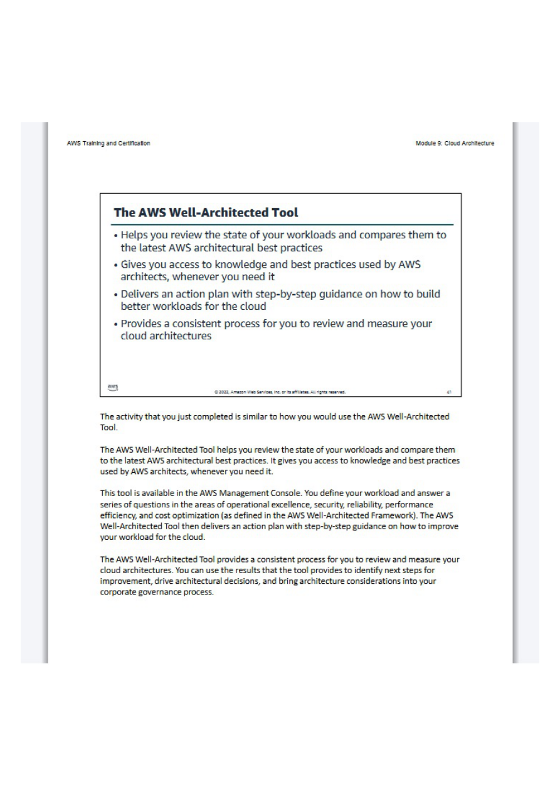

*Página original conservada con sus notas para contextualizar el diagrama; material docente histórico.*

## Fiabilidad y disponibilidad: métricas y compromisos

### «Everything fails, all the time»

`[FUENTE: CA p. 45]`

Las notas atribuyen a **Werner Vogels**, CTO de Amazon, la idea de que los componentes pueden fallar. Para diseñar correctamente, hay que **anticipar fallos** y decidir qué ocurre cuando alguno de ellos deja de funcionar.

El documento diferencia dos propiedades clave a partir de esa premisa: **reliability** y **availability**.

### Fiabilidad (Reliability)

`[FUENTE: CA p. 46]`

La fiabilidad es una medida de la capacidad del sistema para proporcionar funcionalidad **cuando el usuario la necesita**. La diapositiva ilustra la idea mediante un automóvil: su capacidad para circular depende de varios componentes (motor/ignición, frenos, refrigeración y otros); el fallo de uno puede impedir que el vehículo cumpla su función.

Se destaca la fiabilidad de todo el sistema, no únicamente de un componente aislado. Puede expresarse como la **probabilidad de funcionar correctamente durante un periodo especificado**; una medida citada es el **MTBF (Mean Time Between Failures)**, el tiempo medio entre fallos de sistemas reparables.

### Métricas: MTTF, MTTR y MTBF

`[FUENTE: CA p. 47]`

El diagrama representa un ciclo de funcionamiento y reparación:

1. Sistema operativo.
2. Ocurre un fallo.
3. El componente queda fuera de servicio y comienza la reparación.
4. Se repara y vuelve a estar operativo.
5. Transcurre un nuevo intervalo hasta otro fallo.

Términos:

- **MTTF (Mean Time To Failure):** tiempo medio hasta que falla un componente o sistema (según el contexto y tipo de activo).
- **MTTR (Mean Time To Repair):** tiempo medio requerido para repararlo y restaurar su funcionamiento.
- **MTBF (Mean Time Between Failures):** tiempo medio entre dos fallos consecutivos de un sistema reparable; el ejemplo de clase lo relaciona con MTTF + MTTR para un ciclo simple.

**Ejemplo numérico del documento:** una aplicación funciona desde el lunes a mediodía hasta el viernes a mediodía (**96 horas**) y se restaura el lunes siguiente a mediodía tras **72 horas** de reparación. Si el ciclo se repite regularmente, **MTTF = 96 h**, **MTTR = 72 h** y **MTBF = 168 h**.

**Nota editorial:** en contextos industriales y SRE hay convenciones distintas para tiempo de fallo, tiempo entre fallos y disponibilidad; en estos apuntes se respeta el ejemplo y la convención explicada en el módulo.

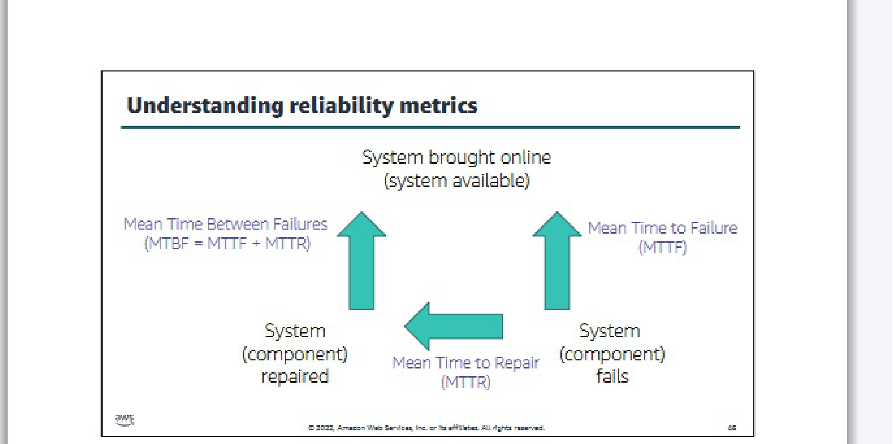

*Diagrama extraído del PDF original. [Consultar la página completa y sus notas](figuras/originales/ca_p47.png).*

### Disponibilidad (Availability)

`[FUENTE: CA p. 48]`

La disponibilidad mide el porcentaje de tiempo en que un sistema se encuentra funcionando correctamente y presta el servicio esperado. La diapositiva la expresa como:

\[
\text{Disponibilidad} = \frac{\text{Tiempo de funcionamiento normal}}{\text{Tiempo total observado}} \times 100\%.
\]

Normalmente se comunica mediante porcentajes para un intervalo determinado, por ejemplo **un año**. Se populariza la expresión «número de nueves» (por ejemplo, **cinco nueves** equivale a **99,999 %**).

Las notas indican que la disponibilidad puede verse afectada por interrupciones programadas y no programadas y que su interpretación precisa depende del objetivo que se utilice.

### Alta disponibilidad (High availability)

`[FUENTE: CA p. 49]`

Un sistema de **alta disponibilidad** puede seguir prestando servicio, aunque experimente cierta degradación tras fallar una parte del sistema. Sus características son:

- Minimizar los periodos de inactividad.
- Mantener disponibles las funciones esenciales durante fallos razonablemente previstos.
- Requerir **poca o ninguna intervención humana** para continuar o restaurar la operación.

Las notas lo relacionan con redundancia y componentes que colaboran para mantener los servicios, además de mecanismos para sustituir o restablecer rápidamente recursos que fallen.

### Niveles de disponibilidad

`[FUENTE: CA p. 50]`

El material utiliza una tabla de **tiempo máximo aproximado de interrupción anual** frente a porcentajes de disponibilidad, acompañados por ejemplos de aplicaciones típicas:

| Disponibilidad anual | Indisponibilidad aproximada por año | Referencia de uso ilustrativa del material |
| --- | ---: | --- |
| 99 % | 3 días y 15 horas | Procesos por lotes, extracción de datos o actividades no críticas. |
| 99,9 % | 8 horas y 45 minutos | Aplicaciones internas de gestión o proyectos. |
| 99,95 % | 4 horas y 22 minutos | Comercio electrónico y puntos de venta online. |
| 99,99 % | 52 minutos | Distribución de vídeo y sistemas de difusión. |
| 99,999 % | 5 minutos | Cajeros automáticos y telecomunicaciones. |

**Interpretación:** pequeñas diferencias porcentuales representan grandes diferencias en tiempo de caída admisible. Los ejemplos son ilustrativos, **no promesas de SLA para un servicio concreto**.

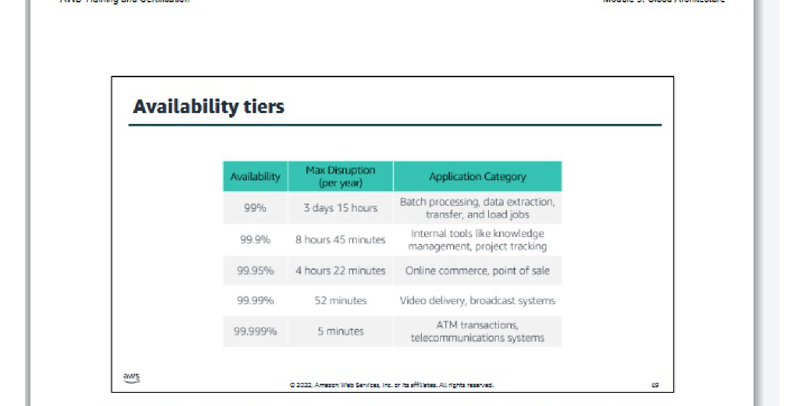

*Diagrama extraído del PDF original. [Consultar la página completa y sus notas](figuras/originales/ca_p50.png).*

### Factores que influyen en la disponibilidad

`[FUENTE: CA p. 51]`

La diapositiva identifica tres propiedades que contribuyen a la disponibilidad:

- **Fault tolerance (tolerancia a fallos):** redundancia incorporada para continuar funcionando ante determinados fallos de componentes.
- **Scalability (escalabilidad):** capacidad de ampliar la capacidad mediante cambios de diseño o incorporación de recursos para soportar demanda creciente.
- **Recoverability (recuperabilidad):** procesos, políticas y procedimientos para restaurar el servicio tras un evento grave, procurando minimizar la pérdida de datos.

Las notas advierten del **compromiso coste-disponibilidad**: garantizar niveles muy elevados de disponibilidad puede exigir duplicación de componentes, más automatización y procedimientos de recuperación, lo que incrementa costes. La solución adecuada depende de las necesidades de los usuarios y del impacto de una interrupción.

## Trusted Advisor: interpretación y cinco recomendaciones

### Qué es Trusted Advisor y sus cinco categorías en el material

`[FUENTE: CA p. 54]`

**AWS Trusted Advisor** proporciona orientaciones basadas en comprobaciones de recursos y configuraciones dentro de la cuenta. Busca detectar problemas o mejoras posibles en coste, rendimiento, seguridad, resiliencia y límites.

El cuadro de 2022 enumera **cinco categorías**:

| Categoría tal como aparece | Para qué sirve |
| --- | --- |
| Cost Optimization | Detectar recursos sin utilizar, oportunidades de reducción de gasto o configuraciones que causan costes evitables. |
| Performance | Identificar configuraciones que puedan limitar rendimiento o aprovechar mejor recursos disponibles. |
| Security | Detectar configuraciones o permisos que exponen información y servicios. |
| Fault Tolerance | Identificar problemas de redundancia o disponibilidad. |
| Service Limits | Avisar cuando el consumo se acerca o supera límites o cuotas de los servicios. |

Las notas describen que Trusted Advisor puede ayudar desde las primeras etapas de diseño y operación, no solo cuando una aplicación está fallando.

**Actualización oficial (fuera del documento):** AWS describe ahora **seis categorías**, añadiendo **Operational Excellence**. Fuente: https://docs.aws.amazon.com/awssupport/latest/user/get-started-with-aws-trusted-advisor.html. En el texto final se deben distinguir las **cinco categorías de la diapositiva** de las **seis categorías actuales**.

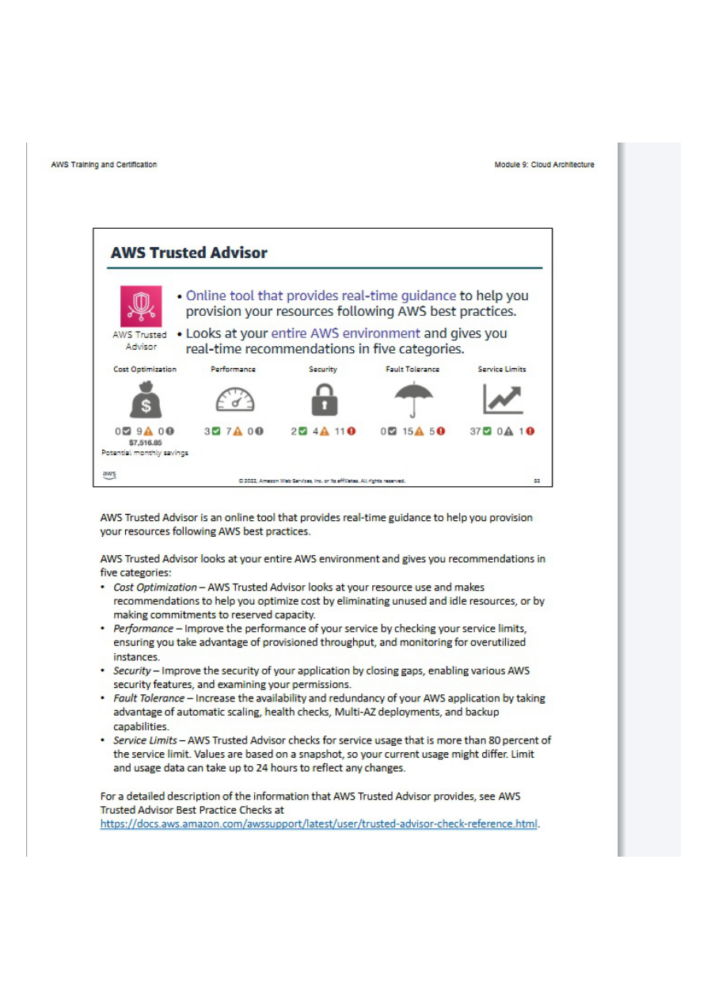

*Página original conservada con sus notas para contextualizar el diagrama; material docente histórico.*

### Actividad: interpretar recomendaciones

`[FUENTE: CA p. 55]`

El ejercicio presenta un panel de Trusted Advisor con cinco categorías y estados de controles. Se pide interpretar una serie de recomendaciones, especialmente alertas de seguridad y tolerancia a fallos.

Para cada recomendación se debe contestar:

1. ¿Cuál es el estado de la comprobación?
2. ¿Qué problema identifica?
3. ¿Qué información concreta se ofrece sobre el entorno afectado?
4. ¿Qué buena práctica se relaciona con el problema?
5. ¿Qué acción recomienda AWS?

**Lectura de indicadores del material:** iconos de diferente color o severidad distinguen comprobaciones correctas, avisos e incidencias que requieren atención. Los recuentos del panel de demostración son datos **de ejemplo**, no resultados de la cuenta del usuario.

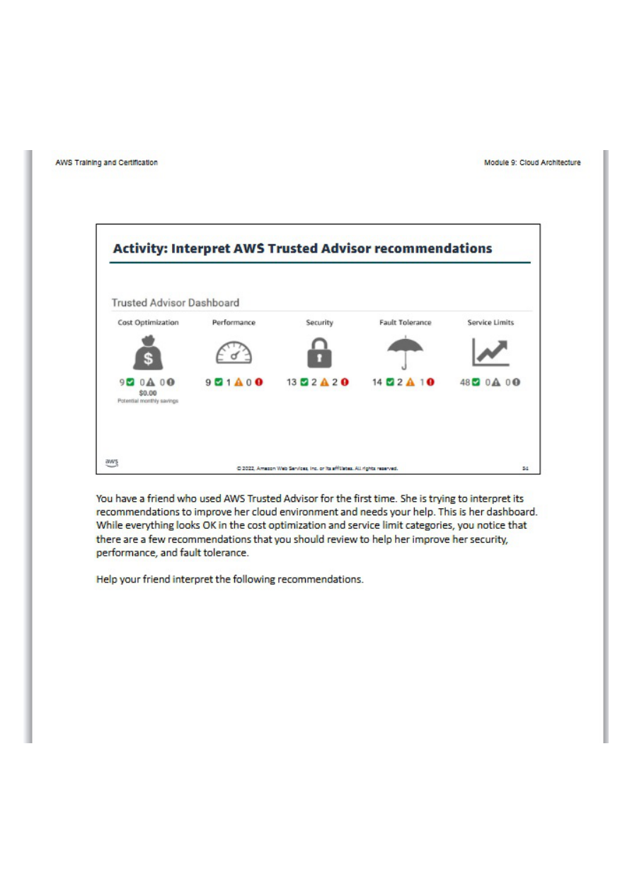

*Página original conservada con sus notas para contextualizar el diagrama; material docente histórico.*

### Recomendación 1 — MFA on Root Account

`[FUENTE: CA p. 56]`

**Problema:** no se ha habilitado **Multi-Factor Authentication (MFA)** en el usuario raíz de una cuenta AWS. Dado que root dispone de privilegios especialmente elevados, el documento recomienda añadir una capa adicional de protección.

- **Estado:** alerta de seguridad.
- **Entorno afectado:** cuenta AWS y usuario root.
- **Buena práctica:** asegurar la cuenta raíz y no utilizarla para las tareas habituales.
- **Acción recomendada:** iniciar sesión como root para activar MFA; utilizar identidades con permisos limitados para operaciones ordinarias.

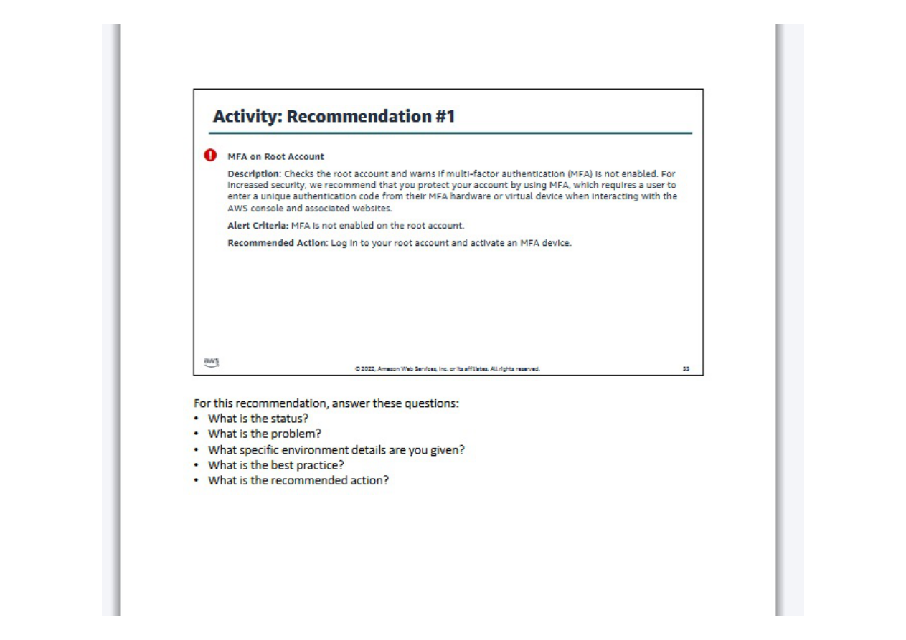

*Página original conservada con sus notas para contextualizar el diagrama; material docente histórico.*

### Recomendación 2 — IAM Password Policy

`[FUENTE: CA p. 57]`

**Problema:** la política de contraseñas de usuarios IAM no está habilitada o no cumple los controles recomendados. El material menciona parámetros de calidad como complejidad, longitud y reglas de actualización.

- **Estado:** advertencia.
- **Entorno afectado:** cuentas de usuario IAM y la configuración de la política de contraseñas.
- **Buena práctica:** definir una política de credenciales coherente y suficientemente protectora, junto con MFA y otros controles de identidad.
- **Acción recomendada:** revisar y configurar la política de contraseñas mediante los ajustes de seguridad de IAM.

`[FUENTE: CA p. 57 — notas cotejadas en la imagen original]`

El ejemplo histórico indica que existe una política, pero al menos un requisito de contenido de contraseña no está habilitado. La diapositiva distingue ese caso del de política inexistente: se revisan requisitos o se crea y configura la política, según corresponda. Sus notas explican que cambiar requisitos se aplica a contraseñas nuevas y no obliga por sí mismo a que todos los usuarios existentes cambien la suya. No debe deducirse una política moderna universal de rotación a partir de este ejemplo de 2022.

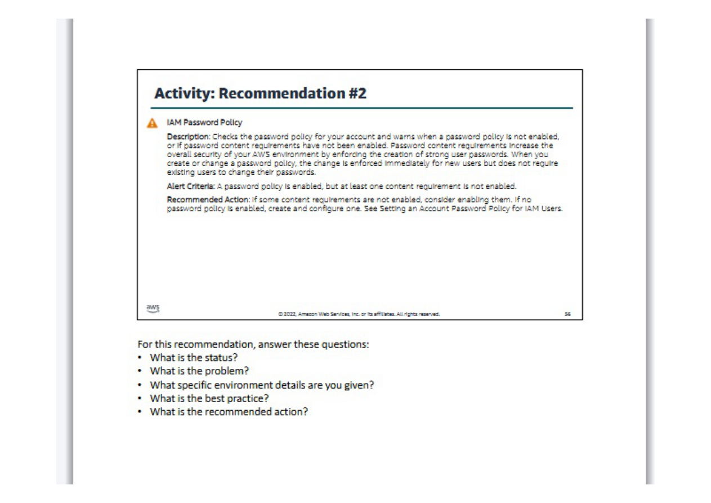

*Página original conservada con sus notas para contextualizar el diagrama; material docente histórico.*

### Recomendación 3 — Security Groups: Unrestricted Access

`[FUENTE: CA p. 58]`

**Problema:** grupos de seguridad permiten acceso entrante demasiado amplio desde Internet a puertos sensibles. Se observa el rango de origen **`0.0.0.0/0`**, que significa **cualquier dirección IPv4**, y en el ejemplo aparecen puertos de administración o servicio.

- **Estado:** rojo / acción requerida.
- **Entorno afectado:** se muestran región, grupo de seguridad, identificador, protocolo, puerto y rango de IP origen.
- **Buena práctica:** principio de mínimo acceso a nivel de red; abrir únicamente los protocolos y destinos necesarios.
- **Acción recomendada:** restringir reglas a direcciones o rangos autorizados; eliminar permisos excesivos.

`[FUENTE: CA p. 58 — notas cotejadas en la imagen original]`

En la tabla del ejercicio aparecen WebServerSG en us-east-1, TCP 22, y DatabaseServerSG en us-west-2, TCP 8080: ambos tienen estado rojo y origen 0.0.0.0/0. El criterio histórico de esta diapositiva alerta ante un origen /0 en puertos distintos de 25, 80 o 443; eso no convierte esos tres puertos en seguros por definición. La acción propone restringir orígenes y retirar las reglas demasiado permisivas después de introducir las nuevas; para una dirección concreta ilustra una máscara /32. Los identificadores están anonimizados, por lo que no deben copiarse como valores reales.

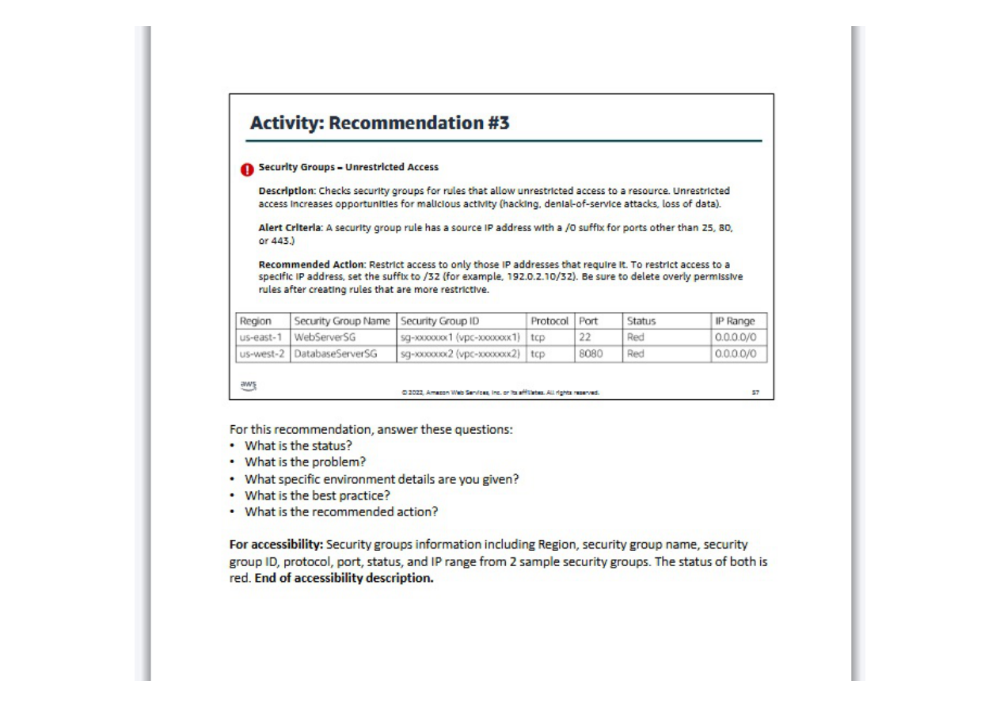

*Página original conservada con sus notas para contextualizar el diagrama; material docente histórico.*

### Recomendación 4 — Amazon EBS Snapshots

`[FUENTE: CA p. 59]`

**Problema:** un volumen de **Amazon Elastic Block Store (EBS)** puede carecer de instantáneas recientes. Las instantáneas permiten disponer de un punto de recuperación del volumen.

- **Estado:** alerta roja en el ejemplo.
- **Entorno afectado:** región, identificador del volumen, nombre, edad de última instantánea y estado de asociación.
- **Buena práctica:** realizar copias de seguridad adaptadas al objetivo de recuperación de la aplicación y comprobar que se puedan utilizar.
- **Acción recomendada:** establecer y ejecutar una programación de instantáneas regulares de los volúmenes relevantes.

**Matiz:** una instantánea de EBS ayuda a recuperar datos, pero no equivale por sí sola a un plan integral de recuperación ante desastres.

`[FUENTE: CA p. 59 — notas cotejadas en la imagen original]`

La comprobación histórica diferencia amarillo para una instantánea reciente de entre 7 y 30 días, rojo para más de 30 días y rojo cuando no existe ninguna. La fila ilustrativa está en us-east-1, identifica My-EBS-Volume y muestra «No snapshot». La recomendación de la diapositiva es crear copias semanales o mensuales; la frecuencia efectiva de una carga debe derivarse de su RPO, retención y necesidades de restauración, no adoptarse automáticamente de este ejemplo. La replicación interna de volúmenes EBS no sustituye una copia que permita volver a un estado anterior.

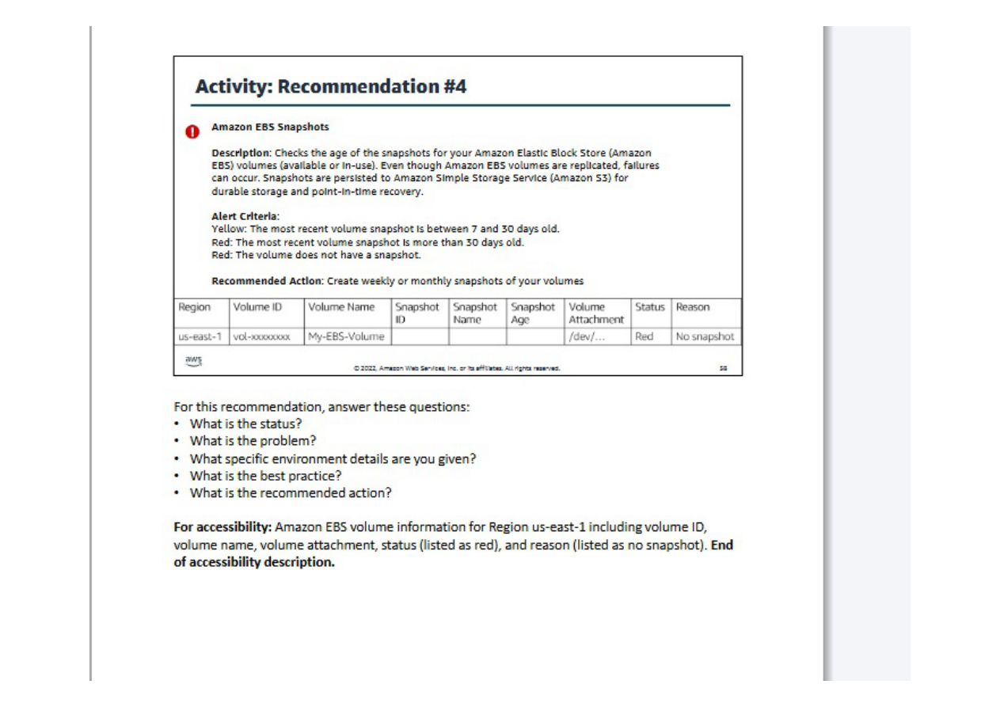

*Página original conservada con sus notas para contextualizar el diagrama; material docente histórico.*

### Recomendación 5 — Amazon S3 Bucket Logging

`[FUENTE: CA p. 60]`

**Problema:** un **bucket de Amazon S3** no tiene habilitado el registro de accesos al servidor (*server access logging*), por lo que no quedan registrados esos detalles de solicitudes según el mecanismo explicado por la diapositiva.

- **Estado:** advertencia amarilla.
- **Entorno afectado:** región, nombre del bucket, destino de logs, propiedad del bucket y estado de escritura/configuración.
- **Buena práctica:** definir registros de acceso y conservar datos necesarios para auditoría y análisis.
- **Acción recomendada:** habilitar el registro de accesos en buckets donde corresponda, configurar un bucket de destino y los permisos adecuados.

**Nota editorial:** no debe confundirse el registro de accesos de S3 con todos los demás mecanismos de auditoría de AWS; existen opciones como eventos de datos de CloudTrail y otros controles con finalidades distintas.

`[FUENTE: CA p. 60 — notas cotejadas en la imagen original]`

En el ejemplo de us-east-2, el bucket my-hello-world-bucket tiene logging sin habilitar y la tabla muestra que no existen el destino, la propiedad compartida ni permisos de escritura configurados. La comprobación histórica marca amarillo si no hay server access logging o si los permisos del destino no permiten a la cuenta propietaria comprobarlo. La acción consiste en habilitar el registro cuando proceda y configurar adecuadamente los permisos del destino. Las notas describen registros de solicitudes, recurso solicitado y momento de procesamiento para auditoría o análisis de uso; su comportamiento debe consultarse en la documentación actual antes de aplicarlo como requisito operativo.

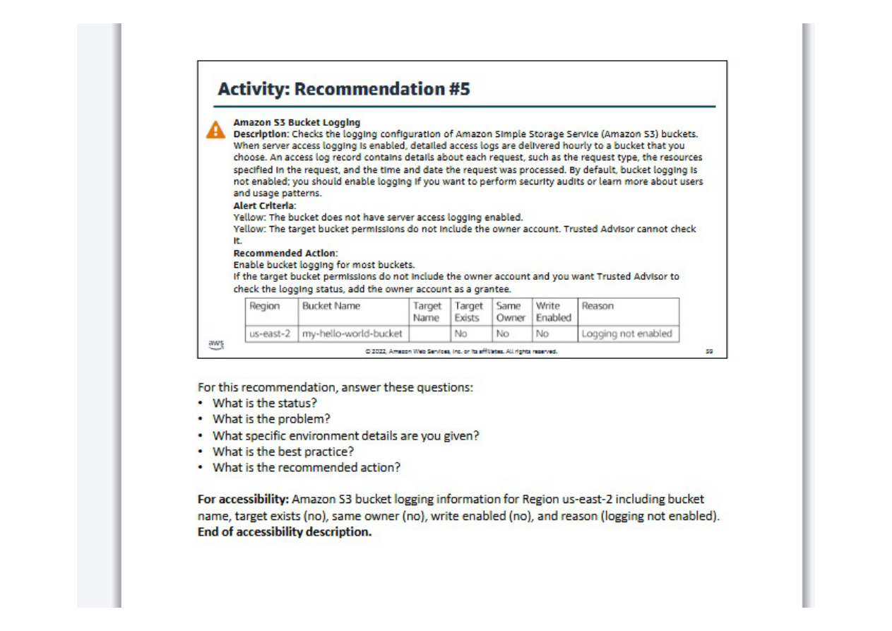

*Página original conservada con sus notas para contextualizar el diagrama; material docente histórico.*

## Cierre, ejercicio de cifrado y recursos

### Ejemplo de pregunta tipo certificación

`[FUENTE: CA p. 65]`

Un profesional de operaciones desea proteger datos tanto **en tránsito** como **en reposo**. El ejercicio propone seleccionar qué servicios pueden ayudar entre un balanceador de carga, Amazon EBS y Amazon S3, además de la opción «todas las anteriores».

La clave del ejercicio es reconocer los requisitos **cifrado/transporte** y **cifrado/almacenamiento**, y que diferentes servicios pueden incorporar controles para proteger datos en sus diferentes etapas.

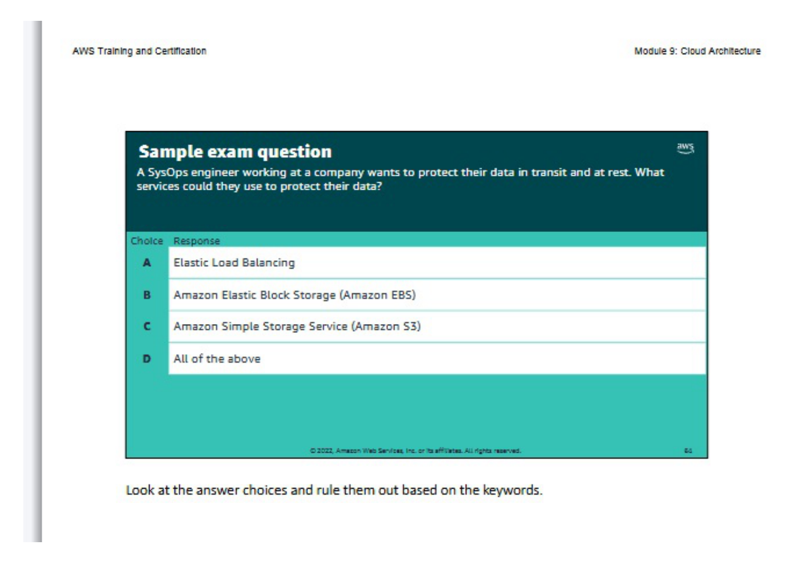

*Página original conservada con sus notas para contextualizar el diagrama; material docente histórico.*

### Respuesta del ejercicio

`[FUENTE: CA p. 66]`

El propio módulo marca como respuesta la **opción D («All of the above»)**. Se debe razonar que **Elastic Load Balancing** puede participar en la protección de tráfico mediante TLS, **Amazon EBS** admite cifrado de volúmenes y **Amazon S3** ofrece cifrado de objetos. Las tres tecnologías no cumplen exactamente la misma función, y la frase «datos en tránsito y en reposo» se refiere al conjunto de necesidades.

*Página original conservada con sus notas para contextualizar el diagrama; material docente histórico.*

### Recursos adicionales

`[FUENTE: CA p. 67]`

La presentación recomienda consultar:

- Documentación/whitepapers de **AWS Well-Architected**: https://docs.aws.amazon.com/wellarchitected/latest/framework/welcome.html
- Laboratorios de Well-Architected: https://wellarchitectedlabs.com/
- Referencia de comprobaciones de **AWS Trusted Advisor**: https://docs.aws.amazon.com/awssupport/latest/user/trusted-advisor-check-reference.html

Los enlaces pueden haber cambiado con el tiempo; son referencias, no contenidos desarrollados dentro del módulo.

## Desarrollo complementario oficial

`[AMPLIACIÓN OFICIAL: documentación enlazada al final de cada apartado; corpus 06]`

### Ampliación oficial: Los seis pilares: significado y diferencias

`[AMPLIACIÓN OFICIAL — CLF-C02, tarea 1.2]`

| Pilar | Pregunta principal | Medidas orientativas |
|---|---|---|
| **Operational Excellence / Excelencia operativa** | ¿Cómo operamos, aprendemos y mejoramos? | Observabilidad, automatización de operaciones, pequeños cambios reversibles y aprendizaje tras incidentes |
| **Security / Seguridad** | ¿Cómo protegemos datos, identidades y sistemas? | Acceso mínimo, cifrado, trazabilidad, defensa en profundidad y respuesta a incidentes |
| **Reliability / Fiabilidad** | ¿Puede funcionar correctamente y recuperarse de fallos? | Redundancia, recuperación automática, pruebas de recuperación y gestión del cambio |
| **Performance Efficiency / Eficiencia del rendimiento** | ¿Aprovechamos bien la tecnología disponible para cumplir el rendimiento requerido? | Tecnología adecuada, monitorización del rendimiento y revisión de alternativas |
| **Cost Optimization / Optimización de costes** | ¿Obtenemos valor sin gastos innecesarios? | Derechos de tamaño, costes por uso, control del gasto y selección de recursos adecuados |
| **Sustainability / Sostenibilidad** | ¿Cómo reducimos el consumo y el impacto ambiental por unidad útil de trabajo? | Medición del impacto, menor capacidad ociosa, servicios gestionados y arquitectura eficiente |

El **AWS Well-Architected Framework** ofrece preguntas y prácticas para evaluar una carga de trabajo desde estos seis puntos de vista. No es un servicio de hosting ni un mecanismo que modifique automáticamente una arquitectura. **AWS Well-Architected Tool** ayuda a revisar, documentar y dar seguimiento a las oportunidades de mejora según el marco. **AWS Trusted Advisor**, en cambio, proporciona comprobaciones y recomendaciones sobre determinados recursos y configuraciones de una cuenta.

**Fuente:** [Definiciones oficiales de los seis pilares](https://docs.aws.amazon.com/es_es/wellarchitected/latest/framework/definitions.html).

### Ampliación oficial: Fiabilidad, disponibilidad y recuperación: conceptos adicionales

La fiabilidad se relaciona con la capacidad de realizar funciones correctamente cuando se necesitan. La disponibilidad es una medida del tiempo en que el servicio está operativo. La recuperación permite restablecer las funciones después de un fallo. Estos conceptos no son idénticos.

La disponibilidad observada se puede aproximar como:

`Disponibilidad = tiempo operativo / tiempo total × 100 %`

**Ejemplos teóricos de indisponibilidad anual máxima** para un año de 365 días (no representan SLA de AWS):

| Disponibilidad | Tiempo no disponible aproximado/año |
|---|---|
| 99 % | 3 días, 15 h y 36 min |
| 99,9 % | 8 h, 45 min y 36 s |
| 99,95 % | 4 h, 22 min y 48 s |
| 99,99 % | 52 min y 33,6 s |
| 99,999 % | 5 min y 15,4 s |

**MTTR (*Mean Time To Repair/Restore*)** es el tiempo medio que tarda una reparación o restauración según la convención usada. **MTTF (*Mean Time To Failure*)** alude al tiempo medio hasta el fallo. **MTBF (*Mean Time Between Failures*)** representa el tiempo medio entre fallos; en un modelo simplificado de sistemas reparables puede aproximarse como `MTBF = MTTF + MTTR`, como ilustran las diapositivas de Cloud Architecture. No aplicar esa igualdad indiscriminadamente a cualquier modelo estadístico o SLA.

Los objetivos **RTO** (*Recovery Time Objective*) y **RPO** (*Recovery Point Objective*) ayudan a expresar las necesidades de recuperación: RTO se refiere al tiempo objetivo para restablecer el servicio, y RPO a la máxima antigüedad de datos/perdida temporal aceptable según el diseño. Ambos se estudian aquí como contexto útil, no como una lista exhaustiva de procedimientos de recuperación.

### Ampliación oficial: AWS Trusted Advisor: actualización necesaria

`[NOTA DE ACTUALIZACIÓN 2026]` El módulo de 2022 presenta **cinco** categorías históricas. La documentación oficial actual de AWS presenta **seis**:

1. Cost Optimization (optimización de costes).
2. Performance (rendimiento).
3. Security (seguridad).
4. Fault Tolerance (tolerancia a fallos).
5. Service Limits / Quotas (límites o cuotas de servicio).
6. **Operational Excellence (excelencia operativa)**.

Trusted Advisor muestra recomendaciones y estados para las comprobaciones disponibles, pero **el número y detalle de verificaciones accesibles pueden variar según los productos y planes contratados**. No es la herramienta que reemplaza Well-Architected Tool.

**Fuente:** [AWS Trusted Advisor — categorías actuales](https://docs.aws.amazon.com/awssupport/latest/user/get-started-with-aws-trusted-advisor.html).

---

## Diagrama editorial de repaso

`[EXPLICACIÓN EDITORIAL]`

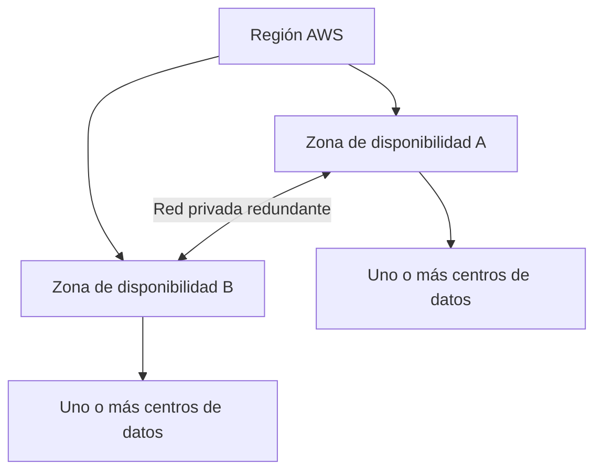

