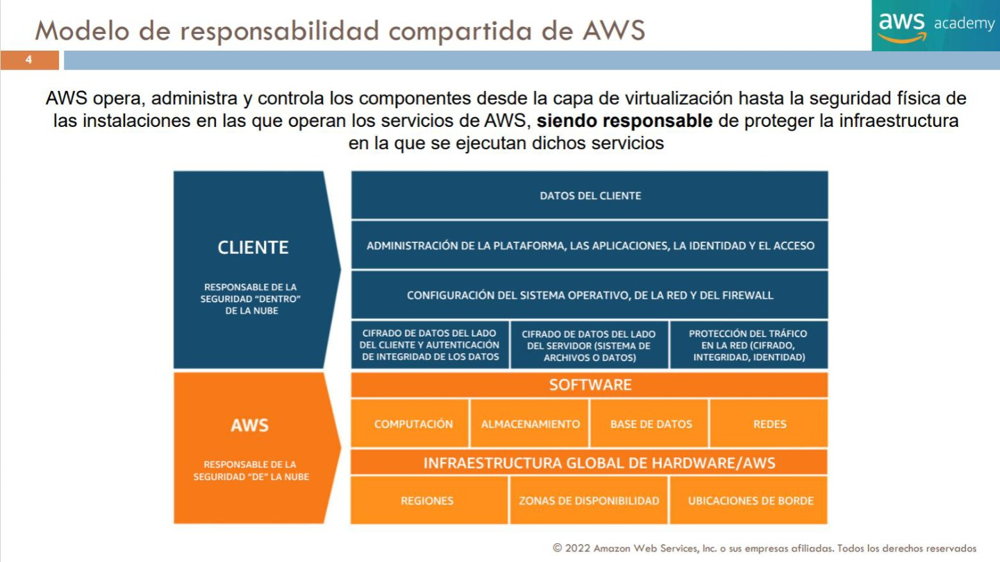
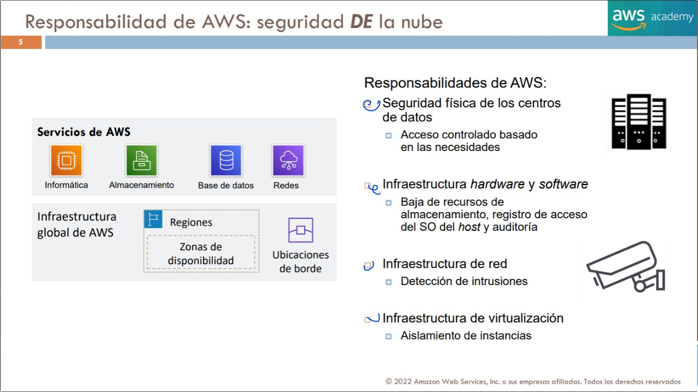
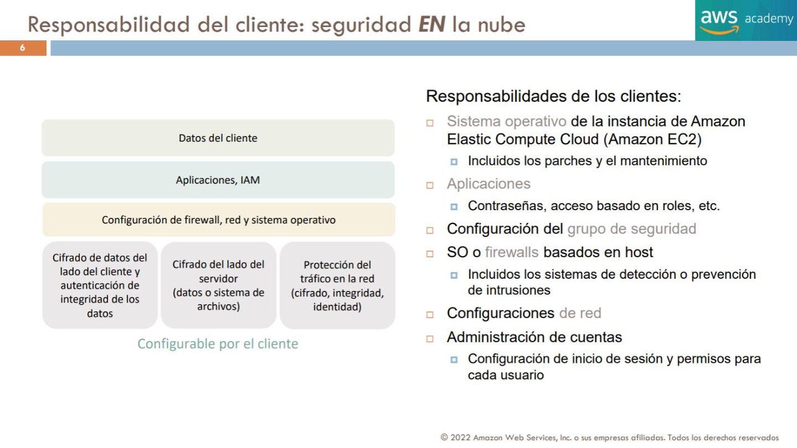
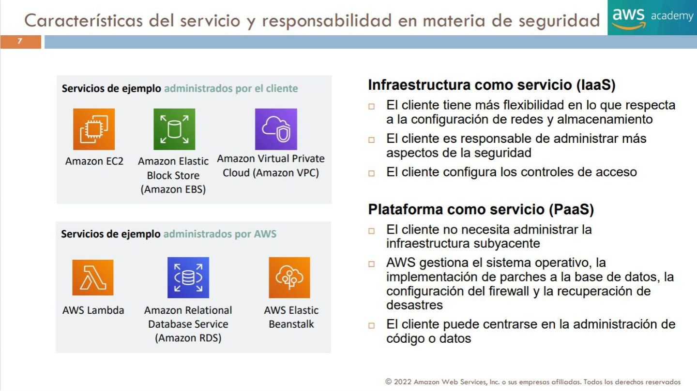
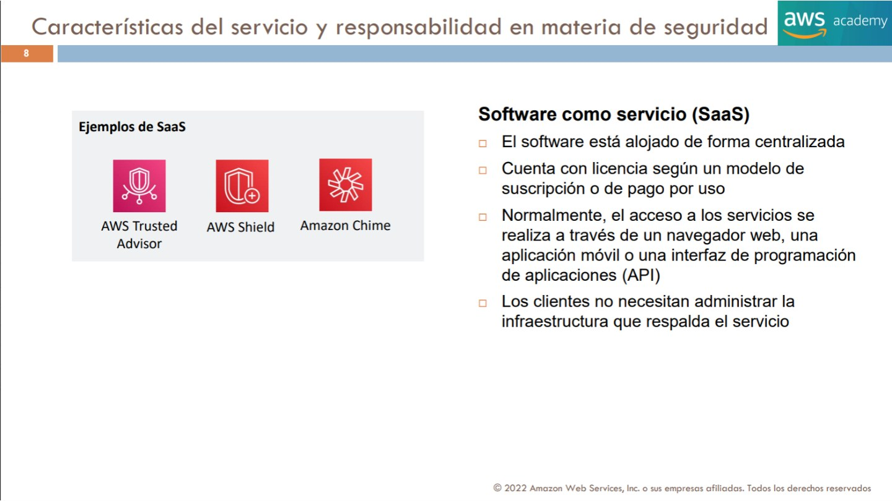
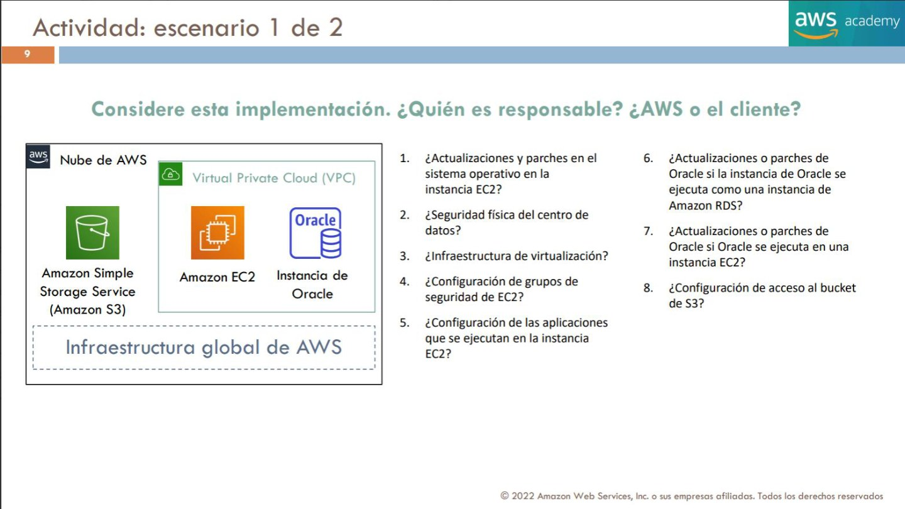
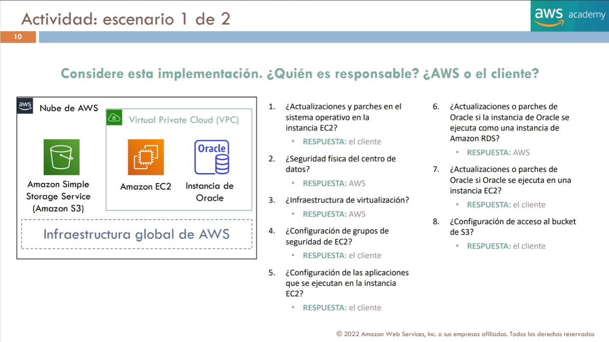
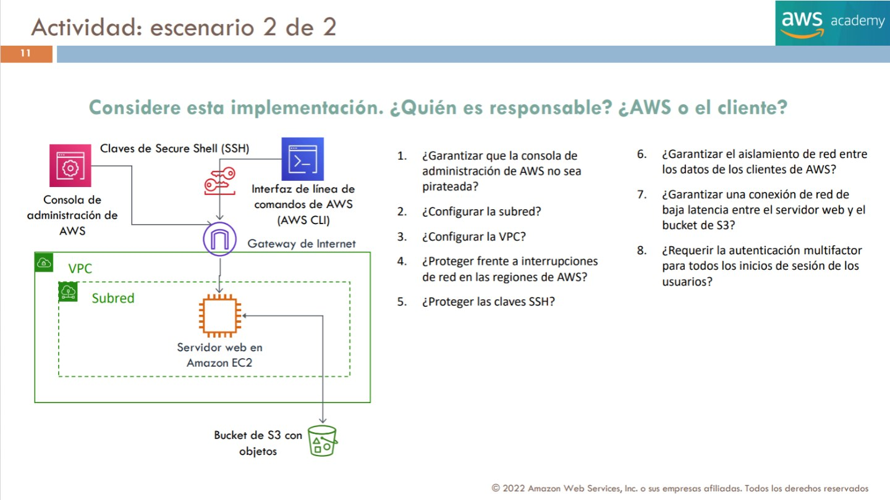
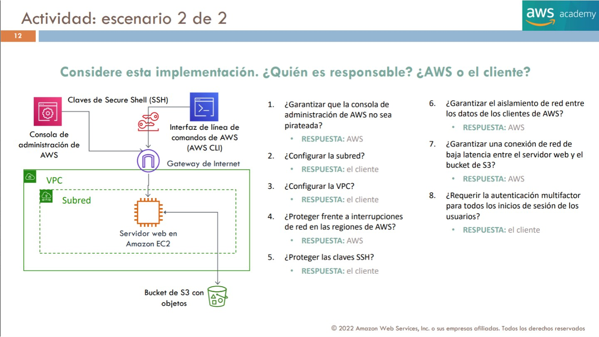

# 05. Modelo de responsabilidad compartida

El modelo de responsabilidad compartida permite responder una pregunta concreta: **¿quién administra y protege cada componente de una solución?** Una aplicación en AWS combina infraestructura operada por el proveedor con decisiones y configuraciones del cliente. Para atribuir una tarea no basta con saber que el dato está «en la nube»: hay que identificar el servicio, la capa y el control del que se habla.

Este capítulo desarrolla la tarea 2.1 del CLF-C02. Al terminar debes poder explicar las obligaciones de AWS, las del cliente y cómo cambian al pasar de una máquina virtual a una base de datos administrada o a una función. Los ejemplos y las dos actividades pertenecen a T3, de 2022; las precisiones actuales se identifican aparte. Las portadas y separadores se registran en la matriz y no interrumpen el estudio.

## 5.1 Seguridad DE la nube y seguridad EN la nube

`[FUENTE: T3 p. 4]`

**Figura central:** diagrama de seguridad «EN la nube» (cliente) y «DE la nube» (AWS). AWS opera, administra y controla desde la capa de virtualización hasta la seguridad física de las instalaciones. Bajo la responsabilidad de AWS aparecen software de cómputo, almacenamiento, bases de datos y redes; infraestructura física global con regiones, zonas de disponibilidad y ubicaciones de borde. En la parte del cliente aparecen datos del cliente; administración de plataforma, aplicaciones, identidad y acceso; configuración del sistema operativo, red y firewall; cifrado de datos del lado del cliente y autenticación/integridad; cifrado de datos del lado del servidor; protección del tráfico de red (cifrado, integridad e identidad). La figura representa responsabilidades configurables por el cliente y no elimina la obligación de éste sobre sus datos.

`[EXPLICACIÓN DIDÁCTICA]` La preposición ayuda a recordar el límite. La seguridad **de** la nube protege la plataforma que AWS presta: edificios, equipos, redes físicas y mecanismos de aislamiento. La seguridad **en** la nube se refiere a lo que el cliente despliega y configura sobre esa plataforma: información, acceso, aplicaciones y controles que el producto pone a su disposición. Una puerta física bien protegida no impide que el cliente publique por error un bucket; un bucket privado tampoco reemplaza la seguridad de las instalaciones.

El dibujo es un mapa de responsabilidades, no una afirmación de que todas las capas superiores recaigan siempre del mismo modo sobre el cliente. En EC2, este administra el sistema operativo invitado. En RDS y Lambda, AWS administra más componentes de plataforma. Sin embargo, el cliente conserva decisiones sobre uso, datos y autorización. Por eso un servicio administrado reduce tareas de infraestructura y al mismo tiempo exige entender las opciones de configuración disponibles.

Una forma de resolver preguntas es reformular el verbo. «Mantener la infraestructura física que proporciona almacenamiento» corresponde al proveedor; «decidir qué identidad puede leer un objeto de una empresa» corresponde al cliente. Ambos enunciados mencionan almacenamiento, pero se refieren a objetos de control diferentes.

## 5.2 Qué protege AWS y qué protege el cliente

`[FUENTE: T3 p. 5]`

La diapositiva agrupa responsabilidades del proveedor en **seguridad física de los centros de datos** (control de accesos basado en necesidad), **hardware y software de infraestructura** (baja/retirada segura de recursos de almacenamiento, registros de acceso del sistema operativo anfitrión y auditoría), **infraestructura de red** (detección de intrusiones) e **infraestructura de virtualización** (aislamiento entre instancias). Los iconos muestran familias de cómputo, almacenamiento, base de datos y redes, además de regiones, AZ y ubicaciones de borde. AWS protege la infraestructura que sostiene los servicios; ello no sustituye los permisos y configuraciones de cada cuenta.

`[FUENTE: T3 p. 6]`

El cliente administra el sistema operativo invitado de una instancia **EC2** —incluyendo parches y mantenimiento—; aplicaciones y sus contraseñas o controles basados en roles; grupos de seguridad; firewalls instalados en el host y, en su caso, detección/prevención de intrusiones; configuraciones de red; usuarios, credenciales, sesiones y permisos de sus cuentas. El diagrama recuerda que los **datos del cliente** y la configuración de protecciones/cifrado siguen bajo su responsabilidad. El reparto preciso cambia con servicios más administrados; no trasladar mecánicamente toda la lista de EC2 a RDS o Lambda.

`[EXPLICACIÓN DIDÁCTICA]` El cliente no entra en un CPD de AWS a cambiar discos ni administra el hipervisor que separa clientes. Puede obtener evidencias e información del proveedor y diseñar la distribución de su carga, pero no sustituye sus controles físicos. En cambio, sí puede abrir excesivamente un puerto, dar permisos innecesarios a un rol, introducir una contraseña en código o elegir una retención insuficiente. Esas decisiones no quedan corregidas automáticamente por el hecho de usar infraestructura protegida.

Conviene distinguir **capacidad del servicio** de **configuración elegida**. Que exista cifrado no demuestra que todas las copias y trayectos de una aplicación estén protegidos como se necesita. Que un servicio permita copias automáticas no demuestra que su política de recuperación cumpla el objetivo de negocio. El cliente necesita clasificar información, asignar acceso, configurar protecciones y verificar que funcionan en su contexto.

### Controles heredados, compartidos y específicos

Un control heredado es una protección que el cliente aprovecha de la infraestructura del proveedor, como los controles físicos del CPD. Un control compartido requiere trabajo de ambas partes, pero sobre ámbitos distintos: AWS mantiene componentes de su plataforma y el cliente mantiene software que instala cuando el servicio le deja esa administración. Un control específico del cliente depende de sus decisiones, como la política de acceso a datos de su negocio.

Compartido no significa que cada tarea se reparta por mitades ni que ambas partes puedan ignorarla esperando que la otra actúe. Deben identificarse responsables, alcance, evidencias y mecanismos de comprobación. En un análisis real se documenta también qué tercero interviene: un fabricante de software puede publicar un parche que el cliente deba aplicar sobre EC2, sin que por ello AWS pase a administrar esa instalación invitada.

## 5.3 Cómo cambia el reparto según el servicio

`[FUENTE: T3 p. 7]`

Para **IaaS** se usan como ejemplos EC2, EBS y VPC: existe mayor flexibilidad al configurar red y almacenamiento, pero el cliente administra más partes de la seguridad y de los controles de acceso. Para **PaaS** la diapositiva presenta AWS Lambda, Amazon RDS y AWS Elastic Beanstalk como ejemplos orientativos de opciones administradas: el cliente no necesita administrar toda la infraestructura subyacente y AWS gestiona más tareas de plataforma como sistema operativo y parches, mientras el cliente continúa gestionando aplicaciones, código y datos. **Nota de precisión:** esta clasificación es didáctica e histórica; Lambda es computación serverless, RDS una base de datos administrada y Beanstalk una plataforma de despliegue, no servicios idénticos.

`[FUENTE: T3 p. 8]`

La diapositiva define SaaS como software alojado centralizadamente, consumido habitualmente por suscripción/pago por uso y accesible por navegador, aplicación móvil o API. Los clientes no administran la infraestructura que respalda ese software. Los iconos utilizados como ejemplos visuales incluyen AWS Trusted Advisor, AWS Shield y Amazon Chime. **Advertencia editorial:** respetar que así aparecen los iconos en el material sin concluir que estos productos equivalgan entre sí ni que todos sean SaaS en la clasificación actual; no memorizar esa asociación como taxonomía oficial.

`[AMPLIACIÓN OFICIAL — corpus 02, A.1]`

La seguridad **de la nube** es responsabilidad de AWS: instalaciones físicas, hardware, infraestructura de red global, hipervisor/virtualización e infraestructura subyacente de los servicios AWS. La seguridad **en la nube** recae en el cliente cuando configura identidades y permisos, protege y clasifica datos, elige cifrado, controla acceso de red, mantiene aplicaciones y administra software que el servicio no gestiona. **Compartida** no significa que una responsabilidad determinada se reparta siempre al 50 %: los límites varían según el producto y los controles.

| Elemento concreto | EC2 (IaaS) | Amazon RDS | AWS Lambda |
|---|---|---|---|
| Instalaciones, infraestructura física e hipervisor | AWS | AWS | AWS |
| SO invitado: instalación y parcheo | **Cliente** | AWS gestiona la base de SO del servicio | AWS gestiona el entorno subyacente admitido |
| Motor de base de datos | Si el cliente instala un motor en EC2, lo mantiene | AWS opera/parchea el motor admitido conforme al servicio; cliente decide versiones y ventanas según opciones | Si la función usa una base externa, depende de ésta |
| Código de aplicación y dependencias propias | Cliente | Cliente (app y consultas; configuración propia de la BBDD) | Cliente (código de función y dependencias aportadas) |
| IAM, usuarios/permisos, clasificación de datos | Cliente | Cliente | Cliente |
| Security Groups y conectividad que configuras | Cliente | Cliente (recursos/configuración asociada) | Cliente donde aplique VPC/configuración |
| Copias, recuperación y retención | Cliente diseña e implementa | AWS ofrece automatismos/opciones; el cliente configura política, retención y pruebas | El cliente diseña copias/estado de servicios asociados |

**Ejemplo de examen:** «¿Quién actualiza Oracle?» Si Oracle se instala en una instancia **EC2**, mantenimiento del motor invitado: **cliente**; si la base se consume como **RDS para Oracle**, AWS administra el parcheo de la plataforma/motor en el marco del servicio, mientras el cliente controla configuraciones, permisos, datos y ciertas opciones de mantenimiento. No confundir gestión del motor con seguridad de los datos.

**Controles heredados, compartidos y propios:** heredado de AWS (control físico del CPD); compartido en la práctica (gestión coordinada de configuración, concienciación o parches, con roles distintos); específico del cliente (políticas sobre datos, identidades, SG, aplicaciones). No se presume que AWS asuma obligaciones legales del negocio al migrar la infraestructura.

**Fuente oficial:** https://aws.amazon.com/compliance/shared-responsibility-model/

### Tres formas de alojar una misma función de negocio

`[EXPLICACIÓN DIDÁCTICA]` Imagina una aplicación que recibe pedidos y consulta una base de datos. Si la aplicación y su motor se instalan en EC2, el equipo administra el sistema operativo invitado, la instalación de la base y la aplicación. Puede decidir versiones y configuraciones con mucho control, pero necesita procesos de parcheo y operación de esas capas.

Si conserva la aplicación y utiliza RDS para la base, delega a AWS las tareas de plataforma y motor que ofrece ese servicio. Aun así, el equipo debe definir los usuarios de base de datos, proteger credenciales, ajustar conectividad, tomar decisiones de mantenimiento disponibles y comprobar la recuperación. La responsabilidad de AWS por el servicio no convierte cualquier consulta o esquema de datos del cliente en seguro.

Si ejecuta parte de la lógica mediante Lambda, deja de administrar directamente los hosts de ejecución. Continúa siendo responsable del código y las dependencias que aporta, de los permisos de su rol, de los datos procesados y del acceso a servicios externos. En modalidades donde el cliente proporciona una imagen o componentes propios, no se debe asumir que AWS mantiene todo su contenido. Para una pregunta conceptual, identifica qué capa proporciona el servicio y cuál introduce el cliente.

| Pregunta de control | Qué revisar para atribuirla |
|---|---|
| ¿Quién parchea este software? | Si pertenece a la plataforma administrada o lo instaló/aportó el cliente |
| ¿Quién autoriza leer este dato? | Políticas, identidades y configuración del recurso del cliente |
| ¿Quién protege el edificio? | Infraestructura física administrada por AWS |
| ¿Quién define recuperación y retención? | El cliente fija requisitos y configura opciones; AWS opera las capacidades que presta |
| ¿Quién asegura la comunicación completa? | AWS protege infraestructura subyacente y el cliente diseña rutas, acceso y cifrado que le corresponden |

## 5.4 Actividad 1: EC2, Oracle, RDS y S3

`[FUENTE: T3 p. 9]`

`[FUENTE: T3 p. 10]`

La figura presenta una VPC con EC2 y Oracle, un bucket S3 y la infraestructura global que los sostiene. El ejercicio introduce expresamente dos ubicaciones posibles para Oracle: una base de datos consumida como servicio RDS y una instalación en EC2. Intenta asignar las ocho tareas antes de consultar la explicación.

| Nº | Pregunta de la actividad | Clave del curso | Por qué y qué matiz conservar |
|---:|---|---|---|
| 1 | ¿Quién aplica actualizaciones y parches al sistema operativo de una instancia EC2? | Cliente | Es el SO invitado que administra en esa máquina virtual; AWS mantiene la infraestructura anfitriona. |
| 2 | ¿Quién protege físicamente el centro de datos? | AWS | El acceso al edificio, su seguridad y la infraestructura física pertenecen al proveedor. |
| 3 | ¿Quién protege la infraestructura de virtualización? | AWS | El cliente consume instancias y no administra el hipervisor que proporciona el servicio. |
| 4 | ¿Quién configura los Security Groups de EC2? | Cliente | El cliente decide reglas y asociaciones permitidas según su arquitectura. |
| 5 | ¿Quién configura las aplicaciones ejecutadas en EC2? | Cliente | Instalar en AWS no transfiere la configuración del software propio al proveedor. |
| 6 | ¿Quién actualiza y parchea Oracle cuando se consume como instancia de Amazon RDS? | AWS | El motor forma parte del servicio administrado dentro de sus condiciones; el cliente mantiene datos, accesos y las opciones de mantenimiento que le correspondan. |
| 7 | ¿Quién actualiza y parchea Oracle cuando está instalado en EC2? | Cliente | Es software invitado instalado en la máquina que administra el cliente, aunque el fabricante publique los parches. |
| 8 | ¿Quién configura el acceso al bucket S3? | Cliente | AWS opera el almacenamiento; el cliente controla políticas y opciones de acceso a sus datos. |

`[EXPLICACIÓN DIDÁCTICA]` Las preguntas 6 y 7 cambian una sola condición —el servicio que aloja el motor— y con ella cambia quién lo mantiene. No concluyas «las bases de datos siempre las parchea AWS» ni «Oracle siempre lo parchea el cliente». La respuesta correcta empieza por ubicar el componente. En S3 ocurre una separación parecida: no administrar discos no elimina la decisión sobre quién puede leer sus objetos.

Para razonar la pregunta 4, separa las reglas del servicio de red de la red física. AWS mantiene la implementación que permite aplicar Security Groups; el cliente selecciona las reglas de sus recursos. Confundir esos dos niveles llevaría a atribuir a AWS cualquier exposición causada por una configuración del cliente.

## 5.5 Actividad 2: consola, claves SSH y conectividad

`[FUENTE: T3 p. 11]`

`[FUENTE: T3 p. 12]`

El segundo esquema incorpora consola y CLI, claves SSH, un Internet Gateway, una VPC con subred y servidor web EC2, y un bucket S3. Conservamos las ocho preguntas y sus claves históricas. El verbo «garantizar» pertenece al enunciado didáctico: se interpreta como ámbito de responsabilidad, no como promesa de invulnerabilidad o ausencia absoluta de interrupciones.

| Nº | Pregunta de la actividad | Clave del curso | Interpretación y límites |
|---:|---|---|---|
| 1 | ¿Quién garantiza que el servicio de consola de administración no sea pirateado? | AWS | La clave se refiere a proteger la plataforma de consola. El cliente debe proteger sus identidades, dispositivos, sesiones y métodos de recuperación. |
| 2 | ¿Quién configura la subred? | Cliente | Define su red lógica y sus decisiones de conectividad dentro de las posibilidades del servicio. |
| 3 | ¿Quién configura la VPC? | Cliente | Decide rangos, subredes, rutas y controles de su entorno. La infraestructura que implementa VPC es de AWS. |
| 4 | ¿Quién protege frente a interrupciones de la infraestructura de red de las regiones AWS? | AWS | El proveedor opera esa infraestructura. El cliente debe diseñar la disponibilidad de su aplicación y sus dependencias. |
| 5 | ¿Quién protege las claves SSH? | Cliente | Custodia el material privado y administra quién puede utilizarlo para acceder al sistema invitado. |
| 6 | ¿Quién garantiza el aislamiento de red entre datos de distintos clientes AWS? | AWS | Es un control de separación de la infraestructura multiinquilino del proveedor. Las autorizaciones dentro de la cuenta siguen siendo del cliente. |
| 7 | ¿Quién garantiza una conexión de baja latencia entre el servidor web y el bucket S3? | AWS, bajo el supuesto de la lámina | El curso atribuye la red subyacente al proveedor. La latencia de extremo a extremo también depende de región, ruta, carga, clientes y recursos elegidos; no hay garantía universal de cualquier configuración. |
| 8 | ¿Quién exige MFA para los inicios de sesión de sus usuarios? | Cliente | Debe configurar y gobernar la autenticación de sus identidades, aunque el proveedor implemente los mecanismos disponibles. |

`[EXPLICACIÓN DIDÁCTICA]` Las preguntas 1 y 8 no se contradicen. Una trata el servicio que ofrece la pantalla de acceso y la otra la política de autenticación que el cliente aplica a su organización. De forma similar, la pregunta 6 no implica que AWS determine los permisos de cada empleado de la empresa: aislamiento entre clientes y autorización dentro de una cuenta son planos diferentes.

La clave privada SSH tampoco es una access key de AWS. Ambas son credenciales y necesitan protección, pero sirven para mecanismos distintos. SSH autentica ante el sistema remoto; una access key permite firmar solicitudes a API AWS. Cambiar una regla de IAM no sustituye automáticamente la administración del acceso SSH del sistema invitado.

## 5.6 Cómo resolver nuevos escenarios de responsabilidad

`[EXPLICACIÓN DIDÁCTICA]` Para una pregunta nueva, aplica una secuencia de análisis: identifica el servicio, localiza el componente, determina quién lo administra y distingue protección de infraestructura de configuración del uso. Después comprueba si la pregunta habla de una capacidad ofrecida o de su aplicación a datos concretos. Esta secuencia evita responder solo por palabras como «seguridad», «parches» o «red».

Un ejemplo adicional sería «se almacenó información sensible en un bucket con una política demasiado amplia». El hecho de que el disco físico y la plataforma estén protegidos no resuelve el permiso excesivo: debe corregirse la configuración. Otro ejemplo sería «una función contiene una dependencia vulnerable aportada por el equipo»: usar serverless no vuelve ajeno ese software. Estos ejemplos son didácticos y no son preguntas adicionales del banco de la aplicación.

Para repasar, explica con tus palabras por qué dos soluciones con el mismo dato y el mismo objetivo de negocio pueden repartir de forma diferente las tareas de mantenimiento. Después vuelve a las 16 respuestas de las actividades y comprueba que puedes defender cada una sin memorizar únicamente «AWS» o «cliente».

## Referencias y continuación

- [Modelo oficial de responsabilidad compartida](https://aws.amazon.com/compliance/shared-responsibility-model/).
- [Objetivo 2.1 de la guía CLF-C02](https://docs.aws.amazon.com/aws-certification/latest/cloud-practitioner-02/cloud-practitioner-02-domain2.html).
- Continúa con [Identidad, acceso y protección de cuentas](06_identidad_y_acceso.md), donde se desarrolla qué significa proteger y autorizar esas identidades.
- Los términos se reúnen en el [glosario de seguridad](08_glosario_integral_seguridad.md).
