# 06. Identidad, acceso y protección de cuentas

La seguridad de identidad responde a dos preguntas distintas: **¿quién solicita acceso?** y **¿qué puede hacer esa identidad?** Un inicio de sesión correcto no autoriza cualquier operación. Una política que permite leer un bucket tampoco revela por sí misma quién debe recibir esas credenciales. Este capítulo conecta autenticación, autorización, delegación y gobierno de cuentas con los objetivos 2.3 y parte de 2.2 del CLF-C02.

Las fuentes T3 enseñan IAM desde pantallas y prácticas de 2022. Conservamos sus ejemplos, pero el acceso humano recomendado actualmente se explica mediante federación, IAM Identity Center y credenciales temporales. Los ejemplos de políticas son para interpretación: los identificadores ficticios no describen recursos reales y los documentos no se presentan como una política lista para desplegar.

<a id="seccion-6-1"></a>

## 6.1 IAM: identidades, recursos y acciones


<a id="t3-p14"></a>

`[FUENTE: T3 p. 14]`

IAM permite administrar **quién puede acceder** a los recursos AWS, **a cuáles** y **cómo/qué puede hacer**. Un recurso es una entidad de una cuenta, como una instancia EC2 o un bucket S3. Ejemplo de autorización: determinar quién puede detener instancias EC2; no basta con que el usuario haya iniciado sesión. La diapositiva señala que IAM como función de gestión de permisos no tiene cargo de servicio propio, aunque los recursos que se administren sí puedan facturarse. Distinguir autenticación (identidad) y autorización (acciones permitidas).

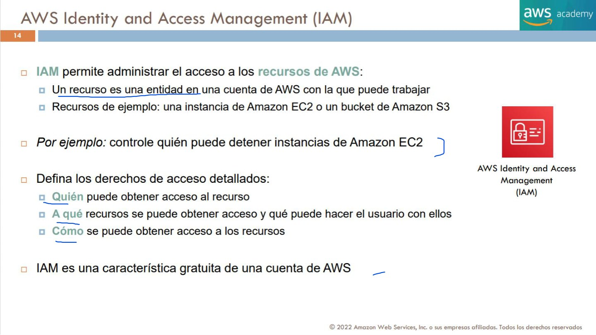


<a id="t3-p15"></a>

`[FUENTE: T3 p. 15]`

**Usuario IAM:** entidad que representa una persona o aplicación que puede autenticarse en una cuenta; **grupo IAM:** conjunto de usuarios que comparten autorizaciones; **política IAM:** documento que especifica recursos, acciones y nivel de acceso, con capacidad de denegación explícita; **rol IAM:** identidad asumible que concede un conjunto de permisos **temporalmente**. Las entidades no son sinónimos: un grupo agrupa usuarios, mientras un rol se asume y proporciona credenciales de sesión temporales.

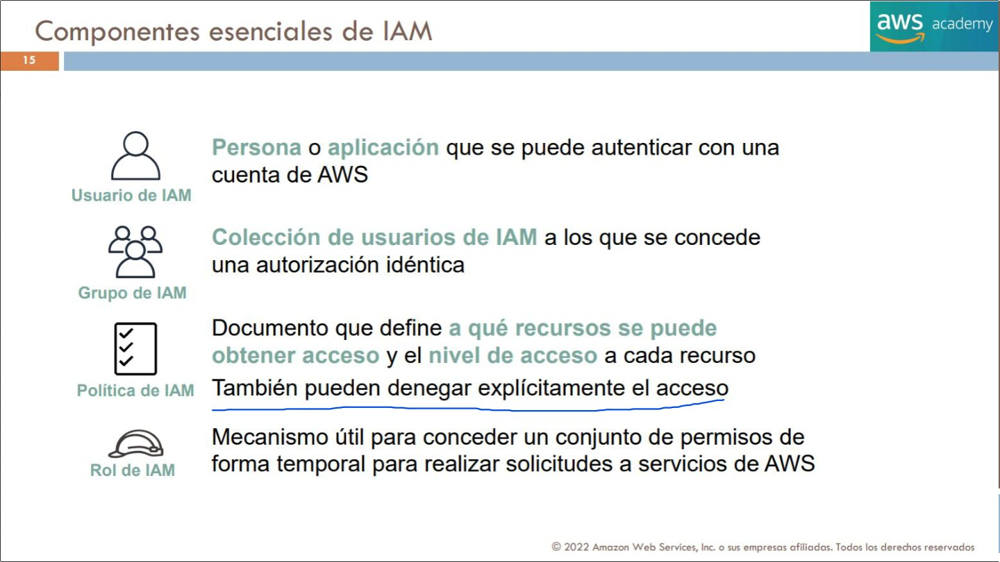


`[EXPLICACIÓN DIDÁCTICA]` **Autenticación** comprueba la identidad de quien se presenta, por ejemplo mediante un proveedor de identidad, una sesión autenticada y MFA cuando proceda. **Autorización** evalúa una solicitud concreta: una identidad intenta una acción sobre un recurso bajo determinadas condiciones. Una persona puede autenticarse correctamente y recibir `AccessDenied` al intentar eliminar una instancia porque esa operación no está permitida.

El **principal** es la identidad o entidad que realiza la solicitud en el contexto de autorización. El **recurso** es el objeto al que se dirige, como un bucket, un objeto o una instancia. La **acción** expresa la operación del servicio, como leer un objeto. La **política** describe concesiones, denegaciones y, cuando se utiliza, condiciones. Entender estas piezas evita describir IAM como un simple listado de usuarios.

| Entidad | Función | Qué no debe suponerse |
|---|---|---|
| Usuario IAM | Identidad persistente dentro de una cuenta, con credenciales configurables | No es la única ni la opción preferida universal para acceso humano |
| Grupo IAM | Conjunto de usuarios IAM que comparte políticas | No inicia sesión, no es una OU y no se asume como un rol |
| Rol IAM | Identidad asumible para obtener una sesión con permisos | No es una contraseña compartida y no necesita claves permanentes propias |
| Política | Documento de autorización asociado a identidades o recursos admitidos | No toda política concede: una denegación y una SCP tienen efectos diferentes |

El nombre del usuario no garantiza sus permisos. Llamar «administrador» a una identidad o añadirla a una estructura visual no equivale a conceder derechos. Son las políticas pertinentes, las condiciones y los límites aplicables los que determinan el resultado efectivo. El mismo cuidado se aplica a una cuenta: crear una OU con nombre «Producción» no configura por sí solo controles de producción.

<a id="seccion-6-2"></a>

## 6.2 Acceso a consola, acceso programático y MFA


<a id="t3-p16"></a>

`[FUENTE: T3 p. 16]`

La diapositiva distingue **acceso programático** mediante ID de clave de acceso y clave secreta para CLI/SDK y **acceso a consola** con identificador/alias de cuenta, nombre de usuario y contraseña; con MFA habilitado se solicita otro factor. Estos son mecanismos mostrados en el curso de 2022, no una recomendación actual de crear claves permanentes. Ampliación oficial debe explicar IAM Identity Center y credenciales temporales como opciones preferidas para acceso humano y de cargas.

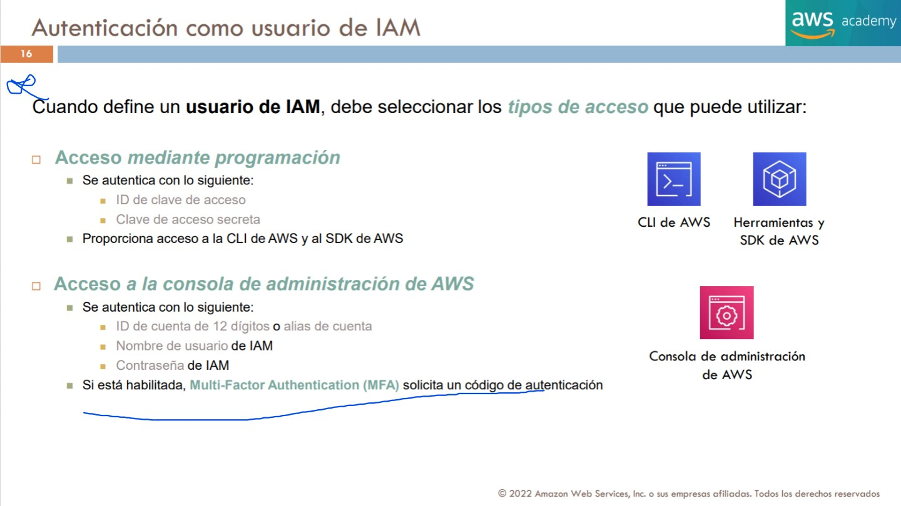


<a id="t3-p17"></a>

`[FUENTE: T3 p. 17]`

MFA aumenta la protección al exigir, además del usuario y contraseña, un código o factor de autenticación único. Se muestran una pantalla de acceso y el flujo hacia la consola, aplicaciones autenticadoras compatibles (ejemplo histórico: Google Authenticator) y dispositivos MFA físicos. La autenticación adicional reduce el riesgo de una contraseña comprometida, pero no sustituye mínimo privilegio, protección de credenciales, revisión de sesiones o recuperación segura.

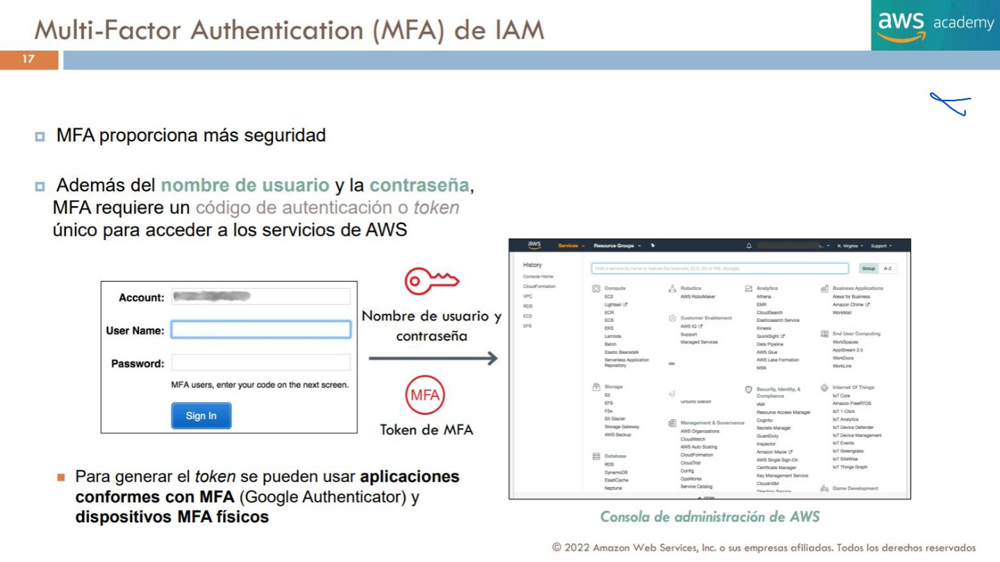


`[EXPLICACIÓN DIDÁCTICA]` La consola ofrece interacción visual, la CLI comandos y el SDK bibliotecas de programación. Son vías técnicas de acceso; el mecanismo de credenciales disponible depende de la identidad y la sesión. Un SDK puede utilizar credenciales temporales de un rol y una CLI puede iniciar una sesión federada. No debe deducirse «usar CLI implica crear una access key permanente» a partir de una pantalla histórica del curso.

Una credencial programática de larga duración suele incluir un identificador de clave y un secreto. El identificador no basta para firmar correctamente una solicitud; el secreto exige custodia. Las credenciales temporales añaden un token de sesión y caducidad. Ni las claves permanentes ni las temporales deben copiarse a ejemplos públicos o repositorios. La aplicación debe obtenerlas por los mecanismos admitidos y limitar los permisos de la identidad que representan.

MFA combina factores de categorías distintas. Reduce el riesgo de que una contraseña comprometida baste para acceder, pero no hace inocuo un permiso excesivo ni corrige una sesión robada o una configuración pública. También se necesitan políticas de acceso, protección de dispositivos y recuperación de cuenta. Un mecanismo de MFA puede ser relevante para iniciar una sesión; las condiciones que exigen MFA en operaciones concretas deben diseñarse según el tipo de identidad y las capacidades de la API.


`[AMPLIACIÓN OFICIAL — corpus 02, C.2]`

**AWS IAM Identity Center:** acceso centralizado de personal a cuentas AWS y determinadas aplicaciones empresariales; facilita asignar conjuntos de permisos y acceso federado/SSO. **Amazon Cognito** se orienta a identidades y login de usuarios de aplicaciones web/móviles. **IAM** resuelve autorización sobre recursos AWS. Estos productos son complementarios, no alternativas indistinguibles.

**Federación** permite acceder a AWS empleando identidades administradas por otro proveedor de identidad, con mecanismos como SAML/OIDC según servicio; **roles entre cuentas** permiten delegación controlada con política de confianza y permisos del rol. **MFA** añade factor adicional además de contraseña/credencial principal. Las claves de acceso a largo plazo (access key ID y secret) implican riesgos: cuando sea viable, usar roles/credenciales temporales y no distribuir credenciales raíz.

Fuentes: https://docs.aws.amazon.com/singlesignon/latest/userguide/what-is.html ; https://docs.aws.amazon.com/IAM/latest/UserGuide/id_roles.html ; https://docs.aws.amazon.com/IAM/latest/UserGuide/best-practices.html


### Identity Center, federación y Cognito resuelven públicos distintos

`[EXPLICACIÓN DIDÁCTICA]` **IAM Identity Center** se orienta al acceso de trabajadores a cuentas y aplicaciones asignadas. El equipo administra identidades o integra un proveedor externo y asigna acceso mediante conjuntos de permisos. La experiencia de SSO centraliza el inicio de sesión; no significa que todas las cuentas tengan los mismos permisos ni que una autenticación válida ignore las políticas de la cuenta de destino.

**Federación** permite confiar en identidades gestionadas por otro sistema en lugar de crear necesariamente una contraseña IAM por cada persona. El proveedor de identidad autentica al usuario y el acceso a AWS se materializa mediante mecanismos y sesiones compatibles. Protocolos como SAML y OIDC cumplen funciones en integraciones concretas; no son intercambiables en cualquier pantalla o servicio.

**Amazon Cognito** responde a necesidades de usuarios de aplicaciones, por ejemplo el registro e inicio de sesión de clientes de una web o móvil. Es un público diferente del equipo de operaciones que administra cuentas AWS. La aplicación todavía necesita decidir qué acciones de negocio permite a cada usuario y cómo accede a sus servicios subyacentes.

<a id="seccion-6-3"></a>

## 6.3 Autorización y tipos de política


<a id="t3-p18"></a>

`[FUENTE: T3 p. 18]`

Esquema: un usuario, grupo o rol consulta las **políticas de IAM**; el acceso puede ser completo sobre las instancias EC2 de un ejemplo y solo de lectura sobre un bucket S3. La pregunta «una vez conectado, ¿qué puede hacer?» diferencia el resultado de autenticación del proceso de autorización. Los permisos son específicos de acciones y recursos, no un permiso genérico de «entrar a AWS».

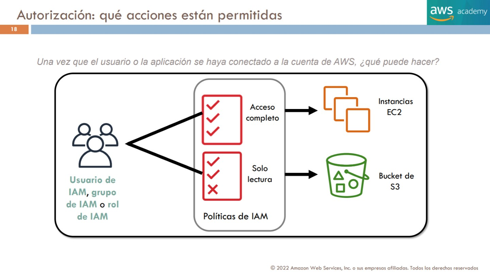


<a id="t3-p19"></a>

`[FUENTE: T3 p. 19]`

Los permisos pueden asignarse mediante creación de una política o selección de una política existente, incluidas políticas administradas por AWS. **Por defecto, los accesos se deniegan implícitamente** si no existe una concesión; **la denegación explícita prevalece** sobre una concesión. Se destaca el principio de **mínimo privilegio** y que IAM es un servicio con alcance global de cuenta, aunque las políticas puedan hacer referencia a recursos regionales. Completar la explicación con otros tipos de políticas y límites de permisos cuando sea necesario.

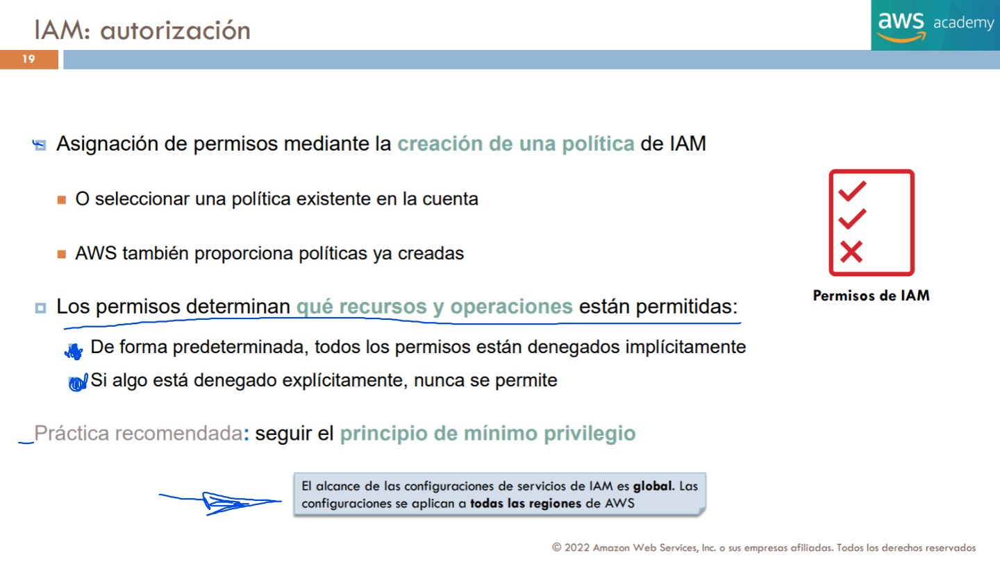


<a id="t3-p20"></a>

`[FUENTE: T3 p. 20]`

Política IAM = documento JSON que define permisos. **Basadas en identidad:** asociadas a usuarios, grupos o roles; pueden ser administradas (reutilizables) o insertadas/inline (incorporadas a una entidad concreta). Las políticas especifican lo que puede o no puede hacer una identidad. **Basadas en recursos:** asociadas al propio recurso (por ejemplo, bucket S3), establecen principals/autorizaciones sobre el recurso; no son válidas universalmente para todo servicio. En una política pueden aparecer `Effect`, `Action`, `Resource` y condiciones; para CLF-C02 interesa interpretar, no dominar sintaxis avanzada.

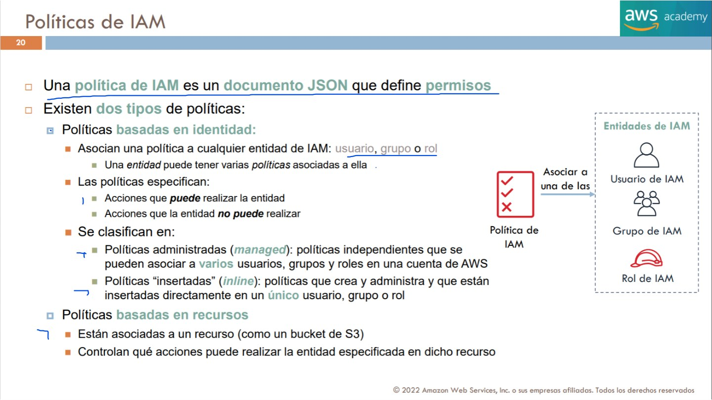


`[EXPLICACIÓN DIDÁCTICA]` Una política administrada es un objeto reutilizable que se puede asociar a entidades compatibles. Puede ser administrada por AWS o por el cliente. Una política inline se incorpora a una identidad concreta. La diferencia es de administración y ciclo de vida, no una garantía de que una sea siempre más segura: una política muy amplia sigue siendo amplia aunque se gestione como objeto reutilizable.

En una **política basada en identidad**, la asociación indica a qué identidad se aplican los permisos. En una **política basada en recurso**, el propio recurso admitido publica reglas de acceso y puede especificar principales. Por ejemplo, una bucket policy de S3 permite expresar quién puede actuar sobre ese bucket y bajo qué condiciones. No todos los servicios implementan todos los tipos de política de la misma forma.


`[AMPLIACIÓN OFICIAL — corpus 02, C.1]`

**Usuario IAM:** identidad tradicional de cuenta con posibles credenciales a largo plazo; **grupo IAM:** colección de usuarios que comparten políticas, no admite subgrupos ni miembros que sean roles; **rol IAM:** identidad que asumen personas, aplicaciones o servicios para obtener credenciales **temporales**; **política IAM:** documento JSON de acciones y recursos `Allow`/`Deny`, con posibles condiciones. **Política gestionada** es reutilizable; **inline** se incrusta en una entidad concreta; **política basada en recurso** se adjunta al recurso admitido y puede designar quién accede.

Los permisos se evalúan con **denegación implícita** de partida, **concesión explícita** cuando corresponda y **Deny explícito prioritario**. El diagrama T3 p.23 es una simplificación: en la práctica intervienen políticas de identidad y recurso, SCP, RCP, permission boundaries, políticas de sesión, condiciones y evaluación entre cuentas; una `Allow` aislada no garantiza acceso si otro control lo bloquea.

**Ejemplo mínimo de mínimo privilegio:** aplicación de informes que necesita leer solo objetos del bucket `ventas-reportes` debe tener únicamente acciones de lectura pertinentes y el ARN de ese bucket/objetos. No se necesita `s3:*` ni `AdministratorAccess` para la tarea. No incrustar secretos permanentes en código EC2 cuando pueda asumirse rol.

Fuentes: https://docs.aws.amazon.com/IAM/latest/UserGuide/introduction.html ; https://docs.aws.amazon.com/IAM/latest/UserGuide/reference_policies_evaluation-logic.html


### Denegación implícita y explícita

La denegación implícita expresa que no se ha encontrado una concesión aplicable que baste para permitir la solicitud en su contexto. Una denegación explícita es una regla `Deny` que coincide con esa solicitud y prevalece sobre concesiones pertinentes. Añadir otra política `Allow` no neutraliza ese `Deny`. Para resolver un problema se debe examinar qué política coincide, su alcance y las condiciones evaluadas.

No conviertas esta explicación en una suma indiscriminada de todos los documentos. Algunas capas conceden y otras limitan. Una permission boundary limita el máximo que puede otorgar una política de identidad, una SCP delimita permisos en su ámbito organizativo y una política de sesión puede restringir una sesión. El efecto de una política de recurso puede depender del principal especificado y del escenario. CLF-C02 requiere reconocer esas ideas y no implementar un evaluador completo.

<a id="seccion-6-4"></a>

## 6.4 Ejemplo de T3 p.21: Allow, Deny y NotResource


<a id="t3-p21"></a>

`[FUENTE: T3 p. 21]`

La diapositiva presenta JSON con `Version: 2012-10-17`, lista `Statement`, efecto **Allow** para acciones como `dynamodb:*` y `s3:*` sobre una tabla DynamoDB y ciertos buckets/objetos S3, y efecto **Deny** con `NotResource` para impedir que esas operaciones se apliquen fuera de la lista indicada. Flechas explican qué ARN representa tabla, bucket y objetos, y la prioridad de una **denegación explícita** ante cualquier permiso. No copiar nombres de cuentas ficticios como si fuesen ARN operativos. La lección es la evaluación de Allow/Deny, el alcance de recursos y que un `NotResource` cambia la interpretación del conjunto al que afecta el statement.

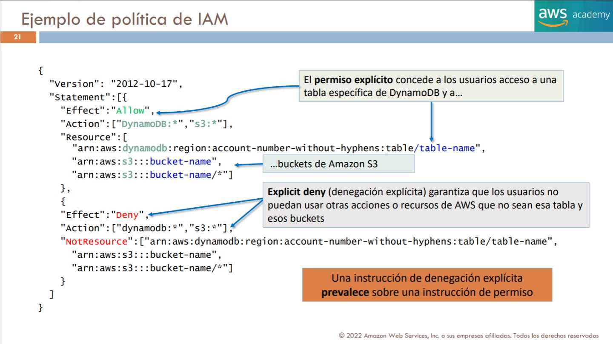


La figura original es la referencia para los nombres y flechas. A continuación se reproduce su **patrón lógico**, con nombres ficticios de estudio, prefijos de acción normalizados y ARN coherentes. No es una transcripción de una cuenta real ni una recomendación de otorgar comodines amplios:

```json
{
  "Version": "2012-10-17",
  "Statement": [
    {
      "Effect": "Allow",
      "Action": ["dynamodb:*", "s3:*"],
      "Resource": [
        "arn:aws:dynamodb:eu-west-1:111122223333:table/tabla-ejemplo",
        "arn:aws:s3:::bucket-ejemplo",
        "arn:aws:s3:::bucket-ejemplo/*"
      ]
    },
    {
      "Effect": "Deny",
      "Action": ["dynamodb:*", "s3:*"],
      "NotResource": [
        "arn:aws:dynamodb:eu-west-1:111122223333:table/tabla-ejemplo",
        "arn:aws:s3:::bucket-ejemplo",
        "arn:aws:s3:::bucket-ejemplo/*"
      ]
    }
  ]
}
```

`[EXPLICACIÓN DIDÁCTICA]` El primer statement intenta conceder acciones de los dos servicios sobre los recursos enumerados cuando las acciones admiten esos tipos de recurso. El segundo aplica una denegación para las acciones indicadas cuando el recurso queda fuera del conjunto de excepciones. **NotResource no significa «denegar los recursos de la lista»**, sino invertir el conjunto al que afecta ese statement.

El ARN de bucket y el ARN de sus objetos son distintos. `arn:aws:s3:::bucket-ejemplo` identifica el bucket; añadir `/*` identifica objetos bajo él. Una operación que actúa sobre un bucket no puede darse por autorizada únicamente por referenciar objetos, y viceversa. Además, algunas operaciones requieren otros tipos de recurso o no permiten acotarse así. El ejemplo sirve para razonar alcance, no para afirmar que autoriza correctamente cualquier operación de cada servicio.

Hay otra precisión importante: ese `Deny` solo contiene acciones `dynamodb:*` y `s3:*`. No deniega por sí mismo todas las acciones de EC2 o de cualquier otro servicio. La flecha explicativa de la diapositiva simplifica el resultado; una política de estudio no debe convertirse en una barrera universal imaginaria. Para una aplicación que solo lee fotografías sería más adecuado limitar acciones de lectura y recursos necesarios, en vez de copiar ambos comodines de servicio.

<a id="seccion-6-5"></a>

## 6.5 Caso Mary y flujo de decisión


<a id="t3-p22"></a>

`[FUENTE: T3 p. 22]`

Comparación en torno a una persona «Mary», su política basada en identidad, un bucket S3 de fotografías y una política basada en recursos incrustada en ese bucket. La política de identidad del ejemplo permite **enumerar/listar y leer** los objetos; la política de bucket permite **enumerar y leer** (según los enunciados visuales). Una política de recurso se define en el recurso y puede incluir el sujeto autorizado; una de identidad se adjunta a la identidad. No todas las familias de AWS admiten ambos tipos de política.

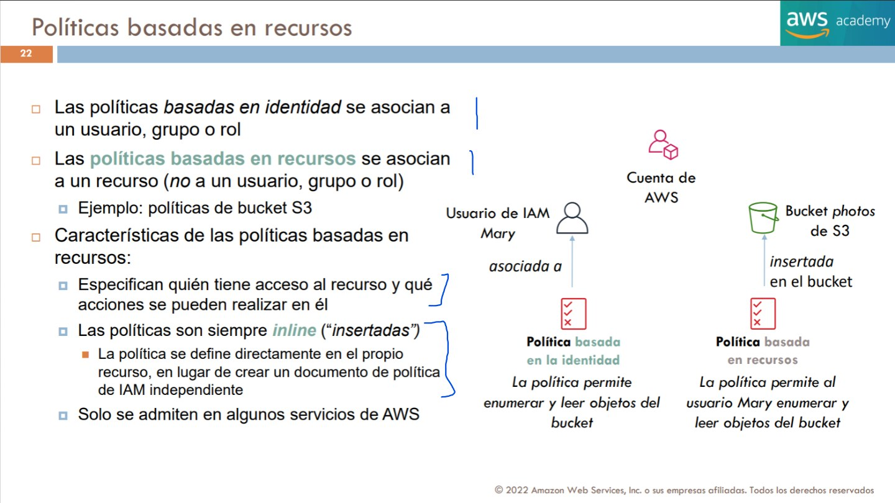


<a id="t3-p23"></a>

`[FUENTE: T3 p. 23]`

Diagrama de decisión simplificado: preguntar si existe **Deny explícito**; si sí, denegar. Si no, comprobar si existe **Allow explícito**; si sí, permitir; si no, **denegar implícitamente**. La presentación no pretende capturar todos los aspectos de evaluación real (SCP, boundaries, políticas de sesión, conditions, recursos y acceso entre cuentas). Debe utilizarse como regla principal del examen sin convertirla en algoritmo universal completo.

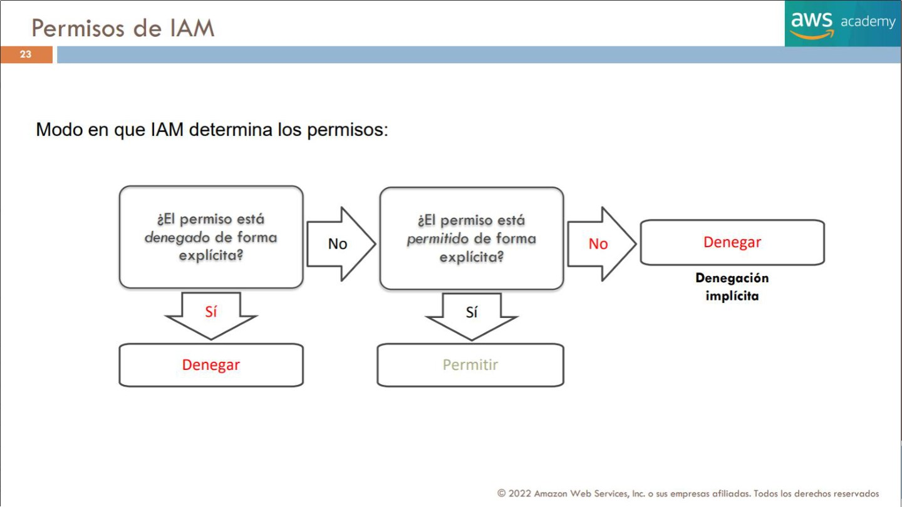


`[EXPLICACIÓN DIDÁCTICA]` En el caso Mary, estudia primero **dónde está asociada la política**. Una identidad con una política que permite listar y leer representa el lado del solicitante. Una bucket policy del bucket de fotografías representa el lado del recurso y puede indicar principales. El hecho de que la intención sea similar no vuelve intercambiables los documentos ni permite asumir que basta cualquier `Allow` en un acceso entre cuentas.

Para una lectura de estudio del diagrama de T3 p.23, recorre las decisiones en este orden:

1. ¿Hay una denegación explícita aplicable? Si la hay, se deniega.
2. Si no la hay, ¿existe una concesión explícita aplicable y se cumplen las demás condiciones y límites requeridos por el escenario? Si es así, se permite.
3. Si falta la concesión necesaria, se mantiene la denegación implícita.

El segundo paso añade el contexto que la figura simplificada no desarrolla. En acceso entre cuentas pueden ser necesarias autorizaciones en ambos lados; en una cuenta miembro una SCP puede bloquear una acción concedida por IAM. No basta mirar el color de una flecha o una única política. El valor del diagrama para el examen es reconocer la prioridad de `Deny` y la ausencia de permiso por defecto.

<a id="seccion-6-6"></a>

## 6.6 Grupos, roles y delegación a una aplicación EC2


<a id="t3-p24"></a>

`[FUENTE: T3 p. 24]`

Un grupo IAM es un conjunto de usuarios IAM usado para conceder permisos comunes. Se adjuntan políticas de IAM al grupo y los usuarios heredan las autorizaciones pertinentes. Un usuario puede pertenecer a varios grupos, no existe grupo IAM predeterminado y **los grupos no se pueden anidar**. El gráfico muestra administradores, desarrolladores y evaluadores, con usuarios en distintas agrupaciones; la pertenencia facilita gestión de permisos sin repetir políticas individuales.

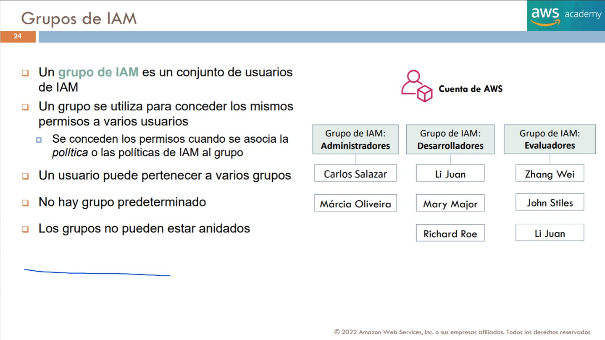


<a id="t3-p25"></a>

`[FUENTE: T3 p. 25]`

Un rol es identidad IAM con permisos definidos, similar en su autorización a un usuario pero **sin estar asociado permanentemente a una persona concreta**; se diseña para que lo asuma una persona, aplicación o servicio. Proporciona **credenciales temporales**, facilitando delegación. Ejemplos del curso: acceso entre identidades de la misma cuenta, acceso entre cuentas y acceso concedido a un servicio como EC2. La analogía con `sudo` de Linux es pedagógica, no equivalencia exacta.

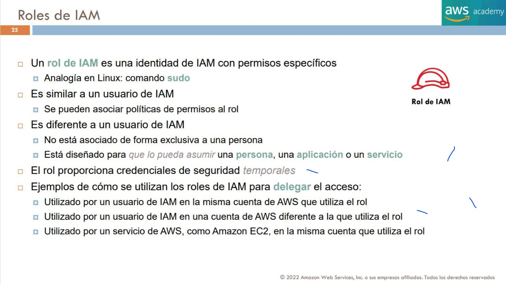


<a id="t3-p26"></a>

`[FUENTE: T3 p. 26]`

**Situación:** aplicación ejecutada en EC2 necesita acceder a un bucket S3 de fotografías. **Pasos del diagrama:** (1) crear política con permisos necesarios sobre el bucket y adjuntarla a un rol IAM; (2) permitir/asociar el rol a la instancia EC2 y que la carga lo asuma; (3) aplicación usa permisos temporales del rol para acceder a S3. Es preferible a incrustar claves de acceso permanentes en el código o en archivos dentro de la instancia. Revisar políticas de confianza y permisos mínimos cuando se generen apuntes finales.

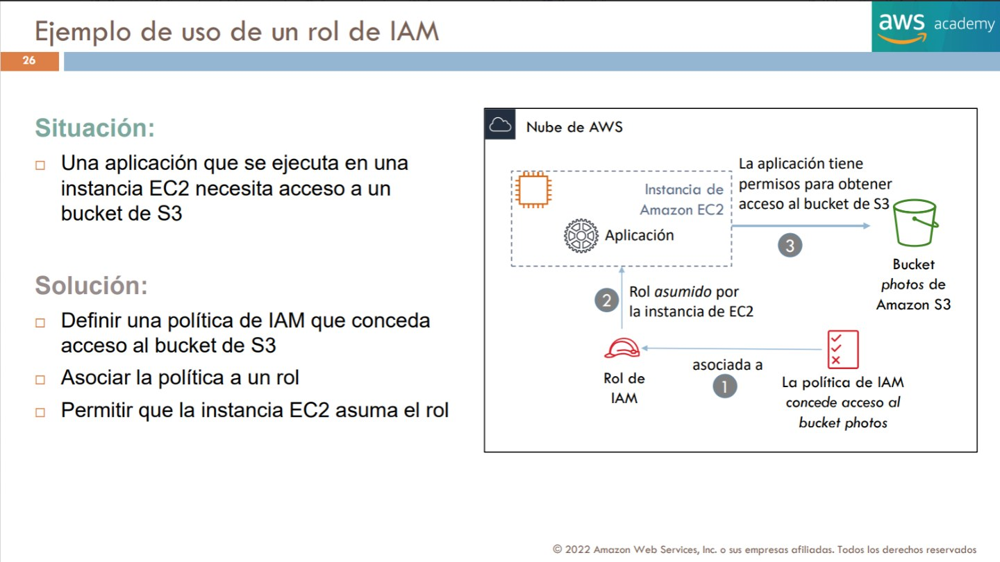


### Política de confianza frente a política de permisos

`[EXPLICACIÓN DIDÁCTICA]` Un rol necesita distinguir **quién puede asumirlo** de **qué puede hacer una sesión que lo asume**. La política de confianza identifica los principales y las condiciones autorizadas a solicitar la asunción del rol. La política de permisos describe acciones que el rol puede realizar sobre recursos. Que un rol tenga permiso para leer S3 no permite automáticamente que cualquier persona o instancia lo asuma.

En el caso de EC2, una política de confianza ilustrativa permite al servicio EC2 asumir el rol mediante `sts:AssumeRole`. Las políticas del rol deben permitir solo las operaciones necesarias sobre el bucket o prefijos pertinentes. La asociación a EC2 se gestiona mediante los mecanismos admitidos, incluido el perfil de instancia. La carga obtiene credenciales temporales y no necesita que un desarrollador copie su propia clave permanente a un archivo del servidor.

El ciclo también tiene una obligación operativa: el código debe utilizar la cadena de credenciales admitida y permitir su renovación. Una sesión temporal reduce exposición de larga duración, pero un rol excesivamente amplio o un sistema comprometido siguen siendo un problema. Deben revisarse tanto la confianza como los permisos y el entorno desde el que se utilizan.

### Delegación entre cuentas

Si un equipo de una cuenta necesita acceder a otra, el rol de destino establece confianza y permisos y el solicitante necesita la autorización pertinente para asumirlo. No se comparten credenciales raíz ni se fusionan por ello las cuentas. Separar confianza y permisos permite cambiar quién entra sin confundir esa decisión con el conjunto de acciones autorizadas en destino.

Un grupo IAM y una OU también son diferentes: el grupo contiene usuarios IAM para administrar políticas comunes; la OU organiza cuentas de AWS Organizations. Ninguno es una subred ni una conexión automática entre aplicaciones. Las agrupaciones administrativas simplifican gobierno, pero hay que conocer su ámbito para interpretar los controles.

<a id="seccion-6-7"></a>

## 6.7 Proteger la cuenta raíz: documento histórico y práctica actual


<a id="t3-p28"></a>

`[FUENTE: T3 p. 28]`

El **usuario raíz** es la identidad inicial creada con el email/contraseña de la cuenta y amplios privilegios; no debe usarse en operaciones cotidianas. La lámina contrasta acceso raíz irrestricto con permisos ajustables de IAM, identidades federadas e integración con otros servicios. Presenta como ejemplos de operaciones reservadas al usuario raíz (en el contexto de 2022) cambiar su contraseña, ciertas decisiones de AWS Support, recuperar permisos de IAM o modificar datos esenciales de cuenta. **No memorizar una lista histórica cerrada:** las excepciones actuales y la administración centralizada de raíz han cambiado; verificar en documentación vigente.

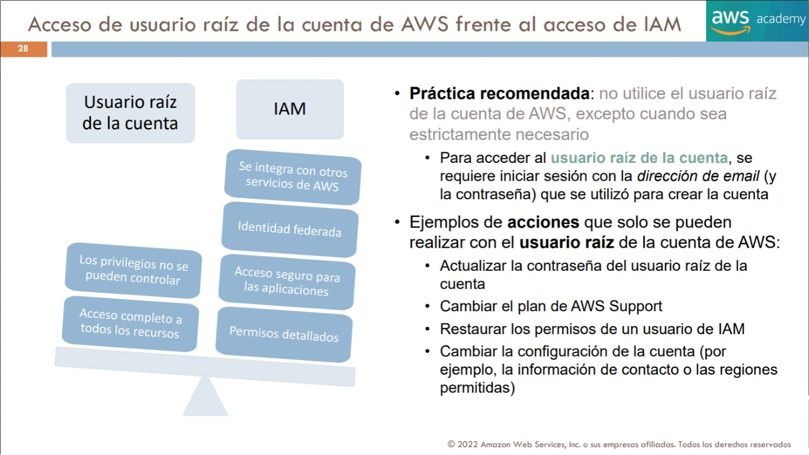


<a id="t3-p29"></a>

`[FUENTE: T3 p. 29]`

**Paso 1** del curso: acceder temporalmente como usuario raíz, crear usuario IAM administrador, crear un grupo de administradores y asociarlo al usuario; deshabilitar/eliminar claves de acceso raíz si existen; habilitar política de contraseñas; acceder con las credenciales nuevas; guardar credenciales de raíz en sitio seguro. Esta es la secuencia docente de 2022. **Ampliación oficial:** para acceso humano actual, especialmente con AWS Organizations, suele preferirse **IAM Identity Center** y credenciales temporales; no extrapolar «crear usuario IAM administrador» como primera práctica universal vigente.

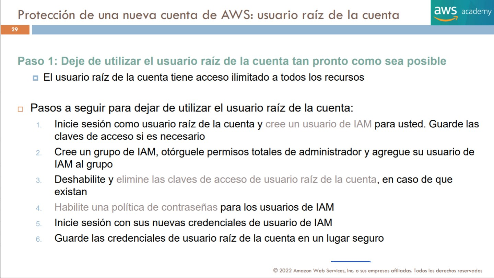


<a id="t3-p30"></a>

`[FUENTE: T3 p. 30]`

**Paso 2:** habilitar autenticación multifactor para la cuenta raíz y para usuarios IAM; también puede intervenir en condiciones de acceso a APIs. Ejemplos históricos: aplicaciones autenticadoras (Google Authenticator, Authy), llaves de seguridad U2F (YubiKey) y dispositivos físicos MFA como los mostrados de Gemalto. La atribución de Windows Phone a Authy se conserva únicamente como rótulo histórico de la figura, no como recomendación actual. El catálogo de dispositivos y obligaciones puede cambiar; contrastar con guía actual de protección de raíz.

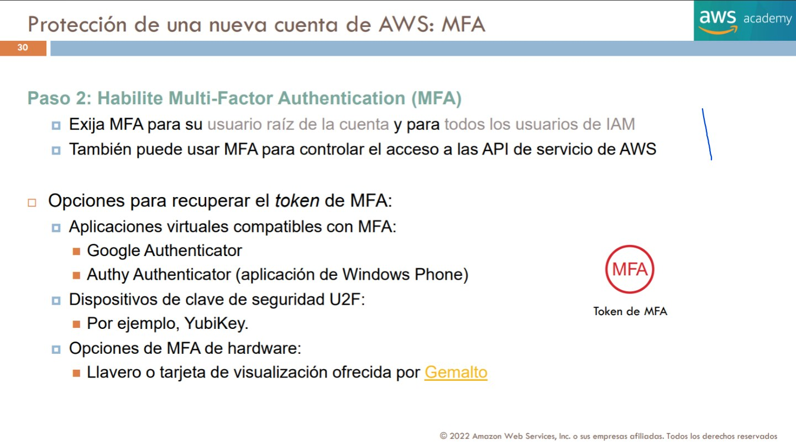


`[AMPLIACIÓN OFICIAL — corpus 02, C.3]`

La cuenta raíz tiene privilegios especialmente sensibles. Buenas prácticas: **no utilizar raíz de forma ordinaria**, proteger su email y mecanismos de recuperación, **MFA**, eliminar/evitar claves programáticas permanentes, preferir acceso humano administrativo con identidad centralizada y credenciales temporales. En organizaciones multicuenta AWS documenta controles de administración centralizada del acceso raíz en cuentas miembro, incluida la posibilidad de quitar credenciales de raíz de algunas cuentas miembro según procedimiento oficial. Debe evaluarse la documentación actual para averiguar qué tareas concretas requieren raíz y qué alternativas delegadas existen; no memorizar listas cerradas de diapositivas de 2022.

**Matiz en examen:** «¿Debe usarse el usuario raíz para administrar EC2 todos los días?» → no. «¿Puede un usuario IAM con políticas de administrador necesariamente hacer *todas* las tareas reservadas a root?» → tampoco.

Fuente: https://docs.aws.amazon.com/IAM/latest/UserGuide/root-user-best-practices.html


`[AMPLIACIÓN OFICIAL — revisión del 2-11-2026]` La documentación actual recomienda evitar credenciales raíz en cuentas miembro administradas mediante Organizations y utilizar los mecanismos de administración centralizada admitidos cuando proceda. Esto no significa borrar sin procedimiento el único acceso de una cuenta independiente. La cuenta de administración, la recuperación y los permisos de las tareas delegadas necesitan un diseño específico. Fuente: [buenas prácticas de raíz](https://docs.aws.amazon.com/IAM/latest/UserGuide/root-user-best-practices.html).

El texto de T3 p.28 usa expresiones como «acceso completo» y enumera acciones reservadas a raíz, entre ellas cambios de contraseña, soporte, recuperación de permisos y configuración de cuenta. Se conservan como ejemplos del curso. No deben memorizarse como una lista vigente cerrada: la administración de cuentas y las opciones delegadas cambian. Una identidad con permisos administrativos IAM tampoco debe confundirse con la identidad raíz para tareas que sigan exigiéndola.

`[EXPLICACIÓN DIDÁCTICA]` La protección incluye el correo asociado y el proceso de recuperación, no solo el dispositivo MFA. Si alguien puede controlar el buzón o el mecanismo de recuperación, puede poner en riesgo el acceso. El acceso extraordinario necesita responsables, custodia, auditoría y un procedimiento conocido. Minimizar el uso de raíz reduce el impacto potencial y mejora la atribución de las tareas habituales a identidades individuales.

### Tareas de raíz: ejemplos actuales con contexto de cuenta

`[AMPLIACIÓN OFICIAL — revisión 2 de noviembre de 2026]` En una cuenta independiente, cambiar el correo, contraseña o claves de acceso del usuario raíz requiere actuar como raíz. Recuperar el acceso cuando el único administrador IAM se ha quitado sus propios permisos es otro caso especial. Estas operaciones excepcionales no justifican usar raíz para administrar EC2 o S3 todos los días: el trabajo ordinario debe realizarse con identidades autorizadas y privilegio mínimo.

Cerrar una cuenta independiente también es una tarea de raíz, mientras que el cierre de cuentas miembro puede gestionarse centralmente mediante Organizations con los permisos correspondientes. La administración centralizada de acceso raíz permite además ciertas tareas privilegiadas sobre cuentas miembro sin mantener credenciales raíz persistentes en cada una. Por tanto, una lista de 2022 no se debe aplicar sin distinguir cuenta independiente, cuenta de administración y cuenta miembro. Cambiar contactos, moneda de pago o administrar regiones tampoco debe clasificarse universalmente como «solo raíz».

Referencias oficiales: [usuario raíz y tareas especiales](https://docs.aws.amazon.com/IAM/latest/UserGuide/id_root-user.html) y [buenas prácticas de raíz](https://docs.aws.amazon.com/IAM/latest/UserGuide/root-user-best-practices.html).

<a id="seccion-6-8"></a>

## 6.8 Gobierno multicuenta con AWS Organizations


<a id="t3-p34"></a>

`[FUENTE: T3 p. 34]`

Permite administrar varias cuentas AWS de manera centralizada, incluyendo facturación consolidada y controles de seguridad/gobierno. Agrupa cuentas en **unidades organizativas (OU)**, admite integración con IAM y usa **Service Control Policies (SCP)** para establecer límites centrales a acciones AWS en cuentas/OU. El permiso efectivo para un principal de cuenta miembro exige autorización IAM y compatibilidad con los límites organizativos. Las SCP **no otorgan permisos por sí solas**.

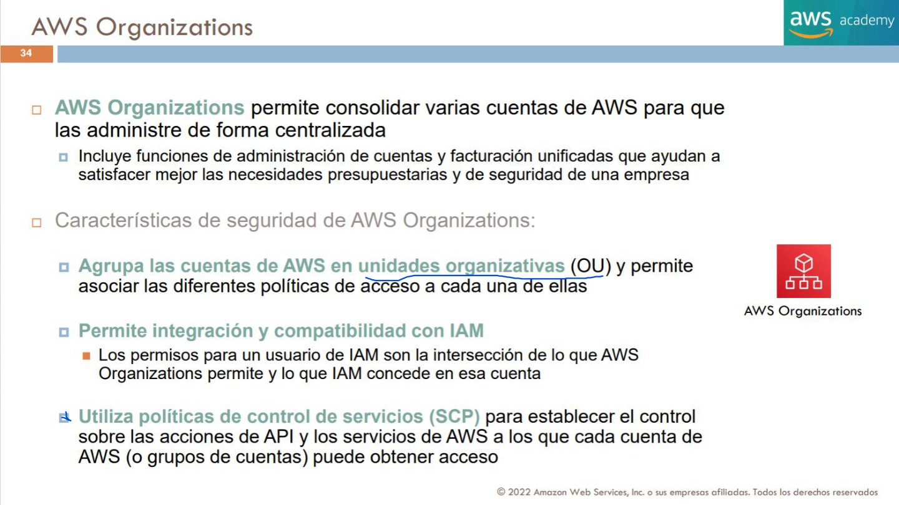


<a id="t3-p35"></a>

`[FUENTE: T3 p. 35]`

La ilustración enumera cuatro funciones: administración mediante **SCP**, gestión mediante **grupos/OU** de cuentas con políticas vinculadas, **APIs** para automatizar administración de cuentas y **facturación unificada/consolidada**. Una organización ofrece control central sin sustituir los mecanismos individuales de protección de la identidad ni la responsabilidad sobre cada carga.

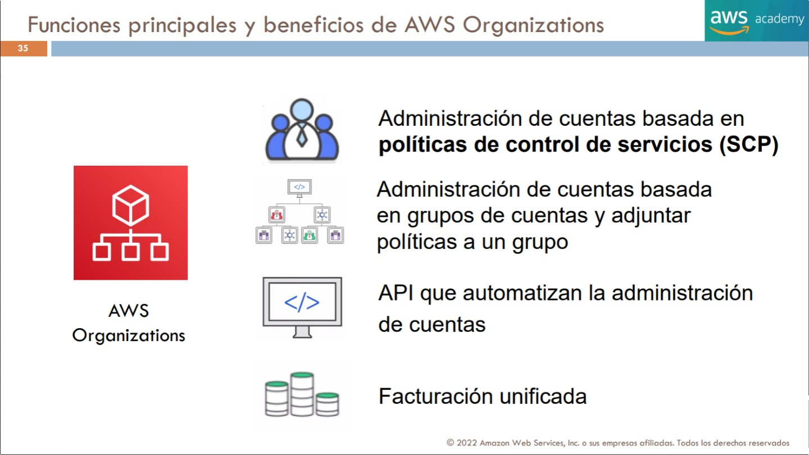


<a id="t3-p36"></a>

`[FUENTE: T3 p. 36]`

El dibujo muestra **Organization**, raíz organizativa o **Root** (no confundir con el usuario raíz de cuenta), unidades organizativas **OU**, cuentas miembro y políticas asociadas a distintos niveles. Una OU contiene cuentas u otras OU de una jerarquía; una cuenta pertenece a un nodo de esa estructura y los controles se heredan según su alcance. Las líneas del gráfico reflejan relaciones y políticas, no conexiones de red ni acceso libre entre cuentas.

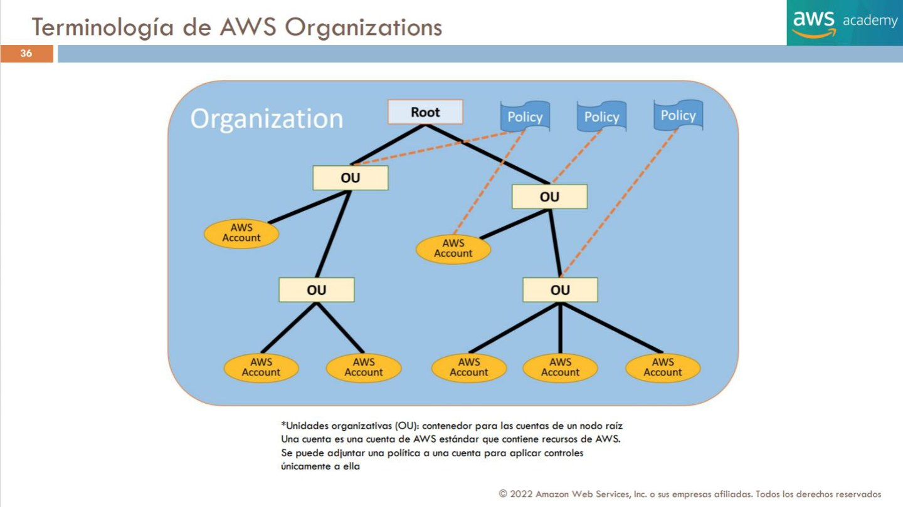


<a id="t3-p37"></a>

`[FUENTE: T3 p. 37]`

Las **SCP** ofrecen control centralizado y restringen los permisos disponibles en cuentas dentro de una organización. Aunque comparten sintaxis semejante a ciertas políticas IAM, **una SCP no concede permisos**. Define el **máximo permitido** por política de organización para las identidades de cuentas a las que se aplica; la concesión efectiva sigue requiriendo políticas IAM pertinentes. Deben explicarse además matices sobre la cuenta de administración y roles de servicio si se van a profundizar fuera del examen.

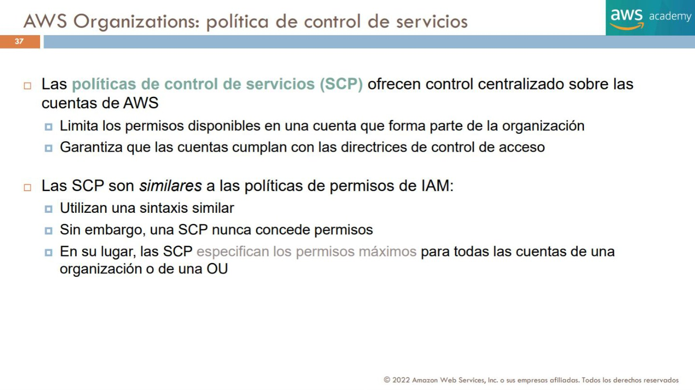


<a id="t3-p38"></a>

`[FUENTE: T3 p. 38]`

La lámina contrapone las políticas IAM, que habilitan o niegan acciones específicas a usuarios, grupos y roles, y las SCP de Organizations, que establecen límites en cuentas o grupos de cuentas. El efecto de una SCP sobre las identidades de una cuenta miembro no implica que por sí sola habilite llamadas API. **Idea de examen:** para un acceso se necesitan ambas capas compatibles, no basta la pertenencia a una OU permisiva.

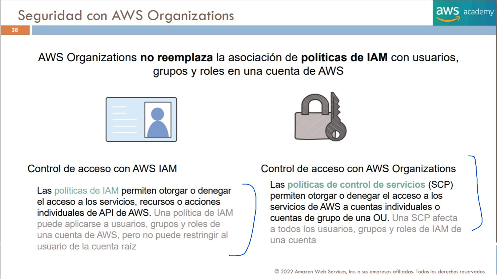


`[AMPLIACIÓN OFICIAL — corpus 02, C.4]`

Una **Organización** agrupa cuentas; **OU** establece jerarquía administrativa (no red); **SCP** limita máximo de permisos para identidades en cuentas miembro, **pero no otorga permisos**. **IAM** concede permisos dentro de los límites efectivos. La documentación moderna también identifica **Resource Control Policies (RCP)** para ciertos límites sobre recursos; es ampliación opcional, de menor prioridad para CLF-C02. Las SCP no restringen identidades de la cuenta de administración y tienen excepciones para determinados roles vinculados a servicios y operaciones. No presentar como regla absoluta «una SCP afecta a todo principal en toda cuenta, incluida la de administración».

**Ejemplo:** una SCP deniega `ec2:TerminateInstances` a una OU: incluso con `AdministratorAccess` IAM, una identidad de cuenta miembro afectada no puede terminar instancias. Si la SCP permite esa acción pero IAM no, tampoco se concede. Se necesita permiso efectivo en los dos niveles.

Fuentes: https://docs.aws.amazon.com/organizations/latest/userguide/orgs_manage_policies_scps.html ; https://docs.aws.amazon.com/IAM/latest/UserGuide/reference_policies_evaluation-logic.html


### Comprender el permiso efectivo

`[EXPLICACIÓN DIDÁCTICA]` Supón que una OU tiene una SCP que deniega terminar instancias EC2. Una identidad afectada en una cuenta miembro no puede terminar una instancia simplemente porque una política IAM le conceda administración. Al contrario, si la SCP deja disponible esa acción y la identidad no tiene una concesión IAM necesaria, tampoco obtiene permiso por pertenecer a la OU. La SCP establece un límite en su alcance; la autorización efectiva requiere evaluar las otras capas.

No conviene describir todas las políticas como filtros idénticos ni afirmar que una SCP se aplica a cualquier principal del mismo modo. La cuenta de administración y determinados roles vinculados a servicios tienen excepciones documentadas. Las Resource Control Policies son una ampliación sobre límites de recursos compatibles, distinta de las políticas de identidad. Para CLF-C02, la prioridad es entender que los guardarraíles organizativos no otorgan por sí solos el acceso operativo.

La raíz organizativa, representada en el árbol, tampoco es el usuario raíz de una cuenta. La primera es un nodo de gobierno que contiene OU y cuentas; el segundo es una identidad de acceso sensible. Las líneas de ese árbol no son rutas de red y no permiten leer datos de todas las cuentas. Gobierno, identidad y conectividad se diseñan conjuntamente pero son planos diferentes.

### Cuotas históricas y medios de administración


<a id="t3-p39"></a>

`[FUENTE: T3 p. 39]`

Tabla de 2022: nombres Unicode de longitud máxima 250; **1 raíz**; referencia histórica a **1.000 OUs**, **1.000 políticas**, tamaño máximo de documento SCP **5.120 bytes**, **5 niveles** de anidamiento, **20 invitaciones/día** y **5 cuentas miembro** creadas simultáneamente (otras cifras del catálogo varían). **Dato histórico, no normativa actual:** no memorizar estas cuotas ni presentarlas como vigentes; el material oficial actualizado puede cambiar límites según servicio y cuenta.

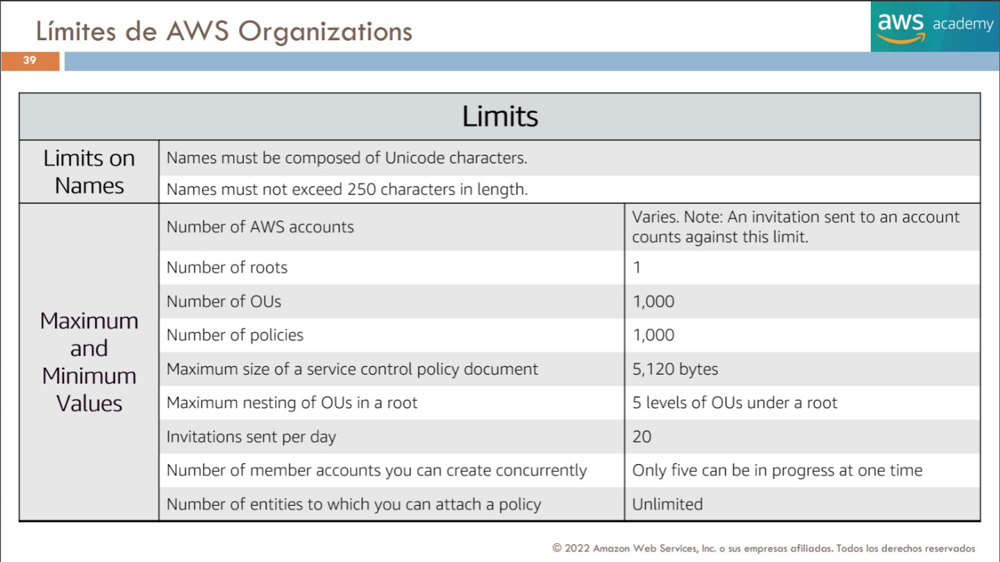


<a id="t3-p40"></a>

`[FUENTE: T3 p. 40]`

El curso muestra **AWS Management Console**, **AWS CLI**, **SDK** y solicitudes **HTTPS a APIs** como cuatro formas de administración de Organizations. Todos estos caminos invocan APIs y requieren permisos adecuados. No confundir el acceso técnico al servicio con las políticas que limitan lo que una cuenta miembro puede ejecutar.

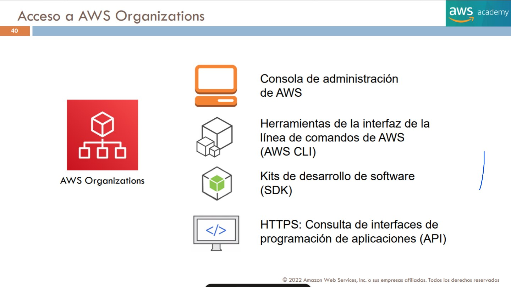


La tabla de T3 p.39 se cotejó en su figura. Además de las cifras indicadas, dice que el número de cuentas varía y que una invitación cuenta contra ese límite; la última fila muestra «Unlimited» para entidades a las que se puede adjuntar una política en ese contexto histórico. Esos rótulos se conservan como lectura de la tabla de 2022 y no como afirmación de que hoy cualquier operación de Organizations carezca de cuotas. Para planificar se consulta la documentación y las cuotas de la cuenta concreta.

Fuente de consulta: [políticas de control de servicios](https://docs.aws.amazon.com/organizations/latest/userguide/orgs_manage_policies_scps.html). Las cuatro interfaces de T3 p.40 —consola, CLI, SDK y API por HTTPS— siguen ilustrando una idea conceptual: cambiar la interfaz no evita la evaluación de permisos.

**Contraste fechado de cuotas (2 de noviembre de 2026):** la documentación de Organizations consultada enumera 2.000 OU y 10.000 políticas de control de servicios por organización, frente a las referencias de 1.000 del cuadro docente. No son límites intercambiables de cualquier objeto llamado «política». Antes de diseñar, consultar el tipo concreto de cuota y si admite aumento en la [tabla oficial de cuotas](https://docs.aws.amazon.com/organizations/latest/userguide/orgs_reference_limits.html).

<a id="seccion-6-9"></a>

## 6.9 Identidad de aplicaciones y gestión de secretos


<a id="t3-p42"></a>

`[FUENTE: T3 p. 42]`

Amazon Cognito facilita **registro, autenticación e identidad de usuarios finales de aplicaciones web/móviles**, con escalado a muchos usuarios. El curso cita inicio de sesión con proveedores sociales como Facebook/Google/Amazon y empresariales como Microsoft Active Directory mediante federación/protocolos compatibles (SAML 2.0 en la diapositiva). Distinguir Cognito (usuarios de apps) de IAM Identity Center (acceso de trabajadores a cuentas y aplicaciones empresariales) e IAM (autorización sobre recursos AWS).

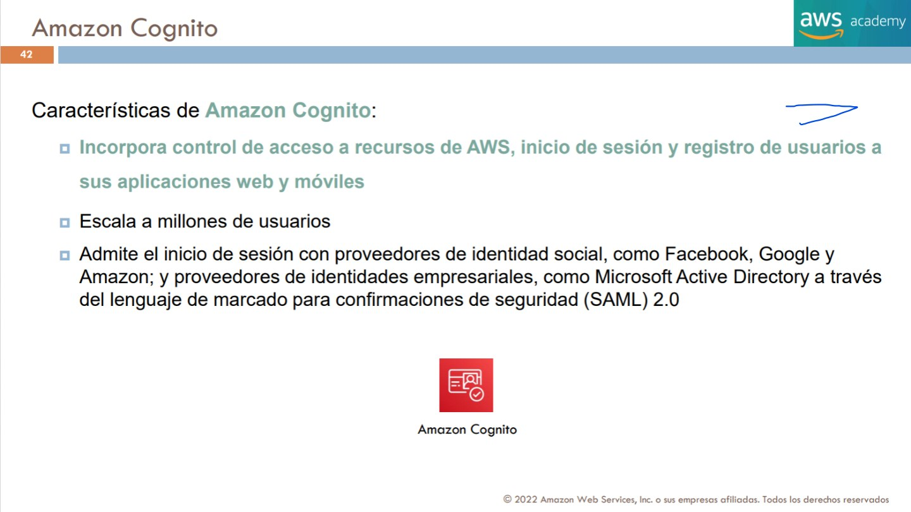


`[AMPLIACIÓN OFICIAL — corpus 02, B.1 y C.2]` **AWS Secrets Manager** almacena y gestiona secretos, como credenciales de base de datos, con capacidades de recuperación y rotación en los escenarios compatibles. **AWS Systems Manager Parameter Store** organiza parámetros de configuración y admite valores sensibles mediante tipos y cifrado compatibles. No son idénticos ni toda contraseña rota por sí sola: importa qué secreto se guarda, qué integración existe y cómo actualizan sus consumidores la credencial.

`[EXPLICACIÓN DIDÁCTICA]` Una aplicación en EC2 puede asumir un rol para recuperar el secreto necesario y usarlo para conectarse a su base. El rol debe poder acceder al secreto concreto y, cuando corresponda, utilizar su clave de cifrado. La autorización a recuperar un secreto y la autorización dentro de la base de datos siguen siendo decisiones distintas. Guardar una contraseña en un almacén adecuado no justifica conceder su lectura a toda la organización.

Si el código puede usar autenticación basada en roles y credenciales temporales para un servicio, no se debe introducir una clave estática innecesaria solo para demostrar el almacén de secretos. Primero se identifica el mecanismo de identidad del servicio de destino; después se diseña la custodia de lo que realmente necesita almacenarse. Se evitan secretos en repositorios, registros, mensajes y ejemplos de documentación.

Fuentes: [Secrets Manager](https://docs.aws.amazon.com/secretsmanager/latest/userguide/intro.html), [Parameter Store](https://docs.aws.amazon.com/systems-manager/latest/userguide/systems-manager-parameter-store.html).

<a id="seccion-6-10"></a>

## 6.10 Analizar acceso excesivo y practicar con AnyCompany


`[AMPLIACIÓN OFICIAL — corpus 02, C.5]`

**IAM Access Analyzer** ofrece análisis de acceso externo, interno o no usado según el tipo de analizador, con alcances, disponibilidad y costes distintos. Puede ser útil para identificar un recurso S3 compartido externamente por error o permisos IAM sin uso. No es el mismo producto que Amazon Inspector ni GuardDuty. Guardar documentos de políticas o contraseñas en repositorios sin protección no es buena práctica; preferir rotación y almacenamientos de secretos controlados.

Fuente: https://docs.aws.amazon.com/IAM/latest/UserGuide/what-is-access-analyzer.html


IAM Access Analyzer ayuda a identificar accesos y permisos según el tipo de análisis configurado. Su utilidad es razonar sobre exposición y autorización; no equivale a detectar vulnerabilidades de un paquete como Inspector ni a detectar comportamiento sospechoso como GuardDuty. Debe examinarse qué entidad, política y condición originan un hallazgo antes de modificar acceso legítimo de una aplicación.


<a id="ca-p10"></a>

`[FUENTE: CA p. 10]`


AnyCompany Corporation es una empresa ficticia creada en **2008** por **John Doe**, dedicada a vender **paisajes urbanos impresos en 3D** (*3D-printed cityscapes*). Está preparando una solicitud de inversión y necesita que su tecnología sea revisada como parte de la diligencia debida (*due diligence*). Nació utilizando tecnología cloud, y en el relato se indica que John creó una cuenta de AWS y lanzó su primera instancia EC2 para la empresa.

**Aspecto de seguridad expresamente mencionado en las notas:** John comparte las credenciales del usuario root de AWS con otros empleados técnicos. Este comportamiento se utiliza como ejemplo de **riesgo de identidad y de accesos**: no se deben compartir credenciales raíz y han de asignarse identidades y permisos específicos.

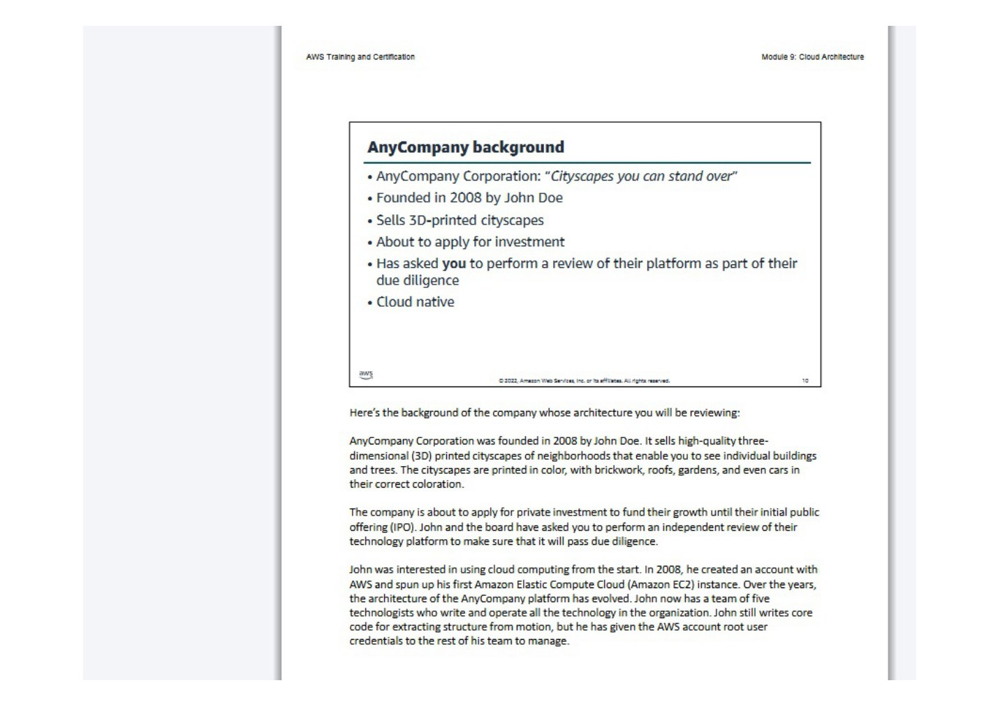


`[EXPLICACIÓN DIDÁCTICA]` El uso compartido de raíz de AnyCompany puede analizarse con cuatro preguntas: ¿quién necesita administrar qué?, ¿qué identidad o rol le corresponde?, ¿cómo se autentica y obtiene sesión?, ¿cómo se atribuye después la actividad? Una propuesta razonada sustituye el acceso compartido habitual por identidades diferenciadas y permisos apropiados, protege recuperación y acceso extraordinario a raíz y comprueba trazabilidad. No se limita a cambiar la contraseña y seguir compartiendo la nueva.

Como repaso, explica por qué habilitar MFA no reduce por sí solo `s3:*` a lectura, por qué una SCP permisiva no crea permisos y por qué una bucket policy y una trust policy responden a preguntas distintas. Son actividades de estudio dentro del manual y no incorporaciones al banco de tests existente.

## Referencias y continuidad

- [Buenas prácticas de IAM: identidades humanas y cargas con credenciales temporales](https://docs.aws.amazon.com/IAM/latest/UserGuide/best-practices.html), revisadas el 2-11-2026.
- [Lógica oficial de evaluación de políticas](https://docs.aws.amazon.com/IAM/latest/UserGuide/reference_policies_evaluation-logic.html).
- [IAM Identity Center](https://docs.aws.amazon.com/singlesignon/latest/userguide/what-is.html).
- [Glosario integral de seguridad](08_glosario_integral_seguridad.md).
- [Seguridad de datos, redes y cumplimiento](07_seguridad_datos_y_cumplimiento.md): protección de la carga una vez definidas las identidades.
