# 07. Seguridad, protección de datos y cumplimiento

Una arquitectura segura combina controles que responden a preguntas diferentes. Las reglas de red deciden qué tráfico puede llegar; las políticas autorizan acciones; el cifrado protege datos bajo un modelo de claves; la observación y la detección aportan señales; las evidencias permiten evaluar controles y cumplimiento. Ninguna de esas capas sustituye automáticamente a las otras.

Este capítulo desarrolla los objetivos 2.2 y 2.4 y conecta con las identidades del capítulo 06. Las tablas y ejercicios proceden de T3, T5, T9 y CA, principalmente de 2022. Las ampliaciones de servicios actuales se identifican como tales y las decisiones de uso se explican con ejemplos didácticos. El criterio de estudio es reconocer el problema y el alcance de cada herramienta, antes que memorizar una lista de nombres.

## 7.1 Defensa en profundidad y preguntas de seguridad

`[FUENTE: CA p. 22]`

**Seguridad**: capacidad de proteger la información, sistemas y activos, mientras se ofrece valor de negocio mediante análisis de riesgo y estrategias de mitigación. Los asuntos destacados son:

- Confidencialidad e integridad de los datos.
- Identificar y administrar quién puede hacer qué.
- Proteger sistemas y recursos.
- Establecer controles para detectar eventos de seguridad.

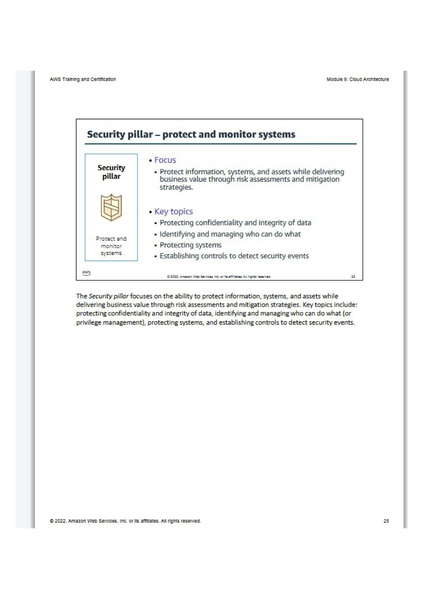

`[FUENTE: CA p. 23]`

1. **Implement a strong identity foundation:** establecer identidades robustas y el principio de **mínimo privilegio**, separar permisos, centralizar la gestión de identidades cuando corresponda y evitar depender del acceso root.
2. **Enable traceability:** registrar, supervisar y auditar cambios y acciones en tiempo real, incorporando registros y alertas a los procedimientos de seguridad.
3. **Apply security at all layers:** aplicar controles en todos los niveles relevantes, como redes, instancias, sistemas operativos, aplicaciones y datos.
4. **Automate security best practices:** automatizar mecanismos de seguridad para reducir errores humanos y aplicar políticas coherentes a escala.
5. **Protect data in transit and at rest:** utilizar cifrado y controles apropiados para los datos tanto **en tránsito** como **almacenados**.
6. **Keep people away from data:** minimizar el acceso y la intervención manual directa sobre datos sensibles, utilizando mecanismos automatizados cuando sea razonable.
7. **Prepare for security events:** preparar la detección, investigación, contención y recuperación ante incidentes mediante procesos y ejercicios de respuesta.

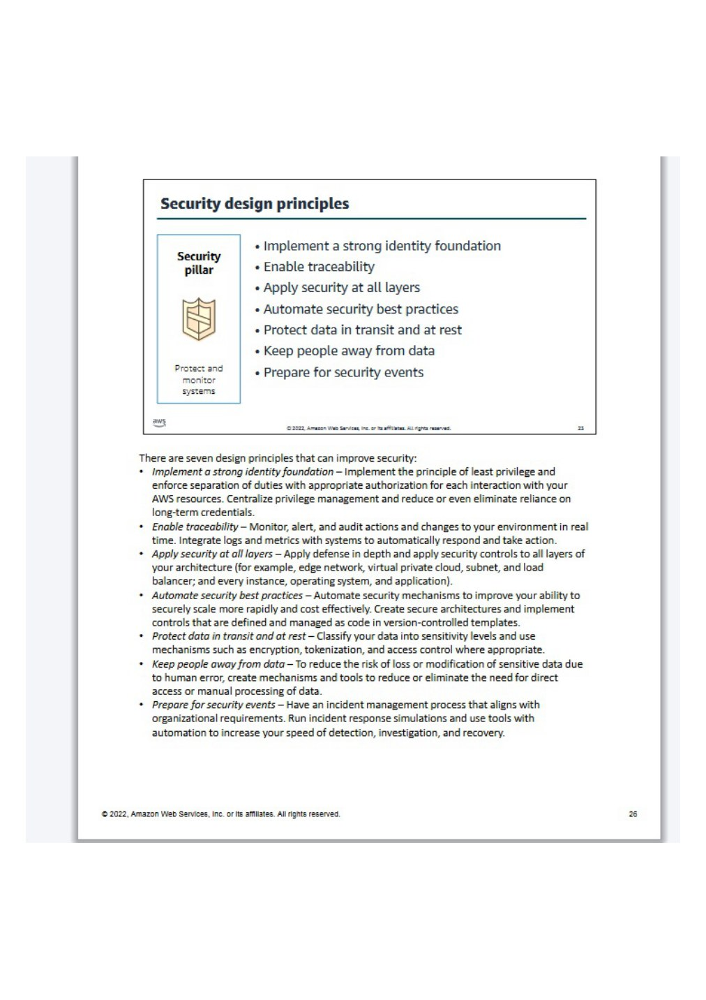

`[FUENTE: CA p. 24]`

Se plantean preguntas agrupadas en:

- **Security:** cómo operar de manera segura las cargas de trabajo.
- **Identity and access management:** cómo gestionar identidades de personas y máquinas, y sus permisos.
- **Detection:** cómo detectar e investigar eventos de seguridad.
- **Infrastructure protection:** cómo proteger los recursos de red y cómputo.
- **Data protection:** cómo clasificar datos y cómo protegerlos en reposo y tránsito.
- **Incident response:** cómo anticipar, responder y recuperarse ante incidentes.

Las notas insisten en disponer de controles de protección, mecanismos de detección y procedimientos de respuesta alineados con los requisitos de la organización.

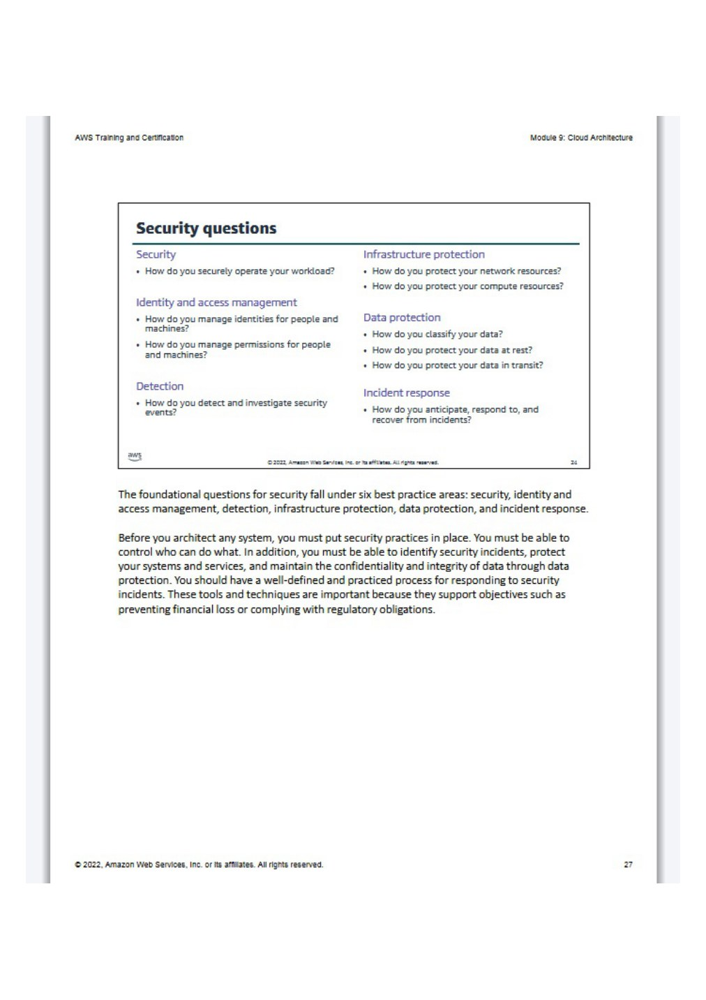

`[FUENTE: CA p. 25]`

Preguntas de referencia:

- **SEC 1:** cómo operar de forma segura la carga de trabajo.
- **SEC 4:** cómo detectar e investigar los eventos de seguridad.
- **SEC 6:** cómo proteger los recursos informáticos.

Se reutiliza el diagrama de AnyCompany para elegir una mejora prioritaria. Las prácticas de la página 23 ayudan a reconocer debilidades como el uso compartido de credenciales de root.

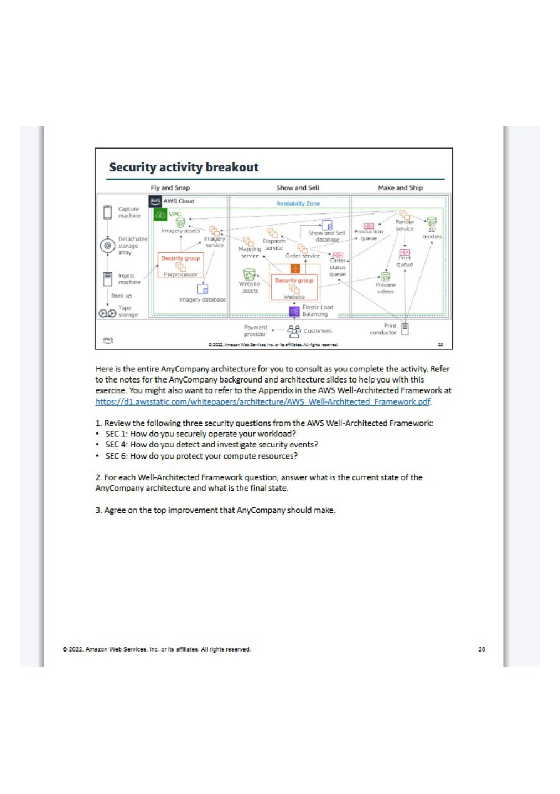

La explicación general de los seis pilares está en el [apartado del Bloque I dedicado a seguridad](../bloque-1/03_infraestructura_y_arquitectura.md#ca-p22). Aquí se aplican específicamente identidad robusta, trazabilidad, controles en capas, automatización, protección en tránsito y reposo, reducción de acceso manual a datos y preparación para incidentes. La actividad conserva las preguntas SEC1, SEC4 y SEC6; no proporciona una solución oficial única para AnyCompany.

`[EXPLICACIÓN DIDÁCTICA]` Una propuesta razonada comienza por identificar un riesgo observable y el componente afectado. Si varias personas usan la misma raíz, el problema incluye privilegio y atribución; si un puerto administrativo se abre a Internet, el problema es exposición de red; si faltan registros, puede ser imposible investigar un cambio. Las acciones deberían responder al riesgo concreto y tener una forma de comprobarse. Escribir «usar más seguridad» o «activar todos los servicios» no describe una mejora verificable.

La defensa en profundidad evita depender de un único control perfecto. Una web puede necesitar TLS, autorización de aplicación, políticas IAM limitadas, controles de red y registros. Si el usuario ya está autorizado a leer un objeto, cifrarlo en reposo no vuelve inválida esa autorización. Si una petición HTTP maliciosa explota una vulnerabilidad, tener un disco cifrado no la bloquea por sí mismo.

## 7.2 Security Groups: alcance, estado y reglas

`[FUENTE: T5 p. 26]`

El diagrama de una VPC y sus subredes públicas/privadas muestra un **Security Group** junto a instancias EC2. Actúa como firewall virtual de entrada/salida en el nivel de la interfaz/recurso asociado, **no** como firewall uniforme de toda la subred. Instancias de una misma subred pueden asociarse a distintos grupos. La diapositiva muestra CIDR ilustrativos (VPC 10.0.0.0/16, subredes 10.0.1.0/24 y 10.0.2.0/24); esos números son ejemplos, no requisitos fijos.

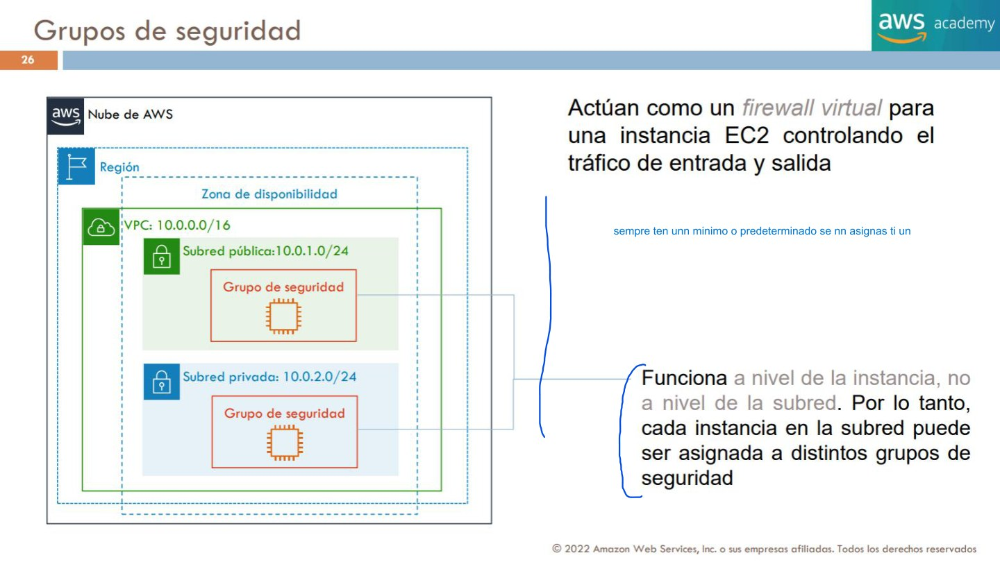

`[FUENTE: T5 p. 27]`

Los Security Groups controlan reglas de entrada/salida. La diapositiva ilustra un estado inicial habitual de grupo nuevo **sin entrada permitida y con salida permitida**; aclara que la **respuesta** a una conexión previamente autorizada se permite gracias al comportamiento **stateful**, sin crear reglas de retorno independientes. Los ejemplos usan IPv4 0.0.0.0/0, IPv6 ::/0 y referencia a otro SG; no deben interpretarse como prácticas universalmente seguras. Un grupo predeterminado existente puede tener reglas diferentes de un SG nuevo; distinguirlos.

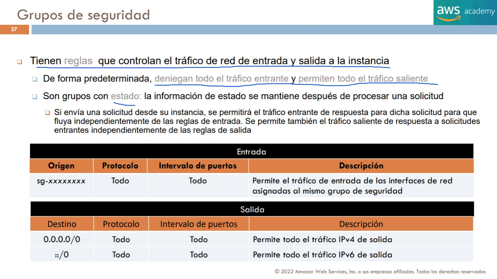

`[FUENTE: T5 p. 28]`

Solo pueden crearse **reglas Allow**, no reglas Deny; AWS evalúa el conjunto de reglas y **el orden no importa**. Ejemplo de entrada TCP **80 HTTP**, **443 HTTPS** desde 0.0.0.0/0, SSH **22** restringido a una procedencia IPv4 indicada, y salida TCP **1433** hacia el SG de una base de datos SQL Server. El caso ayuda a razonar por qué SSH suele requerir orígenes restringidos y por qué referencias de SG representan conjuntos de recursos, no máscaras genéricas.

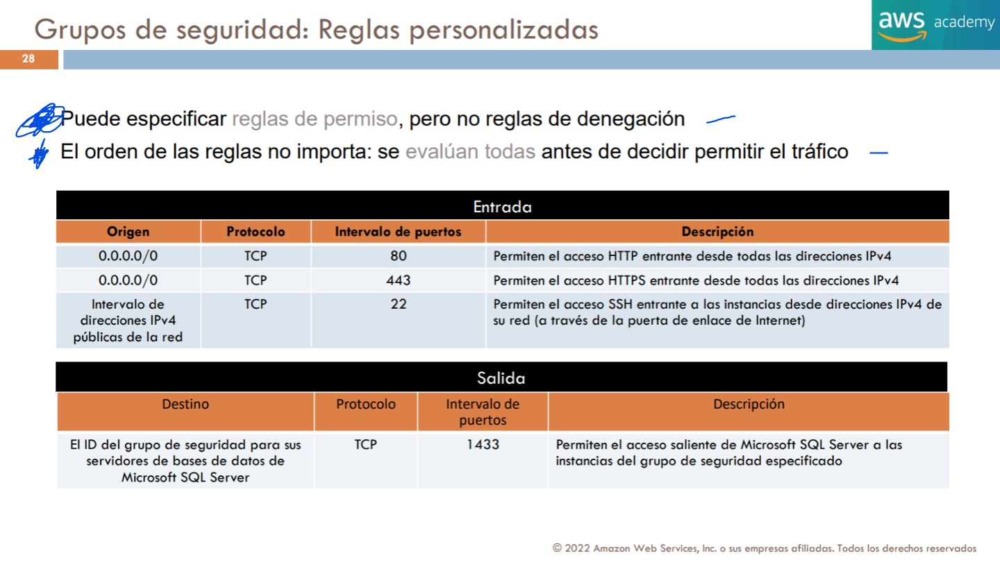

### Leer la configuración inicial sin mezclar casos

`[FUENTE: T5 p.27 — tabla cotejada en la figura]` El texto de la lámina dice que se niega la entrada y se permite la salida por defecto, pero su tabla de entrada representa una **regla que referencia al propio SG**. Son dos configuraciones que hay que distinguir: un grupo nuevo tiene un comportamiento inicial que no debe confundirse con el grupo predeterminado de la VPC o con un grupo ya modificado.

| Dirección en la tabla de T5 p.27 | Origen o destino | Protocolo y puertos | Qué explica |
|---|---|---|---|
| Entrada | ID ilustrativo del mismo SG | Todo / todo | Permite tráfico desde interfaces asociadas a ese grupo, no desde todo Internet |
| Salida | `0.0.0.0/0` | Todo / todo | Permite el tráfico IPv4 de salida del ejemplo |
| Salida | `::/0` | Todo / todo | Permite el tráfico IPv6 de salida del ejemplo |

`[AMPLIACIÓN OFICIAL]` La diferencia se confirma en la documentación de [Security Groups](https://docs.aws.amazon.com/vpc/latest/userguide/vpc-security-groups.html). Se debe inspeccionar el conjunto real de reglas y asociaciones, no inferirlo solo del nombre del grupo ni copiar una descripción histórica de «por defecto» sin contexto.

### Stateful no significa permitir cualquier conexión nueva

`[EXPLICACIÓN DIDÁCTICA]` Si se permite a un cliente establecer HTTPS con una instancia, el seguimiento de estado del SG admite el tráfico de respuesta correspondiente sin una regla de retorno independiente. Esto no autoriza a la instancia a iniciar cualquier conexión nueva hacia un destino ajeno. Hay que distinguir **respuesta a una conexión permitida** de **inicio de otra conexión**, que se evalúa según las reglas aplicables.

Las reglas de SG son de permiso y se evalúan como un conjunto. Añadir una regla estrecha no neutraliza otra más amplia que permita el mismo tráfico. Para retirar una exposición no basta con añadir un origen restringido si continúa existiendo la regla `0.0.0.0/0` que la abría. La corrección debe revisar todas las reglas pertinentes y los grupos asociados al recurso.

### Reglas concretas de T5 p.28

| Dirección | Origen o destino del ejemplo | TCP | Lectura |
|---|---|---:|---|
| Entrada | Cualquier IPv4, `0.0.0.0/0` | 80 | HTTP accesible desde todos los orígenes IPv4 bajo los demás controles del trayecto |
| Entrada | Cualquier IPv4, `0.0.0.0/0` | 443 | HTTPS accesible con ese alcance de red |
| Entrada | Rango público IPv4 de la red de administración | 22 | SSH restringido al origen indicado; la lámina no da una dirección fija que deba inventarse |
| Salida | SG de servidores Microsoft SQL Server | 1433 | Permiso de salida a los recursos de base de datos identificados por ese SG |

Referenciar un SG representa un conjunto admitido de interfaces o recursos en ese contexto; no crea por sí solo una ruta ni copia sus reglas. Permitir el puerto tampoco garantiza que la aplicación escuche, que el sistema invitado lo permita o que las credenciales sean correctas. Diagnosticar conectividad exige comprobar todo el trayecto.

## 7.3 Network ACL: subred, orden y tráfico de retorno

`[FUENTE: T5 p. 29]`

Una **Network ACL** controla tráfico entrante/saliente a nivel de **subred**. La figura usa dos subredes dentro de una VPC y ACL asociadas a cada una; una subred solo puede estar asociada a **una ACL** en un momento dado, mientras una ACL puede asociarse a varias subredes. Si no se asocia una ACL específica, se utiliza la ACL predeterminada según las reglas de VPC. La NACL complementa al Security Group; no lo reemplaza.

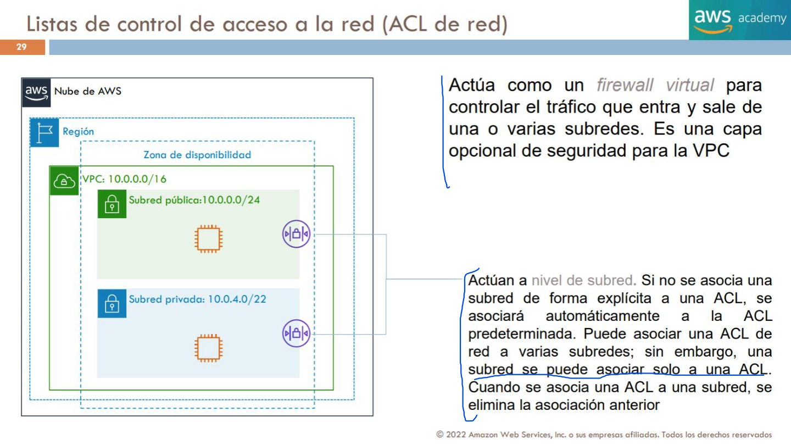

`[FUENTE: T5 p. 30]`

Una NACL tiene **reglas numeradas en orden ascendente**, diferenciando reglas de **entrada** y de **salida**, y cada una puede **permitir o denegar**. Es **stateless**, de modo que el tráfico de retorno necesita permisos explícitos. La diapositiva presenta ejemplo de **ACL predeterminada** con regla 100 que permite tráfico IPv4 y `*` que deniega lo no coincidente. Para un caso real revisar tráfico de retorno/puertos efímeros y el tipo de ACL; «predeterminada permite» no equivale a configuración recomendada para todos los escenarios.

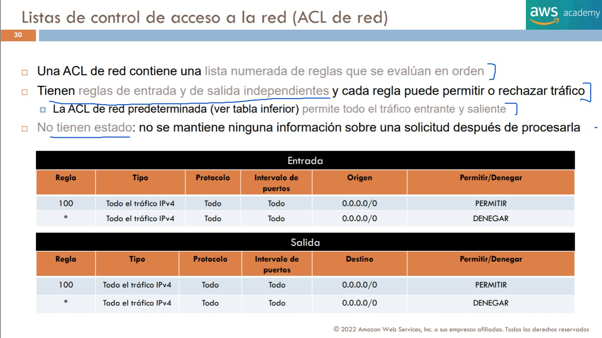

`[FUENTE: T5 p. 31]`

**ACL personalizada:** en entrada se permite HTTPS TCP 443 de 0.0.0.0/0 con regla 100 y SSH TCP 22 de 192.0.2.0/24 con regla 120; la regla `*` deniega demás tráfico. Salida muestra reglas de ejemplo paralelas. La lámina subraya que **las ACL personalizadas niegan tráfico hasta crear reglas**, admiten Allow/Deny y la **primera regla coincidente por orden numérico** decide. **Advertencia:** no copiar literalmente esas salidas como configuración universal: el carácter stateless puede exigir puertos de respuesta diferentes según dirección del flujo.

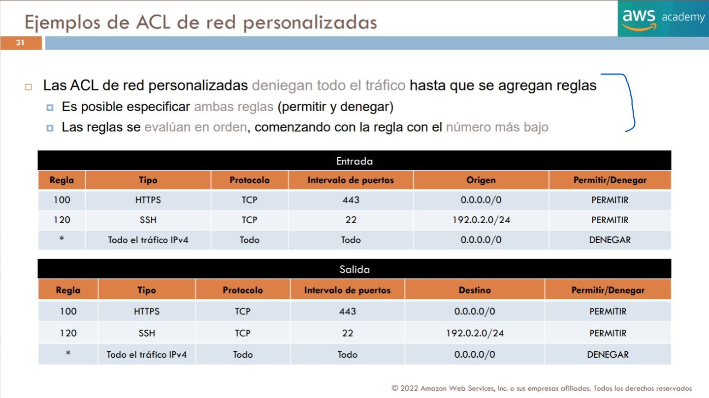

### Reconstrucción legible de las dos tablas de NACL

`[FUENTE: T5 pp.30–31]` En la ACL predeterminada ilustrada, tanto entrada como salida tienen una regla 100 que permite todo el tráfico IPv4 desde o hacia `0.0.0.0/0`, seguida de `*`, que deniega el tráfico no coincidente. La regla `*` no se usa para permitir lo que se olvidó especificar: representa el resultado final de denegación. La tabla de la lámina no se debe extender imaginariamente a configuraciones IPv6 que no muestra.

| Dirección | Regla | Tipo | TCP | Origen / destino | Resultado |
|---|---:|---|---:|---|---|
| Entrada personalizada | 100 | HTTPS | 443 | `0.0.0.0/0` | Permitir |
| Entrada personalizada | 120 | SSH | 22 | `192.0.2.0/24` | Permitir |
| Entrada personalizada | `*` | Todo IPv4 | Todo | `0.0.0.0/0` | Denegar |
| Salida personalizada | 100 | HTTPS | 443 | `0.0.0.0/0` | Permitir |
| Salida personalizada | 120 | SSH | 22 | `192.0.2.0/24` | Permitir |
| Salida personalizada | `*` | Todo IPv4 | Todo | `0.0.0.0/0` | Denegar |

Esta tabla reproduce el **ejemplo docente**, no una receta completa de HTTPS y SSH para producción. Una respuesta a una conexión entrante no suele tener como puerto de destino el mismo puerto de servicio: vuelve al puerto que eligió el cliente. Copiar simétricamente 443 o 22 en ambas direcciones puede impedir el retorno. Debe analizarse cada dirección, los puertos implicados y el tráfico efímero que realmente corresponda al sistema y al patrón de conexión.

### Primera coincidencia y diferencia respecto al SG

`[EXPLICACIÓN DIDÁCTICA]` Si una ACL permite un rango amplio en la regla 100 y una regla 120 intenta denegar una parte de ese rango para el mismo tráfico, la regla 100 gana al coincidir primero. Para obtener el efecto deseado se necesita ordenar y acotar las reglas coherentemente. No se aplica la regla «sumar todos los permisos» propia de la intuición del SG a una lista numerada con primera coincidencia.

Una ACL es **stateless**: una respuesta se evalúa como tráfico de la otra dirección, sin recordar la solicitud anterior. El SG es **stateful** y puede permitir el retorno de la conexión que admitió. En una VPC ambos pueden intervenir: pasar una ACL no equivale a pasar un SG, y permitir en ambos no sustituye rutas, gateway, firewall del host o aplicación.

## 7.4 Comparativa y práctica de diagnóstico SG/NACL

`[FUENTE: T5 p. 32]`

| Atributo | Security Group | Network ACL |
|---|---|---|
| Alcance | Instancia/interfaz/recurso asociado | Subred |
| Reglas | Solo Allow | Allow y Deny |
| Estado | **Stateful**: admite automáticamente tráfico de retorno | **Stateless**: retorno requiere reglas explícitas |
| Orden | No importa; se consideran las reglas de permiso | Numérico, primera coincidencia |

La comparación resume la elección y suele ser materia de examen. Los ejemplos de entrada HTTPS, respuesta y SSH restrictivo se desarrollan a continuación.

---

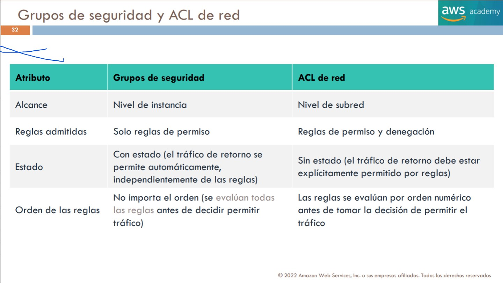

`[AMPLIACIÓN OFICIAL — corpus 02, D.1]`

| Característica | Security Group (SG) | Network ACL (NACL) |
|---|---|---|
| Alcance | Interfaz de red / recurso asociado, común en EC2 | Subred de VPC |
| Reglas | Solo **Allow** | **Allow** y **Deny** |
| Comportamiento | **Stateful**, retorno de conexiones establecidas permitido | **Stateless**, retorno requiere reglas |
| Evaluación | Conjunto de reglas; no prioridad numérica | Por número ascendente, primera regla coincidente |
| Ejemplo | HTTPS al servidor web EC2, SSH solo desde redes de administración | Bloquear segmento IPv4 de entrada/salida para toda una subred |

**Trampa:** el Security Group predeterminado de VPC puede tener reglas entrantes particulares, distintas del comportamiento de un **Security Group nuevo**. Una NACL personalizada y una NACL predeterminada tampoco tienen idénticas reglas iniciales. **No reutilizar** sin analizar un ejemplo de la diapositiva que permite SSH desde cualquier dirección, ni omitir puertos efímeros en retornos de ACL.

Fuente: https://docs.aws.amazon.com/vpc/latest/userguide/vpc-security-groups.html ; https://docs.aws.amazon.com/vpc/latest/userguide/vpc-network-acls.html

`[EXPLICACIÓN DIDÁCTICA]` En una práctica sobre HTTPS, describe el flujo desde el navegador hasta la instancia y de vuelta. Identifica la dirección y el puerto de destino de la solicitud y la dirección y el puerto de destino de la respuesta. Después explica qué regla del SG permite la conexión, por qué su respuesta se admite por estado y qué reglas de ACL necesita el retorno. No inventes un rango universal de puertos efímeros: debe corresponder al cliente y a su configuración.

En una práctica de administración, compara «permitir SSH desde la red autorizada» con «permitir SSH desde cualquier IPv4». En ambos casos el puerto es 22, pero cambia la superficie de acceso. Restringir el origen no sustituye autenticación, custodia de claves ni mantenimiento del sistema invitado. La red decide si una comunicación puede llegar, no si la persona está autorizada a ejecutar cualquier operación de AWS.

## 7.5 Protección de datos en reposo y claves KMS

`[FUENTE: T3 p. 41]`

AWS KMS permite **crear y administrar claves criptográficas** y controlar su uso para cifrado en servicios AWS y aplicaciones. Se integra con **CloudTrail** para auditar las llamadas al uso de claves. El material menciona módulos de seguridad hardware **HSM** validados según requisitos FIPS 140-2 como capa de protección de claves (afirmación del documento histórico; comprobar versiones/certificaciones vigentes). KMS no cifra automáticamente cualquier dato existente sin configurar el servicio/aplicación que lo usa.

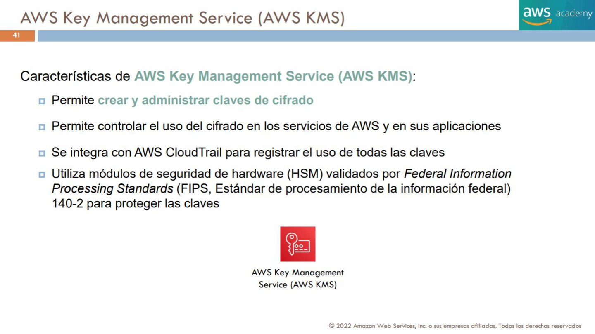

`[FUENTE: T3 p. 45]`

El cifrado transforma información legible usando claves para impedir su lectura por actores no autorizados sin capacidad de descifrarla. **En reposo** significa datos almacenados, por ejemplo en disco o respaldo. La diapositiva menciona **Amazon S3**, **Amazon EBS**, **Amazon EFS** y bases de datos de **Amazon RDS**, con AWS KMS como mecanismo posible para administrar claves. Matiz conceptual: el cifrado en reposo no protege todas las vías de acceso ni sustituye autorización IAM y diseño de claves.

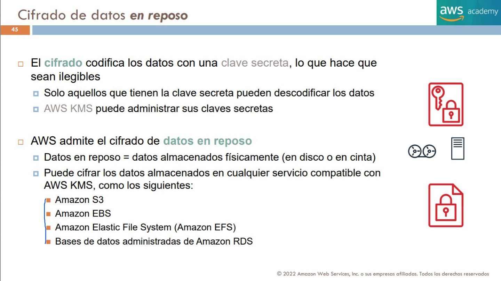

`[AMPLIACIÓN OFICIAL — corpus 02, B.1]`

**En reposo**: protege la información almacenada en discos, bases de datos, objetos o copias. **En tránsito**: protege comunicaciones durante su paso por redes. No confundir cifrado simétrico/asimétrico, identidad/certificado, ni cifrado con autorización. Un objeto puede estar cifrado pero ser accesible para una identidad IAM demasiado permisiva; una conexión HTTPS protege el canal pero no corrige una vulnerabilidad lógica en la aplicación.

Servicios que conviene distinguir:

- **AWS KMS:** creación/administración y políticas de uso de claves gestionadas para servicios compatibles; eventos de uso auditables con CloudTrail; hay claves propiedad de AWS, gestionadas por AWS y claves gestionadas por cliente con diferencias de control.
- **AWS Certificate Manager (ACM):** provisión/administración/renovación de certificados TLS para servicios compatibles; **no** reemplaza KMS como almacén general de claves de cifrado de datos.
- **Amazon S3:** configuraciones de cifrado del lado del servidor, permisos IAM/políticas de bucket, S3 Block Public Access y controles de acceso a objetos; actualmente la desactivación de ACL mediante Object Ownership suele ser la opción predeterminada en buckets nuevos.
- **Amazon EBS:** cifrado de volúmenes/snapshots admitidos, copias y controles de acceso; **Amazon RDS:** cifrado de almacenamiento y conexiones cifradas configuradas para el motor aplicable; **Amazon EFS:** opciones de cifrado de datos en reposo y conexiones en tránsito.
- **AWS Secrets Manager:** almacena, controla acceso y puede rotar credenciales/secretos, por ejemplo contraseñas de base de datos. **Parameter Store** de AWS Systems Manager almacena valores de configuración y secretos compatibles, según tipo/configuración. **No** usar políticas IAM o un repositorio Git para guardar contraseñas en texto plano.

**Ejemplo:** una web requiere HTTPS de usuarios → certificados ACM integrados con un balanceador compatible y TLS; requiere almacenar de forma cifrada sus secretos → Secrets Manager; requiere controlar claves del cifrado del bucket → KMS y configuración S3; requiere leer los objetos → autorización de bucket/IAM. Cada herramienta resuelve una pregunta diferente.

Fuentes: https://docs.aws.amazon.com/kms/latest/developerguide/overview.html ; https://docs.aws.amazon.com/acm/latest/userguide/acm-overview.html ; https://docs.aws.amazon.com/secretsmanager/latest/userguide/intro.html ; https://docs.aws.amazon.com/AmazonS3/latest/userguide/about-object-ownership.html

### Cifrado, autorización y custodia de claves

`[EXPLICACIÓN DIDÁCTICA]` Cifrar transforma datos mediante un mecanismo criptográfico y claves. El efecto práctico depende de quién puede descifrar, en qué contexto y cómo se configura el servicio. Una identidad autorizada a leer un objeto cifrado puede recibir su contenido legible según el mecanismo y los permisos; por ello cifrado y autorización deben evaluarse juntos. La pregunta «¿está cifrado?» no agota la pregunta «¿quién puede leerlo?».

AWS KMS administra claves y permite controlar y auditar su uso en servicios compatibles. No es un almacén genérico de contraseñas equivalente a Secrets Manager ni un gestor de certificados TLS equivalente a ACM. Las claves propiedad de AWS, gestionadas por AWS y gestionadas por el cliente implican diferentes niveles de control y visibilidad. La integración concreta, las políticas y los permisos importan más que afirmar simplemente «utilizamos KMS».

El cliente sigue decidiendo clasificación, acceso, retención y recuperación. Deshabilitar o perder acceso a una clave puede impedir recuperar información que de otro modo sigue almacenada. Se deben comprender dependencias y procedimientos antes de cambiar una política o retirar una clave. Una copia cifrada no es útil para recuperar si no se han conservado los permisos y mecanismos necesarios para usarla.

### Reconocer el tipo de almacenamiento

| Recurso | Qué se protege en el contexto del curso | Qué sigue decidiendo el cliente |
|---|---|---|
| S3 | Objetos almacenados y sus opciones de cifrado | Políticas, exposición, clasificación y acceso a datos/clave |
| EBS | Datos de volúmenes y snapshots según configuración | Recursos protegidos, permisos, copias y restauración |
| EFS | Datos de un sistema de archivos y opciones de protección | Acceso de clientes y requisitos de cifrado en tránsito y reposo |
| RDS | Datos del servicio de base y capacidades asociadas | Configuración, usuarios, aplicación, recuperación y acceso |

Las capacidades no se deben extrapolar a un cambio universal automático de todos los recursos ya creados. Antes de aplicar una configuración se consulta el servicio, el tipo de recurso y sus condiciones. La referencia histórica a HSM y FIPS 140-2 de T3 p.41 se conserva como dato del curso; no certifica la versión actual de todos los módulos o configuraciones de KMS.

**Actualización de certificación (2 de noviembre de 2026):** la descripción oficial de KMS consultada indica HSM validados conforme a FIPS 140-3, nivel de seguridad 3. Es un contraste con la referencia FIPS 140-2 del material de 2022; no convierte cualquier arquitectura del cliente en una solución certificada. Véase la [descripción oficial de KMS](https://docs.aws.amazon.com/kms/latest/developerguide/overview.html).

## 7.6 Datos en tránsito, TLS y certificados

`[FUENTE: T3 p. 46]`

Los datos **en tránsito** se mueven por una red y pueden protegerse mediante **TLS**; el material menciona HTTPS y la administración/despliegue de certificados con **AWS Certificate Manager (ACM)**. Ejemplos gráficos: comunicación entre una instancia EC2 y EFS protegida con TLS, y conectividad de un sistema corporativo con S3 vía AWS Storage Gateway con canal TLS/SSL. Se debe mencionar SSL como denominación histórica **obsoleta/insegura** frente a versiones modernas de TLS, y no equiparar protección de tránsito con cifrado de datos almacenados.

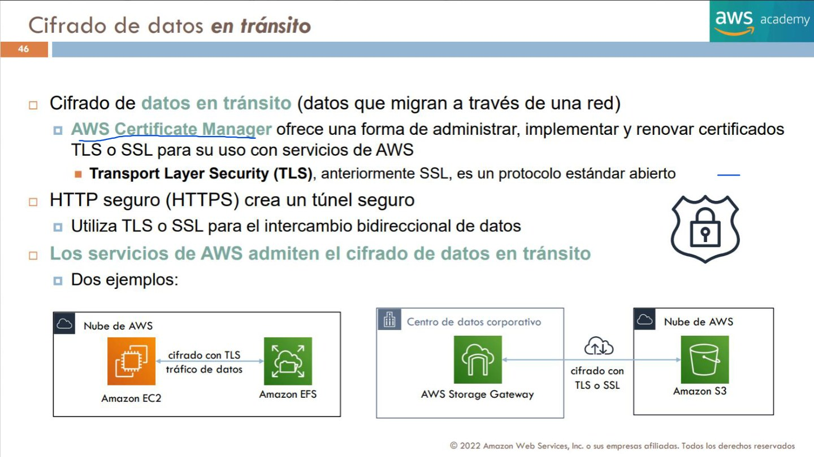

`[EXPLICACIÓN DIDÁCTICA]` Los datos en tránsito se intercambian entre componentes. TLS puede proteger confidencialidad e integridad del canal y participar en la autenticación del extremo mediante certificados, según la configuración. Un certificado no sustituye la autorización de negocio: una web puede tener HTTPS correcto y aun así exponer información a usuarios indebidamente autorizados.

ACM permite gestionar certificados para integraciones compatibles. No significa que cualquier conexión de la arquitectura quede cifrada por existir un certificado en la cuenta. Hay que localizar el punto donde se usa, dónde termina TLS y cómo se protege el siguiente salto. Si TLS termina en un balanceador, la conexión entre ese balanceador y sus destinos es otro tramo que debe diseñarse según requisitos.

La lámina representa EC2 con EFS y un entorno corporativo que utiliza AWS Storage Gateway para comunicarse con S3. Storage Gateway integra almacenamiento de entornos locales con AWS en modalidades admitidas; no debe confundirse con un servicio de identidad o un certificado. El rótulo TLS/SSL de 2022 es histórico. En las explicaciones actuales se utiliza TLS y no se recomienda desplegar protocolos SSL obsoletos.

## 7.7 Buckets privados, acceso público y ACL de S3

`[FUENTE: T3 p. 47]`

Los buckets y objetos **son privados por defecto**; cuando se requiere compartir, debe controlarse expresamente quién accede y qué acciones realiza, aplicando mínimo privilegio y cifrado cuando corresponda. La diapositiva enumera **S3 Block Public Access** (bloqueo de acceso público), **políticas IAM**, **políticas de bucket** y **ACL** como controles; las ACL se presentan como mecanismo heredado. Añade revisiones de permisos mediante **Trusted Advisor**. Matiz actual: Object Ownership/bucket owner enforced suele deshabilitar ACL en configuraciones modernas; no promover ACL como opción preferente.

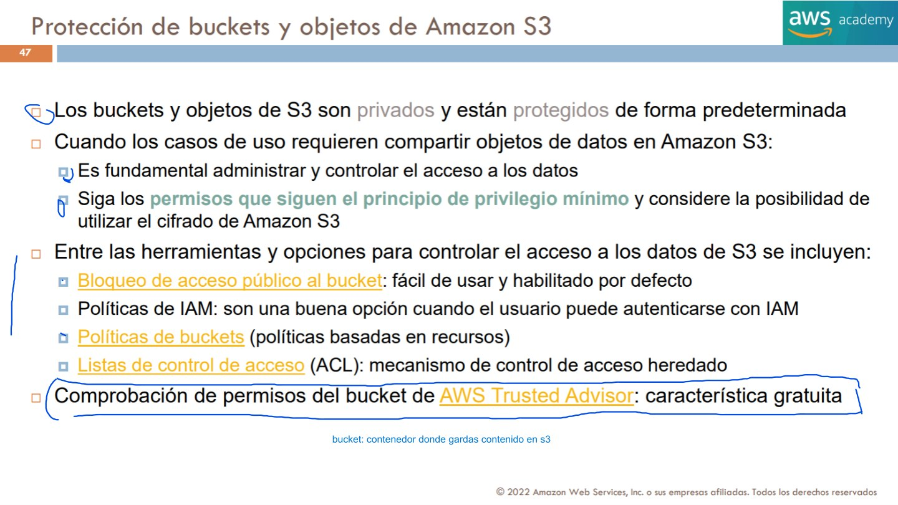

`[AMPLIACIÓN OFICIAL — revisión del 2-11-2026]` S3 Object Ownership permite controlar la propiedad de objetos; la configuración Bucket owner enforced deshabilita ACL y utiliza políticas para el control de acceso. La documentación explica la configuración predeterminada de buckets nuevos. Esto justifica tratar las ACL de S3 como mecanismo heredado cuando el curso las enumera, sin afirmar que cualquier bucket antiguo tenga automáticamente la misma configuración. Fuente: [S3 Object Ownership](https://docs.aws.amazon.com/AmazonS3/latest/userguide/about-object-ownership.html).

`[EXPLICACIÓN DIDÁCTICA]` Una **ACL de S3** y una **Network ACL** comparten una sigla genérica y tienen funciones diferentes. La primera trata acceso a buckets u objetos bajo el modelo admitido; la segunda filtra tráfico al entrar y salir de subredes VPC. Usar ambas palabras como si designaran un firewall único mezcla autorización de datos con filtrado de paquetes.

S3 Block Public Access establece protecciones frente a acceso público según su configuración. Se utiliza junto con políticas y opciones del recurso, no como excusa para dejar de revisar permisos. Si una carga requiere compartir datos, hay que definir quién, qué acciones y sobre qué objetos, evitando convertir un acceso específico en exposición universal. Access Analyzer ayuda a estudiar acceso, mientras que Macie ayuda a descubrir datos sensibles: la pregunta que responde cada uno es distinta.

## 7.8 DDoS, solicitudes web y administración central de controles

`[FUENTE: T3 p. 43]`

AWS Shield es protección administrada contra **ataques DDoS** que afectan a aplicaciones y recursos de AWS. La diapositiva menciona detección continua y mitigación automática, con distinción **Shield Standard** (incluido sin cargo adicional para protecciones aplicables) y **Shield Advanced** (opción de pago). No confundir protección DDoS de red/transporte con **AWS WAF**, que filtra solicitudes HTTP(S) de capa de aplicación; ambos pueden complementarse.

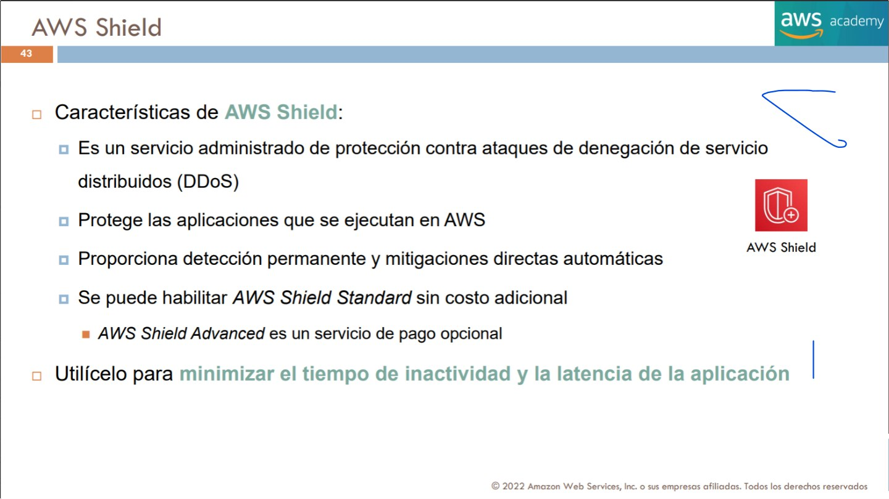

`[AMPLIACIÓN OFICIAL — corpus 02, D.2]`

**AWS Shield:** defensa administrada frente a ataques **DDoS**, con opciones Standard y Advanced según protección y condiciones comerciales.
- **AWS WAF:** filtra solicitudes **HTTP(S)** con reglas web ACL: IP, encabezados, patrones, rate limiting y otros controles según configuración y producto. Defiende contra clases de ataques web y bots, sin sustituir controles de autenticación de la aplicación.
- **AWS Firewall Manager:** gestión centralizada de determinadas políticas de seguridad y firewall en varias cuentas y recursos de una organización; no es idéntico a un firewall de paquetes local ni a Shield.
- **AWS Network Firewall:** servicio de firewall de red administrado para inspección y filtrado de tráfico VPC cuando se necesita ese nivel de control; menor prioridad para el dominio 2 pero útil en comparaciones.

**Escenario:** bloquear patrones SQLi en HTTP → WAF; mitigar avalancha DDoS → Shield; distribuir centralizadamente políticas WAF entre muchas cuentas → Firewall Manager; permitir TCP 443 a una instancia EC2 → SG; negar un rango de origen a nivel de subred → NACL.

Fuentes: https://docs.aws.amazon.com/waf/latest/developerguide/what-is-aws-waf.html ; https://docs.aws.amazon.com/waf/latest/developerguide/fms-chapter.html ; https://aws.amazon.com/shield/

`[EXPLICACIÓN DIDÁCTICA]` Un ataque DDoS intenta degradar disponibilidad mediante una carga distribuida de tráfico o solicitudes. La protección de Shield se centra en ese tipo de amenaza dentro del alcance del servicio y sus modalidades. Una regla WAF, en cambio, inspecciona solicitudes web y aplica criterios HTTP(S): por ejemplo, patrones de inyección SQL o restricciones de tasa bajo la configuración admitida. Las dos herramientas pueden colaborar y no sustituyen un diseño de aplicación resiliente.

Firewall Manager resuelve una pregunta de gobierno: cómo administrar políticas de seguridad compatibles de forma centralizada en una organización con muchas cuentas y recursos. No se debe elegir únicamente porque la pregunta contenga la palabra «firewall» si lo que se necesita es permitir TCP 443 en una instancia. Network Firewall aporta inspección y filtrado de red en VPC para casos que requieren ese nivel; no es otra denominación de WAF.

| Situación | Herramienta que conviene reconocer | Razón |
|---|---|---|
| Controlar patrones maliciosos de solicitudes web | AWS WAF | Evalúa condiciones de HTTP(S) |
| Mitigar un ataque distribuido contra disponibilidad | AWS Shield | Protección DDoS dentro de su alcance |
| Distribuir políticas WAF entre cuentas | AWS Firewall Manager | Administración central de controles compatibles |
| Permitir HTTPS a una instancia | Security Group | Regla de tráfico asociada al recurso |
| Permitir o denegar un rango en una subred | Network ACL | Control numerado en el límite de subred |
| Inspeccionar tráfico de red en una arquitectura VPC | AWS Network Firewall | Firewall de red administrado para escenarios compatibles |

## 7.9 Amenazas, vulnerabilidades, datos sensibles y postura

`[AMPLIACIÓN OFICIAL — corpus 02, B.4]`

**Amazon GuardDuty** es detección administrada de amenazas; analiza señales admitidas como registros de API, red o DNS y otras fuentes configuradas para identificar comportamiento sospechoso. **Amazon Inspector** identifica vulnerabilidades y problemas de exposición en tipos de recursos compatibles, como instancias y artefactos de software admitidos. **Amazon Macie** ayuda a descubrir datos sensibles en S3. **AWS Security Hub CSPM** evalúa postura y buenas prácticas de seguridad mediante controles y consolida hallazgos. **AWS Security Hub**, en la organización actual de la documentación, es una experiencia complementaria para correlacionar/priorizar hallazgos y gestionar respuesta. La nomenclatura y separación **Security Hub vs Security Hub CSPM** es una **actualización de 2026**: el material CLF-C02 puede referirse sencillamente a Security Hub; identificar el caso de uso antes que memorizar una etiqueta histórica.

**Comparación corta:** malware o comportamiento sospechoso → GuardDuty; vulnerabilidades conocidas de software → Inspector; datos sensibles en S3 → Macie; controles y estado de cumplimiento → CSPM; correlación/priorización centralizada → Security Hub. Un producto no reemplaza automáticamente todos los demás.

Fuentes: https://docs.aws.amazon.com/guardduty/latest/ug/what-is-guardduty.html ; https://docs.aws.amazon.com/inspector/latest/user/what-is-inspector.html ; https://docs.aws.amazon.com/macie/latest/user/what-is-macie.html ; https://docs.aws.amazon.com/es_es/securityhub/latest/userguide/what-are-securityhub-services.html

### GuardDuty: comportamiento sospechoso

`[AMPLIACIÓN OFICIAL]` Amazon GuardDuty utiliza fuentes de señales admitidas para generar hallazgos de posibles amenazas. Es apropiado para preguntas de actividad sospechosa y detección; no equivale a conceder permisos, parchear automáticamente toda una aplicación o descubrir por sí solo cualquier secreto almacenado. El equipo necesita analizar el hallazgo, contexto y alcance y definir respuesta.

### Inspector: vulnerabilidades y exposición

Amazon Inspector evalúa vulnerabilidades y determinados problemas de exposición de recursos y software compatibles. El foco es distinto al de un detector de comportamiento: una vulnerabilidad puede existir antes de observar un ataque. Su hallazgo debe llevar a evaluar relevancia, versión, parche y proceso de remediación. No convierte una aplicación en segura simplemente por estar habilitado.

### Macie: descubrir información sensible en S3

Amazon Macie ayuda a identificar datos sensibles en S3 y cuestiones de seguridad asociadas según el alcance configurado. Se utiliza cuando la pregunta es qué información hay y dónde puede necesitar protección adicional. No reemplaza las políticas que conceden o impiden leer esa información, ni demuestra por sí solo cumplimiento jurídico completo.

### Security Hub y Security Hub CSPM

`[AMPLIACIÓN OFICIAL — revisión del 2-11-2026]` La documentación actual presenta ambos servicios como complementarios. CSPM evalúa postura, controles y estándares; Security Hub ofrece una experiencia unificada para priorizar y responder a problemas, correlacionando resultados de servicios compatibles. La guía CLF-C02 puede usar simplemente el nombre Security Hub: primero identifica el caso de uso descrito. Fuente: [relación oficial de Security Hub y CSPM](https://docs.aws.amazon.com/es_es/securityhub/latest/userguide/what-are-securityhub-services.html).

`[EXPLICACIÓN DIDÁCTICA]` Una secuencia práctica podría descubrir un dato sensible con Macie, observar una configuración que expone recursos mediante controles de postura y analizar actividad sospechosa con GuardDuty. Son evidencias relacionadas, pero no afirmaciones equivalentes. Centralizar hallazgos ayuda a priorizar; la organización aún necesita responsables, criterios y un procedimiento de respuesta que no cause una interrupción innecesaria.

## 7.10 Registros, métricas y configuración: observaciones diferentes

`[FUENTE: T3 p. 31]`

**Paso 3:** utilizar CloudTrail para registrar actividad y llamadas API de la cuenta. El material explica un **Event history** básico de los últimos 90 días y la creación de un **trail** para almacenamiento de registros de más larga duración y condiciones/alertas particulares. Pasos descritos: abrir CloudTrail en consola, consultar historial y filtros; crear trail, asignarlo a regiones según objetivo, designar bucket S3 para registros y restringir acceso a los logs. Matiz: el historial de eventos de administración gratuito no equivale a registrar universalmente todos los eventos de datos; tales eventos pueden requerir activación y tener coste.

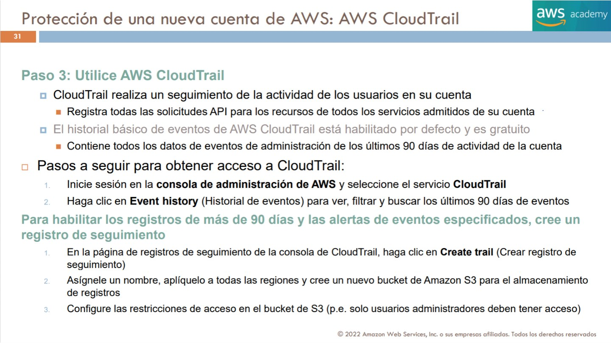

`[FUENTE: T3 p. 50]`

AWS Config permite registrar/consultar **configuraciones** de recursos AWS, cambios en el tiempo e histórico. Puede evaluar recursos frente a configuraciones deseadas usando reglas, ayudar a analizar desviaciones y proporcionar evidencia operativa para auditorías. La captura de consola enseña un panel de reglas y recursos conformes/no conformes. Comparar con CloudTrail (acciones/eventos API) y CloudWatch (métricas, logs y alarmas): son observaciones distintas y complementarias.

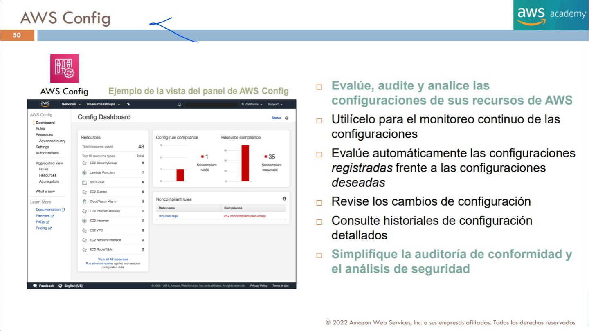

`[AMPLIACIÓN OFICIAL — corpus 02, B.2]`

| Necesidad | Servicio principal | Qué responderá |
|---|---|---|
| Investigar quién hizo una llamada API a AWS | **AWS CloudTrail** | Historial de eventos API/actividad; configuración de trails, destinos, tipos de eventos |
| Monitorizar CPU, peticiones, métricas, logs y activar alarmas | **Amazon CloudWatch** | Observabilidad operativa, alarmas y métricas; pueden ingerirse logs de seguridad |
| Saber cómo estaba configurado un recurso y si cumple reglas | **AWS Config** | Estado/historial de configuración, cambios y evaluaciones de conformidad |
| Identificar comportamientos sospechosos o amenazas | **Amazon GuardDuty** | Hallazgos de seguridad a partir de fuentes de señales admitidas |
| Centralizar, priorizar y evaluar hallazgos de seguridad | **Security Hub / Security Hub CSPM** | Ver apartado B.4 para la distinción actual |
| Encontrar recomendaciones de configuración y buenas prácticas | **AWS Trusted Advisor** | Conjunto de comprobaciones y recomendaciones con alcance dependiente del plan |

**CloudTrail**: el historial de eventos habitual conserva eventos de administración recientes (la diapositiva explica 90 días) sin equivaler a un registro permanente de todas las clases de llamadas. Para retención, auditoría y análisis prolongado se configura trail o destinos/almacenamiento adecuados. Los eventos de datos, como acceso individual a objetos S3, no deben asumirse universalmente habilitados por defecto. **CloudWatch Logs** admite recopilar logs de distintos orígenes, no genera por sí mismo el detalle de API que produce CloudTrail. **Config** no es un SIEM completo: registra configuración y reglas.

**Práctica:** un empleado borra un bucket → investigar actividad CloudTrail; una instancia tiene CPU >90% → alarma CloudWatch; se desactiva el cifrado en un recurso y necesitas comprobar conformidad → Config; se detecta patrón de comportamiento potencialmente malicioso → GuardDuty.

Fuentes: https://docs.aws.amazon.com/awscloudtrail/latest/userguide/cloudtrail-user-guide.html ; https://docs.aws.amazon.com/AmazonCloudWatch/latest/monitoring/WhatIsCloudWatch.html ; https://docs.aws.amazon.com/config/latest/developerguide/WhatIsConfig.html

`[EXPLICACIÓN DIDÁCTICA]` Para investigar «quién cambió una política», interesa actividad atribuible a identidad y operación. Para responder «¿cuándo dejó de cumplir una configuración?» importa el historial del recurso y su evaluación. Para saber «¿la aplicación dejó de responder o aumentó la latencia?» importan métricas, logs operativos y alarmas. Las tres observaciones pueden formar una misma investigación sin que una herramienta sustituya a las otras.

Los registros necesitan retención, protección de acceso, integridad y una forma de consulta. Guardar todo en un bucket que el actor investigado puede borrar sin control limita el valor de la evidencia. También debe entenderse qué eventos se recogen: el historial de administración de CloudTrail no equivale a un archivo indefinido de todos los accesos a objetos S3. Selección de eventos, destinos, regiones y condiciones deben corresponder al requisito.

Config ayuda a analizar recursos conformes o no conformes respecto a reglas definidas; no decide por sí solo si un negocio cumple íntegramente una ley. CloudWatch Logs puede reunir logs de aplicaciones y otras fuentes; no crea retrospectivamente una actividad de API que no se registró. Los costes y capacidades de cada mecanismo necesitan revisión cuando se diseñe su uso real.

## 7.11 CloudWatch: de una métrica a una alarma útil

`[FUENTE: T9 p. 13]`

La presentación pregunta cómo saber cuándo lanzar más instancias EC2, si la aplicación pierde rendimiento/disponibilidad por insuficiencia de capacidad y qué uso real tiene la infraestructura. La respuesta ilustrada es disponer de métricas y monitorización mediante **Amazon CloudWatch**. Estas preguntas son operativas; para el dominio 2 debe vincularse la observación con alarmas y evidencias sin confundir CloudWatch con CloudTrail.

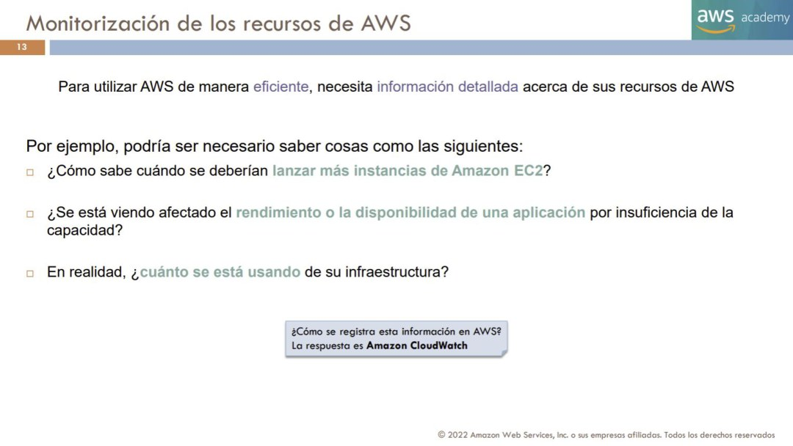

`[FUENTE: T9 p. 14]`

CloudWatch aparece como servicio de **monitorización y observabilidad** de AWS, con métricas de recursos y aplicaciones; métricas estándar (ejemplos CPU, consumo, latencia de ELB) y personalizadas. Las **alarmas** pueden notificar mediante SNS y realizar acciones automatizadas admitidas; los **eventos** desencadenan reglas que envían señales a servicios como Lambda, EC2 o ECS. **Actualización editorial:** no confundir la denominación histórica de «eventos CloudWatch» con Amazon EventBridge, que presta la funcionalidad moderna de bus de eventos.

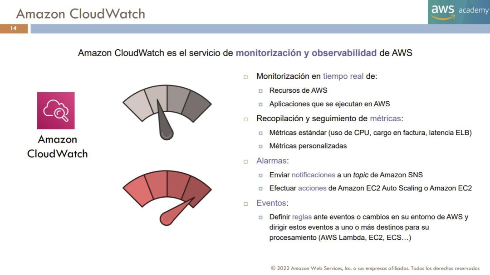

`[FUENTE: T9 p. 15]`

Las alarmas se crean a partir de una métrica o expresiones matemáticas, y evalúan umbrales **estáticos** o detección de anomalías según un modelo de comportamiento. Parámetros ilustrados: namespace (AWS/EC2), métrica (CPU), estadística (media/mínimo/máximo/suma), período, condiciones/operadores (`>`, `<`, etc.), evaluación temporal y acción (notificar o invocar automatización compatible). Una alarma no analiza por sí misma intentos de acceso malicioso salvo que la señal lo represente.

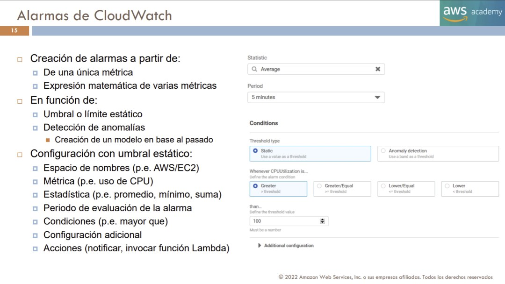

`[EXPLICACIÓN DIDÁCTICA]` Una métrica es una serie de observaciones identificada por un espacio de nombres, un nombre y dimensiones pertinentes. Un estadístico resume datos de un período —por ejemplo promedio o máximo— y la condición compara el resultado con un criterio. Las dimensiones permiten distinguir recursos o subconjuntos; medir una instancia concreta no equivale a medir todas las instancias de la aplicación.

La alarma necesita decidir durante cuánto tiempo y bajo qué condiciones el estado debe considerarse significativo. Un pico breve puede ser inocuo y un promedio largo puede ocultar una degradación importante. También importan los datos ausentes y la acción esperada. Una alarma que avisa de CPU no demuestra por sí sola una amenaza: una carga legítima puede producir el mismo síntoma.

T9 p.14 muestra SNS para notificación y destinos como Lambda, EC2 y ECS para automatización o eventos admitidos. La denominación «CloudWatch Events» es histórica; EventBridge es la referencia moderna para el bus y reglas de eventos. No toda regla de eventos es una alarma de una métrica ni toda alarma necesita invocar una función.

### Actividad completa de T9 pp.16–17

`[FUENTE: T9 p. 16]`

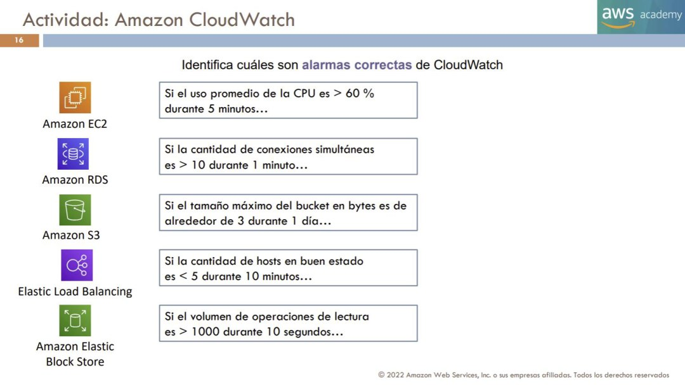

`[FUENTE: T9 p. 17]`

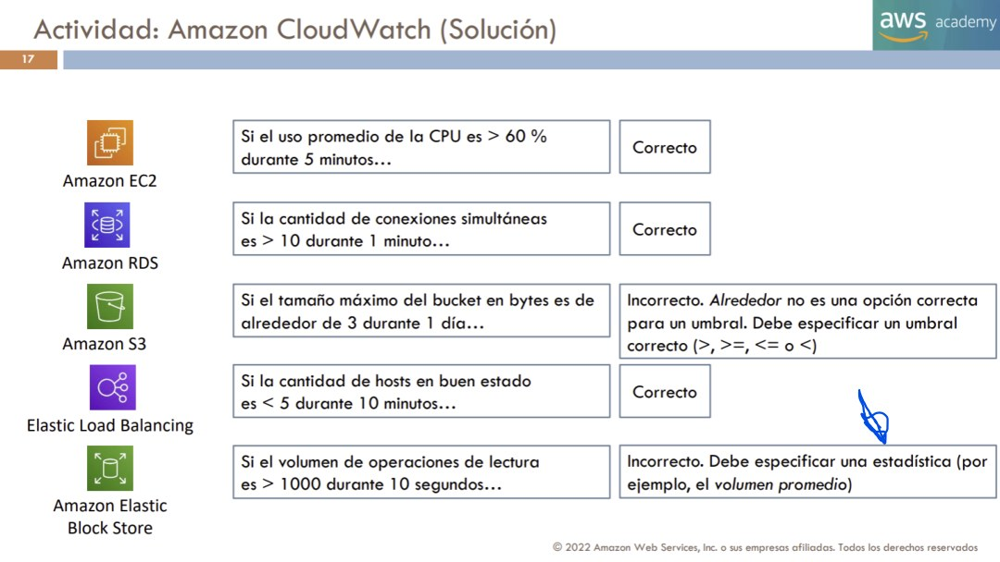

| Nº | Condición propuesta en la lámina | Clave del curso | Explicación |
|---:|---|---|---|
| 1 | Uso promedio de CPU **>60 % durante 5 minutos**, en EC2 | Correcto | Identifica una medida, promedio, comparación y duración. La elección operativa de ese umbral debe justificarse para la carga. |
| 2 | Conexiones simultáneas **>10 durante 1 minuto**, en RDS | Correcto | El curso lo reconoce como condición válida sobre la cantidad de conexiones. No implica que 10 sea un umbral recomendado para todas las bases. |
| 3 | Tamaño máximo de bucket en bytes «**alrededor de 3**» durante 1 día, en S3 | Incorrecto | «Alrededor de» no define un operador ni una banda concreta. El curso pide una comparación expresa como `>`, `>=`, `<=` o `<`. |
| 4 | Hosts saludables **<5 durante 10 minutos**, en ELB | Correcto | Establece una condición y ventana para la cantidad de destinos en buen estado. La topología real determina qué cantidad sería aceptable. |
| 5 | Volumen de operaciones de lectura EBS **>1000 durante 10 segundos** | Incorrecto | La solución señala que falta un estadístico, por ejemplo el volumen promedio; no debe deducirse que todo período de 10 segundos sea inválido en cualquier clase de métrica actual. |

`[FUENTE: T9 pp.16–17 — figuras cotejadas]` El enunciado de EBS utiliza **mayor que**, no «mayor o igual que». La paráfrasis del corpus había usado `≥`; aquí se conserva el signo que muestra la figura. La respuesta de la actividad se refiere a especificar la estadística, no a una afirmación universal sobre la resolución de CloudWatch.

`[EXPLICACIÓN DIDÁCTICA]` Para mejorar la tercera condición se necesitaría expresar qué tolerancia significa «alrededor» y elegir una métrica, un estadístico y una ventana compatibles. No basta sustituir una palabra por un número si falta definir cómo se interpreta. Para la quinta, se especificaría el estadístico y se comprobarían resolución y períodos admitidos por la métrica elegida. Este razonamiento enseña a diseñar una señal verificable en lugar de memorizar etiquetas correcto/incorrecto.

## 7.12 Costes y catálogo de administración como señales auxiliares

`[FUENTE: T3 p. 32]`

**Paso 4:** habilitar un informe de facturación/uso para conocer recursos y cargos estimados. El curso señala entrega de archivos al bucket S3 indicado y actualización diaria, con detalle por hora o día según opciones. La supervisión del gasto puede ayudar a detectar recursos anómalos o abusos pero **no reemplaza** los registros CloudTrail, los detectores de amenazas ni los controles de seguridad. El tema pertenece también al dominio 4 de facturación del CLF-C02.

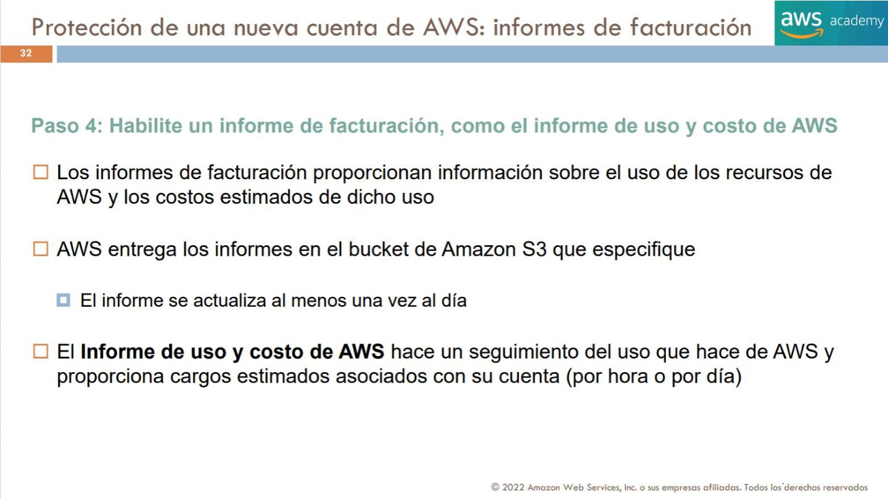

`[FUENTE: T2 p. 18]`

**Referencia reutilizada del Bloque I.** Solo catálogo de servicios: no confundir la presencia de un icono con explicación completa.

La diapositiva contiene seis servicios:

- **AWS Identity and Access Management (IAM)**.
- **AWS Organizations**.
- **Amazon Cognito**.
- **AWS Artifact**.
- **AWS Key Management Service (AWS KMS)**.
- **AWS Shield**.

Definiciones y diferencias en el glosario. La diapositiva solamente muestra iconos y denominaciones.

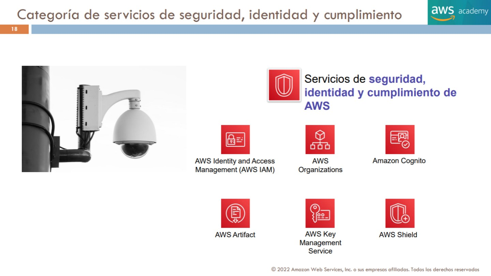

`[FUENTE: T2 p. 19]`

**Referencia reutilizada del Bloque I.** Solo catálogo de servicios: no confundir la presencia de un icono con explicación completa.

La diapositiva muestra:

- **AWS Cost and Usage Report** (informe de coste y uso de AWS).
- **AWS Budgets**.
- **AWS Cost Explorer** (explorador de costes).

**Distinción general:** informes detallados de uso/coste, establecimiento de presupuestos y análisis visual del gasto, respectivamente. La diapositiva enumera herramientas, no entra en una comparación de funcionalidades.

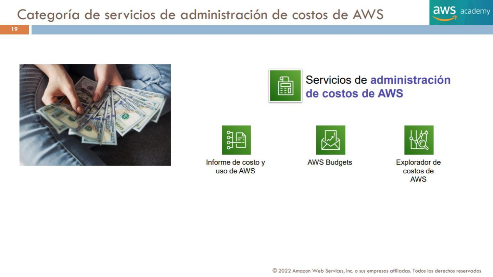

`[FUENTE: T2 p. 20]`

**Referencia reutilizada del Bloque I.** Solo catálogo de servicios: no confundir la presencia de un icono con explicación completa.

Servicios y herramientas enumerados:

1. **AWS Management Console**.
2. **AWS Config**.
3. **Amazon CloudWatch**.
4. **AWS Auto Scaling**.
5. **AWS Command Line Interface (AWS CLI)**.
6. **AWS Trusted Advisor**.
7. **AWS Well-Architected Tool**.
8. **AWS CloudTrail**.

La distinción clave para estudiar es separar **administración**, **observabilidad**, **seguimiento de cambios**, **auditoría**, **escalado** y **revisión de buenas prácticas**.

---

---

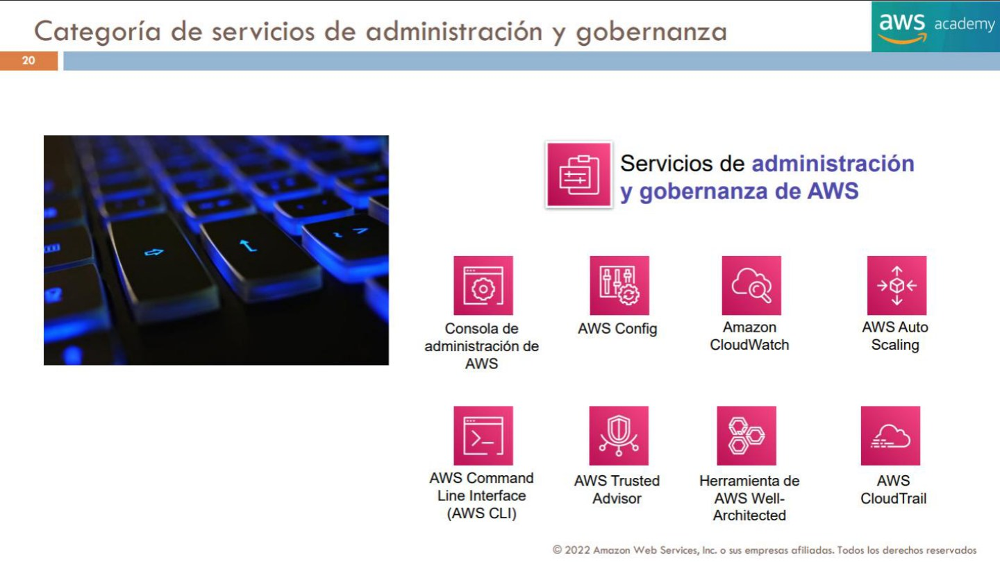

Las imágenes de T2 dan nombres y familias de herramientas; la profundidad propia de cada servicio se desarrolla en los apartados de este bloque. Para almacenamiento, bases y modelos generales se consulta el [Bloque I](../bloque-1/00_indice.md). Aquí los informes de coste sirven como contexto: un pico de consumo puede motivar investigación, pero no identifica por sí mismo al actor ni la causa.

`[EXPLICACIÓN DIDÁCTICA]` Si aparece cómputo inesperado, el equipo puede relacionar coste, inventario de configuración y actividad de API. El gasto indica una consecuencia económica; CloudTrail puede aportar operaciones y principales; las métricas muestran uso. Tratar un presupuesto como detector completo de amenazas deja fuera incidentes que no incrementan la factura y no explica la actividad que sí la incrementa.

## 7.13 Cumplimiento: requisitos, controles y evidencias

`[FUENTE: T3 p. 49]`

Distintas industrias y geografías tienen obligaciones diferentes. AWS trabaja con entidades certificadoras y auditores para proporcionar evidencias sobre controles y procesos del proveedor. La diapositiva distingue **certificaciones/acreditaciones** evaluadas por terceros (ejemplos ISO 27001, ISO 27017, ISO 27018 e ISO 9001), **leyes/regulaciones/privacidad** (GDPR europeo, HIPAA estadounidense) y **marcos sectoriales o de trabajo** (ejemplo CIS). La referencia a un «escudo de privacidad UE–EE.UU.» corresponde a material histórico y no debe presentarse como marco legal vigente sin verificación. Un informe de conformidad AWS no acredita automáticamente el cumplimiento de toda la aplicación del cliente.

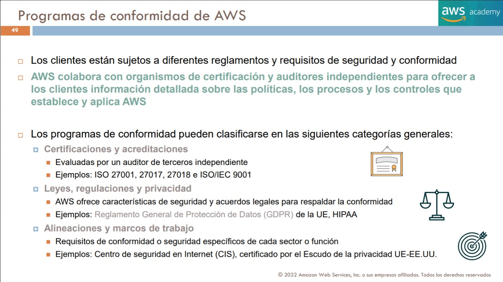

`[FUENTE: T3 p. 51]`

AWS Artifact es recurso para consultar/descargar **informes de seguridad y cumplimiento**, certificados/documentos de auditoría y determinados acuerdos online. El curso cita informes ISO y documentos vinculados al sector de pagos, con acceso desde la categoría de Security, Identity & Compliance de la consola. AWS Artifact facilita **evidencia del proveedor**, pero el cliente continúa obligado a configurar sus controles y cumplir requisitos de su actividad.

---

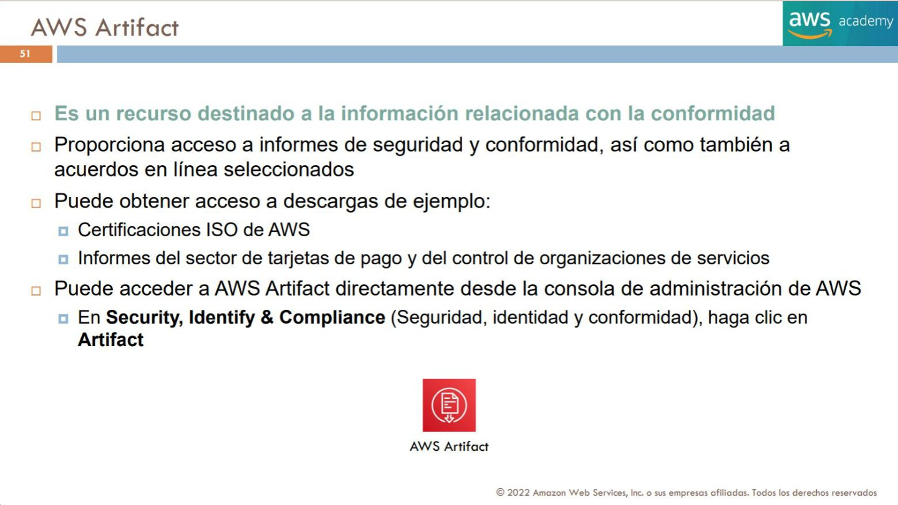

`[AMPLIACIÓN OFICIAL — corpus 02, B.3]`

**AWS Artifact** da acceso a determinados informes/certificaciones de AWS y acuerdos; **AWS Audit Manager** (cuando proceda) ayuda a recopilar evidencia de auditoría del cliente; **AWS Config** da reglas/evolución de configuración; AWS no certifica automáticamente que el código, datos y operaciones del cliente cumplen GDPR, HIPAA o PCI DSS. La ubicación geográfica, la clasificación de datos, la industria y la configuración cambian las obligaciones. Un servicio puede tener alcance en un programa de conformidad sin que *cualquier* uso de él sea conforme.

**Cuidado con la historicidad:** T3 p.49 muestra «Privacy Shield» UE-EE. UU. como referencia formativa de 2022; no debe presentarse como garantía jurídica vigente en 2026. Consultar el marco legal actual de transferencias internacionales y la documentación del regulador en proyectos reales. Del mismo modo, cuotas Organizations de T3 p.39 y listas de tareas «solo root» de T3 p.28 son ejemplos históricos, no cifras/condiciones que deba memorizarse sin actualización.

Fuentes: https://aws.amazon.com/artifact/ ; https://aws.amazon.com/compliance/ ; https://docs.aws.amazon.com/audit-manager/latest/userguide/what-is.html

### Certificaciones, leyes y marcos no son intercambiables

`[FUENTE: T3 p.49 — categorías cotejadas]` La lámina separa certificaciones y acreditaciones evaluadas por terceros; leyes, regulaciones y privacidad; y alineaciones o marcos de trabajo. Entre los ejemplos aparecen ISO 27001, ISO 27017, ISO 27018 e ISO/IEC 9001; GDPR e HIPAA; CIS y la referencia histórica a Privacy Shield. La categoría indica el tipo de evidencia o requisito, no una lista de obligaciones idénticas para toda carga.

`[EXPLICACIÓN DIDÁCTICA]` Una evaluación de cumplimiento empieza por actividad, datos, jurisdicciones y alcance del servicio. Después identifica controles, responsables y evidencias. Que un servicio esté incluido en un programa de AWS no hace conforme cualquier aplicación: aún importan autorización, retención, configuración, procedimientos y uso de datos. También pueden variar regiones y capacidades incluidas; se consulta el alcance documentado para el servicio que se va a utilizar.

El rótulo Privacy Shield se conserva como referencia histórica de la diapositiva. No se utiliza como base para afirmar legalidad actual de una transferencia internacional. Este manual enseña a reconocer la necesidad de consultar requisitos y evidencias vigentes; no sustituye la evaluación jurídica de una organización.

### Artifact, Config, CloudTrail y Audit Manager

| Recurso | Evidencia o ayuda principal | Lo que no demuestra por sí solo |
|---|---|---|
| AWS Artifact | Informes y acuerdos del proveedor disponibles para su consulta | Que todo el código y proceso del cliente cumplan requisitos |
| AWS Config | Estado y evolución de configuración; evaluación de reglas | Que una regla técnica cubra toda una obligación regulatoria |
| AWS CloudTrail | Actividad y eventos del alcance registrado | Que no haya existido actividad que no se recogió |
| AWS Audit Manager | Ayuda a recopilar y organizar evidencias de controles compatibles | Una certificación automática o un dictamen legal |

Un informe debe corresponder al período y al alcance que se pretende demostrar. Un documento antiguo puede servir para una auditoría de ese período y no para una afirmación sobre una capacidad recién incorporada. La custodia de evidencias también necesita permisos y retención adecuados.

## 7.14 Trusted Advisor: leer el hallazgo y proponer una acción

`[FUENTE: CA p. 54]`

**AWS Trusted Advisor** proporciona orientaciones basadas en comprobaciones de recursos y configuraciones dentro de la cuenta. Busca detectar problemas o mejoras posibles en coste, rendimiento, seguridad, resiliencia y límites.

El cuadro de 2022 enumera **cinco categorías**:

| Categoría tal como aparece | Para qué sirve |
| --- | --- |
| Cost Optimization | Detectar recursos sin utilizar, oportunidades de reducción de gasto o configuraciones que causan costes evitables. |
| Performance | Identificar configuraciones que puedan limitar rendimiento o aprovechar mejor recursos disponibles. |
| Security | Detectar configuraciones o permisos que exponen información y servicios. |
| Fault Tolerance | Identificar problemas de redundancia o disponibilidad. |
| Service Limits | Avisar cuando el consumo se acerca o supera límites o cuotas de los servicios. |

Las notas describen que Trusted Advisor puede ayudar desde las primeras etapas de diseño y operación, no solo cuando una aplicación está fallando.

**Actualización oficial (fuera del documento):** AWS describe ahora **seis categorías**, añadiendo **Operational Excellence**. Fuente: [guía de Trusted Advisor](https://docs.aws.amazon.com/awssupport/latest/user/get-started-with-aws-trusted-advisor.html). En el texto final se deben distinguir las **cinco categorías de la diapositiva** de las **seis categorías actuales**.

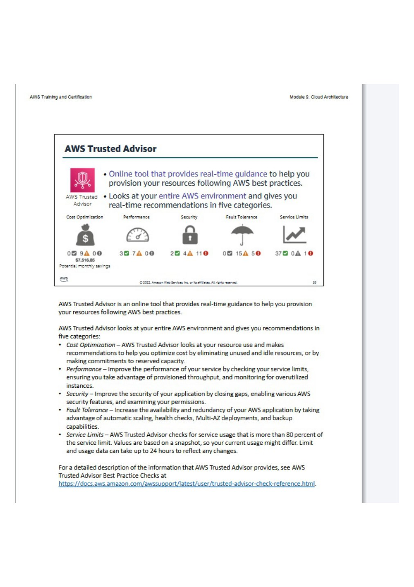

`[FUENTE: CA p. 55]`

El ejercicio presenta un panel de Trusted Advisor con cinco categorías y estados de controles. Se pide interpretar una serie de recomendaciones, especialmente alertas de seguridad y tolerancia a fallos.

Para cada recomendación se debe contestar:

1. ¿Cuál es el estado de la comprobación?
2. ¿Qué problema identifica?
3. ¿Qué información concreta se ofrece sobre el entorno afectado?
4. ¿Qué buena práctica se relaciona con el problema?
5. ¿Qué acción recomienda AWS?

**Lectura de indicadores del material:** iconos de diferente color o severidad distinguen comprobaciones correctas, avisos e incidencias que requieren atención. Los recuentos del panel de demostración son datos **de ejemplo**, no resultados de la cuenta del usuario.

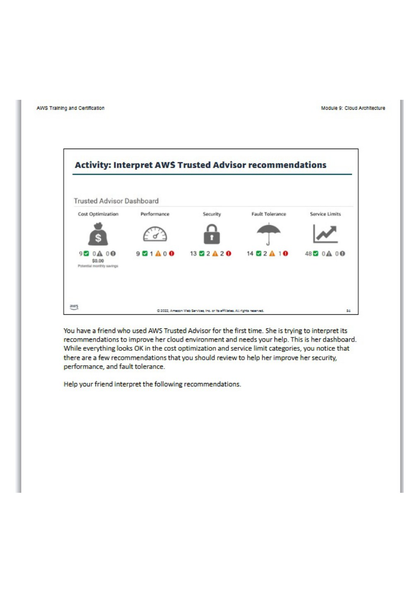

La explicación completa del marco arquitectónico permanece en el [Bloque I, revisión con Well-Architected Tool](../bloque-1/03_infraestructura_y_arquitectura.md#ca-p42). Este apartado conserva las actividades de seguridad nuevas para la práctica del dominio 2. Una recomendación automatizada es una señal para investigar y decidir, no una certificación de la cuenta.

`[AMPLIACIÓN OFICIAL — corpus 02, D.3]`

**AWS Trusted Advisor:** recomendaciones y comprobaciones de buenas prácticas sobre recursos AWS en áreas que han evolucionado. El módulo histórico de Cloud Architecture incluye cinco categorías (costes, rendimiento, seguridad, tolerancia a fallos, límites de servicio) y cinco escenarios: MFA root, política IAM de contraseñas, Security Group con acceso amplio, EBS sin snapshots recientes y logging de acceso S3 deshabilitado. **La documentación actual** incluye también excelencia operativa como categoría; los números de comprobaciones disponibles y su alcance dependen del plan de soporte y de condiciones del servicio. 

**Well-Architected Framework:** revisión arquitectónica sistemática con pilares; **Well-Architected Tool:** registro de revisiones, respuestas y mejoras; **Trusted Advisor:** comprobaciones automatizadas puntuales del entorno. No son la misma herramienta. Conservar el caso AnyCompany de Cloud Architecture como práctica de identificación de riesgos, no copiar toda la clase de Well-Architected de Bloque I otra vez.

Fuente: https://docs.aws.amazon.com/awssupport/latest/user/get-started-with-aws-trusted-advisor.html

### Caso 1: MFA en la identidad raíz

`[FUENTE: CA p. 56]`

**Problema:** no se ha habilitado **Multi-Factor Authentication (MFA)** en el usuario raíz de una cuenta AWS. Dado que root dispone de privilegios especialmente elevados, el documento recomienda añadir una capa adicional de protección.

- **Estado:** alerta de seguridad.
- **Entorno afectado:** cuenta AWS y usuario root.
- **Buena práctica:** asegurar la cuenta raíz y no utilizarla para las tareas habituales.
- **Acción recomendada:** iniciar sesión como root para activar MFA; utilizar identidades con permisos limitados para operaciones ordinarias.

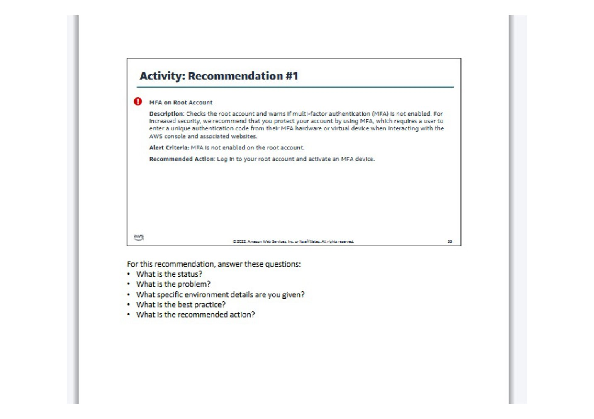

### Caso 2: política de contraseñas IAM

`[FUENTE: CA p. 57]`

**Problema:** la política de contraseñas de usuarios IAM no está habilitada o no cumple los controles recomendados. El material menciona parámetros de calidad como complejidad, longitud y reglas de actualización.

- **Estado:** advertencia.
- **Entorno afectado:** cuentas de usuario IAM y la configuración de la política de contraseñas.
- **Buena práctica:** definir una política de credenciales coherente y suficientemente protectora, junto con MFA y otros controles de identidad.
- **Acción recomendada:** revisar y configurar la política de contraseñas mediante los ajustes de seguridad de IAM.

El ejemplo histórico indica que existe una política, pero al menos un requisito de contenido de contraseña no está habilitado. La diapositiva distingue ese caso del de política inexistente: se revisan requisitos o se crea y configura la política, según corresponda. Sus notas explican que cambiar requisitos se aplica a contraseñas nuevas y no obliga por sí mismo a que todos los usuarios existentes cambien la suya. No debe deducirse una política moderna universal de rotación a partir de este ejemplo de 2022.

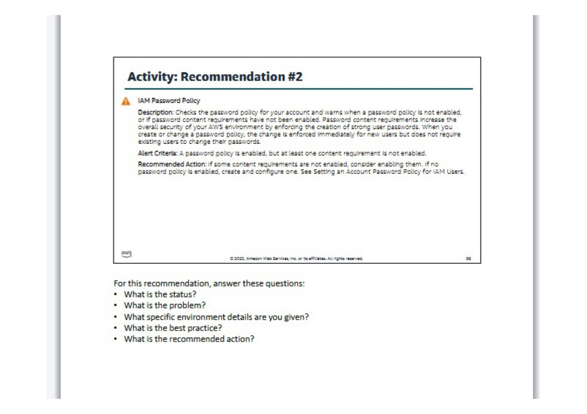

### Caso 3: Security Groups demasiado abiertos

`[FUENTE: CA p. 58]`

**Problema:** grupos de seguridad permiten acceso entrante demasiado amplio desde Internet a puertos sensibles. Se observa el rango de origen **`0.0.0.0/0`**, que significa **cualquier dirección IPv4**, y en el ejemplo aparecen puertos de administración o servicio.

- **Estado:** rojo / acción requerida.
- **Entorno afectado:** se muestran región, grupo de seguridad, identificador, protocolo, puerto y rango de IP origen.
- **Buena práctica:** principio de mínimo acceso a nivel de red; abrir únicamente los protocolos y destinos necesarios.
- **Acción recomendada:** restringir reglas a direcciones o rangos autorizados; eliminar permisos excesivos.

En la tabla del ejercicio aparecen WebServerSG en us-east-1, TCP 22, y DatabaseServerSG en us-west-2, TCP 8080: ambos tienen estado rojo y origen 0.0.0.0/0. El criterio histórico de esta diapositiva alerta ante un origen /0 en puertos distintos de 25, 80 o 443; eso no convierte esos tres puertos en seguros por definición. La acción propone restringir orígenes y retirar las reglas demasiado permisivas después de introducir las nuevas; para una dirección concreta ilustra una máscara /32. Los identificadores están anonimizados, por lo que no deben copiarse como valores reales.

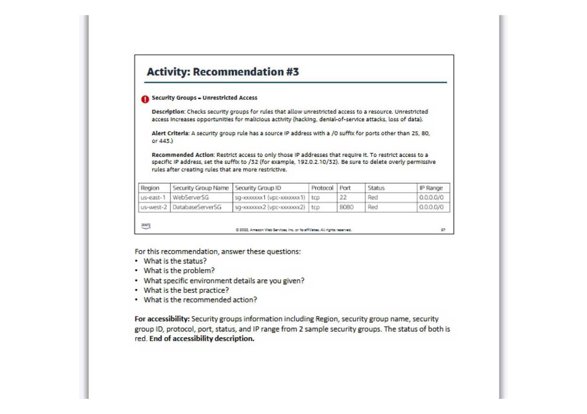

### Caso 4: snapshots de EBS

`[FUENTE: CA p. 59]`

**Problema:** un volumen de **Amazon Elastic Block Store (EBS)** puede carecer de instantáneas recientes. Las instantáneas permiten disponer de un punto de recuperación del volumen.

- **Estado:** alerta roja en el ejemplo.
- **Entorno afectado:** región, identificador del volumen, nombre, edad de última instantánea y estado de asociación.
- **Buena práctica:** realizar copias de seguridad adaptadas al objetivo de recuperación de la aplicación y comprobar que se puedan utilizar.
- **Acción recomendada:** establecer y ejecutar una programación de instantáneas regulares de los volúmenes relevantes.

**Matiz:** una instantánea de EBS ayuda a recuperar datos, pero no equivale por sí sola a un plan integral de recuperación ante desastres.

La comprobación histórica diferencia amarillo para una instantánea reciente de entre 7 y 30 días, rojo para más de 30 días y rojo cuando no existe ninguna. La fila ilustrativa está en us-east-1, identifica My-EBS-Volume y muestra «No snapshot». La recomendación de la diapositiva es crear copias semanales o mensuales; la frecuencia efectiva de una carga debe derivarse de su RPO, retención y necesidades de restauración, no adoptarse automáticamente de este ejemplo. La replicación interna de volúmenes EBS no sustituye una copia que permita volver a un estado anterior.

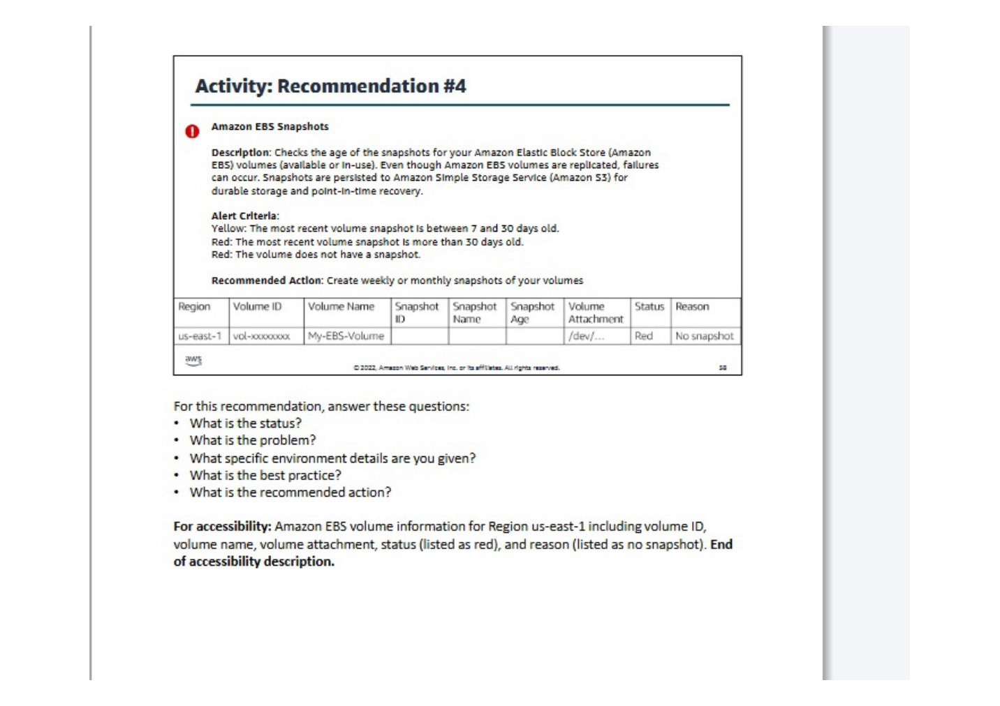

### Caso 5: registro de acceso S3

`[FUENTE: CA p. 60]`

**Problema:** un **bucket de Amazon S3** no tiene habilitado el registro de accesos al servidor (*server access logging*), por lo que no quedan registrados esos detalles de solicitudes según el mecanismo explicado por la diapositiva.

- **Estado:** advertencia amarilla.
- **Entorno afectado:** región, nombre del bucket, destino de logs, propiedad del bucket y estado de escritura/configuración.
- **Buena práctica:** definir registros de acceso y conservar datos necesarios para auditoría y análisis.
- **Acción recomendada:** habilitar el registro de accesos en buckets donde corresponda, configurar un bucket de destino y los permisos adecuados.

**Nota editorial:** no debe confundirse el registro de accesos de S3 con todos los demás mecanismos de auditoría de AWS; existen opciones como eventos de datos de CloudTrail y otros controles con finalidades distintas.

En el ejemplo de us-east-2, el bucket my-hello-world-bucket tiene logging sin habilitar y la tabla muestra que no existen el destino, la propiedad compartida ni permisos de escritura configurados. La comprobación histórica marca amarillo si no hay server access logging o si los permisos del destino no permiten a la cuenta propietaria comprobarlo. La acción consiste en habilitar el registro cuando proceda y configurar adecuadamente los permisos del destino. Las notas describen registros de solicitudes, recurso solicitado y momento de procesamiento para auditoría o análisis de uso; su comportamiento debe consultarse en la documentación actual antes de aplicarlo como requisito operativo.

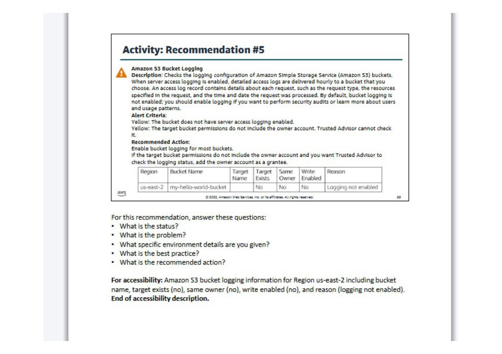

`[EXPLICACIÓN DIDÁCTICA]` Para los cinco casos utiliza la secuencia que pide el curso: identificar estado, problema, detalles del entorno, buena práctica y acción. Después añade el criterio para comprobar la mejora. En EBS puede ser una restauración ensayada; en SG, comprobar que se retiró la regla amplia y se mantiene el acceso legítimo; en logging, verificar destino, permisos y recepción de registros según el mecanismo elegido.

Los colores se interpretan en el alcance del ejemplo. Un indicador sin problema detectado no demuestra ausencia de todos los riesgos posibles. El criterio histórico que exceptúa determinados puertos en una comprobación no vuelve seguros esos puertos por definición. De forma similar, una pauta de snapshots semanal o mensual de una actividad no determina el RPO que necesita una carga real.

## 7.15 Pregunta de cifrado del módulo Cloud Architecture

`[FUENTE: CA p. 65]`

Un profesional de operaciones desea proteger datos tanto **en tránsito** como **en reposo**. El ejercicio propone seleccionar qué servicios pueden ayudar entre un balanceador de carga, Amazon EBS y Amazon S3, además de la opción «todas las anteriores».

La clave del ejercicio es reconocer los requisitos **cifrado/transporte** y **cifrado/almacenamiento**, y que diferentes servicios pueden incorporar controles para proteger datos en sus diferentes etapas.

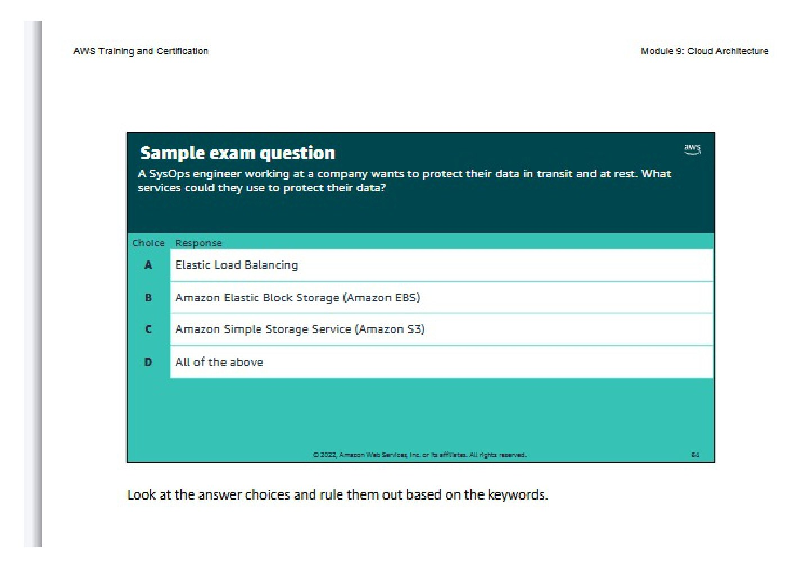

`[FUENTE: CA p. 66]`

El propio módulo marca como respuesta la **opción D («All of the above»)**. Se debe razonar que **Elastic Load Balancing** puede participar en la protección de tráfico mediante TLS, **Amazon EBS** admite cifrado de volúmenes y **Amazon S3** ofrece cifrado de objetos. Las tres tecnologías no cumplen exactamente la misma función, y la frase «datos en tránsito y en reposo» se refiere al conjunto de necesidades.

---

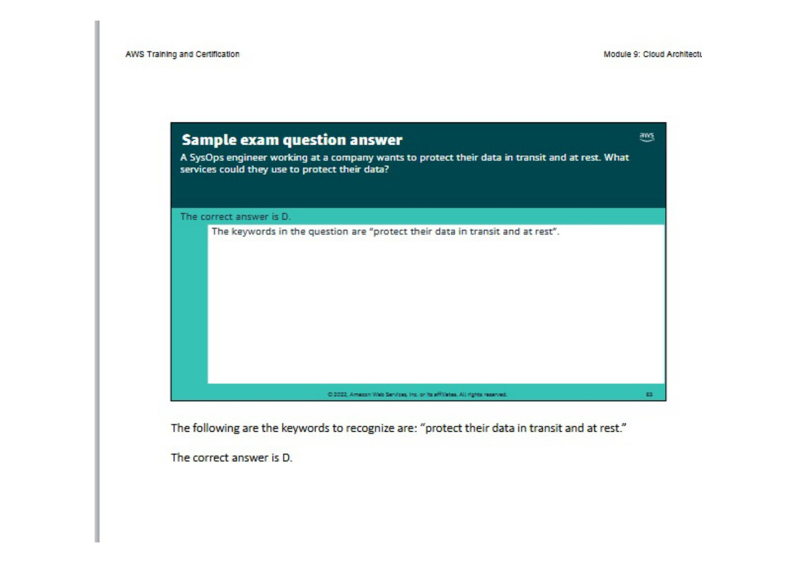

`[EXPLICACIÓN DIDÁCTICA]` La opción «todas las anteriores» del ejercicio agrupa ELB, EBS y S3 en el escenario de protección de datos en tránsito y en reposo. No significa que cada producto, por sí solo y sin configuración, proteja todas las fases de la aplicación. ELB puede participar en TLS del tráfico; EBS y S3 proporcionan capacidades para sus datos almacenados, y la aplicación debe configurar acceso, claves y comunicaciones que correspondan.

La diferencia entre reconocer una capacidad y diseñar un sistema se mantiene en todo el bloque. En un examen introductorio se identifica el servicio pertinente; en un proyecto real se comprueba el flujo completo, opciones, limitaciones y responsabilidades.

## 7.16 Información de seguridad y productos de terceros

`[AMPLIACIÓN OFICIAL — corpus 02, D.4]`

**AWS Security Center / AWS Cloud Security:** visión de seguridad, servicios, prácticas y soluciones.
- **AWS Security Blog:** cambios, explicaciones técnicas, ejemplos y recomendaciones; no sustituye documentación normativa de cada servicio.
- **AWS Knowledge Center / AWS re:Post:** preguntas frecuentes y soluciones de soporte/comunidad para incidencias; verificar antigüedad y versión.
- **AWS Documentation y AWS Whitepapers:** detalles técnicos y guías de cumplimiento disponibles; documentación por servicio.
- **AWS Marketplace:** productos de seguridad de terceros adquiribles/implementables bajo condiciones específicas; comprar un producto no equivale a certificación automática.
- **AWS Artifact:** informes de auditoría y acuerdos de cumplimiento del propio proveedor.

**En examen**, para conseguir un informe de conformidad de AWS → Artifact; para adquirir una solución de seguridad de tercero → Marketplace; para dudas de uso → documentación/Knowledge Center/re:Post; para novedades de seguridad → Security Blog.

Fuentes: https://aws.amazon.com/security/ ; https://aws.amazon.com/blogs/security/ ; https://aws.amazon.com/marketplace/ ; https://repost.aws/knowledge-center/

`[EXPLICACIÓN DIDÁCTICA]` La elección de recurso depende de la pregunta. Para descargar evidencia de un control del proveedor se busca Artifact y el alcance del informe. Para aprender detalles de un servicio se consulta su documentación; para novedades se utiliza Security Blog y después se confirma el comportamiento documentado. Para resolver una incidencia, Knowledge Center o re:Post pueden aportar orientación cuya fecha y contexto hay que revisar.

AWS Marketplace permite encontrar y contratar productos de terceros, incluidas soluciones de seguridad. La adquisición no elimina integración, permisos, operación ni evaluación del producto. Una organización debe conocer a qué datos y redes accede la solución y qué tarea concreta resuelve. Estar en un catálogo no implica que el producto convierta automáticamente cualquier arquitectura en conforme.

## 7.17 Caso integrado de estudio y criterios de elección

`[EXPLICACIÓN DIDÁCTICA]` Imagina una aplicación con web, base de datos y documentos en S3. El equipo necesita que los operadores utilicen sesiones temporales, que la web solo lea su prefijo de documentos, que la administración no se abra a todo Internet, que las conexiones protegidas usen TLS y que puedan investigarse cambios. Cada requisito se traduce en una decisión: identidad y roles, políticas de datos, reglas de red, configuración de transporte y mecanismo de registros.

Si aparecen vulnerabilidades de software, se investiga el hallazgo y se planifica remediación; si aparece comportamiento sospechoso se sigue el procedimiento de incidente. Si se descubren datos sensibles, se revisa clasificación y acceso. No es necesario atribuir a una herramienta única todos esos resultados. El criterio de calidad es explicar por qué una señal y una acción corresponden al problema, y cómo se comprueba que la solución mantuvo el servicio legítimo.

Para repasar, compara sin mirar las tablas: CloudTrail con CloudWatch y Config; KMS con ACM y Secrets Manager; WAF con Shield y Firewall Manager; SG con NACL; GuardDuty con Inspector y Macie; Artifact con Audit Manager. Si solo recuerdas nombres, vuelve a los ejemplos hasta poder justificar qué pregunta responde cada servicio.

## Referencias del capítulo

- [Guía oficial del dominio 2](https://docs.aws.amazon.com/aws-certification/latest/cloud-practitioner-02/cloud-practitioner-02-domain2.html).
- [Security Groups](https://docs.aws.amazon.com/vpc/latest/userguide/vpc-security-groups.html) y [Network ACL](https://docs.aws.amazon.com/vpc/latest/userguide/vpc-network-acls.html).
- [KMS](https://docs.aws.amazon.com/kms/latest/developerguide/overview.html), [ACM](https://docs.aws.amazon.com/acm/latest/userguide/acm-overview.html) y [S3 Object Ownership](https://docs.aws.amazon.com/AmazonS3/latest/userguide/about-object-ownership.html).
- [Glosario de seguridad](08_glosario_integral_seguridad.md) y [matriz de cobertura](09_matriz_cobertura.md).
