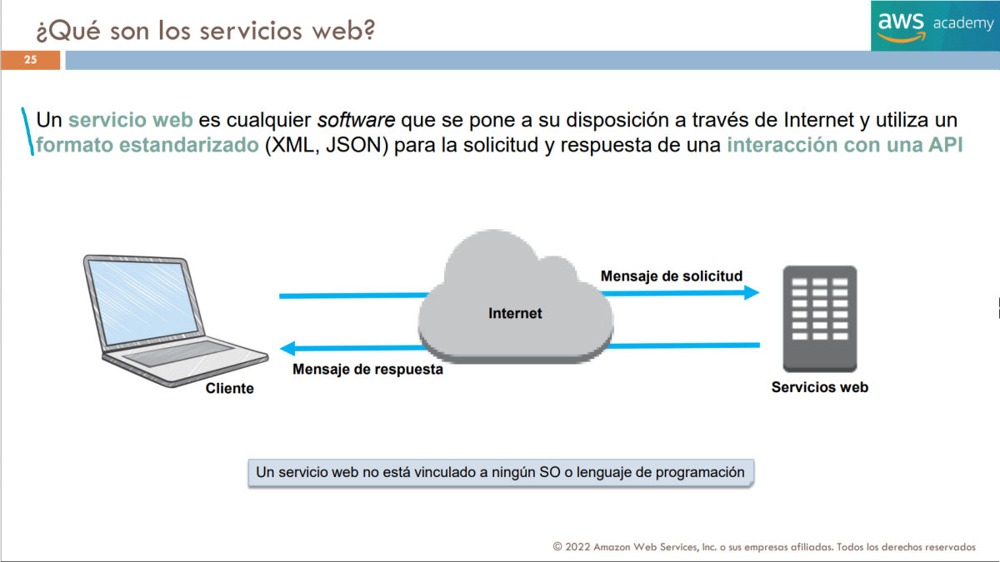
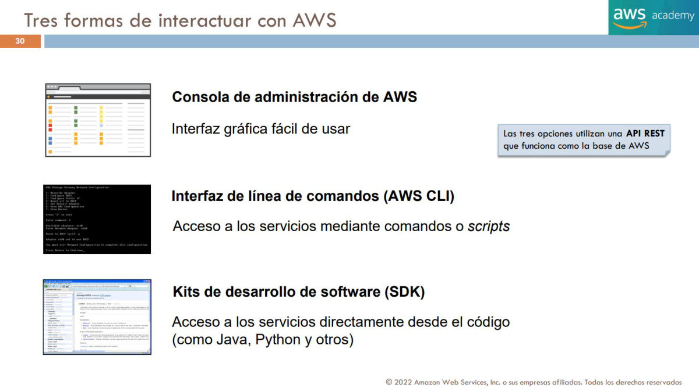
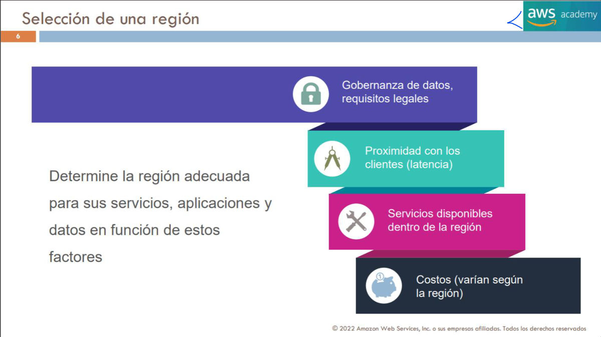
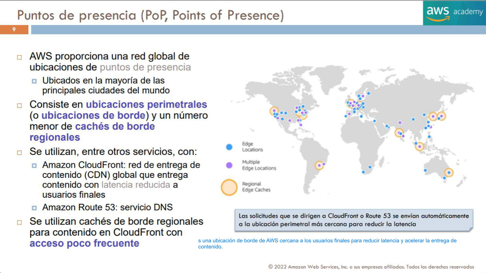

# 08. Despliegue, operación e infraestructura global

Este capítulo conecta los objetivos 3.1 y 3.2: cómo crear y operar recursos y dónde ejecutarlos. La elección de una interfaz de administración y la elección de una ubicación resuelven problemas diferentes. Podemos desplegar la misma arquitectura manualmente o mediante una plantilla; también podemos desplegar una plantilla correcta en una región inadecuada para los datos de la organización.

`[FUENTE DOCENTE]` T1 pp.25,30; T2 pp.4–10 y 20; T6 pp.9,25,29–30. `[AMPLIACIÓN OFICIAL]` Documento 03 del paquete y documentación enlazada. `[EXPLICACIÓN EDITORIAL]` Los escenarios y razonamientos que siguen desarrollan esas fuentes y no son ejercicios atribuidos a AWS Academy. Revisión oficial: 2 de noviembre de 2026.

## 8.1 Solicitudes, servicios web y operaciones

Un servicio web expone capacidades mediante una interfaz que otros programas pueden invocar. T1 p.25 dibuja un cliente que envía una solicitud a través de Internet y recibe una respuesta; menciona XML y JSON como formatos estandarizados. La idea útil no es que todas las operaciones de AWS utilicen exactamente el mismo protocolo, sino que existe un contrato: la petición identifica una operación y sus parámetros y la respuesta comunica datos o un error. El cliente no necesita ejecutar el mismo sistema operativo o lenguaje que el servidor.

Una API es ese contrato programático. Crear una instancia, describir sus atributos o recuperar un objeto son operaciones diferentes, con permisos y efectos distintos. Que una herramienta pueda conectarse al endpoint no significa que esté autorizada para realizar cualquier acción. Las identidades, roles y credenciales temporales se explican en el [capítulo 06 del Bloque II](../bloque-2/06_identidad_y_acceso.md#seccion-6-2); aquí interesa elegir la herramienta adecuada para ejecutar operaciones.

[Registro de la página y detalles conservados](fuentes/05_CORPUS_POR_PAGINA.md#t1-p25).

El plano de control administra recursos: solicita crear una máquina o modificar una configuración. El plano de datos presta la función para la que se creó el recurso: por ejemplo, atiende una petición de negocio o entrega contenido. Distinguirlos ayuda a interpretar una incidencia. Una aplicación puede seguir funcionando mientras una operación administrativa falla; también puede ser posible administrar recursos aunque la aplicación tenga un error propio. No se deben confundir una API de administración de AWS y la API que una empresa ofrece a sus clientes.

## 8.2 Consola, CLI y SDK: tres accesos a capacidades comunes

La **AWS Management Console** presenta formularios y vistas gráficas. Es útil para explorar opciones, inspeccionar un recurso o realizar una operación puntual cuyo resultado se comprobará inmediatamente. T1 p.30 sitúa esta interfaz junto a CLI y SDK: no son tres nubes distintas, sino formas de acceder a capacidades de servicios. Una consola puede agrupar varias operaciones y su diseño cambia; memorizar la posición de un botón de 2022 no demuestra comprender el recurso que se crea.

La **AWS CLI** permite invocar operaciones desde una terminal y componer scripts. Un operador puede describir instancias, filtrar resultados y guardar una salida para una tarea repetible. La CLI reduce acciones manuales, pero un script no es automáticamente seguro, idempotente ni una solución completa de infraestructura como código. Si se ejecuta dos veces una orden de creación sin controles apropiados, pueden aparecer recursos adicionales. La automatización necesita gestionar errores, configuración de cuenta y región, permisos y efectos sobre recursos existentes.

Los **AWS SDK** integran servicios en código de aplicaciones. Si una aplicación debe guardar un archivo en S3 tras recibir una petición, usar un SDK permite realizar la operación dentro de su lógica y tratar la respuesta. El equipo sigue necesitando gestionar errores y reintentos; el SDK no sustituye diseñar qué sucede si una solicitud tarda o se repite. Las credenciales deben proceder del mecanismo adecuado del entorno, como un rol, y no copiarse dentro del código fuente.

| Situación | Elección razonada | Responsabilidad que permanece |
|---|---|---|
| Inspeccionar manualmente una máquina | Consola | Revisar cuenta, región, permisos y efectos de cualquier cambio |
| Consultar recursos mediante un script | CLI | Tratar resultados y errores, proteger el contexto de ejecución |
| Leer o escribir datos desde la aplicación | SDK | Diseñar operaciones, permisos, reintentos y manejo de datos |
| Crear entornos con recursos relacionados | IaC | Revisar el diseño y controlar el ciclo de vida completo |

[Registro de la página y detalles conservados](fuentes/05_CORPUS_POR_PAGINA.md#t1-p30).

El ejemplo histórico T6 p.25 usa `aws ec2 run-instances` y presupone una AMI, un par de claves y un grupo de seguridad. Sirve para reconocer una operación programática; esos identificadores ilustrativos no representan recursos disponibles en nuestra cuenta. Cambiar la región también cambia qué identificadores son utilizables. No se ha ejecutado ese comando durante la elaboración del manual.

## 8.3 Infraestructura como código y CloudFormation

**Infraestructura como código**, o IaC, representa recursos y relaciones mediante archivos versionables. En lugar de explicar a un compañero una secuencia de clics, se conserva una definición que puede revisarse, compararse y desplegarse. **AWS CloudFormation** organiza recursos definidos en plantillas mediante unidades denominadas *stacks*. La plantilla expresa qué infraestructura debe administrar el servicio y sus propiedades; el stack representa su despliegue y estado de administración.

Una plantilla puede relacionar una red, grupos de seguridad y recursos de cómputo. La ventaja no consiste solo en ahorrar tiempo: un equipo puede revisar el cambio antes de aplicarlo y reconstruir entornos coherentes. Conviene parametrizar aquello que varía, como el entorno o determinadas capacidades, sin convertir cada despliegue en una modificación manual del documento. Compartir una plantilla no obliga a compartir contraseñas; la información sensible necesita mecanismos específicos de protección.

Repetibilidad e idempotencia son conceptos relacionados pero distintos. Repetir un procedimiento significa poder ejecutarlo de nuevo. Conservar un estado deseado evita que cada ejecución se interprete simplemente como «añadir otra copia» de todos los recursos. Aun así, un cambio de propiedad puede requerir sustituciones; no se debe interpretar IaC como una garantía de que cualquier actualización preservará datos y disponibilidad sin planificación.

Antes de actualizar un entorno se revisan los efectos esperados, las dependencias, los permisos y los recursos con datos persistentes. Una plantilla puede reproducir una regla demasiado permisiva tan eficazmente como reproduce una regla correcta. IaC ofrece un mecanismo de control, no una certificación del diseño. El historial ayuda a entender qué se cambió, pero también se necesita observar el estado real y detectar modificaciones realizadas fuera del flujo previsto.

**Escenario editorial:** una academia crea laboratorios semejantes para tres grupos. La consola puede servir para explorar el primer prototipo; una plantilla facilita conservar la configuración y desplegar cada entorno con parámetros distintos. Un script CLI puede consultar después qué recursos existen. Un SDK puede pertenecer a la aplicación del laboratorio. Son herramientas complementarias, no una clasificación donde una elimina siempre a las otras.

CloudFormation se diferencia de CloudWatch, que observa métricas y registros; de CloudTrail, que registra actividad de API; y de CodePipeline, que coordina fases de entrega. Un pipeline puede invocar un despliegue de infraestructura, pero el orden de las fases y la definición de recursos son responsabilidades conceptuales diferentes. Véase [integración y herramientas de desarrollo](14_integracion_y_otros_servicios.md).

Referencia: [conceptos de CloudFormation](https://docs.aws.amazon.com/AWSCloudFormation/latest/UserGuide/cfn-whatis-concepts.html).

## 8.4 Nube, instalaciones e infraestructura híbrida

El modelo **cloud** sitúa cargas en recursos de nube, con servicios aprovisionados bajo ese modelo. **On-premises** sitúa infraestructura en instalaciones gestionadas por la organización o para ella. Un despliegue **híbrido** combina entornos y necesita conectividad, identidad y procesos que funcionen entre ellos. No exige necesariamente utilizar dos proveedores públicos, y utilizar una VPN no migra por sí solo una aplicación.

Una empresa puede mantener una aplicación industrial junto a maquinaria local y almacenar o analizar parte de sus datos en AWS. Debe decidir cómo se sincroniza la información, qué sucede si falla la conectividad y dónde se autorizan las operaciones. El requisito de baja latencia hacia un dispositivo físico puede ser distinto del requisito de disponibilidad de un servicio web global. Por eso «mover todo» no es una respuesta universal a una pregunta de arquitectura.

AWS Outposts aproxima determinadas capacidades e infraestructura AWS a instalaciones del cliente bajo sus condiciones, mientras una conexión Direct Connect resuelve conectividad dedicada. Un producto de infraestructura y un enlace de red no son equivalentes. El primero no evita necesitar un emplazamiento adecuado; el segundo no instala servicios gestionados dentro de un CPD. El [capítulo 09](09_computacion_contenedores_serverless.md) desarrolla la elección de cómputo y el [11](11_redes_y_contenidos.md), los enlaces.

## 8.5 Región, zona de disponibilidad y centro de datos

Una **Región** agrupa infraestructura en un ámbito geográfico. Dentro de ella, las **Availability Zones**, o AZ, proporcionan dominios de aislamiento. Una AZ contiene uno o más centros de datos; no debe confundirse la representación didáctica de tres edificios con una obligación universal de que toda AZ contenga exactamente tres. Las AZ se conectan por redes diseñadas para permitir arquitecturas distribuidas dentro de la región.

El cliente puede seleccionar una AZ en servicios que exponen esa decisión, pero no un edificio o servidor físico concreto del centro de datos. T2 pp.7–8 destaca separación física y redundancia de energía y conectividad. La utilidad para estudiar consiste en reconocer el alcance de un fallo y el nivel de control de despliegue. Un recurso zonal y un servicio regional no presentan necesariamente el mismo alcance de disponibilidad.

La selección de región en T2 p.6 combina requisitos legales y gobierno de datos, proximidad a usuarios, disponibilidad de servicios y costes. Una región cercana no es automáticamente la válida si un requisito de residencia exige otra ubicación. Tampoco puede asumirse que cada capacidad o tipo de recurso esté disponible de la misma manera en todas las regiones. La información de disponibilidad debe comprobarse al diseñar.

[Registro de la página y detalles conservados](fuentes/05_CORPUS_POR_PAGINA.md#t2-p06).

Los fundamentos y el desarrollo de Well-Architected permanecen en el [capítulo 03 del Bloque I](../bloque-1/03_infraestructura_y_arquitectura.md). En este bloque usamos esos conceptos para elegir dónde ubicar redes, instancias y datos. El [mapa interactivo oficial](https://aws.amazon.com/about-aws/global-infrastructure/) permite consultar la infraestructura actual sin fijar en los apuntes un recuento que caducaría.

## 8.6 Multi-AZ, multirregión y continuidad

Desplegar componentes en varias AZ puede reducir la dependencia de un único dominio zonal. Sin embargo, debe existir capacidad operativa en la otra zona, una forma de dirigir tráfico hacia ella y acceso a los datos necesarios. Dos máquinas sin balanceo, recuperación ni sincronización no constituyen por sí solas un servicio tolerante a cualquier fallo. El comportamiento debe analizarse por capas.

**Ejemplo editorial:** un balanceador distribuye solicitudes hacia servidores web en dos AZ. Si un servidor deja de responder, las comprobaciones de salud ayudan a retirarlo del tráfico. Si la base de datos permanece en una única instancia sin estrategia de recuperación, la disponibilidad de los servidores no elimina esa dependencia. La solución se revisa junto con las modalidades de base de datos del capítulo 10.

Usar **múltiples regiones** aborda riesgos y requisitos de otro alcance: continuidad ante una interrupción regional, usuarios distantes o residencia de datos. La replicación entre regiones debe configurarse mediante los mecanismos pertinentes; no ocurre universalmente porque todos los recursos pertenezcan a AWS. Deben definirse consistencia, desfase aceptable, responsabilidad de conmutación y forma de volver a operar tras un incidente.

El objetivo de recuperación **RTO** expresa cuánto tiempo puede tardarse en restaurar el servicio; **RPO** expresa cuánta pérdida de datos medida en tiempo resulta aceptable. Una copia nocturna puede ser útil, pero no satisface automáticamente un RPO de pocos minutos. Una réplica tampoco sustituye todas las copias: un borrado lógico puede propagarse. Estos objetivos ayudan a elegir entre mantener copias, infraestructura preparada o capacidad operativa duplicada, con costes y complejidad distintos.

## 8.7 Edge y operación continua

Las ubicaciones **edge** y los puntos de presencia acercan determinadas capacidades a los usuarios. CloudFront puede entregar contenido desde cachés y Route 53 presta DNS mediante infraestructura distribuida. No son AZ donde el alumno pueda lanzar indistintamente cualquier instancia o base de datos. T2 p.9 sitúa también cachés regionales dentro de la entrega de contenido.

[Registro de la página y detalles conservados](fuentes/05_CORPUS_POR_PAGINA.md#t2-p09).

Operar la arquitectura exige medir salud, capacidad y resultados. CloudWatch ayuda a observar; CloudTrail aporta actividad de administración y Config, evolución de configuración. Systems Manager ofrece capacidades de administración de recursos compatibles. Su uso no elimina permisos ni tareas propias del cliente. Estos servicios ya se presentan en el [Bloque II](../bloque-2/07_seguridad_datos_y_cumplimiento.md#seccion-7-10); la aplicación a despliegues y diagnóstico continúa en los capítulos 09 y 14.

Para repasar el objetivo, explica con tus palabras por qué una plantilla, una AZ y una caché no son alternativas entre sí. Después describe qué herramienta usarías para desplegar un entorno repetible, cómo lo repartirías entre zonas y qué observarías para saber si funciona. El razonamiento completo relaciona herramientas, dominios de fallo y operación; una lista de nombres no sustituye esas decisiones.
