# 09. Cómputo, EC2, contenedores y serverless

El objetivo 3.3 consiste en reconocer qué capacidad de ejecución necesita una carga y cómo adaptarla a la demanda. No basta con identificar el icono de EC2 o Lambda: debemos separar máquina virtual, imagen, contenedor, orquestador, capacidad de ejecución, balanceo y escalado. Todos pueden aparecer en una misma arquitectura cumpliendo funciones distintas.

`[FUENTE DOCENTE]` T6 pp.4–30,42–62; T9 pp.4–11,19–29; T2 p.15. Las páginas T6 pp.31–40 conservan economía histórica en el corpus para Bloque IV. `[AMPLIACIÓN OFICIAL]` Documento 03 y referencias enlazadas. `[EXPLICACIÓN EDITORIAL]` Desarrollo conceptual y escenarios de este capítulo. Las cantidades de capacidad de los ejemplos son ilustrativas, no recomendaciones de dimensionamiento.

## 9.1 Elegir el grado de control

EC2 ofrece máquinas virtuales; el cliente elige un sistema inicial y opera el software invitado. Esto permite instalar motores, agentes y dependencias que requieren control del sistema, pero obliga a mantenerlos. El hecho de que AWS administre el host físico no convierte una aplicación instalada por el cliente en software gestionado por el proveedor. El reparto detallado permanece en el [Bloque II](../bloque-2/05_responsabilidad_compartida.md#seccion-5-3).

Un contenedor empaqueta una aplicación y dependencias bajo un modelo de aislamiento del sistema operativo. Un orquestador decide cómo mantener unidades de trabajo y distribuirlas sobre capacidad. Lambda, por su parte, recibe código de función y lo ejecuta bajo su modelo de invocaciones. Elegir entre ellos depende de compatibilidad, duración, empaquetado, control operativo y forma de recibir trabajo. «Serverless» describe la administración abstraída de servidores, no una ejecución sin infraestructura ni límites.

T6 p.5 contrasta EC2, Lambda, contenedores y Beanstalk según concepto y facilidad de uso. La tabla es orientativa: facilitar el despliegue no significa que desaparezcan diseño, seguridad o conocimientos operativos. También hay varios caminos para una misma aplicación y no todos son adecuados para el equipo que la mantiene.

## 9.2 EC2 y las nueve decisiones del lanzamiento

Una **instancia Amazon EC2** es una unidad de cómputo con recursos y entorno de ejecución elegidos dentro de las opciones del servicio. Puede actuar como servidor web, aplicación, base de datos autogestionada, servidor de juegos, correo, archivos o procesamiento, ejemplos de T6 p.7. Cada uso necesita prestaciones distintas y puede tener alternativas administradas que reduzcan trabajo operativo.

La secuencia histórica de T6 pp.9–24 presenta nueve decisiones. Son una guía de arquitectura, aunque la consola actual agrupe pantallas de otra manera:

| Decisión | Qué determina | Error que conviene evitar |
|---|---|---|
| AMI | Sistema e imagen inicial | Confiar en una imagen comunitaria sin evaluar origen |
| Tipo de instancia | Perfil de CPU, memoria, red y almacenamiento admitido | Confundir familia con modelo de compra |
| Red | VPC, subred, direcciones y ubicación | Creer que toda IP privada tiene salida a Internet |
| Rol IAM | Permisos de la aplicación frente a servicios | Guardar claves permanentes en el código |
| User data | Inicialización del entorno | Introducir secretos o asumir que el script sustituye todas las actualizaciones |
| Almacenamiento | Volúmenes, tamaño, tipo, cifrado y borrado | Conservar datos importantes solo en disco efímero |
| Etiquetas | Metadatos de organización y automatización | Interpretar una etiqueta como autorización automática |
| Security Group | Comunicaciones permitidas | Abrir administración a todo Internet sin necesidad |
| Par de claves | Acceso al sistema compatible | Confundir la clave SSH con credenciales IAM |

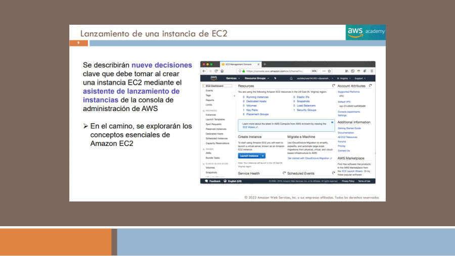

[Registro de la página y detalles conservados](fuentes/05_CORPUS_POR_PAGINA.md#t6-p09).

Una **AMI**, Amazon Machine Image, proporciona una plantilla para crear el sistema inicial. T6 p.10 distingue imágenes proporcionadas por AWS, imágenes propias, Marketplace y comunitarias. No todas ofrecen las mismas garantías o condiciones. Debe comprobarse compatibilidad con la arquitectura de procesador, sistema y requisitos de la aplicación. Lanzar una máquina desde una AMI no convierte sus datos posteriores en parte de esa imagen original.

T6 p.11 representa el proceso de crear una AMI nueva: partir de una imagen, lanzar una instancia, modificarla y capturar una nueva imagen; después puede copiarse a otra región mediante la operación pertinente. El mecanismo permite estandarizar software, pero necesita mantenimiento. Una imagen antigua puede reproducir vulnerabilidades y no reemplaza copias continuas de datos que cambian tras el despliegue.

El **user data** permite ejecutar inicialización, como instalar paquetes o configurar una aplicación. La figura p.18 contiene un script de shell con órdenes `yum`; es un ejemplo del sistema de la época, no un instalador universal para todas las AMI. Una estrategia puede combinar imágenes base y configuración de arranque, evitando mantener una imagen distinta para cada pequeño parámetro. Debe saberse cuándo se ejecuta el mecanismo y cómo revisar sus errores.

El rol IAM es distinto del perfil de instancia que permite asociarlo a EC2. Una aplicación puede obtener credenciales temporales de ese contexto para acceder, por ejemplo, a un bucket autorizado. La red determina si puede comunicarse con el endpoint y la política determina qué acciones puede realizar. Una conexión SSH al sistema operativo es otra relación de autenticación; tener acceso SSH no equivale por sí solo a ser administrador de la cuenta AWS.

**Figura de apoyo — Crear y copiar una AMI.** `[FUENTE HISTÓRICA: T6 p.11]` La secuencia parte de una AMI, lanza y modifica una instancia y captura una imagen nueva que puede copiarse a otra región. La copia es una operación explícita; la imagen inicial no incluye por sí sola todos los cambios posteriores.

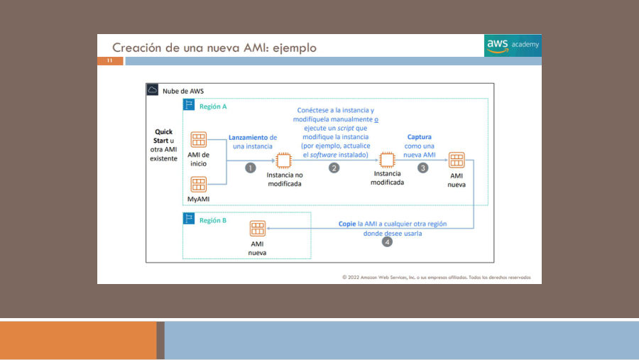

[Registro de fuente](fuentes/05_CORPUS_POR_PAGINA.md#t6-p11).

## 9.3 Familias, tamaños y prestaciones

Las familias de **propósito general** equilibran recursos y sirven para muchas aplicaciones. Las optimizadas para **cómputo** asignan un perfil adecuado a cargas limitadas por CPU, como cálculos o procesamiento intensivo. Las optimizadas para **memoria** favorecen conjuntos de trabajo grandes que necesitan permanecer en RAM. Las orientadas a **almacenamiento** atienden necesidades donde las características de almacenamiento local son decisivas. El **cómputo acelerado** ofrece recursos especializados, como GPU en opciones compatibles, para trabajos que pueden aprovecharlos.

Elegir una familia no consiste en perseguir la palabra «más rápida». Una base que necesita mantener un gran conjunto de datos en memoria puede no mejorar al añadir CPU sin suficiente RAM. Un trabajo de análisis paralelo puede requerir además red y almacenamiento capaces de alimentar el procesamiento. Un acelerador solo ayuda si las bibliotecas y la tarea lo utilizan. Las métricas y una prueba representativa permiten identificar qué recurso limita el resultado.

T6 p.13 explica `t3.large` mediante familia, generación y tamaño. Su tabla de `t3.nano` a `t3.2xlarge` es un ejemplo histórico de cómo varían memoria y recursos; no debe extrapolarse que cada tamaño de todas las familias conserve esa misma relación. Los modelos actuales añaden variantes y capacidades. El conocimiento de examen es reconocer el patrón de nombre y elegir el perfil general, sin convertir el manual en un catálogo numérico de instancias.

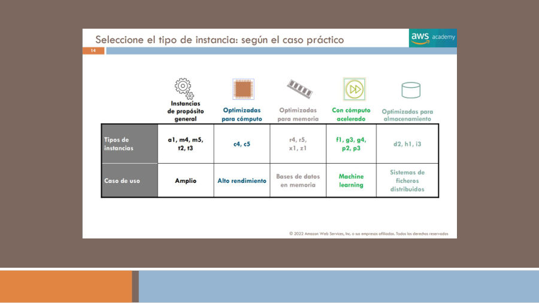

[Registro de la página y detalles conservados](fuentes/05_CORPUS_POR_PAGINA.md#t6-p14).

T6 p.15 añade prestaciones de red y grupos de ubicación en clúster para cargas interdependientes. Acercar instancias puede favorecer ciertos patrones de comunicación, pero no sustituye repartir componentes cuando el objetivo es tolerar fallos zonales. Rendimiento de red, disponibilidad y coste son dimensiones distintas que deben equilibrarse. Las cifras de adaptadores ENA y de generaciones antiguas que aparecen en la fuente se conservan como históricas en el corpus.

Los modelos On-Demand, Spot, compromisos de consumo y opciones dedicadas responden a condiciones de compra, interrupción o aislamiento. No son familias de CPU. Una carga por lotes que puede reanudarse tiene un perfil operativo distinto de un componente que no tolera interrupciones. La explicación económica detallada corresponde al Bloque IV; aquí basta con reconocer que elegir capacidad incluye condiciones de funcionamiento, no solo recursos físicos.

## 9.4 Almacenamiento, ciclo de vida y metadatos

Un volumen **EBS** mantiene almacenamiento de bloques independiente del proceso de la instancia según su configuración. El **instance store** usa almacenamiento local ligado al host y no debe ser la única ubicación de información que deba sobrevivir a una parada o sustitución. EFS y S3 resuelven modelos distintos de archivos y objetos; no se conectan como si fueran automáticamente el mismo disco raíz. Véase el [capítulo 12](12_almacenamiento_y_recuperacion.md).

T6 p.21 plantea dos instancias: una con raíz EBS y volumen adicional, y otra con raíz instance store. La conclusión de estudio es preguntar qué información debe sobrevivir y a qué evento. Una instancia con raíz EBS puede detenerse y arrancarse manteniendo sus volúmenes persistentes según configuración; la raíz instance store tiene restricciones de ciclo de vida y sus datos no se conservan tras terminación. No se interpreta un dibujo de dos discos como un mecanismo de copia de seguridad.

| Evento | Qué significa para estudiar | Qué revisar |
|---|---|---|
| Lanzamiento | Se prepara una instancia y entra en ejecución | Inicialización, red y salud de la aplicación |
| Reinicio | Se reinicia el sistema de la misma instancia | La aplicación debe volver a iniciar correctamente |
| Detención e inicio | Se deja de ejecutar y después se vuelve a arrancar una instancia compatible | Direcciones públicas automáticas, almacenamiento y software |
| Hibernación | Se conserva estado de memoria mediante el mecanismo admitido | Compatibilidad y configuración, sin extrapolar límites antiguos |
| Terminación | Se elimina la instancia y no puede iniciarse otra vez como la misma | Política de borrado de volúmenes y recuperación de datos |

La documentación [de ciclo de vida](https://docs.aws.amazon.com/AWSEC2/latest/UserGuide/ec2-instance-lifecycle.html) distingue el uso de cómputo de otros recursos que pueden seguir generando cargos al detener una instancia. No se debe traducir «stopped» por «toda la arquitectura es gratuita». La [persistencia de instance store](https://docs.aws.amazon.com/AWSEC2/latest/UserGuide/instance-store-lifetime.html) distingue reinicio de detención, hibernación y terminación.

Una **Elastic IP** proporciona una dirección pública estática que puede asociarse bajo condiciones del servicio. Se diferencia de la dirección pública automática que puede cambiar tras detener y volver a iniciar. La dirección privada y la red deben considerarse separadamente. Mantener una IP pública no hace que una aplicación sea saludable, distribuida ni accesible si faltan rutas o reglas.

T6 p.29 muestra acceso a metadatos mediante una dirección local de enlace. Los metadatos describen la propia instancia, como su identificador, red y ubicación. En la práctica actual debe distinguirse [IMDSv2](https://docs.aws.amazon.com/AWSEC2/latest/UserGuide/configuring-instance-metadata-service.html), orientado a sesiones, de las peticiones antiguas sin token. Las credenciales obtenidas por el entorno requieren protección: una aplicación vulnerable no debe exponer ese contexto a solicitudes arbitrarias. No se necesita memorizar un comando de la captura para contestar CLF-C02.

## 9.5 Imágenes y contenedores: Docker, ECR, ECS y EKS

T6 pp.42–44 compara contenedores con máquinas virtuales. En el esquema de VM cada invitado lleva su sistema operativo y bibliotecas; en el de contenedores varias aplicaciones comparten el entorno de kernel del host bajo su modelo de aislamiento. El contenedor empaqueta código y dependencias para mejorar uniformidad entre desarrollo y ejecución. No garantiza que cualquier imagen funcione en cualquier sistema: arquitectura, sistema operativo, permisos y dependencias externas siguen importando.

**Docker** aparece como plataforma para construir y ejecutar imágenes de contenedor. La **imagen** es el artefacto que se guarda y distribuye; un **contenedor** es una ejecución de ese artefacto con configuración y estado de ejecución. Borrar o recrear el contenedor no debe destruir datos de negocio que se pretendían conservar. Conviene externalizar persistencia y definir cómo se configuran las nuevas ejecuciones.

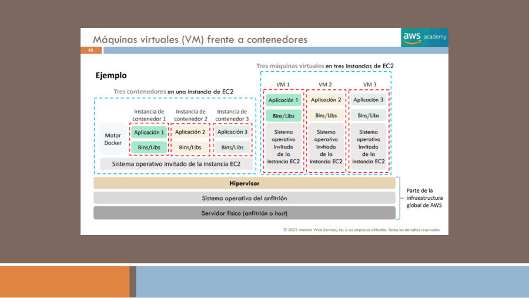

[Registro de la página y detalles conservados](fuentes/05_CORPUS_POR_PAGINA.md#t6-p44).

**Amazon ECR**, Elastic Container Registry, almacena y distribuye imágenes. Un equipo publica una versión y autoriza que el entorno de ejecución la descargue. El registro no decide por sí solo cuántas copias deben ejecutarse ni mantiene una aplicación saludable. Guardar una imagen correctamente es necesario para desplegarla, pero no equivale a desplegarla.

**Amazon ECS**, Elastic Container Service, orquesta contenedores mediante su modelo de tareas y servicios. Una definición de tarea describe cómo ejecutar una unidad de trabajo, sus contenedores y configuración. Una tarea es una ejecución; un servicio puede mantener el número previsto de tareas y participar en despliegues. T6 p.46 representa solicitudes de tres contenedores de un tipo y dos de otro distribuidas sobre capacidad: el objetivo es mantener el trabajo solicitado, no exigir que una persona abra sesión y lance manualmente cada proceso.

**Amazon EKS**, Elastic Kubernetes Service, proporciona Kubernetes administrado. Kubernetes organiza cargas mediante sus objetos y mecanismos de planificación. EKS resulta pertinente cuando una organización utiliza ese ecosistema y necesita sus herramientas o una plataforma compatible. Administrar el plano de control no elimina la responsabilidad sobre aplicaciones, permisos, imágenes, configuración y, según modalidad, capacidad de nodos.

ECS y EKS no son alias. El primero utiliza el modelo de orquestación AWS de ECS y el segundo Kubernetes. La elección puede depender de herramientas existentes, experiencia del equipo, requisitos de plataforma y complejidad que se quiere asumir. ECR es complementario a ambos. Las referencias históricas a Docker no significan que un clúster Kubernetes moderno deba usar necesariamente Docker como runtime.

**Figura de apoyo — ECS distribuye ejecuciones.** `[FUENTE HISTÓRICA: T6 p.46]` El dibujo solicita tres contenedores A y dos B y los reparte entre dos instancias. La definición de tarea describe el trabajo; ECS organiza su ejecución. ECR, que almacena imágenes, cumple otra función.

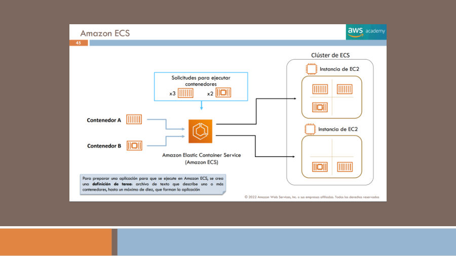

[Registro de fuente](fuentes/05_CORPUS_POR_PAGINA.md#t6-p46).

## 9.6 Fargate y la capacidad de contenedores

**AWS Fargate** aporta capacidad administrada para ejecutar contenedores compatibles con ECS o EKS sin gestionar los hosts subyacentes. No es otro registro ni un tercer nombre para Kubernetes. La pregunta que plantea T6 p.47 es cuánto quiere administrar el equipo de la capacidad que ejecuta sus contenedores.

En una modalidad respaldada por EC2, la organización dispone de más control sobre el conjunto de máquinas y sus características, junto con las tareas que correspondan a ese control. Con Fargate se abstrae la administración de los servidores de ejecución, pero el equipo sigue eligiendo recursos de la tarea, imagen, red, permisos, configuración y escalado del trabajo. Abstraer el host no decide automáticamente cómo debe responder la aplicación a la demanda.

**Ejemplo editorial:** un equipo ya dispone de imágenes de una API y desea mantener varias ejecuciones sin parchear servidores de contenedores. Puede valorar ECS con Fargate. Otro equipo utiliza manifiestos y operaciones Kubernetes compartidas con otras plataformas; puede valorar EKS y después elegir capacidad compatible. La decisión de orquestador precede conceptualmente a la de cómo se suministra el cómputo, aunque ambas estén relacionadas.

**Figura de apoyo — Capacidad EC2 frente a Fargate.** `[FUENTE HISTÓRICA: T6 p.47]` La comparación separa aplicación y bibliotecas de los hosts que las ejecutan. Con Fargate se abstrae la administración de estos servidores; el equipo mantiene imagen, configuración, permisos y decisiones sobre el trabajo. El rótulo «no escalar el clúster» no elimina el escalado de tareas.

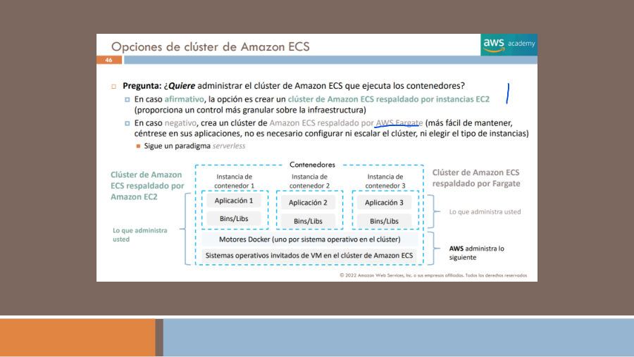

[Registro de fuente](fuentes/05_CORPUS_POR_PAGINA.md#t6-p47).

## 9.7 Lambda: funciones, eventos y límites

**AWS Lambda** ejecuta código de funciones ante invocaciones y eventos bajo su modelo administrado. El cliente aporta código, dependencias, configuración y un rol de ejecución. El servicio organiza la infraestructura que ejecuta la función. Una función puede procesar una solicitud o reaccionar a un cambio, pero no es un servidor al que el cliente instala libremente servicios de larga duración como si fuera EC2.

T6 pp.54–55 muestra orígenes como S3, DynamoDB, SNS, SQS, API Gateway y un balanceador, además de CloudWatch para observación. Son integraciones con mecanismos distintos: no todas entregan eventos de la misma manera o garantizan idéntico tratamiento de reintentos. La aplicación debe conocer si un trabajo puede repetirse y evitar duplicar efectos, como cobrar dos veces una misma operación.

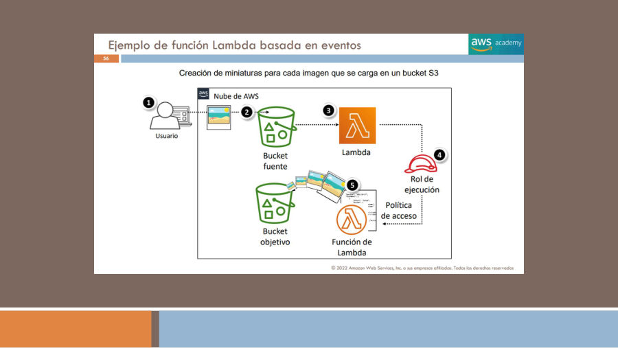

[Registro de la página y detalles conservados](fuentes/05_CORPUS_POR_PAGINA.md#t6-p57).

El ejemplo de miniaturas conserva un flujo concreto: una imagen llega a un bucket fuente, se produce un evento, Lambda la procesa bajo su rol y escribe el resultado en un bucket destino. La separación de origen y destino facilita evitar bucles accidentales. Los permisos deben autorizar lectura y escritura de lo necesario; una función no recibe acceso irrestricto a toda la cuenta por estar integrada con S3.

El ejemplo programado T6 p.56 detiene instancias fuera de horario y las inicia por la mañana. Muestra una programación temporal, función y rol con operaciones autorizadas. El rótulo histórico CloudWatch Events se interpreta hoy junto con las capacidades de eventos y programación correspondientes, sin confundir métricas y bus de eventos. Debe considerarse qué instancias se pueden detener y qué dependencias necesitan los usuarios.

Lambda tiene límites de duración, memoria, concurrencia y empaquetado. El cuadro de T6 p.58 se conserva como histórico; no se convierte en una lista vigente sin contraste. Su enseñanza es que la unidad de trabajo debe encajar en el modelo del servicio. Un proceso muy prolongado o que necesita control especial del host puede requerir otra opción. Más concurrencia puede trasladar presión hacia una base de datos, por lo que escalar funciones no elimina los límites de los componentes posteriores.

**Figura de apoyo — Orígenes y observación de Lambda.** `[FUENTE HISTÓRICA: T6 p.54]` La figura reúne S3, DynamoDB, SNS, SQS, API Gateway y ALB como integraciones de entrada y CloudWatch como observación. Cada integración tiene su propio mecanismo de invocación y tratamiento de errores; las flechas no prometen semántica de entrega idéntica.

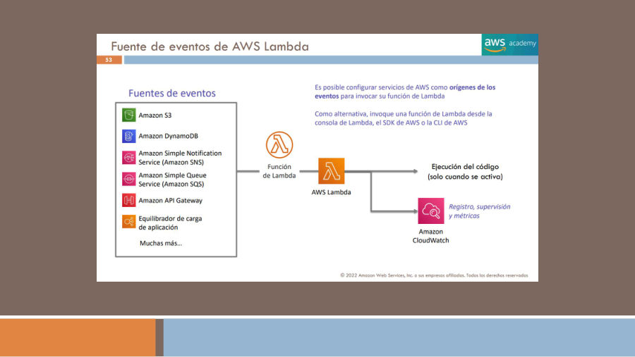

[Registro de fuente](fuentes/05_CORPUS_POR_PAGINA.md#t6-p54).

**Figura de apoyo — Código, dependencias y rol de ejecución.** `[FUENTE HISTÓRICA: T6 p.55]` El bloque izquierdo identifica lo que configura el cliente para la función: código, dependencias y rol. El servicio ejecuta ese código y publica señales de observación según configuración. El rol no es un permiso ilimitado sobre la cuenta.

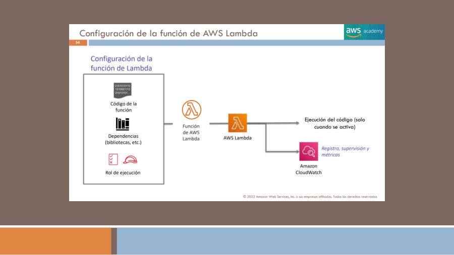

[Registro de fuente](fuentes/05_CORPUS_POR_PAGINA.md#t6-p55).

**Figura de apoyo — Cuotas de Lambda en la lámina histórica.** `[FUENTE HISTÓRICA: T6 p.58]` La captura distingue cuotas regionales y límites por función y cita memoria, duración y paquetes. Los valores se conservan como información histórica de la figura; no se recomiendan como límites vigentes. La enseñanza es comprobar que la unidad de trabajo encaja en las condiciones actuales del servicio.

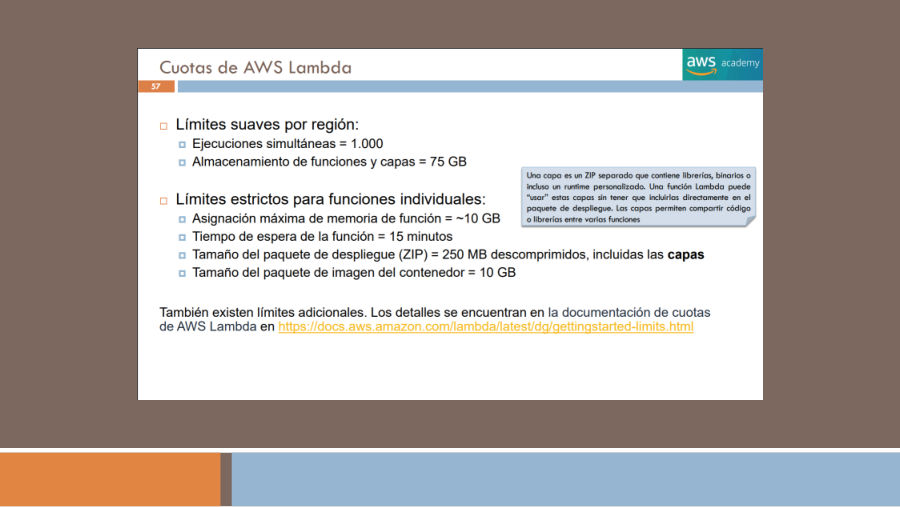

[Registro de fuente](fuentes/05_CORPUS_POR_PAGINA.md#t6-p58).

## 9.8 Beanstalk, Lightsail, Batch y Outposts

**AWS Elastic Beanstalk** facilita desplegar aplicaciones sobre recursos AWS y gestionar aspectos de aprovisionamiento y operación del entorno. T6 pp.60–62 lo presenta con despliegue, balanceo, escalado y observación. El desarrollador aporta su aplicación y configuración; la plataforma no elimina los recursos subyacentes ni su coste. Tampoco prueba que cualquier aplicación o versión de framework sea compatible indefinidamente.

**Amazon Lightsail** simplifica escenarios de infraestructura para aplicaciones y sitios relativamente sencillos mediante un conjunto integrado de opciones. Su valor es reducir decisiones iniciales dentro de ese modelo. No debe elegirse solo por ser «más fácil» si la aplicación exige una arquitectura o integración que supera sus opciones. Comparado con EC2, enfatiza simplicidad de experiencia; comparado con Lambda, no representa el mismo modelo de invocación de funciones.

**AWS Batch** organiza la ejecución de trabajos por lotes. Un trabajo puede necesitar recursos durante un período y terminar; muchos trabajos pueden formar una cola que debe planificarse según requisitos y capacidad. Un renderizado de archivos o un conjunto de simulaciones encaja mejor en este razonamiento que en mantener un servidor web esperando peticiones. Batch organiza trabajos; el contenedor describe el software que ejecutará cada uno y la capacidad suministra recursos.

**AWS Outposts** extiende infraestructura y servicios AWS compatibles a ubicaciones físicas del cliente. Se valora cuando existen necesidades de proximidad, tratamiento local o integración con instalaciones que lo justifican. No equivale a una región completa instalada sin requisitos de emplazamiento, conectividad u operación. Las opciones concretas deben comprobarse, y su razón de uso no es simplemente hacer un servidor «más rápido».

T6 p.4 también incluye VMware Cloud on AWS y el repositorio de aplicaciones serverless como referencias de catálogo. El primero identifica una propuesta histórica relacionada con entornos VMware; el segundo permite descubrir aplicaciones sin servidores empaquetadas. Su presencia en un icono no demuestra disponibilidad comercial actual ni justifica sustituir por ellos el análisis de requisitos. Se registran en el glosario para conservar la procedencia.

## 9.9 Elastic Load Balancing y sus variantes

**Elastic Load Balancing**, ELB, distribuye tráfico entre destinos compatibles y ofrece mecanismos de comprobación de salud. No ejecuta la aplicación ni crea por sí mismo toda la capacidad de servidores necesaria. Un **listener** acepta conexiones de acuerdo con protocolo y puerto; la configuración dirige tráfico a destinos, que en modalidades actuales se organizan mediante grupos de destino.

Un **Application Load Balancer**, ALB, trabaja con tráfico de aplicación HTTP/HTTPS y decisiones basadas en características de la solicitud, como host o ruta. Es útil para distribuir rutas de una aplicación entre servicios. Un **Network Load Balancer**, NLB, atiende necesidades de transporte y flujos compatibles, con propiedades diferentes de protocolo y direccionamiento. **Gateway Load Balancer**, GWLB, integra y distribuye tráfico hacia dispositivos virtuales de red compatibles. **Classic Load Balancer**, CLB, es una generación anterior; la referencia oficial recomienda migrar a una generación actual.

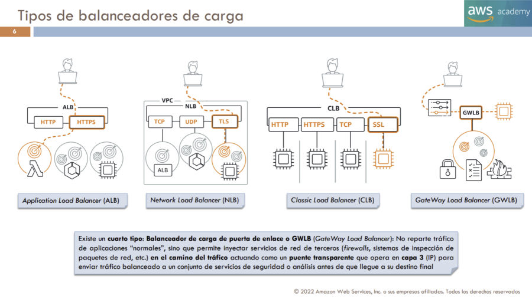

[Registro de la página y detalles conservados](fuentes/05_CORPUS_POR_PAGINA.md#t9-p06).

Una comprobación de salud no es una prueba completa de negocio. Un proceso puede aceptar una conexión mientras no puede leer su base de datos. Debe elegirse una señal que represente suficientemente el estado del destino sin introducir comprobaciones inadecuadas. Además, la configuración, los umbrales y las condiciones excepcionales de encaminamiento dependen del tipo de balanceador: no se interpreta «solo saludables» como garantía absoluta frente a cualquier escenario sin destinos sanos.

### Actividad original de T9 pp.9–10

La tabla conserva el enunciado y la clave docente; el comentario separa la interpretación histórica de la selección actual. No se añade al banco de preguntas.

| Enunciado de la actividad | Solución docente | Explicación y matiz |
|---|---|---|
| Debe admitir el tráfico a una aplicación en contenedores | Balanceador de aplicaciones | ALB es una opción natural para rutas HTTP de aplicaciones; contenedor no implica que NLB sea imposible. |
| El tráfico TCP es extremadamente irregular e impredecible | Balanceador de red | Se reconoce el perfil de transporte y el escenario de capacidad descrito. |
| Necesita balanceo de carga simple con múltiples protocolos | Balanceador clásico | Se conserva la clave del curso; no se recomienda CLB para un despliegue nuevo solo por esta frase. |
| Debe admitir una dirección IP estática o elástica o un destino IP fuera de la VPC | Balanceador de red | La pregunta reúne propiedades del escenario NLB; compatibilidad de destinos exige revisar condiciones. |
| Necesita gestionar millones de solicitudes por segundo manteniendo latencias muy bajas | Balanceador de red | Es la asociación de rendimiento del material, no una garantía numérica de cualquier arquitectura. |
| Debe admitir solicitudes HTTPS | Balanceador de aplicaciones | Es la respuesta histórica. HTTPS no distingue de forma exclusiva ALB porque otras modalidades pueden tratar tráfico TLS/HTTPS según configuración. |

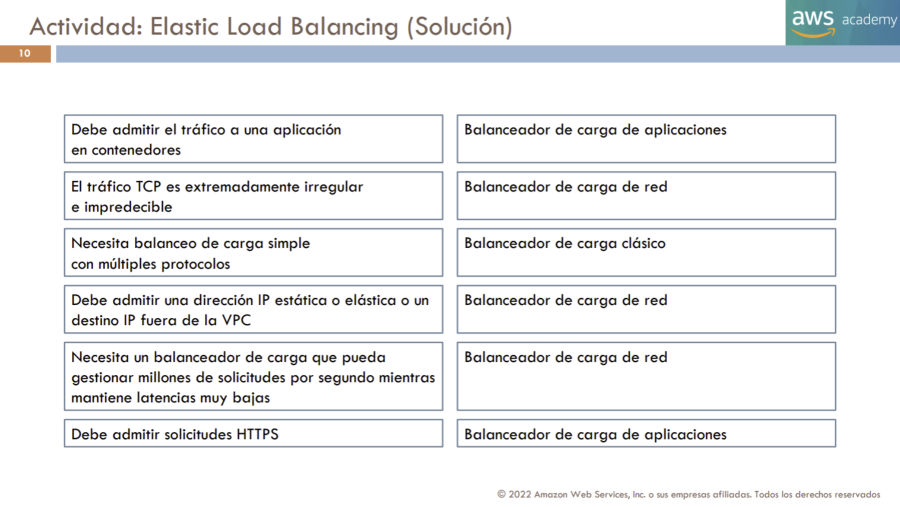

[Registro de la página y detalles conservados](fuentes/05_CORPUS_POR_PAGINA.md#t9-p10).

T9 p.11 diferencia métricas CloudWatch, registros de acceso y CloudTrail. Las métricas ayudan a observar rendimiento y errores; los registros de acceso describen tráfico admitido por la función correspondiente y CloudTrail, operaciones de administración de API. Son evidencias distintas. Tener un registro de creación del balanceador no equivale a disponer del detalle de cada petición de usuario.

## 9.10 Auto Scaling: ajustar capacidad y mantener salud

**Amazon EC2 Auto Scaling** administra grupos de instancias según configuración y políticas. Un **Auto Scaling Group**, ASG, es la agrupación con capacidades mínima, deseada y máxima. El servicio intenta mantener la capacidad prevista y reemplazar instancias que sus mecanismos de salud consideran no saludables. La aplicación debe estar preparada para que una instancia desaparezca y otra empiece a servir: conservar una sesión o archivo imprescindible únicamente en el disco de una máquina impide aprovechar bien ese modelo.

T9 pp.19–22 compara sobreaprovisionar para el máximo con quedarse corto y muestra patrones semanales y picos de noviembre. Los porcentajes de la figura son un ejemplo histórico de utilización, no una proporción universal de ahorro. La conclusión es adaptar capacidad al trabajo y a su variación, teniendo en cuenta cuánto tarda una nueva instancia en arrancar y ser útil.

El escalado **horizontal** añade o retira unidades; el **vertical** cambia recursos de una unidad. El primero permite repartir trabajo si la aplicación admite varias copias; el segundo puede ser necesario cuando una carga requiere una máquina mayor, pero no elimina su condición de punto de fallo. Ninguno resuelve automáticamente un bloqueo o una consulta ineficiente de base de datos.

Una **launch template** conserva parámetros de lanzamiento y admite versiones; la documentación actual la recomienda frente a configuraciones de lanzamiento antiguas. La imagen y el tipo definen qué se ejecuta; las subredes, dónde; las políticas y señales, cuándo ajustar capacidad. Ese esquema conserva el hilo de T9 pp.25–27 sin convertir la antigua consola en un procedimiento actual.

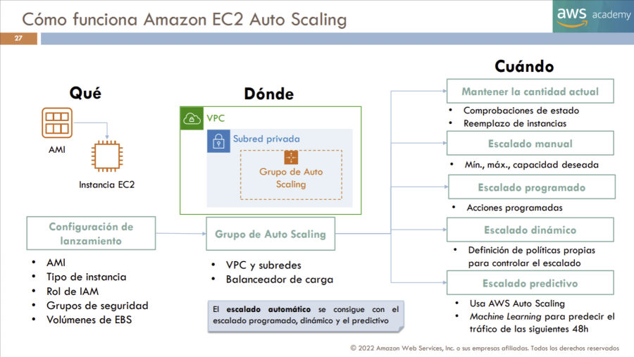

[Registro de la página y detalles conservados](fuentes/05_CORPUS_POR_PAGINA.md#t9-p27).

Las políticas pueden reaccionar a señales observadas, ejecutar cambios programados o utilizar capacidades predictivas compatibles. Una programación resulta útil si el inicio de actividad es conocido; una reacción dinámica ayuda ante cambios observados. Un objetivo de seguimiento necesita una métrica con relación útil con la demanda. La CPU puede servir para una carga limitada por CPU, pero no siempre describe una cola de trabajo o una base saturada por conexiones.

**Ejemplo editorial:** un grupo tiene mínimo dos instancias, capacidad deseada tres y máximo seis. Cambiar la deseada a cuatro solicita otra unidad dentro de esos límites; no garantiza que cuatro estén saludables de inmediato. La nueva máquina necesita inicialización, aplicación operativa y registro correcto. Si se mide antes de que esté lista pueden producirse decisiones de escalado poco útiles. Retirar capacidad también requiere considerar peticiones en curso y estado persistente.

ELB distribuye conexiones entre destinos y Auto Scaling ajusta el conjunto de instancias. Integrarlos permite registrar nuevas unidades y retirar las que dejan de servir, pero son servicios diferentes. El balanceador también escala su propia capacidad de servicio; eso no significa que haya aumentado el número de servidores que ejecutan nuestro código. T9 p.28 representa una señal de CPU que desencadena una política: el valor del ejemplo no es un objetivo recomendado para toda aplicación.

## 9.11 Resolver una selección de cómputo

Para elegir, describe primero el trabajo: servicio permanente, procesamiento por eventos, lote finito o aplicación ya empaquetada en contenedores. Después identifica el control de sistema que necesita y la capacidad operativa del equipo. Solo entonces selecciona una familia, plataforma o modalidad serverless. Añade balanceo, persistencia y escalado cuando el comportamiento de la aplicación lo requiera.

Una aplicación con dependencias particulares del sistema puede justificar EC2. Una función que procesa objetos puede justificar Lambda. Un servicio en contenedores puede utilizar ECS o EKS y capacidad EC2 o Fargate compatible. Trabajos finitos pueden beneficiarse de Batch. Beanstalk facilita ciertos despliegues de aplicaciones y Lightsail simplifica otros escenarios. Ninguna elección debe basarse únicamente en que un nombre incluya «administrado».

Referencias de contraste: [opciones de cómputo](https://docs.aws.amazon.com/whitepapers/latest/aws-overview/compute-services.html), [contenedores](https://docs.aws.amazon.com/whitepapers/latest/aws-overview/containers.html), [ELB](https://docs.aws.amazon.com/elasticloadbalancing/latest/userguide/what-is-load-balancing.html) y [launch templates](https://docs.aws.amazon.com/autoscaling/ec2/userguide/launch-templates.html). Las comparaciones editoriales se apoyan además en los documentos 02 y 03 del paquete y las figuras citadas; no se han desplegado recursos durante la revisión.
