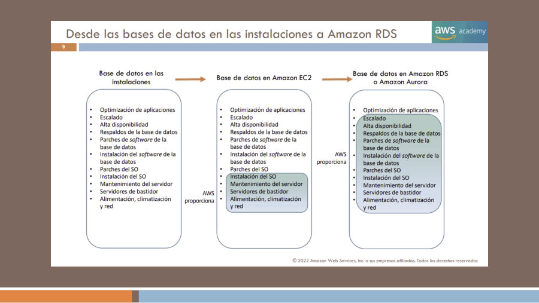
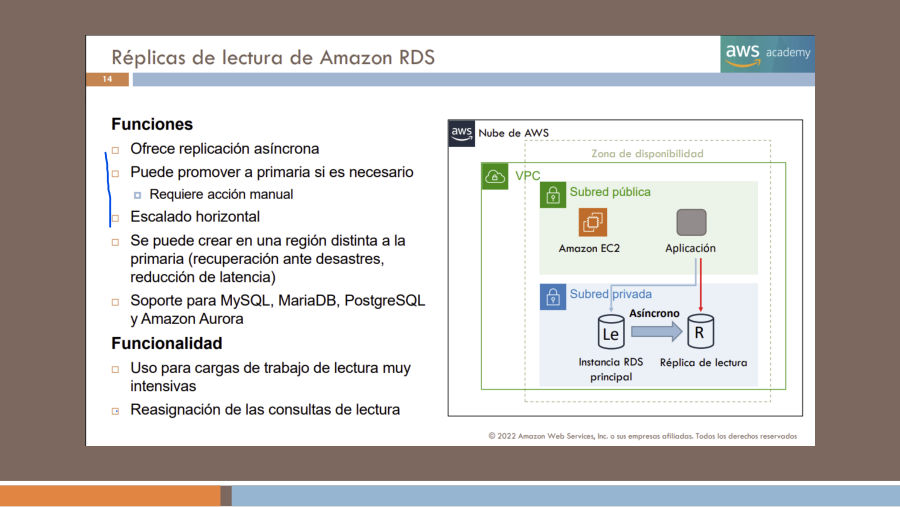
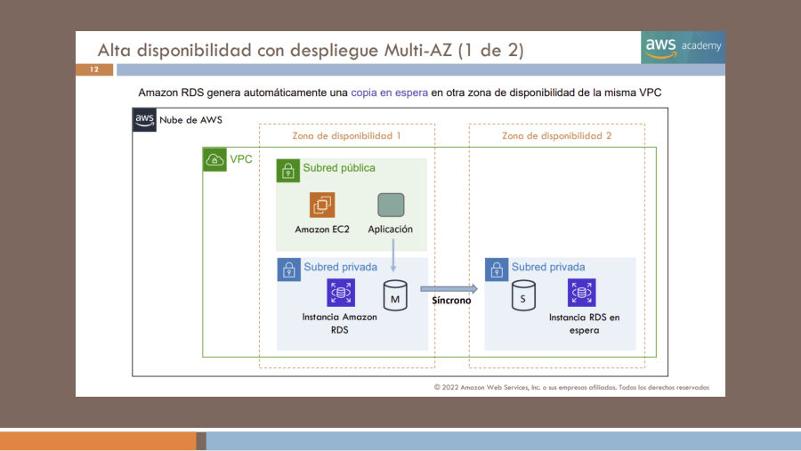
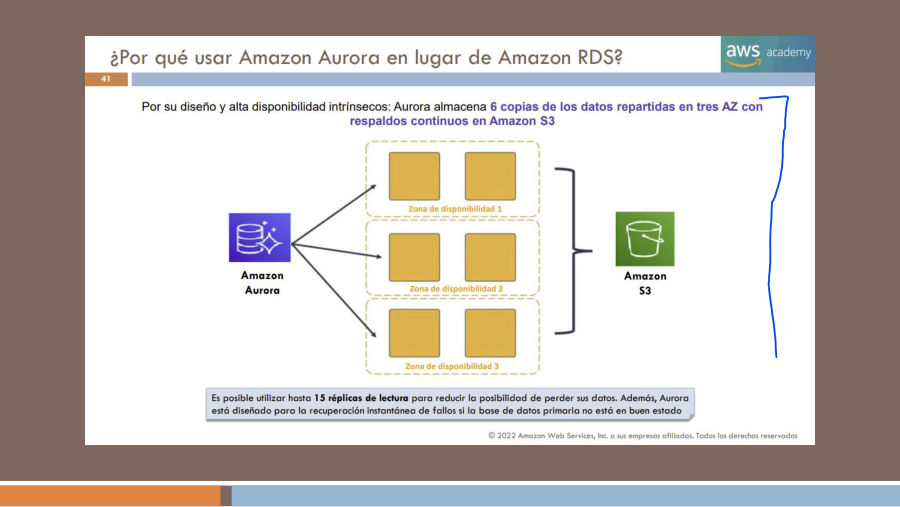
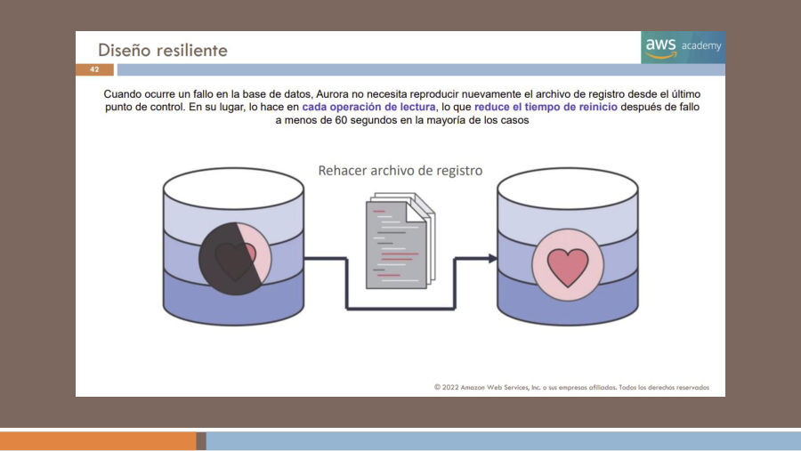
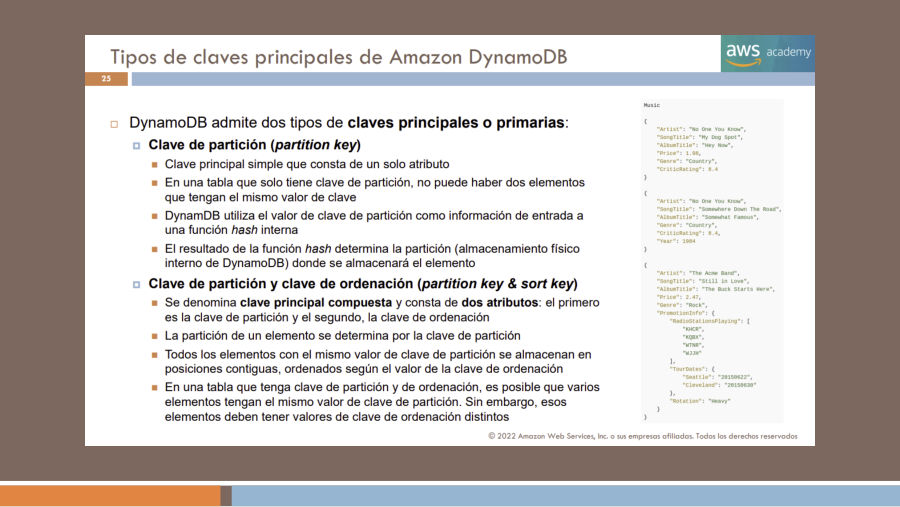
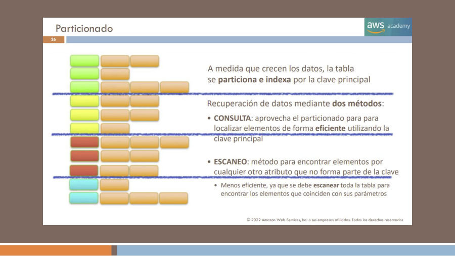
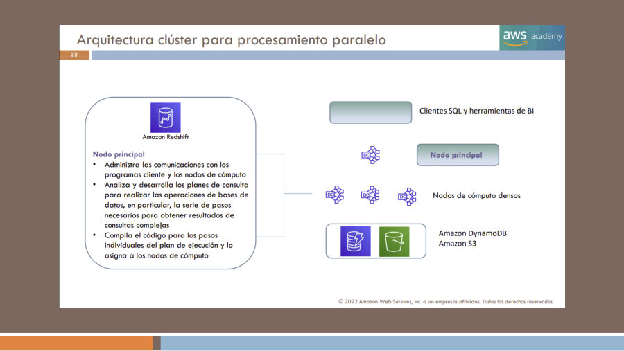

# 10. Bases de datos y herramientas de migración

Una base de datos debe elegirse por el modelo de información, las operaciones que necesita la aplicación y los requisitos de consistencia, latencia, disponibilidad y administración. La palabra «administrada» no indica que todos los productos almacenen de igual manera ni que el cliente deje de diseñar sus datos. Este capítulo desarrolla el objetivo 3.4 y relaciona las bases analíticas con el 3.7.

`[FUENTE DOCENTE]` T8 pp.5–42; T2 p.16. `[AMPLIACIÓN OFICIAL]` Documento 03 del paquete, ElastiCache, DocumentDB, Neptune y herramientas de migración. `[EXPLICACIÓN EDITORIAL]` Casos, comparaciones y desarrollo conceptual. Las tablas promocionales y económicas de 2022 se conservan en el corpus, sin atribuirles vigencia actual.

## 10.1 Del servidor propio al servicio administrado

Una organización que opera una base en sus instalaciones administra desde infraestructura física hasta motor, copias y aplicación. Si instala el mismo motor en EC2, AWS administra la infraestructura del servicio, pero el cliente mantiene sistema invitado, motor instalado y procedimientos que le corresponden. Un servicio como RDS asume tareas adicionales de infraestructura y operación del motor bajo sus condiciones. El diagrama T8 p.9 desplaza esas responsabilidades gradualmente entre tres escenarios.

La administración del proveedor no sustituye el diseño lógico. La aplicación sigue necesitando un esquema adecuado, consultas eficientes, usuarios autorizados y tratamiento correcto de transacciones y errores. También deben definirse configuración de disponibilidad, retención de copias y objetivos de recuperación. Que un servicio pueda realizar copias automáticas no demuestra que la política elegida satisfaga el RPO del negocio.

[Registro de la página y detalles conservados](fuentes/05_CORPUS_POR_PAGINA.md#t8-p09).

**Ejemplo editorial:** una empresa exige instalar una extensión no admitida o modificar profundamente el sistema y motor. Puede necesitar EC2, aceptando las tareas operativas adicionales. Otra utiliza un motor compatible con las capacidades del servicio y prefiere delegar tareas repetitivas; puede valorar RDS. No se decide solo por el número de conexiones o la palabra «SQL»: compatibilidad y responsabilidades importan.

Los costes de ese trabajo incluyen operación, supervisión y recuperación, además de recursos. El cuadro histórico T8 pp.17–20 enumera cómputo, almacenamiento, copias, I/O y transferencias. Se conserva como mapa de factores, no como tarifa vigente ni como garantía de gratuidad de cualquier transferencia. La economía detallada se reserva para el Bloque IV.

## 10.2 RDS: motor, instancia, almacenamiento y red

**Amazon Relational Database Service**, RDS, permite operar bases relacionales con motores y modalidades compatibles. Una base relacional representa información estructurada en tablas y relaciones; SQL permite consultas y operaciones según el motor. El valor del servicio está en delegar determinadas tareas de aprovisionamiento y operación, no en cambiar automáticamente las reglas de datos de la aplicación.

T8 p.10 distingue clase de instancia y almacenamiento. La primera condiciona CPU, memoria y prestaciones de red; el segundo responde a capacidad y características de I/O. Una base con consultas que recorren muchos datos puede sufrir por almacenamiento aun si dispone de CPU libre. Aumentar memoria puede beneficiar un conjunto de trabajo que se reutiliza; no arregla por sí solo una consulta mal planteada o la falta de índices adecuados.

La figura enumera motores como MySQL, PostgreSQL, MariaDB, Oracle, SQL Server, Aurora e IBM Db2 en el material entregado. Es una lista de la figura y no una promesa de que cualquier edición o versión esté disponible bajo idénticas condiciones. Compatibilidad del motor, licencias, región y modalidad deben comprobarse. Aurora se estudia como opción relacional diseñada por AWS, no como una traducción del nombre RDS.

La base suele situarse en redes privadas y recibir conexiones de aplicaciones autorizadas. T8 p.11 muestra una capa web y una base en su VPC. Un Security Group permite el flujo necesario, pero también se necesita autenticación del motor y permisos sobre los datos. Una base pública no es una condición necesaria para que una aplicación alojada en AWS pueda acceder a ella.

La aplicación utiliza un endpoint o nombre de conexión y debe manejar reconexiones y errores transitorios. Referenciar un nombre de servicio en vez de fijar una IP de una máquina concreta facilita las operaciones de conmutación que el servicio soporta. Aun así, el código debe responder correctamente a conexiones interrumpidas y no asumir que una transacción desconocida no produjo ningún efecto.

## 10.3 Multi-AZ, réplicas y copias: tres necesidades diferentes

El despliegue Multi-AZ de instancia representado en T8 pp.12–13 conserva una instancia principal y un standby en otra AZ con replicación síncrona. Si se produce una condición de fallo que activa la conmutación, el servicio promueve la reserva bajo su mecanismo de disponibilidad. El objetivo es reducir el impacto de un fallo, no repartir todas las lecturas entre dos servidores equivalentes.

Una **read replica** recibe cambios y permite dirigir lecturas hacia otra instancia bajo las capacidades del motor y modalidad. El esquema T8 p.14 destaca replicación asíncrona: una lectura puede reflejar un estado anterior al de la principal. La aplicación debe elegir qué consultas toleran ese desfase. Consultar inmediatamente un pedido recién creado desde una réplica con retraso puede dar la impresión de que no existe.

| Necesidad | Mecanismo conceptual | Precaución |
|---|---|---|
| Continuar tras un fallo zonal | Modalidad Multi-AZ apropiada | Comprobar comportamiento de conmutación y reconexión |
| Descargar consultas de lectura | Read replicas compatibles | Considerar replicación, desfase y enrutamiento de consultas |
| Recuperar un estado anterior | Copias y restauración | Definir retención, RPO, RTO y probar recuperación |
| Cubrir una interrupción regional | Diseño multirregión | Configurar replicación y recuperación, no asumirlas por defecto |

[Registro de la página y detalles conservados](fuentes/05_CORPUS_POR_PAGINA.md#t8-p14).

`[CONTRASTE OFICIAL — 2 de noviembre de 2026]` La distinción debe formularse con la modalidad exacta: en un **Multi-AZ DB instance deployment**, el standby no atiende lecturas; un **Multi-AZ DB cluster deployment** dispone de instancias standby que también pueden servirlas. No es correcto generalizar «Multi-AZ nunca sirve lecturas» a todos los productos actuales. La [documentación de modalidades Multi-AZ](https://docs.aws.amazon.com/AmazonRDS/latest/UserGuide/Concepts.MultiAZ.html) permite comprobar esa diferencia.

Una réplica y una copia no tienen idéntico objetivo. Si se borra información por error y el cambio se replica, todas las réplicas pueden reflejarlo. Una copia con retención adecuada puede recuperar un estado anterior, pero hacerlo requiere tiempo y un procedimiento. La alta disponibilidad tampoco equivale a cero pérdida o cero interrupción en cualquier condición. Los requisitos del negocio se expresan y después se comprueba qué configuración puede satisfacerlos.

**Figura de apoyo — Multi-AZ de instancia RDS.** `[FUENTE HISTÓRICA: T8 p.12]` La principal y el standby están en zonas distintas y el esquema marca replicación síncrona. Es el despliegue de instancia representado por el curso; el standby de este modelo no es la réplica para descargar lecturas. La modalidad actual de clúster se distingue en la explicación oficial del apartado.

[Registro de fuente](fuentes/05_CORPUS_POR_PAGINA.md#t8-p12).

## 10.4 Aurora: relacional con arquitectura diseñada para AWS

**Amazon Aurora** es una base relacional con compatibilidad MySQL o PostgreSQL según su edición y capacidades. Permite conservar patrones de acceso relacionales y herramientas compatibles mientras utiliza una arquitectura de almacenamiento diseñada para el servicio. Compatibilidad no significa que toda función, extensión o comportamiento de cualquier versión del motor externo sea idéntico.

T8 pp.39–41 muestra almacenamiento distribuido, mecanismos de recuperación y copias de datos entre zonas. El esquema de seis copias en tres AZ describe el diseño presentado por el material; no debe convertirse en una afirmación de seis réplicas SQL que la aplicación pueda consultar. Las copias de almacenamiento y las instancias de lectura son elementos diferentes.

[Registro de la página y detalles conservados](fuentes/05_CORPUS_POR_PAGINA.md#t8-p41).

La fuente menciona multiplicadores promocionales de rendimiento y un comportamiento rápido de recuperación. Se mantienen como afirmaciones históricas condicionadas por la carga y el producto, no como un SLA universal para todas las aplicaciones. El conocimiento útil es distinguir una arquitectura gestionada de almacenamiento y cómputo de una base instalada manualmente en una máquina.

**Escenario editorial:** una aplicación transaccional ya utiliza PostgreSQL y necesita estudiar mayor disponibilidad y crecimiento de lectura. Aurora puede ser candidata junto a otras modalidades RDS, pero la evaluación debe comprobar extensiones, comportamiento de consultas, requisitos de migración y costes. Si el problema real es ejecutar agregaciones masivas de años de ventas, también debe considerarse una arquitectura analítica; cambiar a Aurora no convierte OLTP en el mismo tipo de carga que un warehouse.

**Figura de apoyo — Recuperación de Aurora en el material docente.** `[FUENTE HISTÓRICA: T8 p.42]` La lámina atribuye la recuperación a su diseño de tratamiento del registro. La referencia a menos de sesenta segundos «en la mayoría de los casos» pertenece al material histórico y no se presenta como SLA, garantía de cero interrupción o RTO universal.

[Registro de fuente](fuentes/05_CORPUS_POR_PAGINA.md#t8-p42).

## 10.5 DynamoDB: tablas, elementos, claves y acceso

**Amazon DynamoDB** es una base NoSQL administrada de clave-valor y documentos. Una tabla contiene **elementos**, cada uno formado por **atributos**. El modelo permite que elementos tengan atributos distintos, pero no elimina la necesidad de diseñar las claves y formas de consulta. «Sin esquema rígido de columnas» no significa «sin estructura ni reglas».

T8 pp.22–24 compara tablas relacionales con representaciones de documentos y elementos. Las comparaciones de la diapositiva son introductorias: no todos los sistemas NoSQL tienen el mismo modelo, y las bases relacionales también ofrecen capacidades diversas. No debe deducirse que NoSQL siempre sea más rápido o que SQL no pueda escalar horizontalmente. Se elige según operaciones y capacidades concretas.

Una clave primaria puede ser solo una **partition key**, que identifica cada elemento de forma única, o combinar **partition key** y **sort key**, donde la pareja identifica el elemento. La clave de partición participa en la distribución interna; la de ordenación permite distinguir y ordenar elementos dentro de la misma clave de partición en operaciones compatibles. No se debe suponer que una tabla admite duplicados arbitrarios de su clave primaria completa.

[Registro de la página y detalles conservados](fuentes/05_CORPUS_POR_PAGINA.md#t8-p25).

**Ejemplo editorial:** una tabla de pedidos puede usar un identificador de cliente como clave de partición y un identificador ordenable de pedido como clave de ordenación. La pareja permite guardar varios pedidos por cliente y consultar el conjunto bajo ese patrón. La utilidad depende de que las consultas importantes coincidan con ese acceso. Un cliente que concentra casi todas las operaciones también puede introducir desequilibrios: distribuir claves es una decisión de diseño y no solo un requisito de sintaxis.

T8 pp.26–27 contrasta **Query** y **Scan**. Query explota una condición de clave para recuperar un conjunto relevante; Scan recorre elementos y puede consumir trabajo desproporcionado si se usa para buscar continuamente pequeñas coincidencias en una tabla grande. No significa que Scan sea siempre una operación prohibida, sino que el diseño del acceso habitual no debe depender de recorrer todo sin necesidad. Los índices compatibles ofrecen opciones adicionales que deben diseñarse para consultas concretas.

DynamoDB administra infraestructura y particionado, pero el cliente decide modelo, acceso, protección y configuración de capacidad. Existen modos de capacidad y opciones de escalado que no deben confundirse con un derecho a cualquier volumen de trabajo sin límites ni coste. La tabla debe observarse según latencia, consumo y distribución, y la aplicación debe gestionar los errores que correspondan.

Para un carrito o catálogo con accesos previsibles por clave, DynamoDB puede ser una candidata. Para consultas relacionales arbitrarias con uniones complejas puede ser más natural un motor relacional. Esa comparación no impide construir sistemas mixtos: una aplicación puede utilizar un servicio para transacciones y otro para un acceso específico, siempre que se diseñen coherencia y sincronización.

**Figura de apoyo — DynamoDB: acceso y particionado.** `[FUENTE HISTÓRICA: T8 p.26]` El dibujo relaciona distribución de elementos con acceso por clave y contrasta consulta con escaneo. Sirve para razonar sobre los patrones de acceso; no especifica cuántas particiones tendrá una tabla real ni demuestra que todo escaneo esté prohibido.

[Registro de fuente](fuentes/05_CORPUS_POR_PAGINA.md#t8-p26).

## 10.6 ElastiCache, documentos y grafos

**Amazon ElastiCache** proporciona capacidades administradas de datos en memoria con motores y modalidades compatibles. Una caché conserva datos que interesa recuperar rápidamente para evitar repetir consultas o cálculos. La aplicación puede buscar un valor en caché y, si falta, obtenerlo de la fuente y guardarlo para usos posteriores. Ese flujo introduce decisiones de vencimiento, actualización e invalidación.

**Ejemplo editorial:** el resumen de un producto se consulta miles de veces y cambia poco. Mantenerlo temporalmente en caché reduce carga sobre la base de origen. Si cambia el precio, debe decidirse cómo se invalida o actualiza el valor para evitar servir uno obsoleto. La rapidez de memoria no resuelve por sí sola coherencia, seguridad ni durabilidad. No se trata ElastiCache como sustituto universal de la base transaccional ni se agrupan todas las bases en memoria bajo una misma garantía de persistencia.

**Amazon DocumentDB** ofrece un modelo documental administrado con compatibilidad MongoDB dentro de sus capacidades admitidas. Puede interesar cuando una aplicación utiliza documentos y ese ecosistema de API, sujeto a evaluación de compatibilidad. No es el mismo servicio que DynamoDB: compartir la etiqueta NoSQL no significa compartir todas las operaciones, arquitectura o modelo de administración.

**Amazon Neptune** se orienta a grafos: nodos y relaciones que interesa recorrer. En una aplicación que investiga conexiones entre cuentas, dispositivos y operaciones, la pregunta puede consistir en encontrar caminos y relaciones entre entidades. El modelo de grafo hace explícitas esas conexiones. No es una base documental por el mero hecho de ser NoSQL ni una herramienta que detecte fraude automáticamente sin un diseño y análisis de negocio.

La selección debe identificar qué operación domina: consulta por clave, relaciones entre tablas, estructura documental compatible, recorrido de conexiones o reutilización de valores en memoria. Una descripción de negocio debe traducirse a esas necesidades antes de buscar un nombre de servicio.

## 10.7 Redshift y el trabajo analítico

**Amazon Redshift** es un almacén de datos orientado a analítica. T8 pp.29–30 describe SQL complejo, almacenamiento columnar y procesamiento paralelo. Un warehouse busca responder preguntas que recorren y agregan muchos registros: ventas por región, evolución mensual o comportamiento de productos. La organización puede cargar y preparar datos de varios sistemas para analizarlos con herramientas de inteligencia de negocio.

El almacenamiento columnar favorece leer las columnas necesarias para ciertas consultas analíticas y comprimir información con características semejantes. El procesamiento paralelo distribuye trabajo y combina resultados. T8 pp.31–33 representa un nodo principal que coordina consultas y nodos de cómputo que ejecutan partes del plan. Es un esquema histórico de clúster, no una obligación de que el alumno administre manualmente ese mismo conjunto en todas las modalidades actuales.

[Registro de la página y detalles conservados](fuentes/05_CORPUS_POR_PAGINA.md#t8-p32).

T8 p.35 menciona SQL, JDBC y ODBC como vías de conexión desde herramientas analíticas. Los conectores permiten interoperabilidad, pero no hacen que todos los motores SQL admitan exactamente el mismo dialecto o rendimiento. Las páginas 36–37 incluyen enterprise data warehouse, big data y analítica incorporada en SaaS: el servicio ayuda a resolver esas cargas, no sustituye los datos de origen ni su preparación.

**Ejemplo editorial:** el proceso de venta necesita registrar de forma correcta una compra y su pago. Un informe de ventas de los últimos años tiene otro patrón de trabajo. Separar el sistema transaccional y el analítico puede evitar que un cálculo masivo perjudique la experiencia del comprador. Esto necesita un flujo de datos y una política de actualidad; el informe puede reflejar un estado con retraso respecto de la última transacción.

Redshift no debe confundirse con Athena, que permite consultar datos de S3 sin administrar un clúster tradicional de base; ni con Quick Sight, que presenta y explora información; ni con Glue, que ayuda a integrar y preparar datos. El [capítulo 13](13_ia_ml_y_analitica.md) desarrolla esas tareas complementarias.

## 10.8 Migración: DMS y conversión de esquemas

**AWS Database Migration Service**, AWS DMS, ayuda a migrar y replicar datos entre orígenes y destinos compatibles. Según la tarea y el soporte, puede realizar una carga inicial y replicar cambios posteriores para reducir el desfase antes del cambio de aplicación. La compatibilidad debe revisarse por motores, tipos de datos, objetos y mecanismos de captura de cambios; no todas las combinaciones tienen idéntico soporte.

**AWS Schema Conversion Tool**, AWS SCT, ayuda a evaluar y convertir esquemas y parte del código de base cuando se cambia a otro motor compatible. **DMS Schema Conversion** ofrece capacidades de evaluación y conversión gestionadas dentro de su ámbito. No se registran como sinónimos perfectos: se relacionan por su finalidad, pero son herramientas o modalidades distintas. Convertir la definición de una tabla no copia por sí solo todas sus filas ni garantiza que una aplicación cambie de motor sin modificaciones.

Una migración **homogénea** conserva el motor o una familia compatible y una **heterogénea** cambia de tecnología, por lo que puede requerir conversiones adicionales. Es necesario revisar procedimientos almacenados, consultas, tipos, permisos y conexiones. La migración no termina cuando la herramienta indica que transfirió datos: debe verificarse el resultado de la aplicación y el plan para volver atrás si el cambio falla.

**Secuencia editorial:** inventariar origen y dependencias; evaluar compatibilidad; preparar destino y esquema; cargar información; mantener cambios cuando proceda; validar integridad y aplicación; decidir una ventana de conmutación; redirigir conexiones; observar el nuevo sistema. Cada paso resuelve un riesgo distinto. La réplica continua puede reducir el tiempo de interrupción, pero no convierte la transición en un proceso infalible o sin planificación.

## 10.9 Comparación de escenarios

| Necesidad predominante | Candidato conceptual | Razón de la selección |
|---|---|---|
| SQL transaccional y relaciones | RDS o Aurora | Modelo relacional con administración delegada compatible |
| Control especial del motor o sistema | Motor en EC2 | Mayor libertad junto con más operación propia |
| Acceso de clave-valor/documentos por patrones conocidos | DynamoDB | Diseño basado en claves y servicio administrado |
| Reducir consultas repetidas mediante memoria | ElastiCache | Caché o capacidades de memoria según modalidad |
| Aplicación documental con API MongoDB compatible | DocumentDB | Evaluar compatibilidad del modelo y operaciones |
| Recorrer conexiones entre entidades | Neptune | Modelo de grafo |
| Analizar y agregar grandes conjuntos | Redshift | Warehouse y procesamiento analítico |
| Transferir datos y mantener cambios durante migración | DMS | Movimiento y replicación según soporte |
| Evaluar y adaptar esquema al nuevo motor | SCT o DMS Schema Conversion | Conversión compatible, con revisión de trabajo manual |

Para comprobar comprensión, explica por qué una réplica no es una copia histórica, por qué una caché necesita invalidación y por qué convertir un esquema no garantiza compatibilidad de la aplicación. Son decisiones que permiten estudiar sin depender de reconocer una marca en una tabla.

Referencias: [categoría de bases de datos](https://docs.aws.amazon.com/whitepapers/latest/aws-overview/database.html), [Aurora](https://docs.aws.amazon.com/AmazonRDS/latest/AuroraUserGuide/OverviewAurora.html), [réplicas RDS](https://docs.aws.amazon.com/AmazonRDS/latest/UserGuide/USER_ReadRepl.html), [componentes DynamoDB](https://docs.aws.amazon.com/amazondynamodb/latest/developerguide/HowItWorks.CoreComponents.html) y [AWS DMS](https://docs.aws.amazon.com/dms/latest/userguide/Welcome.html). Las modalidades concretas se contrastan a la fecha de revisión y no sustituyen una prueba de migración real.
