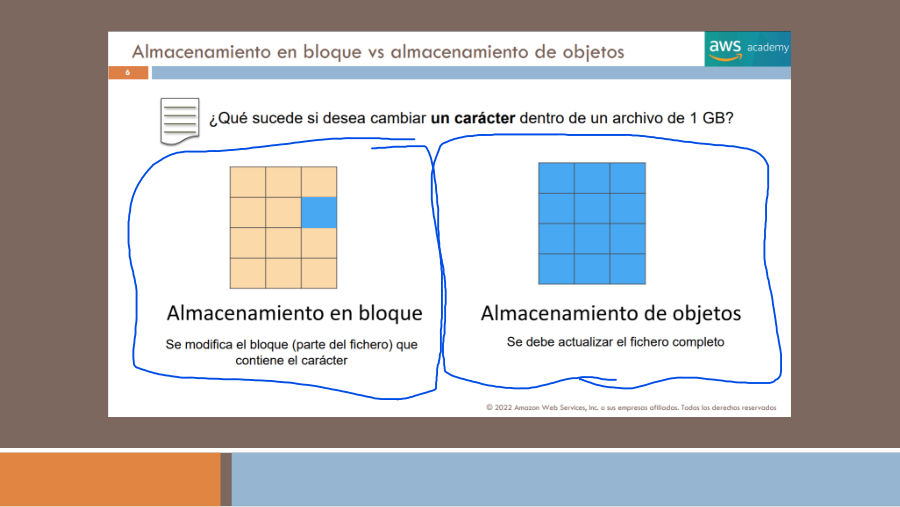
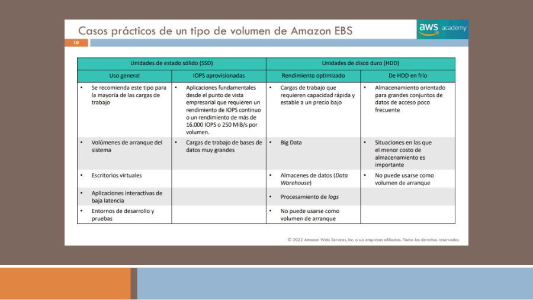
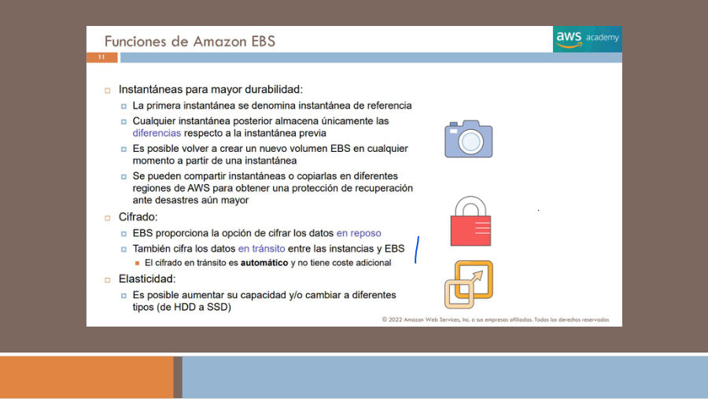
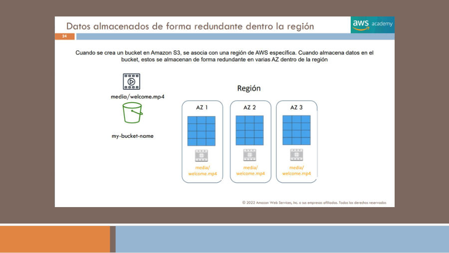
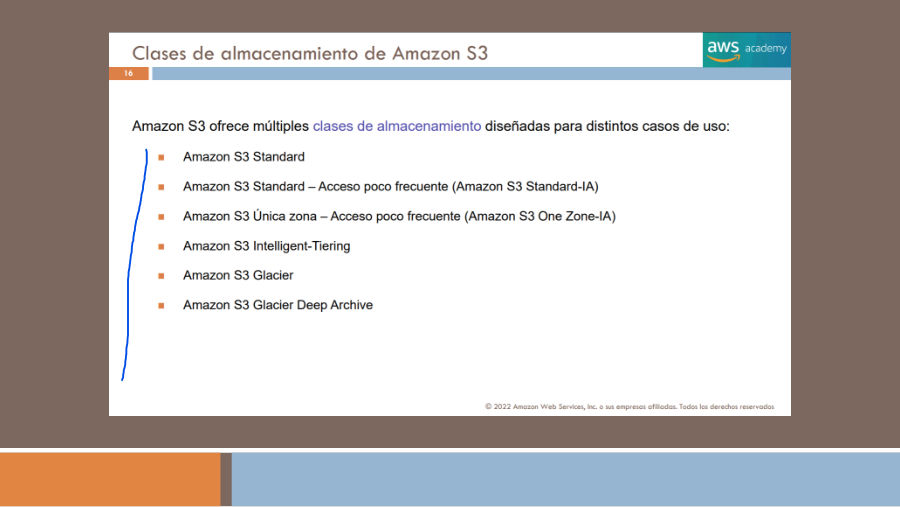
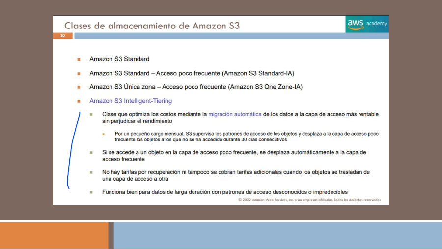
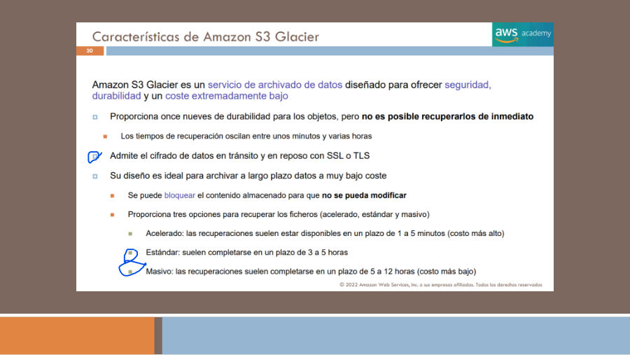
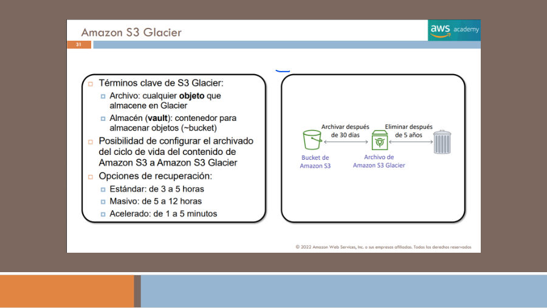
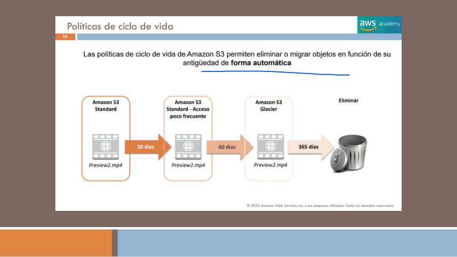
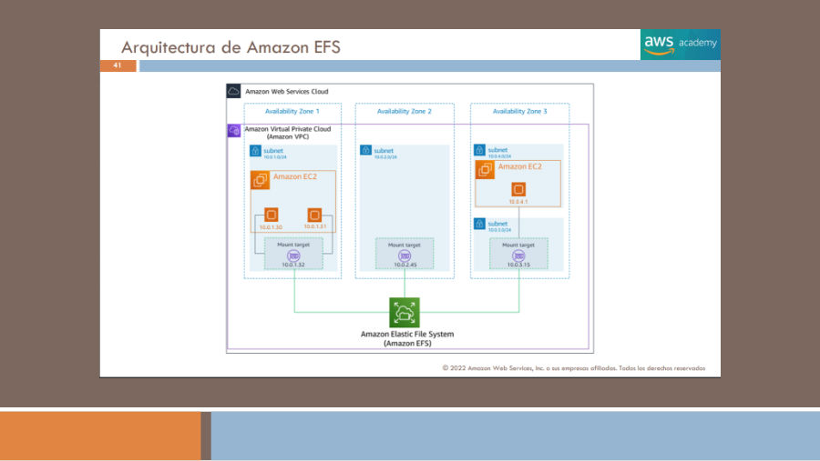

# 12. Almacenamiento, clases y recuperación

El objetivo 3.6 pide reconocer almacenamiento de objetos, bloques y archivos, clases S3, ciclos de vida, sistemas híbridos y copias. La elección no se reduce a cuántos gigabytes se necesitan: importan la forma de acceder, la persistencia, el dominio de fallo, el plazo de recuperación y la operación que mantiene el cliente.

`[FUENTE DOCENTE]` T7 completo; T6 pp.19–21; T2 p.14. `[AMPLIACIÓN OFICIAL]` Documento 03, FSx, Storage Gateway, Backup y Elastic Disaster Recovery. `[EXPLICACIÓN EDITORIAL]` Desarrollo y casos de selección. Las tablas de precios, capacidades máximas y tiempos de 2022 se conservan en las fuentes como históricas.

## 12.1 Bloques, objetos y archivos

El almacenamiento de **bloques** presenta unidades de almacenamiento que un sistema utiliza como discos. Sobre ellas puede construir un sistema de archivos o almacenar datos de una base. El sistema y la aplicación deciden cómo organizar y modificar su contenido. EBS y el almacenamiento local de una instancia pertenecen a esta familia conceptual, con diferencias muy importantes de persistencia y operación.

El almacenamiento de **objetos** organiza datos mediante objetos con una clave y metadatos. El cliente invoca operaciones de un servicio sobre esos objetos. S3 no es automáticamente un disco POSIX sobre el que toda aplicación pueda modificar sectores como si fuera un volumen local. Adaptar una aplicación que espera un sistema de archivos puede necesitar cambios; una interfaz de compatibilidad no vuelve idénticos todos los comportamientos.

El almacenamiento de **archivos** proporciona jerarquías y operaciones de un sistema de archivos mediante protocolos compatibles. Varias aplicaciones pueden compartir un conjunto de archivos cuando el servicio y la configuración lo permiten. EFS y la familia FSx ofrecen modelos de archivos con capacidades y protocolos diferentes. Un directorio compartido no es simplemente un nombre alternativo para un bucket.

T7 p.6 pregunta qué ocurre al cambiar un carácter en un archivo de 1 GB. Su dibujo contrapone modificar bloques con reemplazar el contenido del objeto bajo el modelo ilustrado. Es una analogía útil de granularidad de acceso; no debe convertirse en una regla de facturación de todas las operaciones ni en una afirmación universal sobre cualquier funcionalidad futura de objetos.

[Registro de la página y detalles conservados](fuentes/05_CORPUS_POR_PAGINA.md#t7-p06).

## 12.2 EBS: volúmenes de bloques y persistencia

**Amazon Elastic Block Store**, EBS, proporciona volúmenes persistentes de bloques para instancias EC2 compatibles. El volumen se crea en una AZ y se asocia a instancias admitidas de esa zona. El sistema operativo lo utiliza como dispositivo de bloques; puede contener un sistema de archivos, datos de aplicación o un volumen de arranque compatible.

Persistencia significa que los datos no dependen únicamente del proceso que está ejecutándose, pero no que el volumen sea inmune a borrados o a cualquier fallo. La configuración al terminar una instancia puede eliminar un volumen; una aplicación puede borrar información; una arquitectura puede depender de una sola zona. Deben diseñarse protección, copias y restauración. EBS tampoco implica que un volumen se mueva automáticamente a otra AZ junto con una aplicación.

T7 pp.7–8 ofrece la regla introductoria de un volumen asociado a una instancia. Como matiz, **Multi-Attach** permite asociaciones múltiples para tipos y entornos compatibles en la misma AZ. No se debe generalizar la excepción a todos los volúmenes ni conectar un sistema de archivos convencional de varias máquinas sin coordinación: concurrencia y consistencia requieren soporte de aplicación o sistema apropiado. Referencia: [Multi-Attach](https://docs.aws.amazon.com/ebs/latest/userguide/ebs-volumes-multi.html).

La separación del host hace que EBS sea distinto de **instance store**, que utiliza discos locales ligados a la instancia y host. Reiniciar no es lo mismo que detener o terminar. Para información que deba sobrevivir a los eventos que borran el almacenamiento local, se necesita persistir o copiar en otro sistema. Un directorio temporal de cálculo reconstruible puede tolerar pérdida; el único ejemplar de un pedido confirmado no debería depender de ese modelo.

## 12.3 Rendimiento, tipos y snapshots

T7 pp.9–10 organiza volúmenes en SSD de uso general, SSD de IOPS aprovisionadas y HDD orientados a rendimiento secuencial o datos menos activos. La idea de selección es comparar latencia, operaciones por segundo, throughput y patrón de acceso. Muchas operaciones pequeñas y aleatorias no se comportan como unas pocas transferencias grandes y secuenciales. Un volumen con suficiente capacidad puede no satisfacer el rendimiento de una base.

La tabla histórica muestra capacidades máximas de 16 TiB y distintas cifras de IOPS y MiB/s. Se conserva en la figura y el corpus, pero no como catálogo vigente. Para CLF-C02 importa identificar SSD, HDD y propósito de cada perfil; la selección real necesita la documentación del tipo concreto y las capacidades de la instancia. Tampoco se debe copiar un tipo antiguo por ser el predeterminado de una consola de 2022.

Reconstrucción de T7 p.9, cotejada en la imagen completa. **Todos los números son históricos del cuadro, no límites actuales:**

| Atributo de la figura | SSD uso general | SSD IOPS aprovisionadas | HDD rendimiento optimizado | HDD frío |
|---|---:|---:|---:|---:|
| Capacidad máxima | 16 TiB | 16 TiB | 16 TiB | 16 TiB |
| IOPS máximas por volumen | 16.000 | 64.000 | 500 | 250 |
| Rendimiento máximo | 250 MiB/s | 1.000 MiB/s | 500 MiB/s | 250 MiB/s |

La nota de la figura indica que los SSD pueden utilizarse como volúmenes de arranque en las opciones representadas. No debe utilizarse esta tabla para contratar capacidad sin consultar el tipo vigente. [Figura completa del cuadro](figuras/t7_p09.jpg).

[Registro de la página y detalles conservados](fuentes/05_CORPUS_POR_PAGINA.md#t7-p10).

Un **snapshot EBS** representa una copia puntual del volumen bajo el mecanismo del servicio. La primera copia y las posteriores incrementales permiten conservar bloques necesarios para reconstruir el estado. «Incremental» no significa que cada restauración deba reconstruirse manualmente uniendo archivos descargados por el usuario. Los snapshots se administran como recursos; no aparecen como objetos ordinarios que el cliente deba buscar en un bucket S3 propio.

T7 p.11 relaciona snapshots, copia entre regiones, cifrado y modificación elástica de volúmenes. Son funciones distintas. Copiar un snapshot puede apoyar una estrategia regional, pero se necesita además recrear recursos, configurar claves y validar acceso. Restaurar bloques tampoco garantiza consistencia de una aplicación si los datos no se capturaron de forma coherente. Una prueba de recuperación debe comprobar el servicio completo.

EBS admite cifrado conforme a su configuración y mecanismos de claves. El cifrado protege datos bajo su alcance, mientras permisos y red gobiernan otros accesos. No se interpreta una frase de cifrado como garantía de que todo el trayecto de cualquier protocolo de aplicación esté protegido. El Bloque II desarrolla KMS, datos en reposo y en tránsito.

**Figura de apoyo — Snapshots, cifrado y elasticidad de EBS.** `[FUENTE HISTÓRICA: T7 p.11]` La figura distingue la primera instantánea de las posteriores incrementales y muestra restauración y copia como operaciones diferentes. Cifrado y cambio de capacidad son funciones adicionales. Los rótulos de precio y automatismo de 2022 no se generalizan a toda configuración actual.

[Registro de fuente](fuentes/05_CORPUS_POR_PAGINA.md#t7-p11).

## 12.4 S3: bucket, objeto, clave y región

**Amazon Simple Storage Service**, S3, almacena objetos en **buckets**. Una clave identifica cada objeto dentro del bucket y sus metadatos describen características asociadas. Un nombre como `media/vacaciones/video.mp4` puede presentar prefijos similares a carpetas, pero el modelo de almacenamiento sigue siendo de objetos. La aplicación utiliza operaciones de API, SDK, CLI o consola según permisos.

Un bucket se crea en una región y sus datos siguen las propiedades de su clase y configuración. Que S3 sea un servicio de alcance amplio no significa que toda información se replique automáticamente a todas las regiones. Tampoco todas las clases tienen el mismo número de zonas o el mismo comportamiento de recuperación. La figura multizona de T7 p.24 debe interpretarse para las clases y contexto correspondientes.

[Registro de la página y detalles conservados](fuentes/05_CORPUS_POR_PAGINA.md#t7-p24).

T7 p.23 muestra dos estilos históricos de URL: ruta y alojamiento virtual del bucket. El objetivo de estudio es reconocer bucket, endpoint regional y nombre o clave del objeto, no copiar un ejemplo de endpoint como URL universal. Una URL localizable tampoco implica acceso público: la autorización, firma o mecanismos de entrega deben permitir la operación. El nombre de bucket se interpreta dentro del ámbito de nombres y modalidad correspondiente, sin prometer un espacio privado de nombres idéntico al de carpetas locales.

Los casos de T7 p.26 incluyen copias y archivo, sitios estáticos, contenido multimedia y distribución de software. Son usos de objetos. Un sitio estático no ejecuta por sí solo un servidor de aplicación transaccional y S3 no sustituye una base relacional por almacenar datos. Una arquitectura puede combinar S3 para ficheros, cómputo para lógica y una base para transacciones.

## 12.5 Seleccionar clases S3 por patrón y recuperación

Una **storage class** determina características de almacenamiento y acceso del objeto. Se comparan frecuencia de uso, tiempo de recuperación, resiliencia, disponibilidad y componentes de coste. Durabilidad y disponibilidad no son sinónimos: conservar un objeto y poder recuperarlo en el instante requerido son propiedades distintas. Los costes de solicitudes, recuperación y permanencia mínima pueden cambiar la decisión que parecía más barata por GB almacenado.

**S3 Standard** está orientada a acceso frecuente con prestaciones adecuadas para contenido activo. Puede servir para medios usados regularmente o datos operativos accesibles como objetos. Su finalidad no es minimizar a cualquier precio el almacenamiento de información que no se tocará durante años.

**S3 Standard-Infrequent Access**, Standard-IA, atiende datos consultados con menos frecuencia que siguen necesitando acceso rápido. Un respaldo que debe recuperarse en línea puede pertenecer a ese patrón. Deben considerarse operaciones y condiciones de almacenamiento y recuperación: «acceso infrecuente» no implica que una solicitud esté prohibida ni que su coste total sea siempre menor.

**S3 One Zone-IA** utiliza una sola AZ. Puede interesar para datos recreables o copias secundarias cuando se acepta ese alcance de resiliencia. No es la elección automática para la única copia imprescindible de información que debe sobrevivir a la pérdida de una zona. Esa diferencia es de dominio de fallo, no simplemente de velocidad.

**S3 Intelligent-Tiering** permite adaptar capas de acceso bajo su modelo de observación y transiciones. Es útil para patrones variables o desconocidos, pero deben conocerse las capas y condiciones activadas. La política no consiste en que cualquier objeto pase por una secuencia ilimitada sin coste ni requisitos. T7 p.20 presenta una versión histórica del mecanismo; no se replica aquella lista de condiciones como descripción completa actual.

| Patrón | Clase o familia candidata | Pregunta de diseño |
|---|---|---|
| Acceso frecuente | Standard | ¿Qué disponibilidad y rendimiento requiere la aplicación? |
| Acceso poco frecuente pero inmediato | Standard-IA | ¿Cuánto pesan recuperación y permanencia en el coste total? |
| Datos recreables con acceso infrecuente | One Zone-IA | ¿Se acepta depender de una AZ? |
| Patrón variable | Intelligent-Tiering | ¿Qué capas y condiciones convienen al objeto? |
| Archivo con acceso inmediato ocasional | Glacier Instant Retrieval | ¿Encaja el patrón de archivo con sus condiciones de coste? |
| Archivo que admite espera | Glacier Flexible Retrieval | ¿Qué plazo y modalidad de restauración se necesitan? |
| Archivo de larga duración | Glacier Deep Archive | ¿Puede esperarse al procedimiento de restauración correspondiente? |

La documentación actual incluye otras clases como **S3 Express One Zone**, orientada a un perfil específico de alto rendimiento y latencia dentro de una AZ. Se registra para evitar presentar la tabla histórica como catálogo completo. La elección depende de las condiciones del servicio y no solo de la palabra «rápido». Referencia: [clases de almacenamiento S3](https://docs.aws.amazon.com/AmazonS3/latest/userguide/storage-class-intro.html).

**Figura de apoyo — Catálogo de clases S3 del curso.** `[FUENTE HISTÓRICA: T7 p.16]` La lista permite reconocer Standard, Standard-IA, One Zone-IA, Intelligent-Tiering y las denominaciones Glacier de la época. Se compara con las clases actuales descritas en el texto; no es un catálogo completo ni transforma todas las clases en multizona.

[Registro de fuente](fuentes/05_CORPUS_POR_PAGINA.md#t7-p16).

**Figura de apoyo — Movimiento entre capas en Intelligent-Tiering.** `[FUENTE HISTÓRICA: T7 p.20]` La lámina explica observación del acceso y movimiento entre capas según el modelo presentado. Los treinta días y las afirmaciones de costes pertenecen a esa descripción histórica; no sustituyen comprobar capas activadas, condiciones y modalidad actuales.

[Registro de fuente](fuentes/05_CORPUS_POR_PAGINA.md#t7-p20).

## 12.6 Glacier: clases, restauración y servicio histórico

El material usa «Amazon S3 Glacier» para varias ideas relacionadas con archivo y, en páginas concretas, vocabulario del servicio basado en **vaults** y **archives**. No debe mezclarse ese contenedor histórico con un bucket ni aplicar su tabla de tamaño máximo a todos los objetos S3 actuales. Las clases Glacier de S3 mantienen el modelo de objetos de S3 con sus condiciones específicas.

**Glacier Instant Retrieval** permite acceso inmediato bajo su perfil de archivo; por tanto, «ningún Glacier puede recuperarse inmediatamente» es una generalización incorrecta actual. Flexible Retrieval y Deep Archive implican procedimientos y tiempos de restauración diferentes. El usuario debe escoger una opción cuyo plazo de recuperación satisfaga el negocio, no solo cuyo almacenamiento por GB parezca menor.

T7 pp.30–31 cita opciones acelerada, estándar y masiva con tiempos históricos; p.34 compara tamaños y costes antiguos entre S3 y Glacier. Esas cantidades se conservan como lectura de la fuente en el corpus. Una arquitectura actual debe consultar clase, tamaño, capacidad de recuperación y condiciones vigentes. No se promete que una copia archivada pueda restaurarse inmediatamente en una emergencia.

Los casos de T7 p.32 incluyen medios digitales, información de salud, conservación científica, normativas y sustitución de cintas. En todos importa el horizonte de retención y el acceso esperado. Archivar un documento no acredita por sí solo cumplimiento de una norma: deben considerarse acceso, retención, integridad y los requisitos de la organización. La palabra SSL de la captura se interpreta como referencia histórica; para comunicaciones actuales se estudia TLS según compatibilidad.

**Figura de apoyo — Opciones históricas de recuperación Glacier.** `[FUENTE HISTÓRICA: T7 p.30]` La captura diferencia recuperación acelerada, estándar y masiva, con sus plazos históricos. Es útil para visualizar la espera de restauración en ese contexto; no debe extenderse a Glacier Instant Retrieval ni interpretarse como garantía actual para cualquier objeto.

[Registro de fuente](fuentes/05_CORPUS_POR_PAGINA.md#t7-p30).

**Figura de apoyo — Vault y archivo frente a clases S3.** `[FUENTE HISTÓRICA: T7 p.31]` La figura combina vocabulario del servicio histórico y un flujo de conservación con plazos de ejemplo. Un vault no es un bucket S3 renombrado. Se conserva precisamente para distinguir ambos modelos y evitar trasladar su terminología o límites a todas las clases Glacier actuales.

[Registro de fuente](fuentes/05_CORPUS_POR_PAGINA.md#t7-p31).

## 12.7 Ciclo de vida, versiones y protección

Las **Lifecycle Rules** de S3 automatizan transiciones o expiración de objetos que cumplen criterios. T7 p.33 representa un objeto que pasa de Standard a acceso infrecuente, luego a archivo y finalmente se elimina, con plazos de ejemplo. Son una política concreta del dibujo, no una obligación general de mover todos los datos a los 30 o 60 días. Algunas transiciones tienen restricciones; la regla debe comprobarse antes de aplicarla.

[Registro de la página y detalles conservados](fuentes/05_CORPUS_POR_PAGINA.md#t7-p33).

**Ejemplo editorial:** los vídeos nuevos se consultan mucho durante una campaña y poco después. La organización puede decidir que los más antiguos cambien de clase cuando el patrón lo justifica, y conservar una política de eliminación compatible con sus obligaciones. Si los clientes todavía exigen reproducción inmediata, una transición a archivo con espera podría romper el servicio aunque ahorre almacenamiento.

El **versionado** conserva versiones de objetos según el comportamiento y configuración de S3. Ayuda ante sobrescrituras o eliminaciones, pero requiere comprender qué ocurre con marcadores de borrado y versiones no actuales. La retención de versiones también consume recursos y puede necesitar reglas. Una copia, una réplica, el versionado y una política de retención son mecanismos relacionados, no sinónimos.

Las páginas 35–36 incluyen cifrado y acceso IAM. La frase histórica de que S3 solo cifra al habilitarlo no describe el comportamiento actual de cifrado por defecto de nuevas cargas de objetos. El manual de seguridad explica el matiz: [protección de datos del Bloque II](../bloque-2/07_seguridad_datos_y_cumplimiento.md#seccion-7-5). Cifrado por defecto no elimina la necesidad de configurar quién puede leer, modificar o borrar.

## 12.8 EFS y sistemas de archivos compartidos

**Amazon Elastic File System**, EFS, proporciona almacenamiento de archivos administrado y elástico mediante NFS compatible. Varias cargas pueden compartir datos a través de red. Crecer o reducir el conjunto de archivos no exige aprovisionar de la misma manera un volumen fijo para cada servidor, pero rendimiento, acceso y costes siguen siendo decisiones de diseño.

T7 pp.39–41 ilustra usos como directorios compartidos, contenido y análisis; también representa **mount targets** en subredes para permitir que clientes se conecten. El sistema de archivos es el recurso principal y los destinos de montaje proporcionan puntos de acceso de red según la arquitectura. Deben permitirse los flujos y aplicar permisos sobre archivos y mecanismos compatibles.

[Registro de la página y detalles conservados](fuentes/05_CORPUS_POR_PAGINA.md#t7-p41).

La figura multizona corresponde a la arquitectura presentada. EFS ofrece modalidades **Regional** y **One Zone** con distinto alcance; no se debe asegurar que toda modalidad conserva datos entre varias AZ. Los comandos de montaje de T7 pp.42–43 son capturas históricas, no instrucciones para ejecutar contra las direcciones del ejemplo. El cliente debe utilizar su sistema, destino y método compatibles.

La comparación con EBS es clara: un volumen de bloques no se transforma automáticamente en un sistema de archivos compartido coherente entre servidores. La comparación con S3 también: una aplicación que espera operaciones NFS y jerarquía de archivos no usa el mismo contrato que una aplicación que solicita objetos por API. Referencia: [EFS](https://docs.aws.amazon.com/efs/latest/ug/whatisefs.html).

## 12.9 FSx y compatibilidad de sistemas de archivos

**Amazon FSx** es una familia de sistemas de archivos administrados con variantes específicas. **FSx for Windows File Server** atiende aplicaciones y accesos compatibles con el sistema de archivos y protocolos del entorno Windows, como SMB. **FSx for Lustre** se orienta a cargas que necesitan un sistema de archivos paralelo de alto rendimiento. **FSx for NetApp ONTAP** y **FSx for OpenZFS** proporcionan capacidades de esas tecnologías bajo las condiciones del servicio.

No se elige «FSx» como si todas sus variantes fueran idénticas. Una aplicación Windows que necesita compartir archivos y una simulación paralela que procesa un gran conjunto tienen requisitos diferentes. El sistema esperado por la aplicación, sus protocolos, operaciones y patrón de rendimiento orientan la variante. También deben comprobarse disponibilidad, protección y funcionamiento de cada modalidad.

**Escenario editorial:** una aplicación existente utiliza rutas SMB y permisos integrados en su entorno. Migrarla puede favorecer una opción compatible en vez de reescribir todas sus operaciones como solicitudes S3. En otra carga, los datos se procesan de forma paralela con necesidades de rendimiento de archivos; puede evaluarse Lustre. La decisión no implica que el mismo producto sea óptimo para conservar documentos de archivo durante años.

## 12.10 Storage Gateway, Backup y recuperación de servidores

**AWS Storage Gateway** integra aplicaciones locales con almacenamiento AWS mediante modalidades compatibles. Una capa de caché local puede mantener cerca datos usados y utilizar almacenamiento cloud como parte del diseño. Hay modelos de archivos, volúmenes y cintas virtuales con comportamientos distintos; no se describe el producto como una VPN ni como una copia universal de todo el CPD.

**Ejemplo editorial:** una organización mantiene software local que espera una interfaz de almacenamiento conocida y necesita aprovechar almacenamiento en AWS. El gateway adapta esa relación bajo una modalidad admitida. Debe planificar conectividad, capacidad local, coherencia y qué sucede cuando se pierde la conexión. Tener datos en caché no demuestra que todo el conjunto esté disponible localmente sin red.

**AWS Backup** permite centralizar políticas y administración de copias de recursos compatibles. Un **plan de backup** relaciona protección, programación y retención; las copias o puntos de recuperación deben utilizarse en procedimientos de restauración. Centralizar la política ayuda al gobierno, pero la organización debe elegir recursos, permisos y objetivos adecuados. Una política aplicada no demuestra por sí sola que la aplicación pueda recuperarse dentro del tiempo requerido.

**AWS Elastic Disaster Recovery** se orienta a recuperación de servidores mediante replicación y mecanismos de recuperación compatibles. Su objetivo se distingue de conservar simplemente una copia de objetos o de seleccionar una clase barata de S3. El diseño debe considerar replicación, recursos de recuperación, pruebas y conmutación. No se promete un RTO o RPO idéntico para cualquier entorno sin configuración y ensayo.

Para cerrar una selección de almacenamiento, describe primero la interfaz que espera la aplicación; después identifica qué pérdidas debe tolerar y cuánto puede esperar para recuperar datos. Solo entonces compara clases, rendimiento y costes. La tabla de servicios puede orientar, pero las condiciones de persistencia y restauración son lo que permite justificar una decisión.

Referencias complementarias: [almacenamiento AWS](https://docs.aws.amazon.com/whitepapers/latest/aws-overview/storage-services.html), [ciclo de vida S3](https://docs.aws.amazon.com/AmazonS3/latest/userguide/object-lifecycle-mgmt.html), [AWS Backup](https://docs.aws.amazon.com/aws-backup/latest/devguide/whatisbackup.html) y [Storage Gateway](https://docs.aws.amazon.com/storagegateway/latest/userguide/WhatIsStorageGateway.html).
