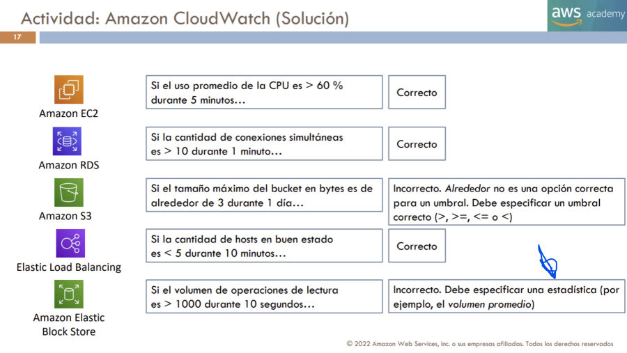

# 14. Integración, aplicaciones y otros servicios

El objetivo 3.8 reúne integración de aplicaciones, aplicaciones empresariales, soporte, herramientas de desarrollo, escritorios y aplicaciones remotas, frontend e IoT. La categoría «otros servicios» no significa que baste con memorizar una lista. Cada servicio resuelve una tarea dentro de un sistema y mantiene responsabilidades propias del equipo.

`[AMPLIACIÓN OFICIAL]` Este capítulo procede principalmente del documento 03 del paquete y de las referencias oficiales enlazadas. `[FUENTE DOCENTE]` T6 pp.53–57 y T9 pp.11–17 aportan conexiones con funciones, notificaciones y observabilidad; T2 p.20 aporta el catálogo de operación. `[EXPLICACIÓN EDITORIAL]` Los casos y comparativas desarrollan el uso conceptual y no son preguntas añadidas al banco existente.

## 14.1 Desacoplar productores y consumidores

En una interacción síncrona, un componente solicita una operación y espera una respuesta. Si el otro no está disponible o tarda, el primero puede quedar bloqueado o fallar. Una integración asíncrona permite transmitir trabajo o información sin exigir que todo el procesamiento termine dentro de esa misma interacción. El desacoplamiento reduce determinadas dependencias temporales, pero introduce decisiones de reintentos, duplicados, orden y observación.

Un **mensaje** transporta información para que otro componente actúe. Un **evento** comunica que algo sucedió. La distinción ayuda a expresar intención: «procesa este archivo» y «se ha publicado este archivo» no imponen exactamente la misma relación con los receptores. Los servicios pueden transportar representaciones parecidas, pero se eligen según entrega, destinatarios y control del flujo.

**Ejemplo editorial:** una tienda confirma un pedido y después necesita generar un documento, enviar información y actualizar métricas. Si todas esas tareas deben terminar antes de responder al comprador, el fallo de una puede perjudicar el proceso completo. Separarlas permite tratarlas de otra manera, pero requiere saber qué pasos han terminado y qué ocurre si uno se repite. Desacoplar no elimina consistencia ni convierte varios pasos en una transacción atómica universal.

## 14.2 SQS: cola de trabajo

**Amazon Simple Queue Service**, SQS, proporciona colas para desacoplar componentes. Un productor envía mensajes y los consumidores los reciben para procesarlos. Una cola puede absorber variaciones temporales entre ritmo de llegada y capacidad de trabajo. El consumidor no debe suponer que dejar de recibir mensajes significa que toda la aplicación está sana: también necesita observar retrasos, fallos y capacidad.

El procesamiento debe tratar el ciclo de recepción y confirmación mediante las operaciones del servicio. La **visibilidad** controla cuándo un mensaje recibido puede volver a estar disponible para otros consumidores si no se completa el procesamiento. Una configuración demasiado corta respecto del trabajo puede generar intentos simultáneos o repetidos; una demasiado larga puede retrasar la recuperación tras un fallo. El valor debe relacionarse con la duración y comportamiento de la aplicación.

Las colas **Standard** y **FIFO** ofrecen propiedades diferentes de orden y deduplicación bajo sus condiciones. No se afirma que «usar FIFO» garantice exactamente una vez cada efecto externo de negocio. El consumidor debe diseñarse para evitar duplicaciones de operaciones sensibles y conocer los límites de su flujo. Una cola con mensajes no procesables puede necesitar una **dead-letter queue**, DLQ, para separarlos y permitir investigación y tratamiento.

**Escenario editorial:** llegan muchos archivos y su análisis tarda. El productor guarda la información necesaria y envía trabajo a SQS; los consumidores procesan según capacidad. Si un consumidor falla, debe poder retomarse el mensaje sin perder el archivo ni ejecutar de forma incorrecta un efecto repetido. SQS coordina la entrega de trabajo, pero no contiene el algoritmo de análisis ni reemplaza el almacenamiento del archivo.

Referencia: [SQS](https://docs.aws.amazon.com/AWSSimpleQueueService/latest/SQSDeveloperGuide/welcome.html).

## 14.3 SNS: publicación y suscripción

**Amazon Simple Notification Service**, SNS, proporciona publicación-suscripción. Un emisor publica en un **topic** y el servicio distribuye a suscriptores compatibles según configuración. El productor puede comunicar información sin conocer directamente cada consumidor. Es apropiado cuando varios destinos deben recibir una notificación o reaccionar a la misma publicación.

La diferencia con una cola de trabajo es el patrón de distribución. En una cola, varios trabajadores pueden compartir el procesamiento de los mensajes. En publicación-suscripción, varios suscriptores pueden necesitar cada uno la misma información. Se pueden combinar: un topic SNS distribuye hacia varias colas SQS y cada equipo consume la suya, con su propio ritmo de procesamiento y gestión de errores.

**Ejemplo editorial:** un pedido publicado debe llegar tanto al equipo que prepara documentación como al que organiza logística. Si ambos necesitan una copia lógica del evento, una única cola con dos consumidores que compiten por mensajes no expresa por sí sola esa necesidad. Distribuir a dos colas permite separar sus trabajos. Permisos, entrega y reintentos deben diseñarse en cada integración.

SNS también aparece en T9 p.14 como destino de notificaciones de alarmas CloudWatch. Una alarma detecta una condición sobre métricas y una publicación puede informar a destinatarios; publicar no corrige automáticamente el fallo ni garantiza que una persona haya actuado. Referencia: [SNS](https://docs.aws.amazon.com/sns/latest/dg/welcome.html).

## 14.4 EventBridge y Step Functions

**Amazon EventBridge** permite recibir y encaminar eventos desde fuentes a destinos mediante mecanismos como buses y reglas. Una regla selecciona eventos que coinciden con un patrón y dirige su procesamiento a destinos compatibles. Esto facilita relacionar componentes sin que cada productor invoque directamente a todos los consumidores. El diseño debe incluir errores de entrega, permisos y las capacidades específicas del mecanismo utilizado.

EventBridge se diferencia de una cola que mantiene trabajo para trabajadores y de un topic orientado a distribución de publicaciones. Puede combinarse con esos servicios. Cuando el requisito destaca eventos de distintas fuentes y selección por reglas, EventBridge es un candidato natural. No se describe una regla como un flujo completo que recuerda y coordina automáticamente todas las etapas de un proceso de negocio.

**AWS Step Functions** coordina flujos mediante estados y pasos. Una **state machine** representa el proceso: qué tarea ocurre, qué sucede con su resultado y cómo se manejan decisiones, esperas y errores bajo sus capacidades. Puede coordinar servicios y funciones compatibles. Una invocación Lambda realiza un trabajo; un flujo puede organizar varias operaciones con control del recorrido.

**Escenario editorial:** revisar un archivo, decidir si cumple condiciones, procesarlo y comunicar el resultado. Un evento puede iniciar el flujo; Step Functions organiza los pasos; una función realiza una transformación y SQS puede mantener trabajo que se procesa separadamente. Cada herramienta conserva una función distinta y deben considerarse efectos que ya ocurrieron cuando un paso falla. Reintentar todo no es siempre la respuesta correcta.

La denominación CloudWatch Events de las diapositivas debe contextualizarse con la evolución del servicio de eventos. CloudWatch sigue siendo fundamental para métricas y registros, pero el alumno no debe usarlo como nombre genérico de cualquier bus de eventos actual. Referencias: [EventBridge](https://docs.aws.amazon.com/eventbridge/latest/userguide/eb-what-is.html) y [Step Functions](https://docs.aws.amazon.com/step-functions/latest/dg/welcome.html).

| Necesidad principal | Servicio | Qué no debe confundirse |
|---|---|---|
| Mantener trabajo hasta que consumidores lo traten | SQS | Cola frente a enviar la misma publicación a muchos destinatarios |
| Distribuir publicaciones a suscriptores | SNS | Topic frente a una cola compartida por trabajadores |
| Seleccionar y dirigir eventos de fuentes | EventBridge | Regla de eventos frente a toda la lógica de un proceso con estado |
| Coordinar pasos y decisiones | Step Functions | Orquestación frente a ejecutar una sola función |

## 14.5 Connect y SES: necesidades empresariales distintas

**Amazon Connect** proporciona capacidades de centro de contacto. Una organización lo valora para gestionar interacciones de atención y sus flujos bajo las funciones del servicio. La integración con aplicaciones de negocio puede permitir consultar información o dirigir una interacción, pero sigue siendo necesario diseñar permisos, datos y experiencia del usuario. No equivale a contratar un equipo humano que resuelve automáticamente cada incidencia.

Un bot Lex puede participar en una experiencia conversacional; Transcribe puede aportar capacidades de texto a partir de audio. Eso no hace de los servicios sinónimos. Connect atiende un ámbito de operación de atención al cliente, mientras Lex se orienta a interfaces conversacionales y Transcribe a reconocimiento de voz. La arquitectura selecciona funciones compatibles según necesidad.

**Amazon Simple Email Service**, SES, permite integrar correo electrónico en aplicaciones según sus capacidades de envío y recepción. Una aplicación puede necesitar enviar una confirmación transaccional a un cliente, con configuración de identidades, permisos y tratamiento de resultados de entrega. Que una API acepte una solicitud de envío no demuestra que el destinatario haya leído el mensaje ni que todos los servidores lo entreguen sin restricciones.

SES no debe identificarse como un buzón corporativo completo o como reemplazo de todas las formas de notificación de SNS. La elección empieza por el canal y las funciones: correo de aplicación, distribución de avisos o atención de un centro de contacto. Referencia: [aplicaciones empresariales AWS](https://docs.aws.amazon.com/whitepapers/latest/aws-overview/business-applications.html).

## 14.6 Construir, entregar y diagnosticar software

**AWS CodeBuild** ejecuta tareas de construcción y comprobaciones de software en entornos administrados. Puede obtener código, instalar dependencias compatibles y producir **artefactos** como un paquete o imagen. Construir correctamente no significa que el artefacto ya esté en producción ni que todos los requisitos de seguridad y negocio se hayan validado. La definición de comandos, entorno y permisos pertenece al equipo.

**AWS CodePipeline** coordina fases de entrega. Un flujo puede incluir origen, construcción, aprobaciones y despliegue mediante herramientas compatibles. CodeBuild puede ser una parte del pipeline, pero no son nombres alternativos. La coordinación expresa qué sucede y en qué orden; cada tarea concreta conserva su implementación. El despliegue de infraestructura puede apoyarse en CloudFormation, que define recursos en lugar de representar por sí solo el pipeline completo.

**AWS X-Ray** aporta trazado para comprender solicitudes en aplicaciones distribuidas compatibles. Una **traza** relaciona partes de una petición entre componentes para localizar latencia o fallos. Un registro de texto muestra un acontecimiento y una métrica resume una medida; el trazado ayuda a relacionar el recorrido de una solicitud. No observa automáticamente cualquier sistema sin instrumentación e integración adecuadas.

**Ejemplo editorial:** una petición tarda y la CPU web no parece saturada. Un trazado puede mostrar que la mayor parte del tiempo se consume en una dependencia posterior. Aumentar máquinas web no resolvería necesariamente esa causa. El diagnóstico combina métricas, registros y trazas, y debe proteger datos sensibles que no deberían incluirse en observabilidad.

Se estudia la función de X-Ray porque aparece en la guía. La documentación consultada indica que sus SDK y daemon entran en mantenimiento el 25 de febrero de 2026 y orienta la instrumentación hacia OpenTelemetry; esto no significa que el servicio X-Ray sea sinónimo de ese estándar. No se fija un agente antiguo como requisito permanente. Referencias: [herramientas de desarrollo](https://docs.aws.amazon.com/whitepapers/latest/aws-overview/developer-tools.html) y [migración de instrumentación](https://docs.aws.amazon.com/xray/latest/devguide/xray-sdk-migration.html).

## 14.7 WorkSpaces, aplicaciones remotas y navegador

**Amazon WorkSpaces** proporciona escritorios virtuales bajo modalidades administradas. Un usuario accede a un entorno de trabajo remoto, mientras la organización administra aplicaciones, identidades y políticas que correspondan. Es pertinente cuando la necesidad es entregar un escritorio y no solo publicar una página web. No se confunde con una instancia EC2 que ejecuta cualquier servidor de aplicación sin experiencia de escritorio administrada.

**Amazon AppStream 2.0**, denominación de la guía de examen, se orienta a entregar aplicaciones mediante streaming. La documentación actual consultada lo presenta como **Amazon WorkSpaces Applications**; se conserva la correspondencia de nombres, sin confundirlo con toda la familia WorkSpaces. La pregunta de estudio es si se necesita un entorno de escritorio o una aplicación remota. El usuario puede utilizar software que se ejecuta en infraestructura remota; siguen importando compatibilidad, acceso, capacidad y datos. Referencia: [WorkSpaces Applications](https://docs.aws.amazon.com/appstream2/latest/developerguide/what-is-appstream.html).

**Amazon WorkSpaces Secure Browser** se centra en acceso a navegación web remota bajo su modelo de aislamiento y administración. No es sinónimo de cualquier escritorio WorkSpaces ni un servicio DNS. Puede interesar para proporcionar una experiencia de navegador para recursos permitidos sin convertir cada equipo del usuario en el entorno de ejecución de toda la aplicación.

**Escenario editorial:** empleados necesitan un escritorio completo con varias herramientas; otra población solo requiere una aplicación concreta; un tercer grupo necesita acceso a recursos web mediante navegador administrado. La categoría común es computación para usuario final, pero los tres requisitos no son idénticos. La decisión se comprueba por experiencia requerida y aplicaciones compatibles, no por compartir una marca.

Referencia: [computación de usuario final](https://docs.aws.amazon.com/whitepapers/latest/aws-overview/end-user-computing.html).

## 14.8 Amplify: frontend y aplicaciones móviles

**AWS Amplify** proporciona herramientas y capacidades para construir y desplegar aplicaciones frontend y móviles e integrarlas con servicios compatibles. Puede facilitar un flujo desde el código de la interfaz hacia su publicación y relaciones con backend. No elimina la necesidad de desarrollar la experiencia de usuario ni de definir acceso a los datos y operaciones que la aplicación consume.

Debe distinguirse una interfaz publicada de los servicios que ejecutan lógica y guardan información. Una aplicación web puede utilizar APIs, autenticación y almacenamiento, cada uno con su responsabilidad. Publicar el frontend no hace que un bucket privado, una base de datos o una función tengan automáticamente permisos correctos. Las claves que se entregan al navegador no se consideran secretas por estar dentro de un archivo de configuración.

**Ejemplo editorial:** un equipo necesita desplegar una web con un flujo de actualizaciones ligado a su código y utilizar servicios de backend compatibles. Amplify puede ser una opción para ese desarrollo e integración. Si la necesidad es coordinar un proceso de varios servicios en segundo plano, Step Functions responde a otra pregunta. Si es ejecutar un trabajo por lotes, Batch tampoco se sustituye por una herramienta frontend.

Referencia: [Amplify Hosting y su relación con backend](https://docs.aws.amazon.com/amplify/latest/userguide/welcome.html).

## 14.9 IoT Core: dispositivos, identidad y mensajes

**AWS IoT Core** permite conectar dispositivos y servicios mediante mecanismos compatibles de identidad, comunicación y mensajería. Un dispositivo puede publicar telemetría y recibir comunicaciones autorizadas. El equipo debe definir cómo se autentica, qué temas u operaciones puede utilizar y cómo mantiene sus credenciales y software.

Una señal de temperatura que llega desde un sensor es diferente de una fila que una aplicación web escribe directamente en una base. Puede necesitar tratamiento de conectividad intermitente, volumen de mensajes y reglas que dirijan información hacia procesamiento o almacenamiento. IoT Core proporciona piezas de conexión e integración; no interpreta automáticamente cada lectura como una decisión correcta de mantenimiento industrial.

**Ejemplo editorial:** sensores envían lecturas y una regla dirige datos hacia un procesamiento que detecta condiciones. Debe comprobarse si el evento es reciente, si el dispositivo está autorizado y qué ocurre si se pierde la conexión. Una orden de actuación sobre una máquina necesita controles de negocio adicionales: aceptar un mensaje de red no basta para justificar cualquier acción física.

La guía pide identificar servicios que gestionan dispositivos IoT; conocer IoT Core permite reconocer esa familia sin atribuirle todas las funciones de cualquier producto IoT. Algunas necesidades de administración, análisis o ejecución local pueden requerir capacidades adicionales. Referencia: [AWS IoT](https://docs.aws.amazon.com/iot/latest/developerguide/what-is-aws-iot.html).

## 14.10 Soporte y recursos operativos

**AWS Support** proporciona asistencia bajo planes y condiciones aplicables. La selección depende del tipo de ayuda y necesidades de la organización; no se presenta un tiempo de respuesta o nombre de plan histórico como promesa comercial vigente. Una incidencia de una aplicación tampoco se convierte automáticamente en un fallo de la infraestructura AWS: es útil reunir información sobre alcance, momento, cambios y síntomas.

Las herramientas de operación responden a preguntas diferentes. **AWS Health Dashboard** informa de eventos de salud según su alcance; **Service Quotas** ayuda a consultar y gestionar cuotas compatibles; **AWS Systems Manager** agrupa capacidades de administración de recursos. **AWS Service Catalog** permite ofrecer productos de infraestructura aprobados y **AWS Control Tower** facilita gobierno de entornos de múltiples cuentas. No se confunden con el código de negocio ni con una autorización universal de acceso.

El material T2 p.20 incluye también Config, CloudTrail, CloudWatch, Organizations, Trusted Advisor y Well-Architected Tool. Sus explicaciones previas permanecen en los bloques anteriores y se registran en el glosario sin duplicar una segunda entrada canónica. En este bloque interesa relacionar desplegar, observar, diagnosticar y pedir asistencia; los detalles de precios y planes corresponden al futuro Bloque IV.

## 14.11 Actividad CloudWatch conservada y aplicación al diagnóstico

T9 pp.16–17 pide identificar qué enunciados describen alarmas correctas. La actividad ya se desarrolló en el [Bloque II, apartado 7.11](../bloque-2/07_seguridad_datos_y_cumplimiento.md#seccion-7-11). Se conserva aquí su correspondencia y clave para relacionarla con operación, sin modificar el banco de 370 preguntas.

| Enunciado de la figura | Clave docente | Razón |
|---|---|---|
| CPU promedio >60% durante 5 minutos | Correcto | Expresa estadístico, comparación y ventana en el ejemplo |
| Conexiones simultáneas RDS >10 durante 1 minuto | Correcto | La condición expresa un umbral concreto |
| Tamaño máximo de bucket «alrededor de 3» durante 1 día | Incorrecto | «Alrededor» no define un operador de comparación preciso |
| Hosts en buen estado ELB <5 durante 10 minutos | Correcto | Se identifica una condición medible |
| Operaciones de lectura EBS >1000 durante 10 segundos | Incorrecto | Falta especificar estadístico; el problema no demuestra que todo período de 10 segundos sea inválido |

[Registro de la página y detalles conservados](fuentes/05_CORPUS_POR_PAGINA.md#t9-p17).

Una señal se define por qué se mide, cómo se agrega y durante qué ventana. Una alarma puede notificar mediante SNS o participar en acciones compatibles; el destino no sustituye el criterio que activa la alarma. Si se quiere entender por qué una petición fue lenta, también pueden necesitarse registros y trazas, no solo una comparación de CPU.

## 14.12 Caso integrado de entrega de una aplicación

Un equipo conserva código y lo construye con CodeBuild dentro de un pipeline coordinado por CodePipeline. El despliegue utiliza los recursos y mecanismos pertinentes. La aplicación publica eventos mediante EventBridge; distribuye avisos con SNS y mantiene trabajo pendiente en SQS cuando conviene. Step Functions coordina una secuencia que debe observar su estado y gestionar fallos. SES envía correo de aplicación y Connect puede formar parte de la atención al usuario.

CloudWatch observa, los registros aportan detalle y el trazado ayuda a localizar dependencias lentas. WorkSpaces o una modalidad de aplicaciones remotas responde a necesidades del personal, mientras Amplify puede participar en el desarrollo y publicación del frontend. IoT Core se añade si existen dispositivos que deben autenticarse e intercambiar mensajes. Esta arquitectura no prescribe utilizar todos los productos: muestra cómo razonar sobre su función antes de elegir solo los necesarios.

El repaso final consiste en explicar diferencias: cola frente a topic, evento frente a proceso con estado, construcción frente a pipeline, escritorio frente a aplicación remota y navegador, y frontend frente a backend. Esas distinciones cubren el objetivo 3.8 con comprensión de uso, sin convertir el capítulo en una enumeración de marcas.
