# Corpus ampliado por página — fase 1

Las 236 figuras se revisaron visualmente en 40 láminas de contacto. Se recuperó texto individual de todas ellas mediante Windows OCR y se conservan sus líneas para no sustituir la fuente por un título. **La lectura automática no es una transcripción certificada:** puede desordenar columnas, perder signos o interpretar anotaciones manuscritas. Las cifras, cuotas, comandos y condiciones se mantienen como material histórico y no deben reutilizarse como datos actuales sin contraste. Las tablas y actividades que se emplean en el manual se reconstruyen allí en texto legible; esta capa de recuperación conserva detalles para una auditoría adicional.

Cada registro incluye contenido recuperado y su figura íntegra. No se considera validada una nota pequeña por el mero hecho de aparecer en el OCR. T6 presenta desfases entre algunas cifras impresas y el índice del archivo; las citas usan el número del JPG, que corresponde al índice físico en T5–T9. En las selecciones T1/T2 se conserva el número original del nombre.

Las imágenes incluyen subrayados y anotaciones añadidas, algunas informales o sin fecha. El pie de copyright de 2022 no fecha necesariamente cada anotación ni convierte todo el texto visible en una afirmación oficial de AWS. La recuperación las conserva como parte del archivo entregado; el manual separa su explicación y el contraste oficial.

## Correcciones transversales de lectura

- T5 p.11: no poder reemplazar el CIDR primario no impide añadir bloques secundarios compatibles. T5 p.12 contiene cuatro ejemplos /24 dentro de /16: no son cuatro partes que agoten todas las direcciones del /16.
- T5 pp.41–42: ponderar respuestas DNS no garantiza porcentajes exactos de conexiones; geolocalización no demuestra cumplimiento jurídico y multivalor no ofrece todas las funciones de ELB. La figura histórica permanece para reconocer el ejemplo.
- T6 pp.25,29: comandos y acceso a metadatos de la consola antigua son ilustrativos; en el manual se explica IMDSv2 y no se ejecutan recursos. La fuente diferencia claves SSH, rol IAM y user data.
- T6 pp.31–40: economía histórica conservada para el futuro Bloque IV, sin tarifas vigentes. Una Reserved Instance no implica universalmente reserva de capacidad; depende de modalidad y alcance.
- T7 pp.7–11: la regla general de asociación EBS no debe ocultar Multi-Attach compatible; snapshots no son objetos navegables de un bucket del cliente. El cifrado y la conectividad son controles distintos.
- T7 pp.15,30–36: no mezclar el servicio histórico Glacier basado en vaults con las clases Glacier de S3 ni llamar SSL al protocolo recomendado actual TLS. No se proyectan los antiguos máximos de objeto sobre la actualidad.
- T8 pp.12–14: el standby del despliegue Multi-AZ de instancia no sirve lecturas; el clúster Multi-AZ actual admite lectores. Read replica no es sinónimo de standby. Las afirmaciones de rendimiento promocional se conservan como históricas.
- T9 pp.9–10: la clave CLB se conserva como respuesta docente histórica, no como recomendación para una aplicación nueva. HTTPS por sí solo tampoco identifica de forma exclusiva ALB.

## T1 · página 25

`[FUENTE HISTÓRICA — recuperación OCR; contraste visual general]`

- ¿Qué son los servicios web?
- Un servicio web es cualquier software que se pone a su disposición a través de Internet y utiliza un
- formato estandarizado (XML, JSON) para la solicitud y respuesta de una interacción con una API
- Internet
- Mensaje de respuesta
- Cliente
- Mensaje de solicitud
- Servicios web
- Un servicio web no está vinculado a ningún SO o lenguaje de programación

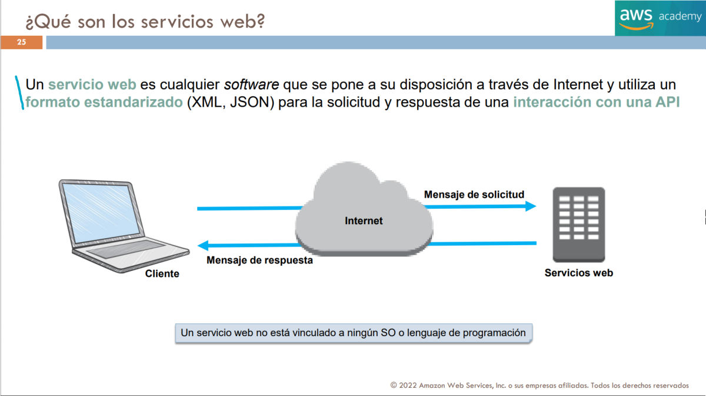

## T1 · página 30

`[FUENTE HISTÓRICA — recuperación OCR; contraste visual general]`

- Tres formas de interactuar con AWS
- Consola de administración de AWS
- Interfaz gráfica fácil de usar
- Interfaz de línea de comandos (AWS CLI)
- Las tres opciones utilizan una API REST
- que funciona como la base de AVVS
- Acceso a los servicios mediante comandos o scripts
- Kits de desarrollo de software (SDK)
- Acceso a los servicios directamente desde eI código
- (como Java, Python y otros)

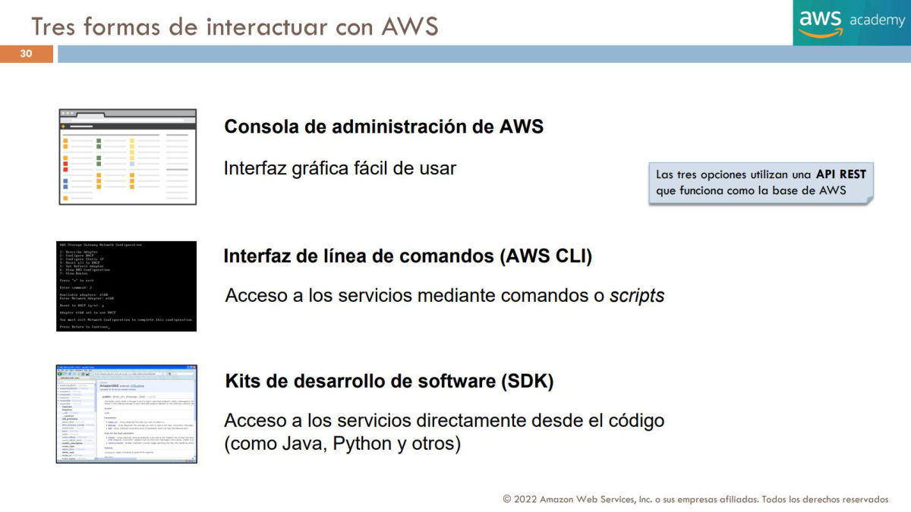

## T2 · página 4

`[FUENTE HISTÓRICA — recuperación OCR; contraste visual general]`

- Infraestructura global de AWS
- La infraestructura global de AWS está diseñada para ofrecer un entorno de cómputo en la nube
- fiable, confiable, escalable y seguro con un rendimiento de red global de alta calidad
- AWS actualiza constantemente la huella de carbono de su infraestructura global. Las siguientes
- páginas web muestran información actualizada sobre las infraestructuras:
- Mapa de infraestructura global de AWS:
- infrastructurey#AWS G'obal Infrastryct_ure Map
- Regiones y zonas de disponibilidad
- ("Regions and Avadability Zones orjust AZ'):
- infrastructure/regions azí
- Elige un círculo del mapa para ver
- información resumida sobre la Región
- representada por el círculo

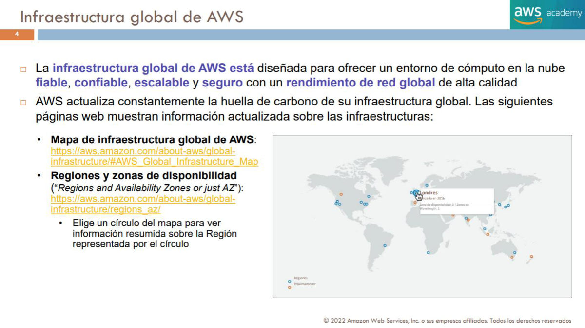

## T2 · página 5

`[FUENTE HISTÓRICA — recuperación OCR; contraste visual general]`

- Regiones de AWS
- Una región de AWS es una ubicación geográfica física
- Usted controla la replicación de datos entre regiones
- La comunicación entre regiones utiliza la
- infraestructura de red troncal de AWS
- Las regiones están aisladas unas de otras
- Algunas regiones con acceso restringido
- (GovCloud)
- Cada región proporciona a la red niveles plenos de
- redundancia y conectividad
- Una región normalmente consta de dos o más zonas
- de disponibilidad (Availabilty Zones, AZ)
- ondres
- zonas de disponibilidad
- Ejemplo: región de Londres

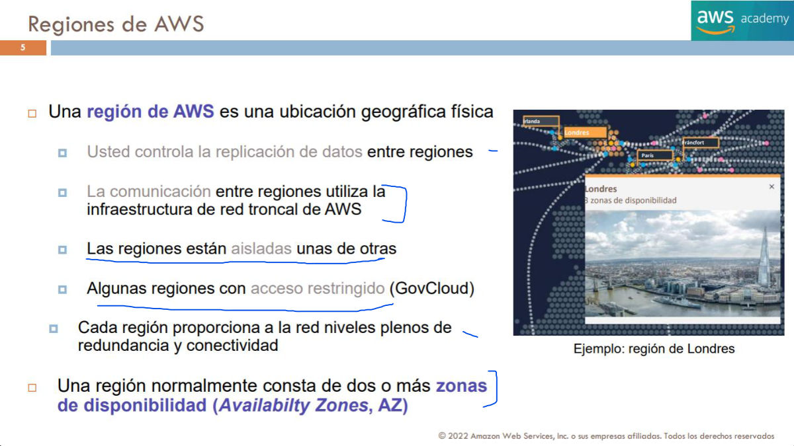

## T2 · página 6

`[FUENTE HISTÓRICA — recuperación OCR; contraste visual general]`

- Selección de una región
- Determine la región adecuada
- para sus servicios, aplicaciones y
- datos en función de estos
- factores
- Gobernanza de datos,
- requisitos legales
- Proximidad con los
- clientes (latencia)
- Servicios disponibles
- dentro de la región
- Costos (varían según
- la región)

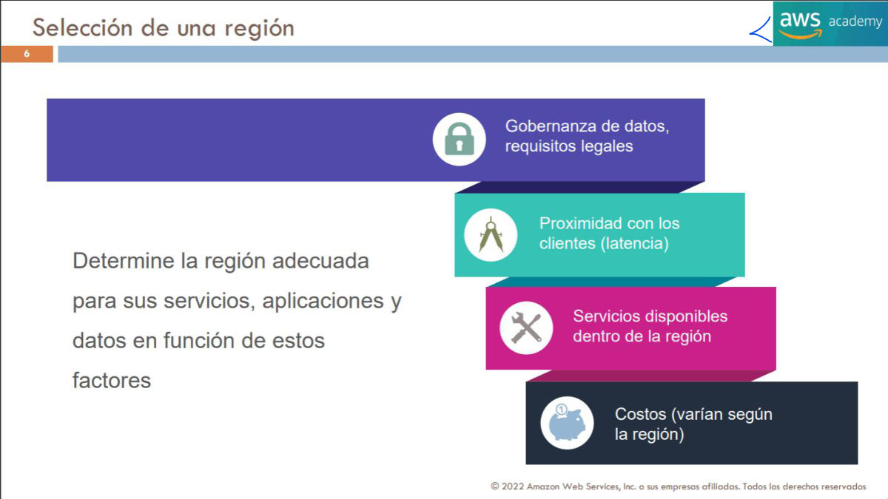

## T2 · página 7

`[FUENTE HISTÓRICA — recuperación OCR; contraste visual general]`

- Zonas de disponibilidad
- Cada región cuenta con varias zonas de disponibilidad
- Cada zona de disponibilidad (AZ) es una partición
- completamente aislada de la infraestructura de AWS
- as AZ constan de varios centros de datos (CPD) discretos
- a
- 0
- (normalmente 3)
- Diseñadas para el aislamiento de errores, con su propia
- infraestructura de emergFYTíSiCãñíêñtêSeparadas por
- decenas de kilómetros de otras AZ
- Se interconectan con otras AZ mediante redes privadas
- redundantes de alta velocidad
- EI usuario elige la AZ, pero no eI CPD dentro de la AZ
- AWS recomienda replicar los datos y los recursos entre
- las AZ para obtener mayor resiliencia
- aws
- Nube de AVVS
- Región eu-west-l
- Zona de disponibilidad eu-west-la
- Centro de datos
- Centro de datos
- Centro de datos
- Zona de disponibilidad eu-west-lb
- Zona de disponibilidad eu-west-lc

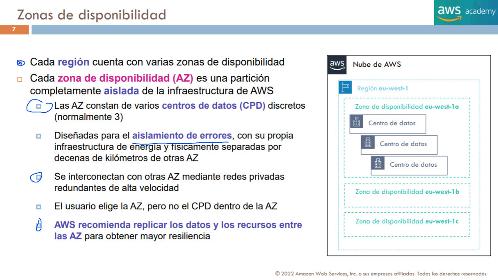

## T2 · página 8

`[FUENTE HISTÓRICA — recuperación OCR; contraste visual general]`

- Centros de datos de AWS
- Los centros de datos (CPD) de AWS están
- diseñados para ofrecer seguridad
- En los CPD se almacenan y se procesan los datos
- Un cliente no especifica un CPD para desplegar
- recursos
- EI nivel más granular que puede especificar es el
- nivel de las zonas de disponibilidad
- Cada CPD tiene alimentación, redes y
- conectividad redundantes, y se aloja en una
- instalación independiente
- Un CPD suele albergar entre 50000 y 100000
- servidores físicos

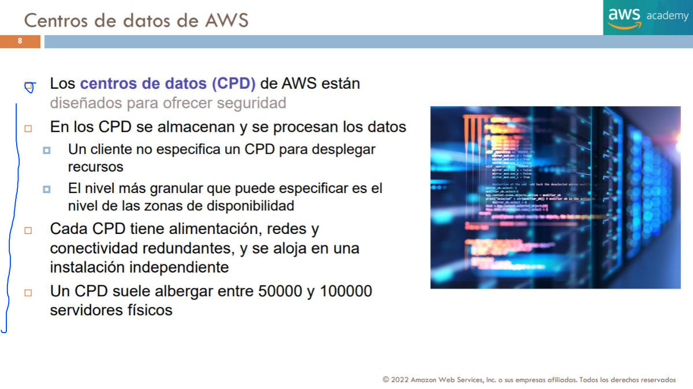

## T2 · página 9

`[FUENTE HISTÓRICA — recuperación OCR; contraste visual general]`

- Puntos de presencia (POP, Points of Presence)
- (9,
- CI
- AWS proporciona una red global de
- ubicaciones de puntos de presencia
- Ubicados en la mayoría de las
- a
- principales ciudades del mundo
- Consiste en ubicaciones perimetrales
- (o ubicaciones de borde) y un número
- menor de cachés de borde
- regionales
- Se utilizan, entre otros servicios, con:
- Amazon CloudFront: red de entrega de
- contenido (CDN) global que entrega
- contenido con latencia reducida a
- usuarios finales
- Amazon Route 53: servicio DNS
- Se utilizan cachés de borde regionales
- Las solicitudes qtE se dirigen a CloudFront 0 Route 53 se envían automáticamente
- a la ubicación perimetral más cercana para reducir la latencia
- para contenido en CloudFront con
- acceso poco frecuente
- s una ubicación de borde de AWS cercana a los usuarios finales para reducir latencia y acelerar la entrega de
- contenido,

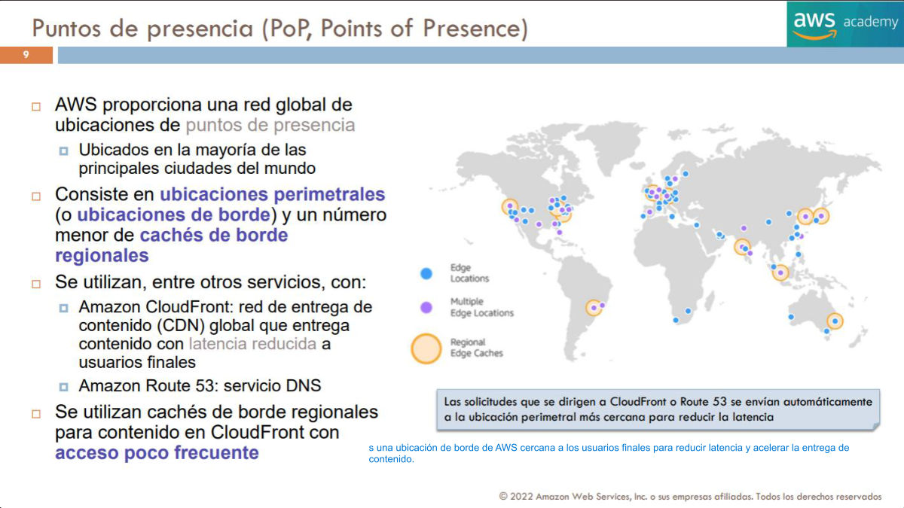

## T2 · página 10

`[FUENTE HISTÓRICA — recuperación OCR; contraste visual general]`

- Funciones de la infraestructura de AWS
- Elasticidad y escalabilidad
- • Infraestructura elástica; adaptación dinámica
- de la capacidad
- Infraestructura escalable; se adapta para
- crecer
- Tolerancia a errores
- Continúa funcionando correctamente en
- presencia de un error
- Redundancia integrada de los componentes
- Alta disponibilidad
- Alto nivel de rendimiento operativo
- Minimiza el tiempo de inactividad
- Intervención humana mínima o nula
- Diferencia
- física
- Generadores
- de respaldo
- Zona de disponibilidad
- de disponibilidad
- Conectividad
- a la red
- Suministro eléctrico
- ininterrumpido
- ena de disponibilidad
- Región de AWS
- Equipo de
- enfriamiento

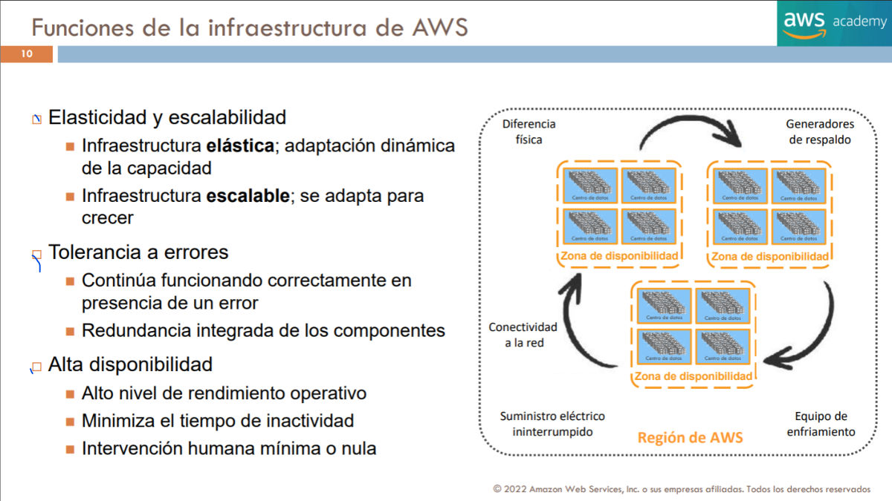

## T2 · página 14

`[FUENTE HISTÓRICA — recuperación OCR; contraste visual general]`

- Categoría de servicios de almacenamiento
- Amazon Simple Storage
- Service (Amazon S3)
- Servicios de almacenamiento
- de AWS
- Amazon Elastic Block
- Store (Amazon EBS)
- Amazon Elastic File
- System (Amazon EFS)
- Amazon Simple Storage
- Service Glacier

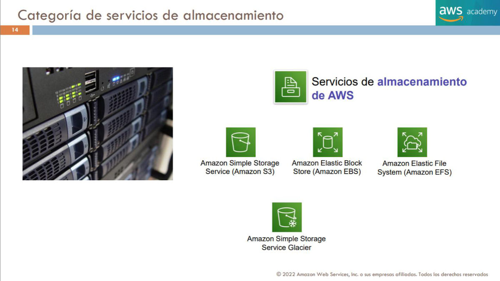

## T2 · página 15

`[FUENTE HISTÓRICA — recuperación OCR; contraste visual general]`

- Categoría de servicios de cómputo
- Amazon EC2
- AWS Elastic
- Beanstalk
- Servicios de cómputo de AWS
- Amazon EC2
- Auto Scaling
- AWS Lambda
- Amazon Elastic
- Container Service
- (Amazon ECS)
- Amazon Elastic
- Kubemetes Service
- (Amazon EKS)
- Amazon EC2
- Container Registry
- AWS Fargate

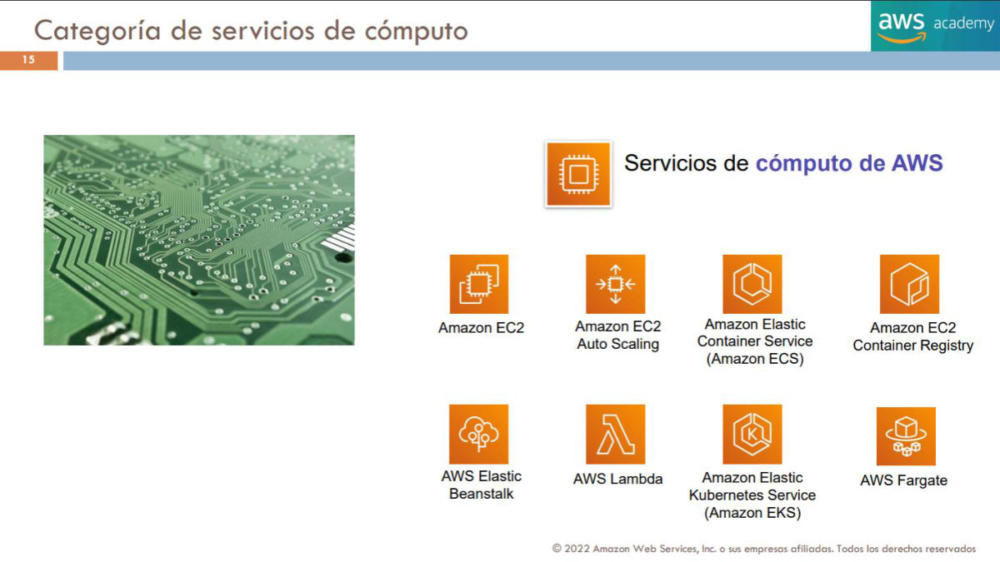

## T2 · página 16

`[FUENTE HISTÓRICA — recuperación OCR; contraste visual general]`

- Categoría de servicios de bases de datos
- Amazon Relational
- Database Service
- Servicios de bases de datos
- de AWS
- Amazon Aurora
- Amazon Redshift
- Amazon
- DynamoDB

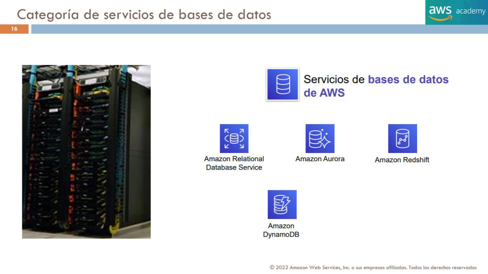

## T2 · página 17

`[FUENTE HISTÓRICA — recuperación OCR; contraste visual general]`

- Categoría de servicios de redes y entrega de contenido
- Servicios de redes y de entrega
- de contenido de AWS
- Amazon VPC
- Amazon
- Route 53
- Elastic Load
- Balancing
- AWS Direct
- Connect
- Amazon
- CloudFront
- AWS VPN
- AWS Transit
- Gateway

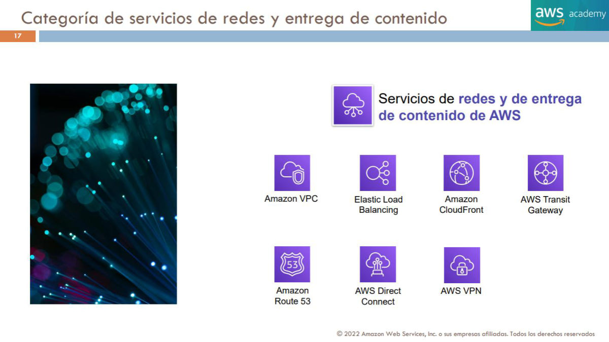

## T2 · página 18

`[FUENTE HISTÓRICA — recuperación OCR; contraste visual general]`

- Categoría de servicios de seguridad, identidad y cumplimiento
- Servicios de seguridad,
- identidad y cumplimiento de
- AWS Identity and Access
- Management (AWS IAM)
- AWS Artifact
- AWS
- a
- AWS
- Organizations
- AWS Key
- Management
- Service
- a
- Amazon Cognito
- AWS Shield

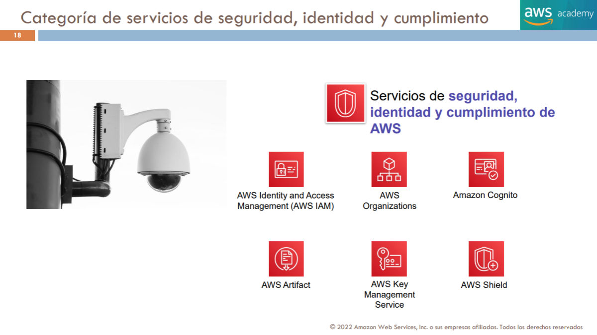

## T2 · página 19

`[FUENTE HISTÓRICA — recuperación OCR; contraste visual general]`

- Categoría de servicios de administración de costos de AWS
- Servicios de administración
- de costos de AWS
- Informe de costo y
- uso de AWS
- AWS Budgets
- Explorador de
- costos de
- AWS

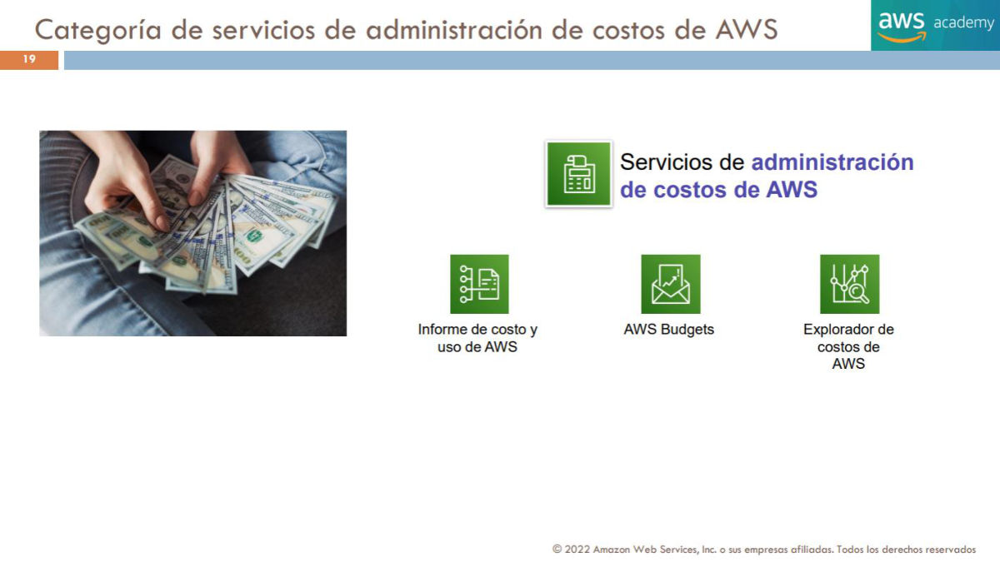

## T2 · página 20

`[FUENTE HISTÓRICA — recuperación OCR; contraste visual general]`

- Categoría de servicios de administración y gobernanza
- Servicios de administración
- y gobernanza de AWS
- Consola de
- administración de
- AWS
- a
- AWS Command
- Line Interface
- (AWS CLI)
- AWS config
- a
- AWS Trusted
- Advisor
- Amazon
- CloudWatch
- Herramienta de
- AWS Well-
- Architected
- AWS Auto
- Scaling
- AWS
- CloudTrail

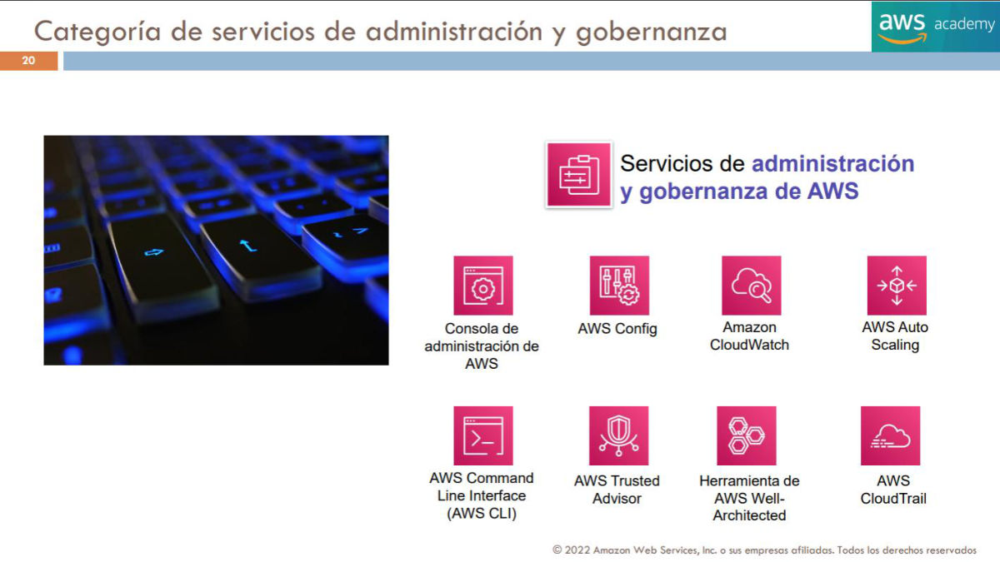

## T5 · página 1

`[FUENTE HISTÓRICA — recuperación OCR; contraste visual general]`

- BLOQUE DE AWS
- TEMA 5: REDES Y ENTREGA DE CONTENIDO

## T5 · página 2

`[FUENTE HISTÓRICA — recuperación OCR; contraste visual general]`

- Contenidos
- Conceptos básicos de redes
- Amazon VPC
- VPC networking
- Seguridad de VPC
- Amazon CloudFront
- Amazon Route 53

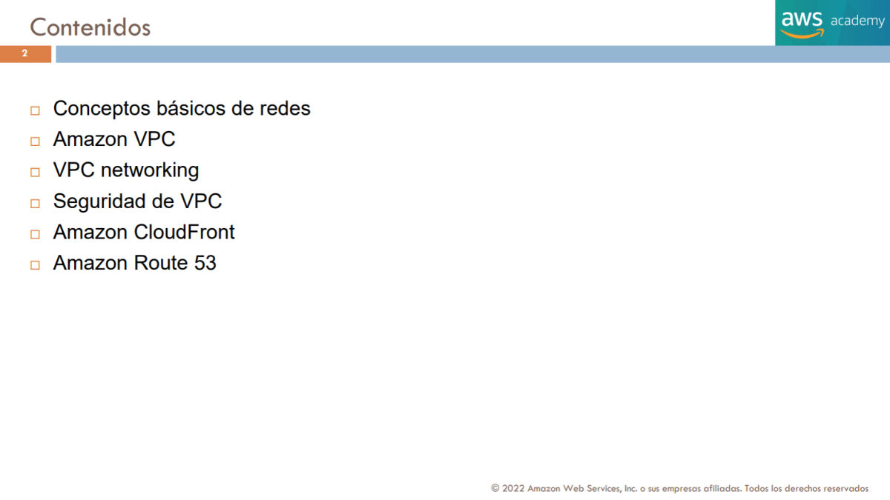

## T5 · página 3

`[FUENTE HISTÓRICA — recuperación OCR; contraste visual general]`

- Conceptos básicos de redes

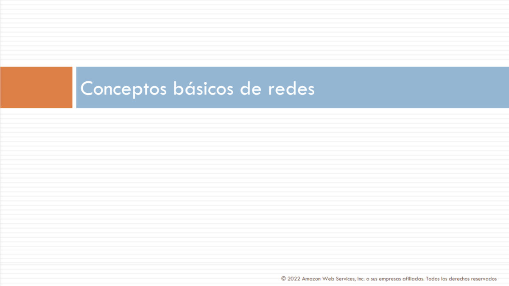

## T5 · página 4

`[FUENTE HISTÓRICA — recuperación OCR; contraste visual general]`

- Redes
- Una red informática consiste en dos o más máquinas clientes que están conectadas para compartir
- recursos. Una red se puede dividir lógicamente en subredes aisladas entre sí
- Las redes requieren de dispositivos de red (p.e.
- enrutadores, conmutadores) para conectar todos
- los clientes entre sí y habilitar la comunicaciÓn
- Subred I
- Enrutador o conmutador
- Subred 2

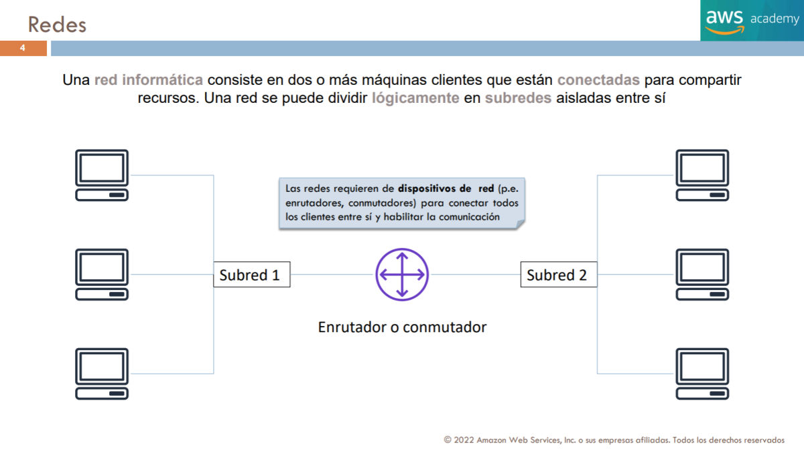

## T5 · página 5

`[FUENTE HISTÓRICA — recuperación OCR; contraste visual general]`

- Direcciones IPv4 e IPv6
- Cada máquina en una red tiene una dirección IP única que la identifica. Una dirección IP es
- una etiqueta numérica en formato decimal que las máquinas convierten en formato binario
- 192
- 11000000
- 00000000
- 2
- 00000010
- 00000000
- Dirección IPv4 (32 bits):
- 192.0.2.0
- Dirección IPv6 (128 bits):

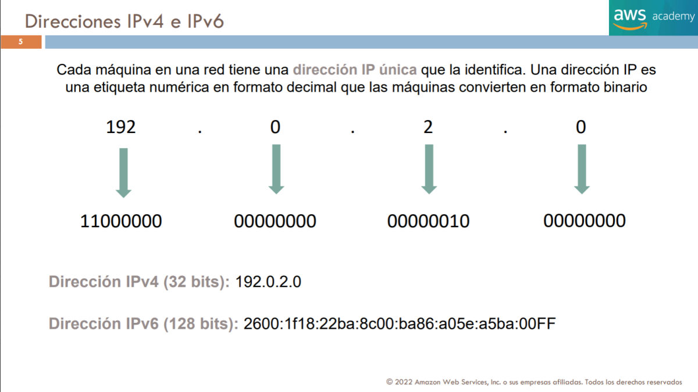

## T5 · página 6

`[FUENTE HISTÓRICA — recuperación OCR; contraste visual general]`

- Enrutamiento entre dominios sin clases (CIDR)
- Classless Inter-Domain Routing (CIDR): método compacto para describir redes
- que permite que una dirección IP represente un rango de direcciones consecutivas
- Identificador de red (prefijo de enrutamiento)
- 192
- lloooooo
- Fijos
- Casos especiales:
- Identificador de host
- 00000000
- Flexibles
- 24
- Indica cuántos
- bits del prefijo se
- asignan al
- identificador de red
- 00000000
- Fijos
- 2
- 00000010
- Fijos
- Las direcciones IP fijas, en las que todos los bits son fijos, representan una única dirección IP (p.e. 192.0.2.0/32)
- Internet, donde todos los bits son flexibles, se representa como 0.0.0.0/0

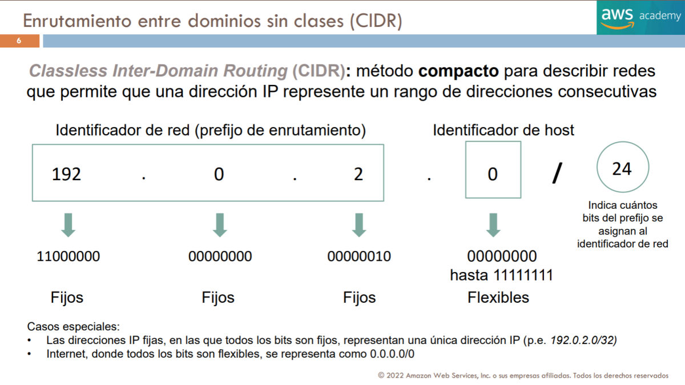

## T5 · página 7

`[FUENTE HISTÓRICA — recuperación OCR; contraste visual general]`

- Modelo de interconexión de sistemas abiertos (OSI)
- Capa
- Aplicación
- Presentación
- Sesión
- Transporte
- Red
- Enlace de datos
- Física
- Número
- 7
- 6
- 5
- 4
- 3
- 2
- Función
- Medios para que una aplicación acceda a una red informática
- Garantiza que la capa de aplicación pueda leer los datos
- Cifrado
- Permite el intercambio ordenado de datos
- Proporciona protocolos para respaldar la comunicación de host a host
- Enrutamiento y reenvío de paquetes (enrutadores)
- Transferir datos en la misma red LAN (hubs y conmutadores)
- Transmisión/recepción de flujos de bits sin procesar a través de un medio físico
- Protocolo
- Dirección
- HTTP(S), FTP, DHCP, LDAP
- Asa, ICA
- NetBIOS, RPC
- TCP y UDP
- Señales (l y O)

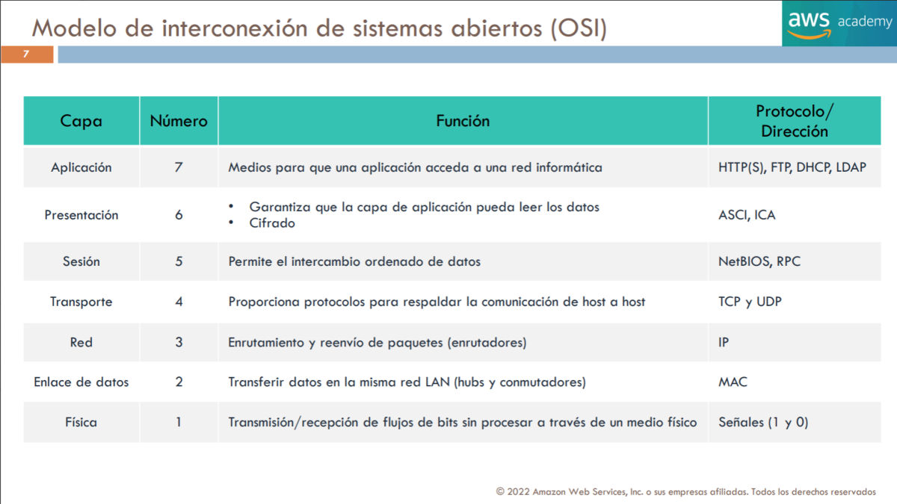

## T5 · página 8

`[FUENTE HISTÓRICA — recuperación OCR; contraste visual general]`

- Amazon V PC

## T5 · página 9

`[FUENTE HISTÓRICA — recuperación OCR; contraste visual general]`

- Amazon V PC
- Permite aprovisionar una sección aislada lógicamente en la nube de AWS
- En ella puede desplegar recursos de AWS en una red virtual definida por eI usuario
- Permite controlar los recursos de la red virtual, entre ellos:
- Selección de un rango de direcciones IP
- Creación de subredes
- Configuración de tablas de enrutamiento y puertas de enlace de red
- Soporte IPv4 e IPv6
- Permite utilizar varios niveles de seguridad
- Grupos de seguridad
- CL de red
- Amazon
- VPC
- @ o empresas afiliadas. IOS derechos reservados

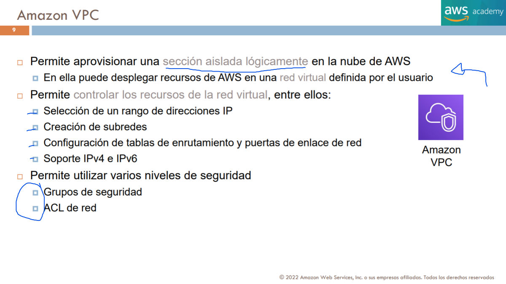

## T5 · página 10

`[FUENTE HISTÓRICA — recuperación OCR; contraste visual general]`

- VPC y subredes
- VPC:
- Se encuentra aislada de forma lógica
- de otras VPC en la nube de AWS
- • Dedicada a una cuenta de AWS
- Pertenece a una única región de AWS
- y puede abarcar varias AZ
- Subredes:
- a Intervalo de direcciones IP que divide
- una VPC
- Pertenece a una única zona de
- disponibilidad
- Se clasifica como pública o privada
- aws
- Nube de AVA•/S
- Región
- : Zona de disponibilidad 1
- vpc
- Subred
- : Zona de disponibilidad 2
- Subred

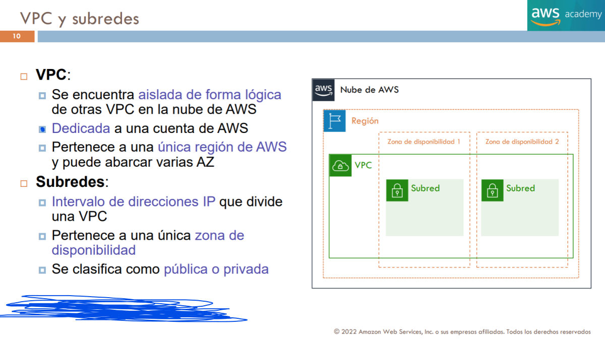

## T5 · página 11

`[FUENTE HISTÓRICA — recuperación OCR; contraste visual general]`

- Direccionamiento IP
- Al crear una VPC, se le asigna un bloque
- CIDR IPv4 (rango de direcciones privadas)
- No puede cambiar el rango de direcciones
- después de crear la VPC
- También se admite IPv6
- EI tamaño de bloque CIDR IPv4
- más
- grande es / 16
- EI tamaño de bloque CIDR IPv4 más
- es /28
- pequeño
- VPC
- Direcciones x.x.x.x/16
- 0 65.536 (máx)
- Direcciones x.x.x.x/28 0 16 (mín)
- EI bloque de CIDR de una subred puede ser el mismo que el bloque de CIDR para la VPC. En este caso, la VPC y la subred
- tienen el mismo tamaño (la VPC tiene una única subred).
- EI bloque de CIDR de una subred puede ser un subconiunto del bloque de CIDR para la VPC, permitiendo la definición de
- múltiples subredes. Si crea más de una subred en una VPC, los bloques de CIDR de las subredes no pueden superponerse.

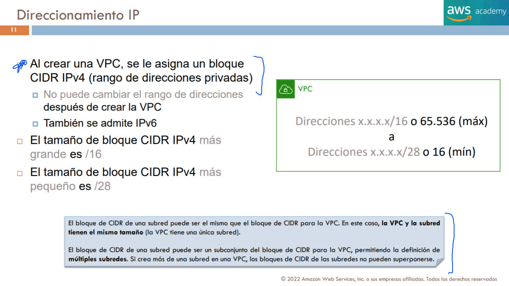

## T5 · página 12

`[FUENTE HISTÓRICA — recuperación OCR; contraste visual general]`

- Direcciones IP reservadas
- 12
- Ejemplo: una VPC con un bloque CIDR IPv4 de 10.0.0.0/16 tiene un total de 65536 direcciones IR La
- VPC tiene cuatro subredes del mismo tamaño cada una (124, 256 direcciones IP). Hay 251
- direcciones IP disponibles para uso del usuario en cada subred
- vpc: 10.0.0.0/16
- Subred I (10.0.0.0/24)
- Direcciones IP
- Subred 4 (10.0.1.0/24)
- Direcciones IP
- Subred 2 (10.0.2.0/24)
- Direcciones IP
- Subred 3 (10.0.3.0/24)
- Direcciones IP
- Direcciones IP para e
- loque 10.0.0.0/24
- 10.0.0.0
- 10.0.0.1
- 10.0.0.2
- 10.0.0.3
- 10.0.0.255
- Reservado para
- Dirección de la red
- Enrutador local de la VPC
- (para comunicaciones internas)
- Resolución DNS
- Uso futuro
- Dirección de difusión de la
- red (broadcasf)
- Web o afiliadas. Todos IOS derechos reservados

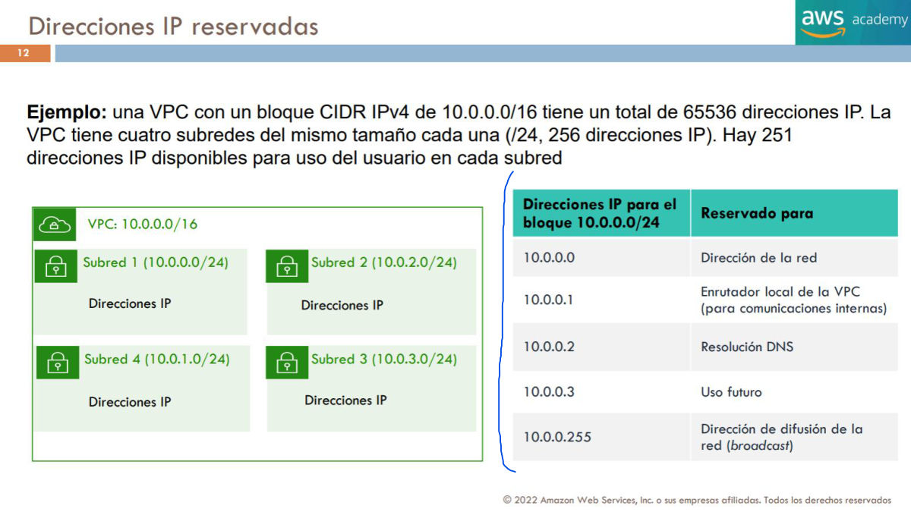

## T5 · página 13

`[FUENTE HISTÓRICA — recuperación OCR; contraste visual general]`

- Interfaz de red elástica
- Una interfaz de red elástica es una
- interfaz de red virtual que puede:
- a Conectarse a una instancia EC2
- Desconectarse de la instancia y conectarla a otra instancia para redirigir el tráfico de red
- Sus atributos se mantienen cuando se reasigna a una nueva instancia
- Cada instancia EC2 en una VPC tiene una interfaz de red predeterminada a la que se
- asigna una dirección IPv4 privada del intervalo de direcciones de la VPC
- La interfaz de red principal no se puede desconectar
- • Subred 10.0.1.0/24
- Interfaz de red elástica

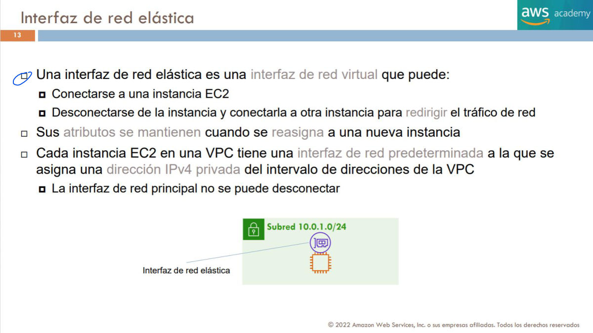

## T5 · página 14

`[FUENTE HISTÓRICA — recuperación OCR; contraste visual general]`

- Tipos de direcciones IP
- 14
- Cada instancia EC2 en una VPC obtiene automáticamente una dirección IPv4 privada
- Opciones para direcciones IP públicas para instancias EC2
- Dirección IPv4 pública
- Asignación automática en el momento de
- crear la instancia a través de una opción de
- configuración
- Asignación manual a través de una dirección
- IP elástica
- Dirección IP elástica
- IPv4 estática y pública
- Asociada a una cuenta de AWS
- Se puede asignar y reasignar
- dinámicamente en cualquier momento
- Tanto a instancias como a interfaces de red
- Es posible que se apliquen costos
- adicionales
- Deben liberarse cuando no se necesitep

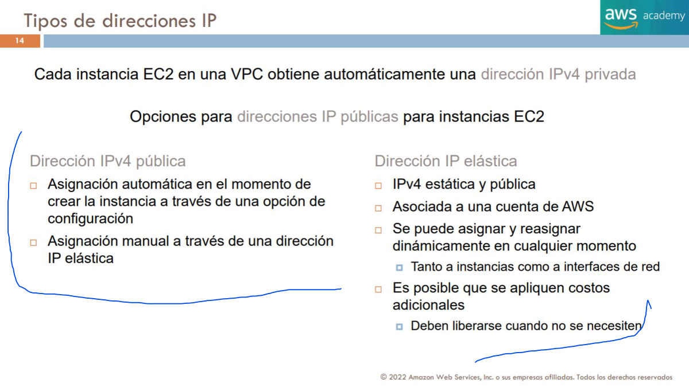

## T5 · página 15

`[FUENTE HISTÓRICA — recuperación OCR; contraste visual general]`

- Tablas de enrutamiento y rutas
- Una tabla de enrutamiento contiene un conjunto de
- reglas (o rutas) que puede configurar para dirigir el
- tráfico de una subred
- Cada ruta especifica un destino
- Y un objetivo a través del
- a
- cual se envía el tráfico
- De forma predeterminada, cada tabla de enrutamiento
- contiene una ruta local para la comunicación interna
- dentro de la VPC
- Esta ruta local no se puede eliminar
- Tabla de enrutamiento principal: tabla que se asigna
- automáticamente a una VPC
- Controla el enrutamiento de todas las subredes que no
- estén asociadas de forma explícita a ninguna otra tabla
- Cada subred de una VPC debe estar asociada a una
- a
- tabla de enrutamiento (cómo máximo a una)
- Pero pueden asociarse varias subredes a la misma tabla
- Tabla de enrutamiento principal
- (predeterminada)
- Destino
- 10.0.0.0/16
- Obietivo
- local
- Bloque CIDR de la VPC

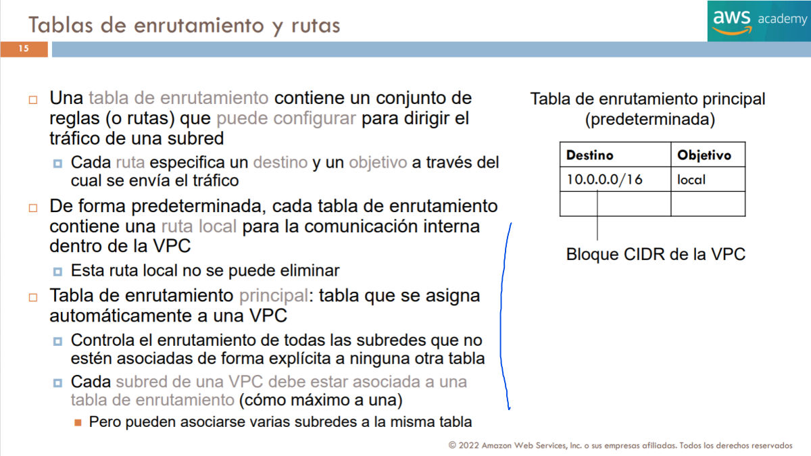

## T5 · página 16

`[FUENTE HISTÓRICA — recuperación OCR; contraste visual general]`

- V PC networwing

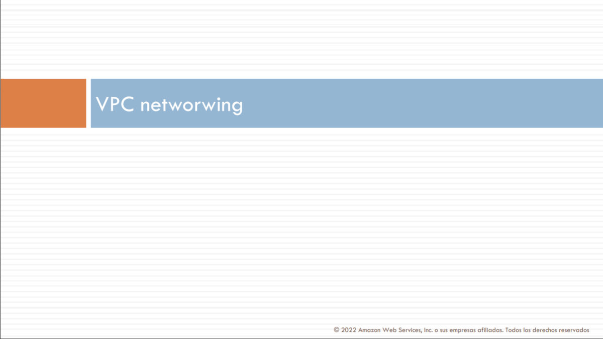

## T5 · página 17

`[FUENTE HISTÓRICA — recuperación OCR; contraste visual general]`

- Puerta de enlace de Internet (Internet Gateway)
- Nube de AWS
- Región
- Zona de disponibilidad
- 10.0.0.0/16
- Subred pública: 10.0. I .0/24
- Subred privada:
- 10.0.2.0/24
- Tabla de
- enrutamiento
- Servicio gestionado de alta disponibilidad,
- escalable y
- redundante a nivel de región
- que
- habilita la comunicación entre instancias de una
- VPC que poseen IPs públicas e Internet.
- Funciones:
- • Proporcionar un objetivo en las tablas de rutas para
- el tráfico enrutable a través de Internet
- Traducción NAT 1:1 entre la IP privada de la
- instancia y su dirección IP pública asociada
- Tabla de enrutamiento de
- subred pública
- Destino Obietivo
- Puerta de
- enlace de
- internet
- (igw-id)
- 10.0.0.0/16
- 0.0.0.0/0
- Internet
- local
- igw-id

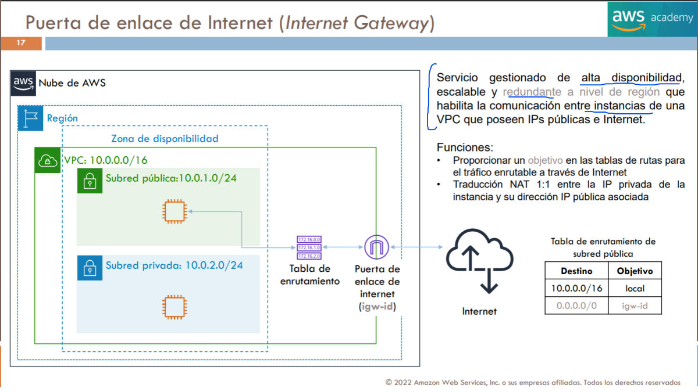

## T5 · página 18

`[FUENTE HISTÓRICA — recuperación OCR; contraste visual general]`

- Puerta de enlace NAT (NAT Gateway)
- aws
- Nube de AVA•/S
- Región
- Zona de disponibilidad
- :vpc: 10.0.0.0/16
- Subred pública: 10.0.1 ,0/24
- Puerta de enlace NAT
- (nat-gw-id)
- Subred privada: 10.0.2.0/24
- Servicio gestionado, altamente disponible dentro de una
- AZ, que permite a las instancias de subredes privadas la
- conexión hacia Internet u otros servicios de AWS, sin)
- qceptar conexiones entrantes iniciadas desde Internet
- Se debe ubicar en una subred pública y asociarle una
- dirección IP elástica (también tiene IP privada en la subred)
- Realiza traducción NAT N: 1 mediante PAT: varias instancias
- (con IPs privadas) salen a Internet compartiendo una única IP
- pública (la del NAT Gateway)
- Para alta disponibilidad regional, se recomienda desplegar un
- NAT Gateway en cada AZ (despliegue Multi-AZ) y enrutar
- cada subred privada al NAT Gateway de su propia AZ
- Tabla de enrutamiento de
- subred pública
- Tabla de
- enrutamiento
- pública
- Tabla de
- enrutamiento
- privada
- Puerta de
- enlace de
- internet
- (igw-id)
- Destino
- 10.0.0.0/16
- 0.0.0.0/0
- Obietivo
- local
- igw-id
- Internet
- Tabla de enrutamiento de
- subred privada
- Destino
- 10.0.0.0/16
- 0.0.0.0/0
- Obietivo
- local
- nat-gw-id

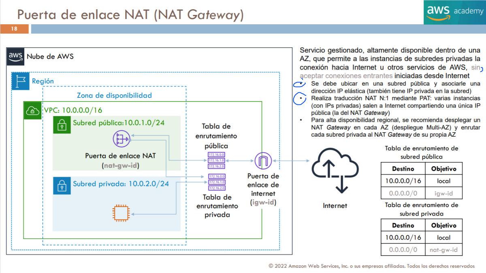

## T5 · página 19

`[FUENTE HISTÓRICA — recuperación OCR; contraste visual general]`

- Uso compartido de V PC
- 19
- Permite a los usuarios compartir subredes con otras cuentas de AWS dentro de la misma organización en
- AWS Organizations
- aws
- Nube de AWS
- Región
- VPC: Cuenta A (propietario)
- • Subred privada
- Cuenta B (participante)
- Enrutador
- Cuenta C (participante)
- o
- Instancia de
- EC2
- o
- Instancia
- de EC2
- o
- Instancia de
- EC2
- Subred pública
- Cuenta D (participante)
- Puerta de enlace NAT
- Amazon Redshifi
- Instancia de EC2
- Puerta de
- enlace de
- internet
- Instancia de
- RDS

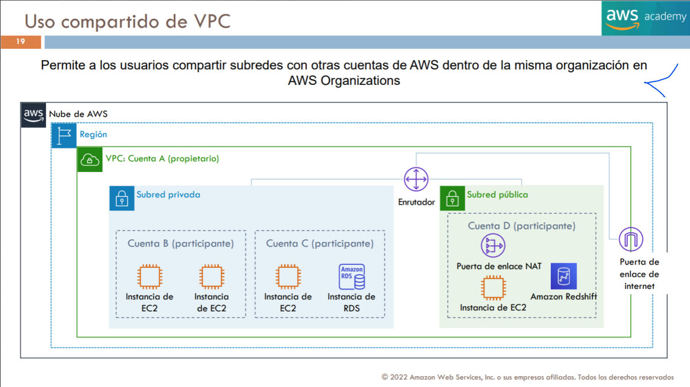

## T5 · página 20

`[FUENTE HISTÓRICA — recuperación OCR; contraste visual general]`

- Interconexión de V PC
- 20
- aws
- Nube de AVIS
- vpc A: 10.0.0.0/16
- Tabla de enrutamiento
- para la VPC A
- vpc B:
- 10.3.0.0/16
- Interconex ión
- (pcx-id)
- Tabla de enrutamiento
- para la VPC B
- Destino
- 10.0.0.0/16
- 0.3.O.O/ló
- Obietivo
- local
- pcx-id
- Destino
- 10.3.0.0/16
- 10.0.0.0/16
- Obietivo
- local
- pcx-id
- Permite conectar VPCs de forma
- privada en su propia cuenta de
- AWS, entre cuentas de AWS o
- entre regiones de AWS
- Restricciones:
- Los espacios IP no se pueden
- superponer
- La interconexión transitiva no
- está admitida
- Puede tener solo un recurso de
- interconexión entre dos VPC
- Solo puede haber un recurso de
- peering entre dos VPC concretas.
- Es decir, entre vpc A y vpc g
- A puede hablar con B
- B puede hablar con C
- A NO puede hablar con C a través de B

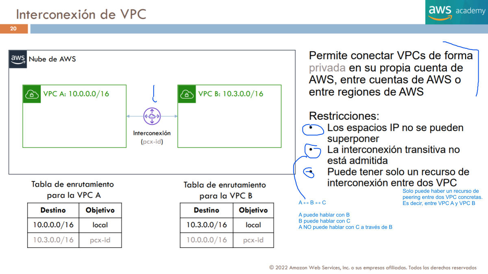

## T5 · página 21

`[FUENTE HISTÓRICA — recuperación OCR; contraste visual general]`

- AWS Site-to-Site VPN
- 21
- aws
- Nube de AWS
- Región
- Zona de disponibilidad
- es 10.0.O.O/16
- Subred pública:l O. 1.0.0/24
- Subred privada: 10.0.2.0/24
- Tabla de enrutamiento de
- subred pública
- Conexión de
- Site-to-Site
- Destino
- 10.0.0.0/16
- 0.0.0.0/0
- Objetivo
- local
- igw-id
- Tabla de enrutamiento de
- subred privada
- Internet
- Tabla de
- enrutamie
- Destino
- 10.0.0.0/16
- 192.168.10.0/24
- Puerta de
- enlace de
- cliente
- 11
- Centro de datos corporativo:
- 192.168.10.0/24
- Obietivo
- local
- vgw-id
- Pue
- en
- vi
- (vg
- a de
- -id)

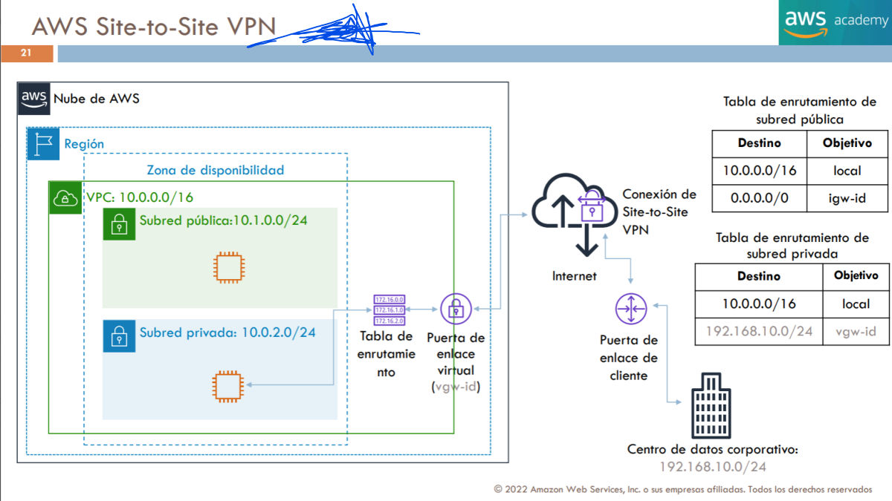

## T5 · página 22

`[FUENTE HISTÓRICA — recuperación OCR; contraste visual general]`

- AWS Direct Connect
- aws
- Nube de AWS
- Región
- Zona de disponibilidad
- Ypc: 10.0.0.0/16
- Subred pública: 10.1.0.0/24
- Subred privada: 10.0.2.0/24
- EI rendimiento de una conexión
- VPN se puede ver afectado si su
- centro de datos está ubicado lejos
- de su región de AWS
- Internet
- AWS Direct Connect o DX permite
- establecer una conexión
- dedicada
- Y privada entre su red y una de las
- ubicaciones de DX
- Tabla de
- Pue
- 802.1
- VLAN
- a de
- AWS Direct
- Puerta de
- enlace de
- cliente
- como se fora un repetidor de redstone
- enrutami
- ento
- vi
- Centro de datos corporativo:
- 192.168.10.0/24

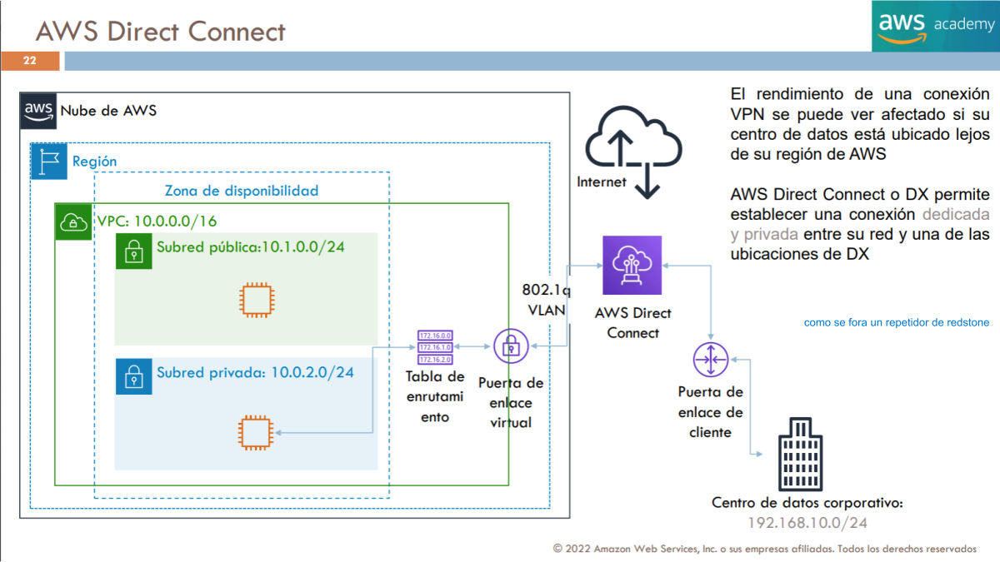

## T5 · página 23

`[FUENTE HISTÓRICA — recuperación OCR; contraste visual general]`

- Actividad: Etiquetar este diagrama
- aws
- Nube de AWS
- 10.0.1.0/24
- 10.0.2.0/24
- Dirección IP?
- Destino
- o.o.o.o o
- Internet
- Obietivo
- local
- 10.0.0.0/16

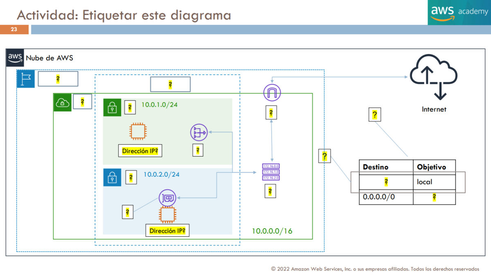

## T5 · página 24

`[FUENTE HISTÓRICA — recuperación OCR; contraste visual general]`

- Actividad: Solución
- aws
- Nube de AVIS
- Región
- VPC
- Zona de disponibilidad
- 10.0.1.0/24
- Subred pública
- Puerta de
- enlace de
- Dirección IP privada
- Puerta de enlace NAT
- Tabla de enrutamiento
- Ruta
- Destino
- 10.0.0.0/16
- o.o.o.o o
- 10.0.2.0/24
- Interfaz
- de red
- elástica
- Dirección IP privada
- Internet
- Obietivo
- local
- igw-id
- Tabla de enrutamiento
- 10.0.0.0/16

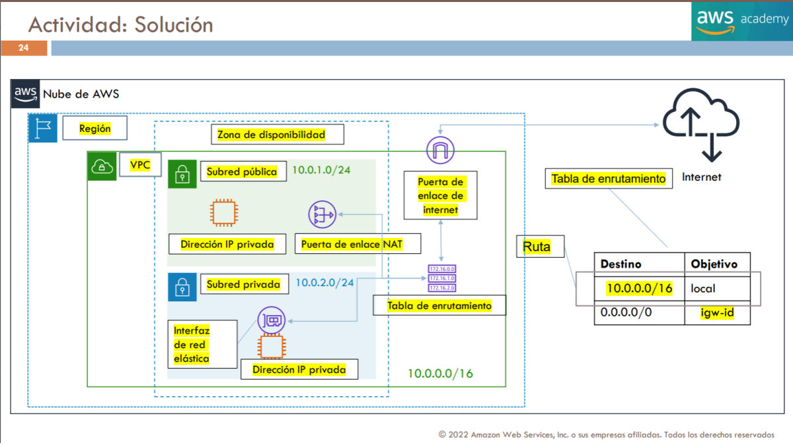

## T5 · página 25

`[FUENTE HISTÓRICA — recuperación OCR; contraste visual general]`

- Seguridad de VPC

## T5 · página 26

`[FUENTE HISTÓRICA — recuperación OCR; contraste visual general]`

- Grupos de seguridad
- aws
- Nube de AWS
- Región
- Zona de disponibilidad
- :vpc: 10.0.0.0/16
- Subred pública: 10.0.1.0/24
- Grupo de seguridad
- Subred privada: 10.0.2.0/24
- Grupo de seguridad
- Actúan como un firewall virtual
- para
- una instancia EC2 controlando el
- tráfico de entrada y salida
- sempre ten unn minimo o predeterminado se nn asignas ti un
- Funciona a nivel de la instancia, no
- a nivel de la subred.
- Por 10 tanto,
- cada instancia en la subred puede
- ser asignada a distintos grupos de
- seguridad

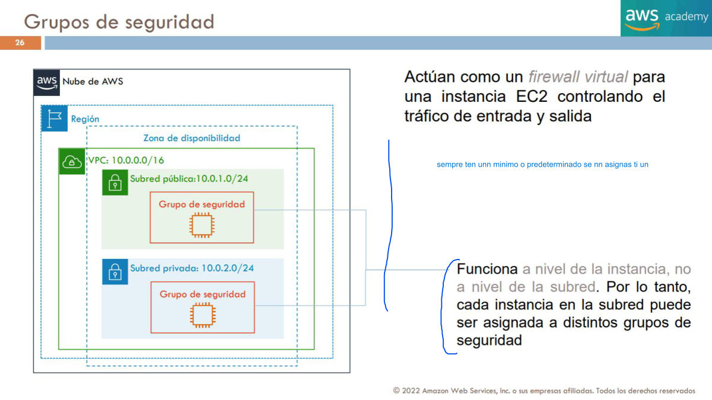

## T5 · página 27

`[FUENTE HISTÓRICA — recuperación OCR; contraste visual general]`

- 27
- Grupos de seguridad
- Tienen reglas
- que controlan el tráfico de red de entrada y salida a la instancia
- De forma predeterminada, deniegan todo eI tráfico entrante y permiten todo eI tráfico saliente
- Son grupos con
- la información de estado se mantiene después de procesar una solicitud
- estado:
- Si envía una solicitud desde su instancia, se permitirá eI tráfico entrante de respuesta para dicha solicitud para que
- fluya independientemente de las reglas de entrada. Se permite también el tráfico saliente de respuesta a solicitudes
- entrantes independientemente de las reglas de salida
- Entrada
- Ori en
- sg-xxxxxxxx
- 0.0.0.0/0
- Todo
- Todo
- Todo
- Todo
- Todo
- Todo
- Permite el tráfico de entrada de las interfaces de red
- asignadas al mismo grupo de seguridad
- Salida
- Permite todo el tráfico IPv4 de salida
- Permite todo el tráfico IPv6 de salida

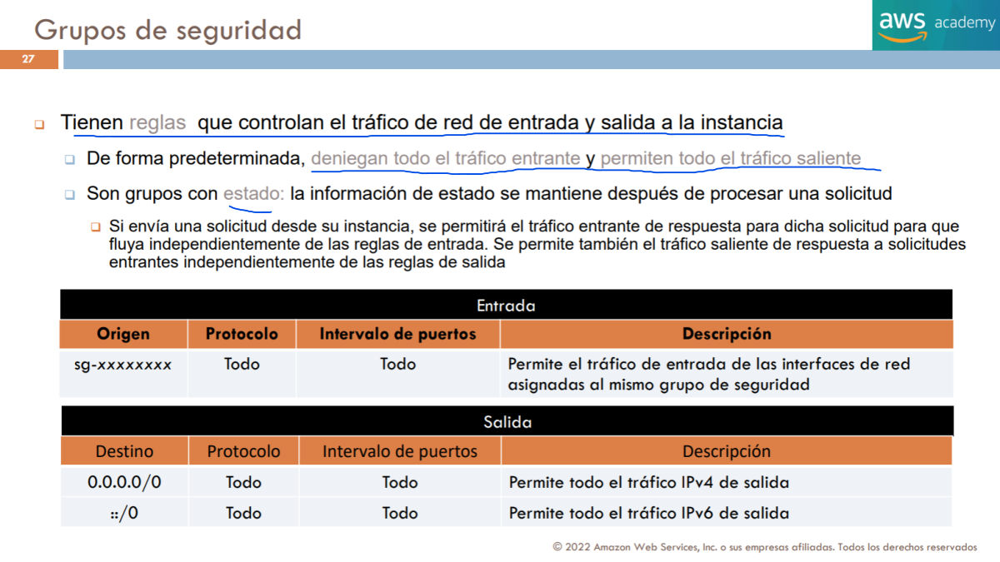

## T5 · página 28

`[FUENTE HISTÓRICA — recuperación OCR; contraste visual general]`

- Grupos de seguridad: Reglas personalizadas
- uede especificar reglas de permiso, pero no reglas de denegación
- EI orden de las reglas no importa: se
- evalúan todas antes de decidir permitir el tráfico
- Entrada
- 0.0.0.0/0
- 0.0.0.0/0
- Intervalo de
- direcciones IPv4
- públicas de la red
- Destino
- TCP
- TCP
- TCP
- 80
- 443
- 22
- Protocolo
- Permiten el acceso HTTP entrante desde todas las direcciones IPv4
- Permiten el acceso HTTPS entrante desde todas las direcciones IPv4
- Permiten el acceso SSH entrante a las instancias desde direcciones IPv4 de
- su red (a través de la puerta de enlace de Internet)
- Salida
- Intervalo de
- 1433
- EI ID del grupo de seguridad para Sus
- TCP
- servidores de bases de datos de
- Microsoft SQL Server
- Descripción
- Permiten el acceso saliente de Microsoft SQL Server a las
- instancias del grupo de seguridad especificado

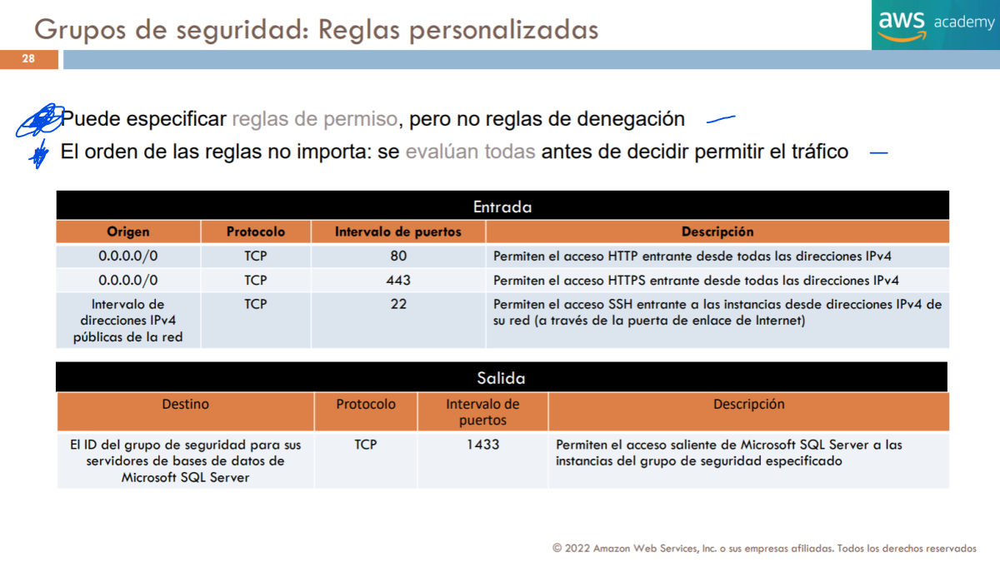

## T5 · página 29

`[FUENTE HISTÓRICA — recuperación OCR; contraste visual general]`

- Listas de control de acceso a la red (ACL de red)
- aws
- Nube de AV•/S
- Región
- Zona de disponibilidad
- C» :vpc: 10.0.0.0/16
- Subred pública:10.0.0.0/24
- Subred privada: 10.0.4.0/22
- Actúa como un
- firewall virtual
- para
- controlar el tráfico que entra y sale de
- una o varias subredes. Es una capa
- opcional de seguridad para la VPC
- Actúan a nivel de subred. Si no se asocia una
- subred de forma explícita a una ACL, se
- asociará automáticamente a la ACL
- predeterminada. Puede asociar una ACL de
- red a varias subredes; sin embargo, una
- Cuando se asocia una ACL a una subred, se
- elimina la asociación anterior
- @ Web o sus empresas afiliadas. IOS reservados

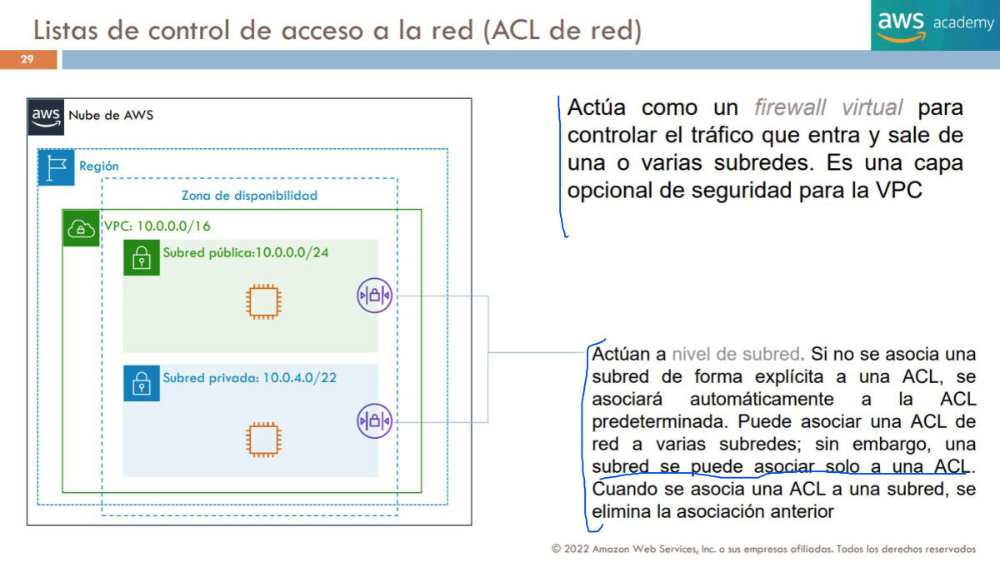

## T5 · página 30

`[FUENTE HISTÓRICA — recuperación OCR; contraste visual general]`

- Listas de control de acceso a la red (ACL de red)
- 30
- lista numerada de reglas que se evalúan en orden
- Una ACL de red contiene una
- Tienen reglas de entrada y de salida independientes y cada regla puede permitir o rechazar tráfico
- ere pre eterminada (ver tabla inferior) permite todo el tráfico entrante y saliente¯]
- La
- No tienen estado: no se mantiene ninguna información sobre una solicitud después de procesarla
- Regla
- Regla
- 100
- Tipo
- Todo el tráfico IPv4
- Todo el tráfico IPv4
- Tipo
- Todo el tráfico IPv4
- Todo el tráfico IPv4
- Protocolo
- Todo
- Todo
- Protocolo
- Todo
- Todo
- Entrada
- Intervalo de
- Todo
- Todo
- Salida
- Intervalo de
- Todo
- Origen
- 0.0.0.0/0
- 0.0.0.0/0
- Destino
- 0.0.0.0/0
- 0.0.0.0/0
- Permitir/Denegar
- PERMITIR
- DENEGAR
- Permitir/Denegar
- PERMITIR
- DENEGAR

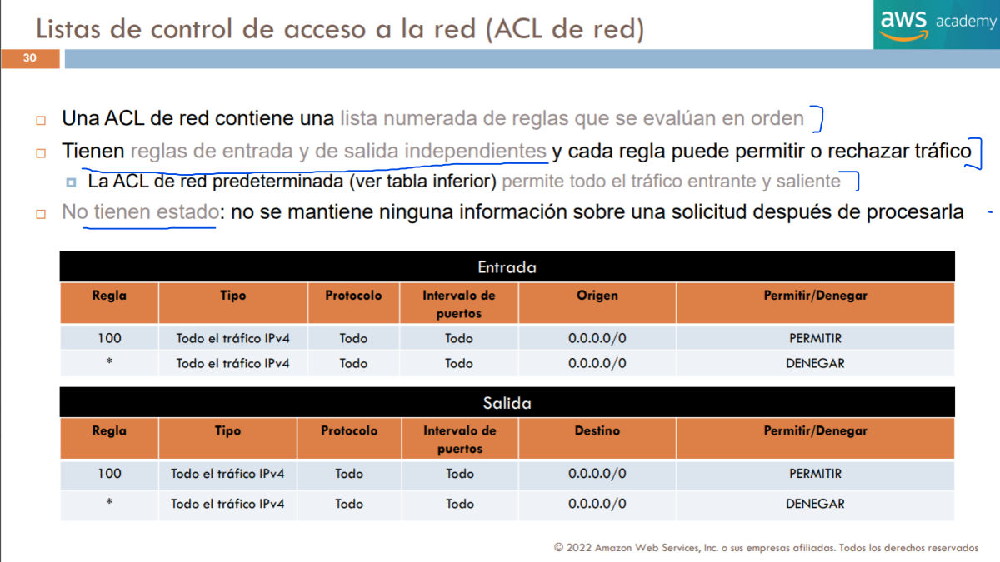

## T5 · página 31

`[FUENTE HISTÓRICA — recuperación OCR; contraste visual general]`

- 31
- Ejemplos de ACL de red personalizadas
- Las ACL de red personalizadas deniegan todo el tráfico hasta que se agregan reglas
- Es posible especificar ambas reglas (permitir y denegar)
- Las reglas se evalúan en orden, comenzando con la regla con el número más bajo
- 100
- 120
- la
- 100
- 120
- HTTPS
- SSH
- Todo el tráfico IPv4
- Ti
- HTTPS
- Todo el tráfico IPv4
- TCP
- TCP
- Todo
- Protocolo
- TCP
- TCP
- Entrada
- Intervalo de
- 443
- 22
- Todo
- Salida
- Intervalo de
- 443
- 22
- Todo
- Origen
- 0.0.0.0/0
- 192.0.2.0/24
- 0.0.0.0/0
- Destino
- 0.0.0.0/0
- 192.0.2.0/24
- 0.0.0.0/0
- PERMITIR
- PERMITIR
- DENEGAR
- Permitir
- PERMITIR
- PERMITIR
- DENEGAR

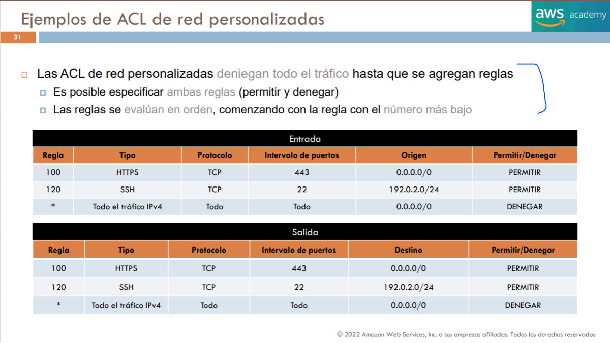

## T5 · página 32

`[FUENTE HISTÓRICA — recuperación OCR; contraste visual general]`

- Grupos de seguridad y ACL de red
- Atributo
- Alcance
- Reglas admitidas
- Estado
- Orden de las reglas
- Grupos de seguridad
- Nivel de instancia
- Solo reglas de permiso
- Con estado (el tráfico de retorno se
- permite automáticamente,
- independientemente de las reglas)
- No importa el orden (se evalúan todas
- las reglas antes de decidir permitir
- tráfico)
- ACL de red
- Nivel de subred
- Reglas de permiso y denegación
- Sin estado (el tráfico de retorno debe estar
- explícitamente permitido por reglas)
- Las reglas se evalúan por orden numérico
- antes de tomar la decisión de permitir el
- tráfico

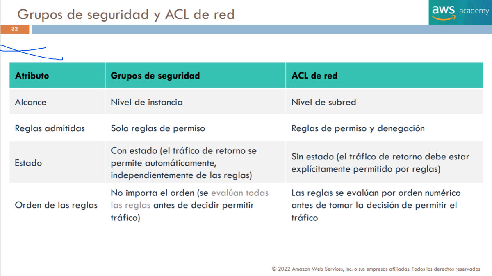

## T5 · página 33

`[FUENTE HISTÓRICA — recuperación OCR; contraste visual general]`

- Amazon CloudFront

## T5 · página 34

`[FUENTE HISTÓRICA — recuperación OCR; contraste visual general]`

- Entrega de contenido y latencia de red
- Cuando se navega por un sitio web o se transmite un video, la solicitud se enruta a través de
- muchas redes diferentes para llegar al servidor de origen
- Este servidor almacena las versiones originales de los objetos (páginas web, archivos multimedia.
- La cantidad de saltos de red y la distancia que debe recorrer una solicitud desde el cliente afectan
- significativamente el rendimiento y la capacidad de respuesta del sitio web
- Además, la latencia de la red es diferente en distintas ubicaciones geográficas
- Una red de entrega de contenido (Content Delivery Network, CDN) puede ser la solución
- Saltar
- Enrutador
- Saltar
- Cliente
- Enrutador
- Usuario
- Saltar
- Enrutador
- Saltar
- Saltar
- Saltar
- Saltar
- Enrutado
- Servidor de origen
- Web Inc. o sus empresas afiliadas. Todos IOS derechos reservados

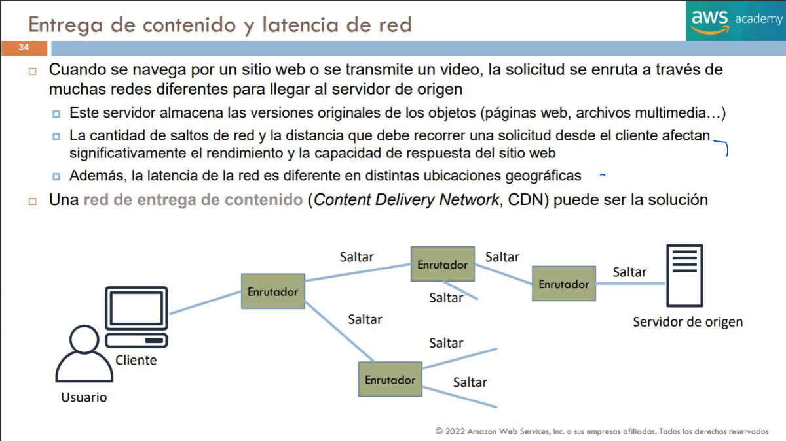

## T5 · página 35

`[FUENTE HISTÓRICA — recuperación OCR; contraste visual general]`

- Red de entrega o distribución de contenido (CDN)
- 0
- Una CDN es un sistema de servidores de almacenamiento en caché distribuido globalmente que
- almacena copias de archivos solicitados comúnmente que están alojados en el servidor de origen
- Principalmente para contenido estático: páginas HTML, hojas CCS, scripts de JavaScript, imágenes...
- Una CDN entrega una copia local del contenido solicitado desde una caché más cercana al cliente
- que proporciona una entrega más rápida y de menor latencia mejorando así el rendimiento
- También puede ofrecer contenido dinámico que es exclusivo del solicitante y que no es fácil de
- almacenar en caché
- Las páginas web dinámicas no se almacenan como archivos HTML estáticos. En su lugar, eI código o
- s
- script que se ejecuta en eI servidor origen genera un archivo HTML personalizado en respuesta a eventos
- del usuario (por ejemplo, un inicio de sesión) y que se envía al navegador web
- En estos casos, la CDN envía al servidor origen el último tiempo de almacenamiento en caché del
- contenido junto con la solicitud. EI servidor origen puede responder más rápido si determina que el
- contenido no fue modificado y no necesita ser generado de nuevo
- Además, usar una CDN también aporta una ventaja adicional ya que permite establecer conexiones
- seguras más cercanas al cliente y más rápidamente

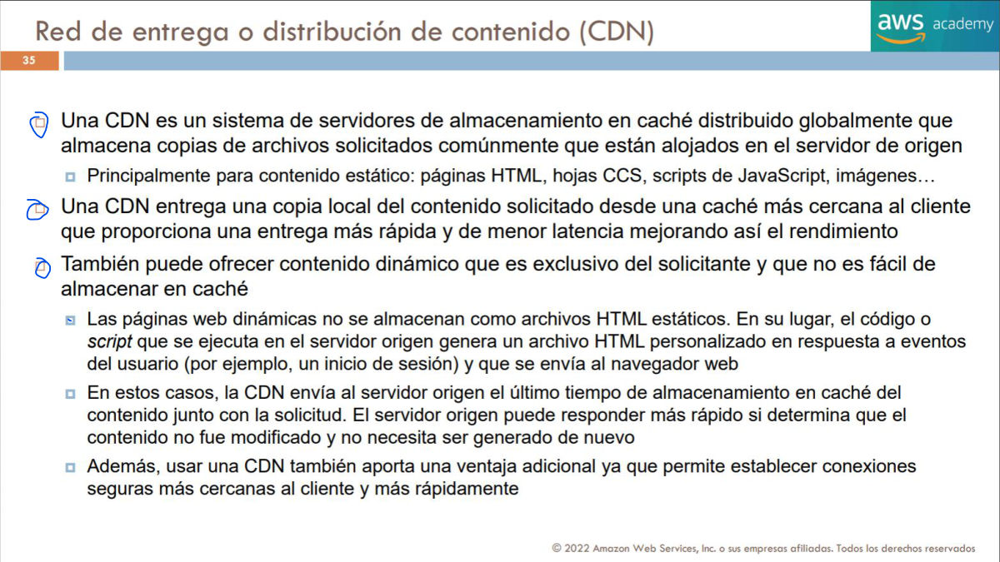

## T5 · página 36

`[FUENTE HISTÓRICA — recuperación OCR; contraste visual general]`

- Amazon CloudFront
- Servicio CDN rápido, global y seguro que suministra datos, videos,
- aplicaciones y APIS de manera segura a clientes de todo el mundo, con
- baja latencia y altas velocidades de transferencia
- Hace uso de los puntos de presencia de AWS (POP, Points of Presence)
- a Ubicaciones de borde (o perimetrales) globales y cachés de borde regionales
- Modelo de autoservicio sin contratos negociados ni tarifas mínimas
- Precios de pago por uso
- POP = punto fisico de la red de AWS cercano al usuario, usado para reducir
- latencia y entregar contenido más rápido.
- Amazon
- CloudFront
- Y no 10 confundas con una Región/AZ: normalmente tus EC2 están en una región y una AZ los POP están orientados a acercar servicios como CloudFront al usuario final.

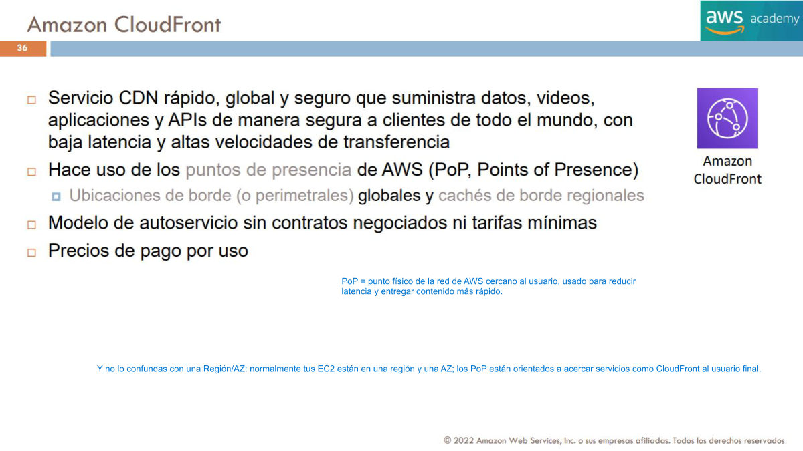

## T5 · página 37

`[FUENTE HISTÓRICA — recuperación OCR; contraste visual general]`

- Infraestructura de Amazon CloudFront
- Ubicaciones perimetrales
- Varias ubicaciones perimetrales
- Cachés perimetrales regionales
- • Ubicaciones de borde o perimetrales: red d
- centros de datos que CloudFront utiliza para
- ofrecer contenido popular rápidamente a los
- clientes
- • Caché de borde o perimetral regional: ubicación
- de CloudFront que almacena en caché contenido
- que no es 10 suficientemente popular como para
- permanecer en una ubicación perimetral. Está
- ubicado entre eI servidor origen y la ubicación de
- borde global. Su caché es más grande que el de
- una ubicación perimetral individual

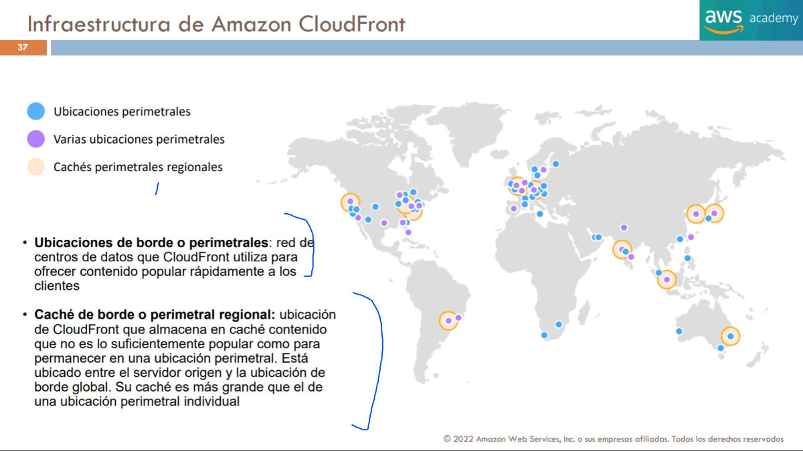

## T5 · página 38

`[FUENTE HISTÓRICA — recuperación OCR; contraste visual general]`

- Amazon Route 53
- Web Services, o sus empresas afiliadas. Todos IOS derechos reservados

## T5 · página 39

`[FUENTE HISTÓRICA — recuperación OCR; contraste visual general]`

- Amazon Route 53
- Servicio web de sistema de nombres de dominio (Domain Name
- System, DNS) escalable y de alta disponibilidad en la nube de AWS
- Se utiliza para redirigir a los usuarios finales a las aplicaciones de Internet
- mediante la traducción de nombres (como www.examolecom) en las
- direcciones IP numéricas que las computadoras utilizan para conectarse
- entre ellas
- Route 53 es totalmente compatible con IPv4 e IPv6
- Conecta de manera efectiva las solicitudes de los usuarios con la
- Infraestructura que se ejecuta en AWS (p.e., instancias EC2 0 buckets
- de S3)
- ambién puede usarse para dirigir a los usuarios a infraestructuras
- xternas a AWS
- Se puede utilizar también para comprobar el estado de sus recursos
- Permite registrar y administrar nombres de dominio
- 53
- Amazon Route
- 53

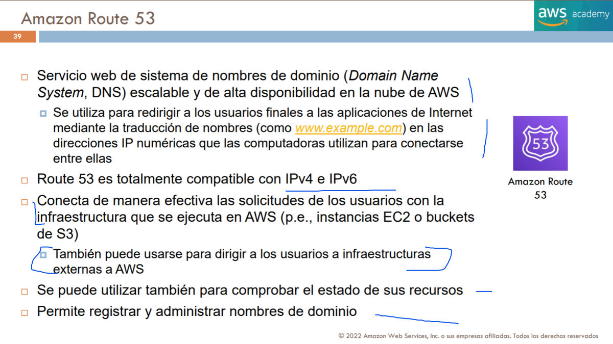

## T5 · página 40

`[FUENTE HISTÓRICA — recuperación OCR; contraste visual general]`

- Resolución DNS de Amazon Route 53
- 40
- Usuario
- Solicitud
- www.example.com
- Devuelve la dirección
- 192.0.2.0
- DNS resolver
- Verificaciones Con Route 53
- de dirección IP
- Devuelve la dirección
- 792.0.2.0
- 53
- Amazon Route
- 53

## T5 · página 41

`[FUENTE HISTÓRICA — recuperación OCR; contraste visual general]`

- Políticas de enrutamiento de Amazon Route 53
- Enrutamiento simple: Responde con un recurso único (o una lista estática de IPs sin
- comprobaciones de estado)
- Uso: Entornos básicos de un solo servidor o donde no se requiere alta disponibilidad a nivel
- DNS (no soporta health checks individuales para conmutación)
- Enrutamiento ponderado: Distribuye el tráfico proporcionalmente a varios recursos según
- pesos numéricos asignados a cada registro (ej. 90% / 10%)
- Uso: Despliegues de tipo canary, pruebas AIB y migraciones graduales entre infraestructuras
- (E Enrutamiento de latencia: Dirige las peticiones a la región que ofrezca el menor tiempo
- de respuesta de red (Round-Trip Time, RTT) medido por AWS
- Uso: Optimizar rendimiento global cuando tiene recursos en varias regiones (mide velocidad de
- red real, no proximidad geográfica)
- Cà Enrutamiento de geolocalización: Enruta el tráfico en función de la ubicación de los
- usuarios según la frontera política o administrativa del cliente (continente, país, estado...)
- Uso: Cumplimiento normativo (RGPD), derechos de emisión/licencias territoriales y localización
- estricta de contenidos/idioma

## T5 · página 42

`[FUENTE HISTÓRICA — recuperación OCR; contraste visual general]`

- Políticas de enrutamiento de Amazon Route 53
- 42
- Enrutamiento de geoproximidad: Enruta el tráfico en función de la ubicación de los
- recursos calculando la distancia física del usuario a las distintas regiones de AWS o
- CPDs externos on-premise (vía coordenadas geográficas)
- a Permite modificar el radio de atracción de cada ubicación mediante un factor de sesgo (bias):
- multiplicador que altera artificialmente cómo Route 53 "percibe" la distancia a ese punto
- Uso: Ajustar la carga que absorbe cada región/CPD según la capacidad de cómputo disponible
- a Enrutamiento de conmutación por error: Modelo activo-pasivo vinculado a
- comprobaciones de estado (health checks)
- a Uso: Recuperación ante desastres dirigiendo eI tráfico a una réplica de contingencia solo si eI
- route 53 fai os Chewcks
- recurso principal deja de responder o se vuelve inaccesible
- a Enrutamiento de respuesta con varios valores: Responde a la consulta DNS con una lista
- de hasta 8 registros IP seleccionados al azar exclusivamente de nodos en buen estado
- (health checks activos)
- a Uso: Balanceo de carga en eI lado del cliente y alta disponibilidad sin eI coste de un
- balanceador (ALBINLB) intermedio

## T5 · página 43

`[FUENTE HISTÓRICA — recuperación OCR; contraste visual general]`

- Caso de uso práctico: implementación en varias regiones
- 53
- Amazon Route 53
- e:
- some-elb-name.us-west-2.elb.amazonaws.com
- Usuario
- Enrutamiento basado en la latencia para la región
- Balanceo de carga entre las AZs de la región
- example.com
- example.com
- ALIAS
- ALIAS
- e:
- some-elb-name.ap-s0utheast-2.elb.amazonaws.com
- some-elb-name.us-west-2.elb.amazonaws.com
- some-elb-name.ap-southeast-2.elb.amazonaws.com

## T5 · página 44

`[FUENTE HISTÓRICA — recuperación OCR; contraste visual general]`

- Conmutación por error de DNS para una aplicación web
- aws
- Nube de
- Zona de dispmibilidad A
- Zona de disponibilidad B
- elastic load balancer
- Política de enrutamiento Conmutación por error
- Tipo de registro = Principal
- Sitio web de Anwzon S3
- Política de enrutamiento Conmutación por error
- Tipo de registro = Secundario
- Usuario
- Amazon Route
- 53
- Secunda rio
- Amaz
- Grupo de Scaling
- EC2
- Amazon EC2
- Amazon
- RDS
- Principal
- Sitio web estático de
- Amazon S3
- Amazon
- RDS
- Instancia de base de
- datos de Amazon
- Relational Database
- Service (Amazon RDS)
- Instancia de base de
- datos de Amazon
- Relational Database
- Service (Amazon RDS)
- Web Inc. o sus afiliadas. Todos IOS derechos reservados

## T6 · página 1

`[FUENTE HISTÓRICA — recuperación OCR; contraste visual general]`

- BLOQUE DE AWS
- TEMA 6: COMPUTACIÓN

## T6 · página 2

`[FUENTE HISTÓRICA — recuperación OCR; contraste visual general]`

- Contenidos
- Información general sobre los servicios de cómputo
- Amazon Elastic Compute Cloud (EC2)
- Optimización de costos de Amazon EC2
- Servicios de contenedores
- Introducción a AWS Lambda
- Introducción a AWS Elastic Beanstalk
- aWS atadén-vy

## T6 · página 3

`[FUENTE HISTÓRICA — recuperación OCR; contraste visual general]`

- Información general sobre los servicios de cómputo

## T6 · página 4

`[FUENTE HISTÓRICA — recuperación OCR; contraste visual general]`

- Servicios de cómputo de AVVS
- AWS ofrece muchos servicios de cómputo. En este toma analizaremos los servicios destacados
- A. EC2
- aWS acàdefrv,'
- AWS
- K SI
- de AWS
- AWS

## T6 · página 5

`[FUENTE HISTÓRICA — recuperación OCR; contraste visual general]`

- Categorización de los servicios de cómputo
- AWS
- AWS
- AWS Elogie
- • Cómputo
- como 10
- • Escaba
- de o
- con
- de w
- Se
- de
- de de
- CDNSI. «e
- aWS academi
- Cmp'c
- de n
- del
- de TI,
- usa r de aprerE
- a trabalar ege
- eS fóc/l y rápido

## T6 · página 6

`[FUENTE HISTÓRICA — recuperación OCR; contraste visual general]`

- Amazon EC2

## T6 · página 7

`[FUENTE HISTÓRICA — recuperación OCR; contraste visual general]`

- Amazon Elastic Compute Cloud (Amazon EC2)
- aWS Scademy
- Amazon EC2 máquinas Virtuales en las que alojar IOS de ejecuta
- servidores fisicos en las instalaciones bcales. capacidad de cónwo ajustaNe en la ruñe de AVv'S
- Servidores en las instalaciones
- Instancias de Amazon EC2
- 0000
- 0000
- 0000
- 0000
- de
- de archivos

## T6 · página 8

`[FUENTE HISTÓRICA — recuperación OCR; contraste visual general]`

- aWS
- Información general sobre Amazon EC2
- Amazon Elastic Compute Cloud (Amazon EC2)
- proporciona máquinas virtuales, denorninadas instancias EC2. en la nube
- a EI usuario tiene control absoluto eI sistema operativo invitado que
- ejecuta cada instancia
- Es posible iniciar instancias de cualquier capacidad en una zona de
- disponibilidad en cualquier parte del mundo
- Lanzamiento de instancias usando Amazon Machine Images (ANI)
- Amazon
- Inicie instancias con unos pocos clics o CMI una linea de código y estarán
- EC2
- listas en cuestión de minutos
- Puede controlar el tráfico de red hacia y desde las instancias
- mediante grupos de seguridad
- EC2 P..S •

## T6 · página 9

`[FUENTE HISTÓRICA — recuperación OCR; contraste visual general]`

- Lanzamiento de una instancia de EC2
- Se describirán nueve decisiones
- clave que debe tomar al crear
- una instancia EC2 mediante el
- asistente de lanzamiento de
- instancias de la consola de
- administración de AWS
- En el camino. se explorarán los
- conceptos esenciales de
- Amazon EC2
- aws

## T6 · página 10

`[FUENTE HISTÓRICA — recuperación OCR; contraste visual general]`

- I . Seleccionar una Amazon Machine Image (AMI)
- aWS academi
- Elecciones que se realizan con
- asistente de lanzamiento de
- instancias:
- TIPO de
- ConfiwaciOn red
- Rol 'AM
- Imagen máquina de Amazon (AMI)
- Es una plantina que se utiliza para crear una instancia EC2
- Contiene un sistema Windows, Linux o macOS
- A menudo también tiene software preinstalado
- Elecciones de AMI
- a Inicio rápido; AMI de Linux y Mnd0WS que AWS
- Mis AMI_• cualquier AMI que haya creado
- a AWS Marketplace: plantillas preconfiguradas de terceros
- AMI de la cornunidad: AMI compartidas por demás; deben
- usarse bajo su propio riesgo

## T6 · página 11

`[FUENTE HISTÓRICA — recuperación OCR; contraste visual general]`

- Creación de una nueva AMI:
- Nube de AWS
- ejemplo
- a instancia y
- eiecute un que
- modifique la instancia
- 'por actualice
- el software Instalado)
- aWS atademy
- Start u
- Otra ANI
- una instancia
- o
- Instancia
- MyAM1
- Instancia
- a cualquier otra

## T6 · página 12

`[FUENTE HISTÓRICA — recuperación OCR; contraste visual general]`

- 2. Seleccionar un tipo de instancia
- Considere su caso de uso
- ¿Cómo se utilizará la hstancia EC2 que quiere crear?
- aws
- reditan
- a sisteate de de
- EI tipo de instancia determina 10 siguiente:
- o Memoria (RAM)
- a Potencia de procesamiento (CPU)
- a Espacio en desca y tipo de dísco (afrnacenamiento)
- a Rendimiento de red
- Categorias de tipos de instancia:
- a Instancias de propósito general
- Optimizadas para computo
- Optimizadas para mernoria
- Optimizadas para alrnacenamiento
- Con COrnput0 (GPU)
- Los tipos de instancia ofrecen familia. generación y tamaño

## T6 · página 13

`[FUENTE HISTÓRICA — recuperación OCR; contraste visual general]`

- Nombres y tamaños de los tipos de instancia EC2
- aws aeademy
- Nombre del tipo de instancia
- Ejemplo: t3.Iargo
- a T es el nombre de la familia
- a 3 es el n úrnero de la generación
- a Large es eI tamaño
- Tamaños de instancia de ejemplo
- Solo Eas
- solo EBS
- solo
- solo
- solo Eas

## T6 · página 14

`[FUENTE HISTÓRICA — recuperación OCR; contraste visual general]`

- Seleccione el tipo de instancia: según el caso práctico
- Optimizadas
- aws
- Optimizadas para
- Tipos de
- Caso de u so
- n Cia s
- de propósito
- genera
- 12,
- Amplio
- O pti miz
- para c á m pufo
- para memo
- Bases de dato
- Con cómputo
- Machine
- lea r ning

## T6 · página 15

`[FUENTE HISTÓRICA — recuperación OCR; contraste visual general]`

- Tipos de instancias: características de red
- EI ancho de banda de red (Gbps) varia según el tipo de instancia
- Consultar Icos para comparar
- Para maximizar el rendimiento de la red y el ancho de banda del tipo de instancia:
- Si tiene instancias interdependientes, láncelas en un
- Habilitar las redes mejoradas
- La mayoría de los tipos de instancia admiten tipos de redes mejoradas
- Consultar la documentación sobre las Canarrcrj53cas de redes y almacenamiento para
- obtener más detalles
- Tipos de redes mejoradas:
- Adaptador de red elástico (ENA): admite velocidades de red de hasta 100 Gbps
- a Interfaz de función virtual Intel 82599: admite velocidades de red de hasta 10 Gbps

## T6 · página 16

`[FUENTE HISTÓRICA — recuperación OCR; contraste visual general]`

- 3. Especificar la configuración de red
- ¿Dónde debería ubicarse la instancia?
- Identificar la VPC y. opcionalmente. la subred
- aws
- que Se realizan
- asistente de lanzamiento de
- Tipo
- Gmpo de
- ¿Debería asignarse automáticamente una dirección IP pública?
- para hacerla desde Internet
- que ubiar la
- instando

## T6 · página 17

`[FUENTE HISTÓRICA — recuperación OCR; contraste visual general]`

- 4. Adiuntar rol de IAM (opcional)
- Elecciones que se realizan con
- asistente de lanzamiento de
- instancias:
- 12.
- de
- Datos
- ¿EI software de la instancia de EC2 necesita interactuar con
- otros servicios de AWS?
- En caso afirmativo, adjunte rpl de IAM adecuago
- un rol de IAM que se adjunta a una instancia de EC2 se
- mantiene en un perfil de instancias
- No se limita a adjuntar un rol solo en el lanzamiento de la
- instancia
- También adjuntar un rol a instancia que ya existe
- Ejemplo:
- Rol
- de 53

## T6 · página 18

`[FUENTE HISTÓRICA — recuperación OCR; contraste visual general]`

- 5. Script de datos de usuario (opcional)
- iáecciones que realizan con
- eI asistente de lanzamiento de
- V' stMCias:
- Datos de usuario
- yun update -y
- yur instan I -y wget
- aws
- Ejecución de
- instancias EC2
- 7.
- ripa de
- Etiqu«u
- Si 10 desea. puede configurar un script de datos de usuario al
- lanzar la instancia
- Utilice estos scripts para personalizar el entorno en tiempo de
- ejecución de su instancia
- a E' scnpt se ejecuta la pomera vez que se micia la instancia
- Se puede utilizar estratégicamente
- Por ejernplo. reduzca eI número de AMI ;wsonalizadas que crea
- y mantiene

## T6 · página 19

`[FUENTE HISTÓRICA — recuperación OCR; contraste visual general]`

- 6. Especificar almacenamiento
- Configurar el
- volumen raiz
- aWS ata den-vy
- —«iones que se realizan con
- eI asistente de lanzamiento de
- Tipo de
- red
- de
- de
- Donde está instalado el sistema operativo invitado
- Adjuntar volúmenes de almacenamiento adicionales
- (opcional)
- Es posible que la AMI ya incluya más de un
- para cada volumen. especifique 10 siguiente:
- a Tamaño del disco (en GB)
- a EI tipo de volumen
- Hay disponibles Merentes tipos de unidades de
- estado solido (SSD) y discos duros (HDD)
- Si eI volumen se eliminará o no al finalizar la instancia
- o Si se debe utiizar el cifrado

## T6 · página 20

`[FUENTE HISTÓRICA — recuperación OCR; contraste visual general]`

- Opciones de almacenamiento de Amazon EC2
- Amazon Elastic Block Store (Amazon EBS):
- Volúmenes de almacenamiento persistentes a nivel de bloque
- aws
- • Accesibles de forma remota a través de la red de forma totalmente transparente (acceso de tipo SAN)
- c Si se usan corno volumen raíz, permiten detener la instancia e iniciarla de nuevo sin perder
- Amazon EC2 Instance Store:
- Almacenamiento efímero a nivel de bloque proporcionado por los discos que se encuentran
- directamente conectados al semidor fisico (anfitrión) en la que se ejecuta la instancia
- • Accesibles de forma local (acceso de tipo DAS)
- Si la instancia se detiene, los datos almacenados se eliminan
- • Si se usan como volumen raiz. las instancias no se pueden detener (solo terminar)
- Otras opciones de almacenamiento (no válidas para el volumen raíz):
- Montaje de un sistema de ficheros en red: Amazon Elastic File System (Amazon EFS)
- Conexión a buckets de Amazon Simple Storage Service (Amazon S3)

## T6 · página 21

`[FUENTE HISTÓRICA — recuperación OCR; contraste visual general]`

- Opciones de almacenamiento de ejemplo
- Características de la
- instancia l:
- Tiene un tipo de volurnen raiz
- de Arnazon EBS para eI SO
- a ¿Oué ocurre s' la instancia se
- detiene y Se vuelve a iniciar?
- Caracteristicas de la
- instancia 2:
- Tene un de raiz
- de Instance Store para eI SO
- a ¿Qué ocurre si la instancia se
- detiene (debido a un error o a un
- ma/ funcionamiento del sistema)?
- EBS)
- 20 GB
- volumen de
- Adjunto como
- volumen de
- "u de
- miento
- . "unto como :
- volumen Rau
- Instancia 2
- aWS atademy
- efímero
- efímero 2

## T6 · página 22

`[FUENTE HISTÓRICA — recuperación OCR; contraste visual general]`

- 7. Agregar etiquetas
- Elecciones que se realizan con
- asistente de lanzamiento de
- 2.
- Opciones almacenamiento
- &upo
- Par de
- aWS Scad•erny
- Una etiqueta es un rótulo que se puede asignar a un recurso en
- la nube de AWS
- Consta de una clave y de un valor opcional
- EI etiquetado es la forma en que se pueden adjuntar metadatos
- a una instancia de EC2
- Beneficios potenciales de las etiquetas: filtro, automatización,
- asignación de costos y control de acceso
- Ejemplo:

## T6 · página 23

`[FUENTE HISTÓRICA — recuperación OCR; contraste visual general]`

- 8. Configuración del grupo de seguridad
- aWS ataderny
- klecciones que se realizan con
- eI asistente de lanzamiento de
- instancias:
- 14,
- Cmfgu
- Rol JAM
- de
- par
- Un grupo de seguridad es un conjunto de reglas de firewall que
- controlan el tráfico a la instancia
- Existe fuera del SO nvitado de la instancia
- Las reglas especifican la fuente (origen) y los puertos que
- pueden utilizar las comunicaciones de red
- Especifique eI número de puerto y eI protocolo (TCP, UDP, ICMP)
- Especifique la fuente (por ejemplo. una dirección IP u Otro grupo de
- seguridad) a la que se Ie permite utilizar la regla
- Regla de ejemplo:
- SSH
- TCP

## T6 · página 24

`[FUENTE HISTÓRICA — recuperación OCR; contraste visual general]`

- 9. Identificar o crear el par de claves
- En el lanzamiento de la instancia, se especifica
- aWS *ademy
- jaecciones que se realizan con
- eI asistente de lanzamiento de
- instancias:
- 2.
- 4.
- de
- de
- de IAM
- de
- un par de claves existente o se crea un nuevo par
- un par de claves consiste en:
- Una clave pública que almacena AWS
- Un archivo de clave privada que almacena el
- Permite conexiones seguras a la instancia
- para AMI de Windows:
- Utilice la clave privada con el fin de obtener la
- contraseña de administrador que necesita para
- iniciar sesión en su instancia
- para AMI de Linux;
- Utilice la clave privada a fin de emplear SSH para
- conectarse de forma segura a su instancia

## T6 · página 25

`[FUENTE HISTÓRICA — recuperación OCR; contraste visual general]`

- Otra opción: lanzar una instancia de EC2 con AVVS CLI
- aws
- Las instancias EC2 también se pueden crear
- de forma programática usando AWS CLI
- En el ejemplo de la derecha, se muestra 10
- sencillo que puede ser el comando
- Se supone que eI par de claves y eI grupo de
- ya existen
- Se podrían especificar más opciones
- Consulte la
- para obtener más de detalles
- de de
- de AWS
- cul
- Comando de ejemplo:
- aws ec2 run-instances \
- --image-id ami-1a2b3c4d
- --count I
- --instance-type c3.1arge
- --key—name MyKeypair
- -securi ty-groups Mysecuri tyGroup
- --region us-east—l

## T6 · página 26

`[FUENTE HISTÓRICA — recuperación OCR; contraste visual general]`

- Ciclo de vida de las instancias de Amazon EC2
- Solo de
- Npo A— EBS
- aws

## T6 · página 27

`[FUENTE HISTÓRICA — recuperación OCR; contraste visual general]`

- Hibernación de instancias
- aWS
- Guarda e contendo de la mernoria RAM de la instancia al vdunen raiz de Amazm EBS
- A reá-±iar la instancia, eI volumen raiz se restaura a Su estado anterior, se recarga e' de la
- RAM y ream"an los procesos que se estaban ejecutando antericgmente en la instancia
- En ayrvaración una instancia en ejecución, permite ahorrar costos (—similares al deterüda)
- Se y restaura RAM, Se pocos y EBS
- • Ese extra de la RAM puede st_ooner un pequeño a uru
- Requisitos previos
- Solo cornpatble con algunas AMI de Linux (corno Amazcm Linux 2) y con ciertas farnilias de instvu:ias
- a La tener un VOIurnen raiz de Amazon EBS cifrado y un maxirno 150 GB MM
- La hibernacón debe habilitarse en el monwnto de lanzar la instancia

## T6 · página 28

`[FUENTE HISTÓRICA — recuperación OCR; contraste visual general]`

- Considere utilizar una dirección IP elástica
- Reiniciar una instancia no cambiará
- ninguna dirección IP ni nombre de DNS —J
- ¿Oué ocurre si la instancia se detiene y se
- vuelve a iniciar?
- z La dirección IPad pública y el nombre de DNS
- se modificarán
- si asõnó una IP elástica a la
- a La drección IPv4 privada y el nombre DNS
- interno no se rnmiftan
- Si necesita una dirección IP pública
- persistente:
- Puede asociar una dirección IP elástica
- con la instancia
- Características de la dirección P
- elástica:
- ta Se puede asociar con instancias de la
- regón según sea necesMi0
- Permanece asignada a su cuenta hasta
- que decida liberarla

## T6 · página 29

`[FUENTE HISTÓRICA — recuperación OCR; contraste visual general]`

- Metadatos de la instancia de EC2
- Los metadatos de la instancia son datos sobre la propia instancia
- Mientras esté conectado a la instancia, es posible visualizarlos:
- Desde un navegador: http : 1/169.2 54-169.254/1 atest/meta-data/
- Desde un terminal: curl http://169.254.169.254/1
- Ejemplos de valores recuperables:
- aWS akademy
- Dirección IP pública, dirección IP privada. nombre de host público, ID de instancia, grupos de
- seguridad, región, zona de disponibilidad
- También se puede acceder a cualquier dato de usuario especificado en el lanzamiento de la
- instancia en: http://169.254.169.254/1 atest/user-data/
- Se puede utilizar para configurar o administrar una instancia en ejecución
- Por ejemplo, crear un script de configuración que lea los metadatos y los utilice para configurar
- aplicaciones 0 ajustes del SO

## T6 · página 30

`[FUENTE HISTÓRICA — recuperación OCR; contraste visual general]`

- Cloud\A/atch para la supervisión
- Utilice Amazon CloudWatch para monitorizar
- instancias de EC2
- Proporciona métricas en tiempo real
- Proporciona gráficos en la pestaña Monitoreo
- de la consola Amazon EC2
- Ama Clo udWatCh
- aws
- Instancia CloudWatCh
- Man
- de datos h
- Supervisión básica
- Predeterminado. sin costo adicional
- Datos de rnétricas enviados a CloudWatch
- cada 5 minutos
- Monitorización detallada
- Tarifa mensual fija para siete métricas
- preseleccionadas
- t:' Datos de métricas cada 1 Muto

## T6 · página 31

`[FUENTE HISTÓRICA — recuperación OCR; contraste visual general]`

- Optimización de costos de Amazon EC2

## T6 · página 32

`[FUENTE HISTÓRICA — recuperación OCR; contraste visual general]`

- Modelos de precios de Amazon EC2
- Instancias bajo demanda
- por hora
- NO a largo plazo
- Servidores (hosts) dedicados
- fisco
- exclusivo por cuente
- Se p" por host
- del
- perneen propias
- software szxket o
- Est
- Instancias dedicadas
- Instancias EC2 que se ejecutan en
- hardware dedicado a un solo cliente
- Instancias reservadas
- Pago total (AURI). parcial (PURI) o
- sin pago hicial (NURI) para las
- Descuento en eI cargo h«ario por
- uso de las instancias
- Plazo de 0 3 anos
- Instancias reservadas
- programadas
- Adq u i era una reserva de
- q Lie esté
- horario recurrente
- paga pu eI tiernpo en que se
- aws
- Instancias de spot
- Las nstancias se ejecutan
- Siemve que estén di S'Y'nibleS
- y puja Sea superior al
- de las hStanCiaS de Spot
- AWS muede interrurnpirtas
- una noMc&iOn de 2 minutos
- Los precios, que nuctúan en
- función de La oferta y la demanda,
- suelen ser significativamente
- con las instancias bajo demanda
- Buena elección cuando se tiene
- flexibilidad en Cuanto a cuándo se
- ejecutar sus
- mograman las instancias. induso
- Si no las utiliza
- de g.

## T6 · página 33

`[FUENTE HISTÓRICA — recuperación OCR; contraste visual general]`

- Modelos de precios de Amazon EC2: beneficios
- Ofrece bajo costo
- y flexibilidad
- Si n Contratos a plazo .
- Carga de trabajo Cinámica •
- y a gran escala
- Ofrece previsibilidad.
- 10 que garantiza que la
- capac.d ad Cómputo
- esté disponible cuando se
- aWS aa-demry
- • Permite anorrar en
- costos de licencia
- • a requisitos
- mrmativos (organizaciones
- que Sus
- e n servidores
- en lugar de
- servidores de varios

## T6 · página 34

`[FUENTE HISTÓRICA — recuperación OCR; contraste visual general]`

- Modelos de precios de Amazon EC2•. casos de uso
- Ca de trabajo
- con de
- • de trabajo a Corto
- plazo, con picos de
- • Desarrolo o prueba
- a PI Caciones
- Cargas de trabaja
- del
- • Aplicaciones de
- inicio y finalización nexit*eS
- • que "o
- Son Viables Con
- de aimputo muy bajos
- • Con
- de cómputo urwntes de
- grandes cantidades de
- capacidad ad
- Cargas de
- de ble
- • Cargas de trabajo de uso
- predecible o estado estable
- • que requiere n
- capacidad ,
- incluida la recuperación ante
- desastres
- • Usuarios capaces de
- afrontar pagos iniciales para
- reducir aún más IOS COStOS
- de cúnputo
- aWS átademy
- Cargas de trabajo
- de
- • Madela de
- YourOwn License• (BYOL)
- • normativas o
- requisitos corpcyativos
- específicos
- • uso y las

## T6 · página 35

`[FUENTE HISTÓRICA — recuperación OCR; contraste visual general]`

- Modelos de precios de Amazon EC2: casos de uso
- de trabajo
- Con de demanda
- • Cargas de trabajo a
- plazo. mn picos de
- nda O
- • Desarrollo o prueba de
- de trabajo
- • Con tiempos de
- inicio y finalización flexibles
- • SOJO
- son viables con precos
- de Computo muy bajos
- • Usuarbs con necesidades
- de cómputo urgentes de
- de
- capacidad adicional
- Cargas de
- de estado estable
- • Cargas de trabajo uso
- predecible o estado estable
- • que
- capacidad reservada.
- ida ante
- desastres
- • Usuarios capaces
- afrontar para
- reducir aún más los costos
- de computo
- a WS Staaerny
- Cargas de tra bajo
- m &pem dientes
- Your Own Lácense" (BYOL)
- requ isitos corporativos
- • del uso y

## T6 · página 36

`[FUENTE HISTÓRICA — recuperación OCR; contraste visual general]`

- Los cuatro pilares de la optimización de costos
- Optimización de costos

## T6 · página 37

`[FUENTE HISTÓRICA — recuperación OCR; contraste visual general]`

- Pilar 1 : Dimensionamiento adecuado
- aws
- Pilares:
- l. adecuado
- 2, Aumento de la elasticidad
- 3. Modela de precios óptimo
- 4. Optimización de las
- opciones de almacenamiento
- Aprovisionar instancias para satisfacer la necesidad
- CPU, memoria. almacenamiento y rerúimiMflo de red
- Seleccione los tipos de instancia para su uso
- uso de métricas de Amazon CloudWatch
- ¿Qué tan inactivas están las instancias? ¿Cuándo?
- Reducir eI tarnano de las hstancias
- Práctica recomendada: tamaño correcto, luego reserve

## T6 · página 38

`[FUENTE HISTÓRICA — recuperación OCR; contraste visual general]`

- Pilar 2: Aumento de la elasticidad
- Pilares:
- I. Dimensión correcta
- 3, Modelo de precios óptimo
- 4. Optimizacibn de 135
- opciones de almacenamiento
- aWS *aderny
- Detener o hibernar instancias respaldadas por
- Amazon EBS que estén en uso inactivo
- Ejemplo: entornos que no son de producción o
- instancias de prueba
- Utilice el escalado automático para satisfacer las
- necesidades de acuerdo con el uso
- Elasticidad automatizada y basada en el tiempo

## T6 · página 39

`[FUENTE HISTÓRICA — recuperación OCR; contraste visual general]`

- Pilar 3
- Modelo de precios óptimo
- aWS ataderny
- Pilares:
- I, Dimensión correcta
- 2, Aumentar elasticidad
- 4. Optimización de las
- opciones de almacenamiento
- Aproveche el modelo de precios adecuado para
- su caso práctico
- o ¿Cuáles son los patrones de uso?
- Optimizar y combinar tipos de compra
- Ejemplos:
- Utilice instancias bajo demanda e instancias de spot
- para cargas de trabajo variables
- Utilice instancias reservadas para cargas de trabajo
- predecibles
- Considere soluciones sin servidor (severless)
- AWS Lambda

## T6 · página 40

`[FUENTE HISTÓRICA — recuperación OCR; contraste visual general]`

- Pilar 4: Optimización de las opciones de almacenamiento
- aws
- Pilares:
- I. Dimensión correcta
- 2. Aumentar elasticidad
- 3. Modelo de precios optimo
- opciones de almacenam•enro
- Reduzca los costos manteniendo el rendimiento y la
- disponibilidad del almacenamiento
- Modificar el tamaño de los volúmenes de Amazon EBS
- Modificar los tipos de volúmenes de Amazon EBS
- ¿Se pueden cumplir los requisitos de con un
- almacenamiento menos costoso?
- Ejempb; el HOD (stl) Con rendimiento optimizado de
- Amazon EBS 10 general cuesta la mitad que la opción de
- almacenamiento SSD do uso general (gp2) predeterminada
- Elimine las instantáneas de EBS que ya no sean necesarias
- Identificar el destino más apropiado para tipos específicos de datos
- ¿La aplicación necesita que la instancia resida en Amazon EBS?
- Las opciones de almacenamiento de Amazon S3 con politicas de
- ciclo de vida pueden reducir los costos

## T6 · página 41

`[FUENTE HISTÓRICA — recuperación OCR; contraste visual general]`

- Servicios de contenedores

## T6 · página 42

`[FUENTE HISTÓRICA — recuperación OCR; contraste visual general]`

- Conceptos básicos de contenedores
- contenedores son un método de virtualización a nivel
- del sistema operativo
- También llamado virtualización por compartición de kernel
- Beneficios:
- Entornos completamente autónomos y uniformes
- Reproducible
- a EI software se ejecuta igual en diferentes entornos
- • Prueba, producción, portátil del desarrollador.
- Más rápido para iniciar, detener 0 terminar que las VM
- aWS Àademy
- Contenedor
- Aplicación
- 01 OS

## T6 · página 43

`[FUENTE HISTÓRICA — recuperación OCR; contraste visual general]`

- ¿Qué es Docker?
- Docker es una plataforma software que permite crear,
- probar e implementar aplicaciones ejecutadas en
- contenedores rápidamente
- Docker se instala en cada servidor que alojará IOS
- contenedores y proporciona comandos sencillos para
- crear, iniciar o detener contenedores
- • docker run —name mi_contenedor -d -p 8080:80
- Los contenedores se crean a partir de una plantilla
- llamada imagen
- docker run —name mi_contenedor -d -p 8080:80 nginx
- Un contenedor tiene todo 10 que una aplicación
- software necesita para ejecutarse
- Código, dependencias, librerías.
- aWS Sta.démy
- software para

## T6 · página 44

`[FUENTE HISTÓRICA — recuperación OCR; contraste visual general]`

- Máquinas virtuales (VM) frente a contenedores
- Tres máquinas Virtuales tres de EC2
- Ejemplo
- Tres contenedores una de
- contenedor contenedor 2 contenedor 3
- aWS atademy
- M : Aplicación 2
- Docker
- Bins,'L'bS
- Sistema operativo invitado de la instancia EC2
- ECI
- del
- operativo
- EC2 EC2
- parte de la
- global de AWS

## T6 · página 45

`[FUENTE HISTÓRICA — recuperación OCR; contraste visual general]`

- Amazon Elastic Container Service (Amazon ECS)
- Amazon Elastic Container Service (Amazon ECS)
- a Servicio admimstrado de contenedores altamente escalable y rápido
- Beneficios clave:
- • Coordina la de contenedores
- y de EC2 IOS
- • Elimina la y la
- Funciones esenciales:
- Permite iniciar decenas de miles de contenecwes Docker en
- Administra del Clúster que ejecuta IOS
- Integrado con caacteristicas para usuarios de Amazon EC2:
- aWS acaderny
- • Balanceo de Carga elástica
- • Gruvx»s de segurk*ad de Amazon EC2
- • Volúmenes de Amazon EBS
- Roles IAM
- o EC2

## T6 · página 46

`[FUENTE HISTÓRICA — recuperación OCR; contraste visual general]`

- Amazon ECS
- para
- ECS)
- Clúster de ECS
- de EC2

## T6 · página 47

`[FUENTE HISTÓRICA — recuperación OCR; contraste visual general]`

- Opciones de clúster de Amazon ECS
- Pregunta: ¿Quiere administrar el clúster de Amazon ECS que ejecuta los contenedores?
- aws
- En caso afirmativo, la opción es crear un clúster de Amazon ECS respaldado por instancias EC2
- (proporciona un control más granular sobre la infraestructura)
- En caso negativo, crea un clúster de Amazon ECS respaldado por (más fácil de mantener,
- céntrese en sus aplicaciones, no es necesario configurar ni escalar el clúster, ni elegir el tipo de instancias)
- • Sigue un paradigma serverless
- Clúster de Amazon
- ECS respaldado por
- Amazon EC2
- que
- Instancia de
- Contenedw
- Libs
- Insta de
- ene 2
- 2
- Instan cia de
- 3
- Apficación 3
- Bins/Ubs
- Motores Docker (uno por sistema operativo en eI Clúster)
- operativos invitados de VM Clúster de Amazon ECS
- Clúster de Amazon ECS
- respaldado por Fargate
- AWS administra 'o
- Siguiente

## T6 · página 48

`[FUENTE HISTÓRICA — recuperación OCR; contraste visual general]`

- ¿Qué es Kubernetes?
- aws
- Kubernetes es una plataforma software de código abierto desarrollada por Google para la
- orquestación de contenedores
- Permite desplegar y administrar aplicaciones en contenedores a gran escala
- EI mismo conjunto de herramientas se puede utilizar en las instalaciones y en la nube
- Complementa a Docker
- Docker permite ejecutar varios contenedores en un único host
- Kubernetes coordina múltiples hosts con Docker (funciona en modo clúster)
- También soporta otras tecnologias de virtualización además de Docker
- Automatiza:
- Aprovisionamiento de contenedores
- Balanceo de la carga
- Escalado

## T6 · página 49

`[FUENTE HISTÓRICA — recuperación OCR; contraste visual general]`

- Amazon Elastic Kubernetes Service (Amazon EKS)
- Amazon Elastic Kubernetes Service (Amazon EKS)
- ta Servicio administrado que facilita la ejecuciõn de Kubernetes en AWS
- sin necesidad de instalar. operar y mantener su plano de control
- Características
- Habilita la ejecución de Kubernetes en la nube de AWS
- Certificado conforme a Kubernetes (admite una fácil migración) —
- Admite contenedores de Linux y Windows
- Compatible con las herramientas de la comunidad de Kubemetes y
- admite complementos populares
- Utilice Amazon EKS para:
- Administrar clústeres de instancias EC2 y ejecutar contenedores
- orquestados por Kubernetes en ellas
- ECZ
- Kube Set vice

## T6 · página 50

`[FUENTE HISTÓRICA — recuperación OCR; contraste visual general]`

- Amazon Elastic Container Registry (Amazon ECR)
- Amazon ECR registro o repositorio de Docker (Docker
- cotnple'amen'e administrado que facilita a los
- desarrolladores las tareas de almacenamiento, administración e
- de imágenes de contenedores
- aWS *ade-T1y
- Integración Amazon ECS
- Compatibilidad con Docker
- Colaboración en

## T6 · página 51

`[FUENTE HISTÓRICA — recuperación OCR; contraste visual general]`

- Introducción a AM,/S Lambda

## T6 · página 52

`[FUENTE HISTÓRICA — recuperación OCR; contraste visual general]`

- AWS Lambda: eiecutar código "sin servidores"
- AWS Lambda es un servicb de cómputo "sin sorvidor" (server/ess) basado en eventos que *Mar
- necesidad de ni ServidMeS y SuS
- aWS atá dém•y
- EI Códgo que Se es una Función
- Lam bda; delo (FaaS)
- Cargue código
- de AWS
- EI códgO eiecuta
- Cuando Se activa
- Código o
- respues'a a eventos
- paga por el nempo
- de cómputo que utiliza

## T6 · página 53

`[FUENTE HISTÓRICA — recuperación OCR; contraste visual general]`

- Beneficios de AVIS Lambda
- aws
- AWS Lambda
- Compatible con varios lenguajes de (Java, Go, pyhton,
- Ruby Node.js„.)
- Administracón automatizada por completo
- Tolerancia a fallos integrada (capacidad de computo en múltiples AZ)
- Admite la ccnrdinaciOn de múltiples funciones (AWS Step Functions)
- Precios de pago por (facturación en incrernentos de 100 ms)

## T6 · página 54

`[FUENTE HISTÓRICA — recuperación OCR; contraste visual general]`

- Fuente de eventos de AVVS Lambda
- Fuentes de eventos
- Amazon DynamoDB
- Amazon Simple Notification
- Service C Amaton SNS)
- Amauan Simple Qu eue
- Se (Amazon SQS)
- Equilibrador de Carga
- de
- aWS atadeTty
- Es posible configurar de AWS como de los
- eventos para invocar Su
- Como una de desde la
- consola de Lambda. el SOK de AWS o la CU de AWS
- Función
- de
- A'WS La mbda
- del c" go
- (sol O se
- Registra supervisión
- y métricas

## T6 · página 55

`[FUENTE HISTÓRICA — recuperación OCR; contraste visual general]`

- Configuración de la función de AVIS Lambda
- Configuración de la
- función de Lambda
- Código de la
- liü
- pen d
- ( *bliotecas, )
- Roa de ejecución
- AWS La rnbda
- aws
- del código (solo
- cuando activa)
- Registra supervisión

## T6 · página 56

`[FUENTE HISTÓRICA — recuperación OCR; contraste visual general]`

- Ejemplo de función Lambda basada en programación
- aWS áaxferrvy
- Detener instancias EC2 a una hora predefinida (por ejernplo, por la noche. cuando nadie accede a ellas) y luego
- reiniciarlas por la mañana (antes de hiciar la jomada laboral)
- Detener las instancias
- to de CloudWatch
- O f unción tiem po,
- ejemplo a las 22 m
- Iniciar las instancias
- 0
- función del
- Rol de tAM
- O Función de
- Lambda activada
- EC2 detenida
- 0
- Rol de 'AM
- Fu de
- La m bda activada

## T6 · página 57

`[FUENTE HISTÓRICA — recuperación OCR; contraste visual general]`

- Eiemplo de función Lambda basada en eventos
- Creación de miniaturas para cada imawn se carga en un bucket S3
- aWS akademy
- Nube de AWS
- o
- o
- fuente
- Bucket
- objetivo
- Lambda
- o
- Función de
- Lambda
- Rol de
- ejecución
- Política
- de acceso

## T6 · página 58

`[FUENTE HISTÓRICA — recuperación OCR; contraste visual general]`

- Cuotas de AVIS Lambda
- Límites suaves por región:
- Ejecuciones simultáneas = 1.000
- Almacenamiento de funciones y capas = 75 GB
- aws
- Limites estrictos para funciones individuales:
- Asignación máxima de memoria de función = —10 GB
- Tiempo de espera de la función = 15 minutos
- a Tamaño del paquete de despliegue (ZIP) = 250 MB descomprimidos, incluidas las capas
- a Tamaño del paquete de imagen del contenedor = 10 GB
- También existen limites adicionales. Los detalles se encuentran en la documentación de cuotas
- de AWS Lambda en

## T6 · página 59

`[FUENTE HISTÓRICA — recuperación OCR; contraste visual general]`

- Introducción a AWS Elastic Beanstalk

## T6 · página 60

`[FUENTE HISTÓRICA — recuperación OCR; contraste visual general]`

- AVVS Elastic Beanstalk
- AWS Elastic
- Beanstalk
- rr,y
- Forma sencilla de poner aplicaciones web en funcionamiento
- en el menor tiempo posible
- Servicio PaaS administrado que maneja automáticamente:
- Administración de aprovisionamiento y configuración
- Des pliegue
- Balanceo de la carga
- Escalado automático
- Monitoreo de la salud
- Anâ"sis y depuración
- NO se aplican cargos adicionales por utilizar Elastic Beanstalk
- Solo paga por IOS servicios subyacentes que se utilizan

## T6 · página 61

`[FUENTE HISTÓRICA — recuperación OCR; contraste visual general]`

- Implementación de AWS Elastic Beanstalk
- aWS ataderr.,'
- Admite aplicaciones web escritas para
- plataformas comunes
- a Java, .NET, PHP, Node.js, Python, Ruby,
- Go y Docker
- Cargue su código
- Elastic Beanstalk gestiona el despliegue
- automáticamente
- Uso de servidores tales como Apache,
- NGINX, Passenger, Puma y Microsoft
- Internet Information Services (IIS)
- adm
- de

## T6 · página 62

`[FUENTE HISTÓRICA — recuperación OCR; contraste visual general]`

- Beneficios de Elastic Beanstalk
- Rápido y sencillo de
- empezar a usar
- Productividad
- para los
- desarrolladores
- Difícil de superar
- en rendimiento
- Control completo de

## T7 · página 1

`[FUENTE HISTÓRICA — recuperación OCR; contraste visual general]`

- BLOQUE DE AWS
- TEMA 7: ALMACENAMIENTO

## T7 · página 2

`[FUENTE HISTÓRICA — recuperación OCR; contraste visual general]`

- Contenidos
- Amazon Elastic Block Store (Amazon EBS)
- Amazon Simple Storage Service (Amazon S3)
- Amazon S3 Glacier
- Amazon Elastic File System (Arnazon EFS)
- aWS 't ademy

## T7 · página 3

`[FUENTE HISTÓRICA — recuperación OCR; contraste visual general]`

- Servicios principales de AVVS
- Amazon Virtual
- Private Cloud
- (Amazon VPC)
- Amazon Elastic
- Compute Cloud
- (Amazon EC2)
- Amazon S 3
- Almacenamiento
- Amazon RDS
- DynamoDB
- Base de datos
- aWS 'k ademy
- AWS Identity and Access
- Management (AWS IAM)

## T7 · página 4

`[FUENTE HISTÓRICA — recuperación OCR; contraste visual general]`

- Amazon Elastic Block Store (Amazon EBS)

## T7 · página 5

`[FUENTE HISTÓRICA — recuperación OCR; contraste visual general]`

- Amazon EBS
- EBS proporciona volúmenes de almacenamiento persistente a nivel de bloque para utilizarlos con instxwias EC2
- Amazon Elastic Block Store
- (Amazon EBS)

## T7 · página 6

`[FUENTE HISTÓRICA — recuperación OCR; contraste visual general]`

- Almacenamiento en bloque vs almacenamiento de obietos
- aWS acadet-ny
- ¿Qué sucede si desea cambiar un carácter dentro de un archivo de 1 GB?
- Almacenamiento en bloque
- Se modifica el bloque (parte del fichero) que
- contiene eI carácter
- Almacenamiento de objetos
- Se debe actualizar el fichero completo

## T7 · página 7

`[FUENTE HISTÓRICA — recuperación OCR; contraste visual general]`

- Características de Amazon EBS
- aWS ataderny
- Amazon EBS permite crear volúmenes de almacenamiento individuales y persistentes
- que es posible adjuntar a única una instancia de Amazon EC2 dentro de la misma AZ
- EBS ofrece almacenamiento persistente a nivel de bloque
- Los volúmenes EBS se adjuntan a las instancias corno dispositivos de bloques estándar (p.e. Idev/sdX)
- • En un momento dado, solo una instancia EC2 puede montar (usar) un volumen EBS
- • Se puede ver Como almacenamiento "extraíble" que se parece a un disco duro externo
- • NO confundir con eI almacenamiento a nivel de bloque de tifX) Instance Store
- Son accesibles a traves de la red de forma totalmente transparente (arquitectura SAN) baja
- latencia entre la ubcación en la que están los datos y la ubicación de la EC2

## T7 · página 8

`[FUENTE HISTÓRICA — recuperación OCR; contraste visual general]`

- Características de Amazon EBS
- aWS acaderny
- Amazon EBS permite crear volúmenes de almacenamiento individuales y persistentes
- que es posible adjuntar a única una instancia de Amazon EC2 dentro de la misma AZ
- EBS ofrece almacenamiento persistente a nivel de bloque
- persisten independientemente de la vida útil de una instancia EC2
- Se replican de forma automática dentro de su AZR
- Se pueden realizar copias de seguridad de un volumen EBS por medio de las instantáneas
- Estas se almacenan en Amazon S3 y se repican automáticamente en varias AZ
- Los casos de usos de EBS incluyen•
- Volúmenes de arranque (volumen raíz) y almacenamiento para instancias de Amazon EC2
- Almacenamiento de datos con sistemas de ficheros
- Bases de datos
- Aplicaciones empresariales

## T7 · página 9

`[FUENTE HISTÓRICA — recuperación OCR; contraste visual general]`

- Tipos de volúmenes de Amazon EBS
- 'Solo los SSD se pueden usar corno
- volúmenes de arranque en instancias de EC2
- unidades de estado sólido
- "Disco duros de soporte magnético
- Capacidad máxima del
- volumen
- IOPS mos por volumen
- Rendimiento máximo por
- VOI
- Uso general
- 16 TiB
- 16000
- 250 MiB/s
- 16 TiB
- 64 000
- 1000 MiB/s
- Rendimiento
- 16 TiB
- 500
- 500 MiB/s
- HDD "en frío"
- 16 TiB
- 250
- 250 MiB/s
- InmWOutput Operations Per Second = Operaciones de
- usada para de de

## T7 · página 10

`[FUENTE HISTÓRICA — recuperación OCR; contraste visual general]`

- Casos prácticos de un tipo de volumen de Amazon EBS
- generpl
- Se recomienda este tipo para
- la de las cargas de
- trabajo
- Escritorios virtuales
- interactiWS de
- baja latencia
- de y
- Apucaaones fundamentales
- el de v•ta
- qar un
- renfiientO •S
- o un rendfiiento de rNs de
- 16_tn ops 0 250 MiB/s por
- volumen,
- Ca rga S de traba» de de •
- datos muy grandes
- Cargas de trabajo que
- requier en rápi& y
- estable a un bajo
- Data
- Almacenes de datos (Oata
- Procesamiento de bgs
- NO puede usarse
- volumen de arranque
- aWS *aderrr,'
- "DO en frio
- Abrnacenamiento orientado
- para grandes conjuntos de
- datos de acceso poco
- el menor costo de
- a namiento es
- No puede usarse como
- volumen de ananque

## T7 · página 11

`[FUENTE HISTÓRICA — recuperación OCR; contraste visual general]`

- Funciones de Amazon EBS
- Instantáneas para mayor durabilidad:
- La primera instantánea se denomina instantánea de referencia
- Cualquier instantánea posterior almacena únicamente las
- diferencias respecto a la instantánea previa
- Es posible volver a crear un nuevo volumen EBS en cualquier
- momento a partir de una instantánea
- Se pueden compartir instantáneas o copiarlas en diferentes
- regiones de AWS para obtener una protección de recuperación
- ante desastres aún mayor
- EBS proporciona la opción de cifrar IOS datos en reposo
- También cifra los datos en tránsito entre las instancias y EBS
- • EI cifrado en tránsito es automático y rW coste adicional
- Elasticidad:
- Es posible aurnentar su capacidad y/o cambiar a diferentes
- tipos (de HDD a SSD)
- académy

## T7 · página 12

`[FUENTE HISTÓRICA — recuperación OCR; contraste visual general]`

- Amazon EBS: Precios
- Los vournenes de Amazon EBS persisten ódependencia de la instarWa
- Opos se la se aprovisiona en GB por
- SSD de generat hduye en eI
- HDD se cobra según eI núnrro de sdizñ.des reafizadas al volunen
- SSD de IOPS provisionadas: cobra la c.M'tZú avovisonada en 'OPS
- Instantáneas
- aWS acaderry
- EI añadido de las de EBS a Amazon S3 se GB•'mes de datos
- Transferencia de datos
- Las Fansferencias de datos entrantes son
- Las de datcx

## T7 · página 13

`[FUENTE HISTÓRICA — recuperación OCR; contraste visual general]`

- Amazon Simple Storage Service (Amazon S3)

## T7 · página 14

`[FUENTE HISTÓRICA — recuperación OCR; contraste visual general]`

- Amazon S3
- aWS ata demy
- S3 es servicio administrado 70porcW-.a almacenamiento de objetos
- Amazon Simple Storage Service
- (Amazon 53)

## T7 · página 15

`[FUENTE HISTÓRICA — recuperación OCR; contraste visual general]`

- Información general sobre Amazon S3
- Gas datos se almacenan como Objetos en bucketS
- EI no u y ú e IOS btzkets
- Los Objetos de . )
- a HTTP(S) o de fm
- da bs en S3 a nngún w-vidM AWS
- y sin necesidad de administrar
- Alrnacenamiento casi ilirnitado
- EI se lunita a 5 TE
- Diseñado para once nueves de durabilidad
- defecto. 'Os datos se almacenan de AZ y
- en dispositivas de de una
- Acceso granular detallado a buckets y '*tos: mcas IAM (basadas
- en dentidad). politZas de bockets (basadas en recursos). ACL_.
- no
- aWS ataderny

## T7 · página 16

`[FUENTE HISTÓRICA — recuperación OCR; contraste visual general]`

- Clases de almacenamiento de Amazon S3
- aWS 't ademe,'
- Amazon S3 ofrece múltiples clases de almacenamiento diseñadas para distintos casos de uso:
- Amazon S3 Standard
- Amazon S3 Standard — Acceso poco frecuente (Amazon S3 Standard-lA)
- Amazon S3 Única zona — Acceso POCO frecuente (Amazon S3 One Zone-lA)
- Amazon Sa Intelligent-T1ering
- Amazon S3 Glacier
- Amazon S3 Glacier Deep Archive

## T7 · página 17

`[FUENTE HISTÓRICA — recuperación OCR; contraste visual general]`

- Clases de almacenamiento de Amazon S3
- Amazon S3 Standard
- aWS ataderf•y
- Amacenamiento de alta durabilidad, alta disponibilidad y alto rendimiento para los datos que se
- acceden con frecuencia
- Adecuado para una amplia variedad de casos prácticos
- Sitios web dinámicos. distribución de contenido, aplicaciones móviles..

## T7 · página 18

`[FUENTE HISTÓRICA — recuperación OCR; contraste visual general]`

- Clases de almacenamiento de Amazon 53
- Amazon S3 Standard
- mazon S3 Standard — Acceso poco frecuente (Amazon S3 Standard-lA)
- aWS
- Útil para datos a los que se accede con menos frecuencia pero que requieren acceso rápido
- cuando se necesitan
- Diseñado para ofrecer la alta durabilidad, el alto rendimiento y la baja latencia de Amazon S3
- Standard, con precios de almacenamiento por GB ligeramente más económicos
- Opción ideal para el almacenamiento y respaldo a largo plazo, al igual que como almacén de datos
- para IOS ficheros de recuperación ante desastres

## T7 · página 19

`[FUENTE HISTÓRICA — recuperación OCR; contraste visual general]`

- Clases de almacenamiento de Amazon S3
- Amazon S3 Standard
- Amazon S3 Standard — Acceso poco frecuente (Amazon S3 Standard-lA)
- Amazon S3 única zona — Acceso poco frecuente (Amazon S3 One Zone-lA)
- aWS atademy
- Útil para datos a los que se accede menos frecuencia pero que requieren un acceso rápido
- cuando se necesitan
- A diferencia las demás clases de almacenamiento. que almacenan datos en un mínimo de tres
- zonas de disponibilidad, One Zone-IA 10 hace en una sola zona de y cuesta nwnos que
- Standard-lA
- Apto para clientes que desean una opeon de menor costo para los datos a los qtR se poca
- frecuencia , pero que no necesitan la ni la resiliencia de S3 Standard o S3 Standard-lA
- Buena opción para almacenar copias de seguridad secundarias de los datos que se encuentran en
- las instalaciones o de los datos que se pueden volver a crear fácilmente

## T7 · página 20

`[FUENTE HISTÓRICA — recuperación OCR; contraste visual general]`

- Clases de almacenamiento de Amazon 53
- Amazon S3 Standard
- Amazon S3 Standard — Acceso POCO frecuente (Amazon S3 Standard-lA)
- Amazon S3 Única zona — Acceso POCO frecuente (Amazon S3 One Zone-lA)
- Amazon S3 Intelligent-Tiering
- aWS *ademy
- Clase qtn optimiza los costos mediante la migración autcgnática de los datos a la capa de acceso más rentable
- sin el rendimiento
- pc: un pequeño cargo S3 supervisa patrones de los y deS*Za a la de
- frecuente los objetos a los que no se ha accedido durante 30 dias consecMivos
- Si se a un Objeto en la capa de acceso POCO frecuente. se desdaza automáticamente a la capa de
- acceso frecuente
- No hay tarifas ni tarifas cuando los ot*etos se trasladu-l de
- una capa de a Otra
- Funciona bÓn para datos de larga duración patrorws de acceso o impredecibles

## T7 · página 21

`[FUENTE HISTÓRICA — recuperación OCR; contraste visual general]`

- Clases de almacenamiento de Amazon S3
- Amazon S3 Standard
- Amazon S3 Standard — Acceso poco frecuente (Amazon S3 Standard-lA)
- Amazon S3 Única zona — Acceso poco frecuente (Amazon S3 One Zone-lA)
- Amazon S3 Intelligent-Tiering
- Amazon S3 Glacier
- aWS atademy
- Clase de almacenamiento segura, duradera y de bajo costo para el archivado de datos a precios
- cornpetitivos
- Ofrece tres opciones de recuperación que van desde unos pocos minutos hasta horas, con costos
- diferentes y adecuados para distintas necesidades
- puede cargar Objetos a S3 Glacier de manera directa 0 utilizar las politicas de ciclo de Vida de S3
- para transferir datos entre cualquiera de las clases de almacenamiento previas y S3 Glacier

## T7 · página 22

`[FUENTE HISTÓRICA — recuperación OCR; contraste visual general]`

- Clases de almacenamiento de Amazon S3
- Amazcn S3 Standard
- Arnazm S3 Standard — Acceso POCO (Arnaz«t S3
- Amazm S3 Única zma — Acces) frecuente (Arruzm S3 Zone-IA)
- Amazcn S3
- Arnazm S3
- Amazon S3 Deep Archive
- aWS acaderny
- Clase de e' menor S3 aúnite la reterWón a y la
- ves«vacúl datos a los se estirna acceder 'ma o dos al año maxirno
- de a 10 (o
- dispersas y en tiazo de 12

## T7 · página 23

`[FUENTE HISTÓRICA — recuperación OCR; contraste visual general]`

- URL de buckets de Amazon S3: dos estilos
- Para cargar sus datos:
- Cree un bucket en una región de AWS
- Cargue objetos en el bucket
- aWS acadeh-ry
- 1.
- un objeto está compuesto por datos y por metadatos que describen incluida una
- URL de acceso puede tener dos formatos
- 1. punto de enlace de la URL de ruta del bLR*et:
- del
- 2mp
- Región
- IgEb3.apnonheas'.
- Código de región
- Nombre del bucke'
- 2. Punto de enlace de la URL de tipo alojamiento virtual del bucket:
- N " e el Cadigo de reg

## T7 · página 24

`[FUENTE HISTÓRICA — recuperación OCR; contraste visual general]`

- Datos almacenados de forma redundante dentro la región
- Se S3, Se asocia Con una de AWS especifica. datos
- bucket, estos se almacenan de forma redundante en varias AZ dentro de la región
- Región
- media/welcome.mp4
- académy

## T7 · página 25

`[FUENTE HISTÓRICA — recuperación OCR; contraste visual general]`

- Acceda a los datos desde cualquier lugar
- Cmsola de admú"stración
- AWS Command Line
- de AWS
- hterface (AWS CLI)
- También puede acceder a los datos del bucket de forma directa mediante puntos de enlace REST
- que admiten HTTP/HITPS

## T7 · página 26

`[FUENTE HISTÓRICA — recuperación OCR; contraste visual general]`

- Casos de uso típicos de Amazon S3
- Copias de seguridad
- y almacenamiento
- Alojamiento web
- estático
- Alojamiento multimedia
- Entrega de software
- ata*my
- Centro datm

## T7 · página 27

`[FUENTE HISTÓRICA — recuperación OCR; contraste visual general]`

- Precios de Amazon S3
- Solo paga por 10 que utiliza, incluido 10 siguiente:
- GB al mes
- Transferencias SALIENTES de datos a otras
- Solicitudes Pl_m COPY, LIST y GET
- • Hay tarifas distintas pa solicitudes GET qtn
- No paga por 10 siguiente:
- Transferencias ENTRANTES a Amazon S3
- Transferencias SALIENTES desde Amazon S3 a:
- Ubicaciones perimetrales de Amazon CloudFront dentro de la misma región
- Instancias EC2 dentro de la misma regúl
- aWS atademy

## T7 · página 28

`[FUENTE HISTÓRICA — recuperación OCR; contraste visual general]`

- Amazon S3 Glacier

## T7 · página 29

`[FUENTE HISTÓRICA — recuperación OCR; contraste visual general]`

- Amazon S3 Glacier
- aWS 'k aden-t•,'
- Amazon S3 Glacier prop«yciona almacenarniento en la nube seguro, duradero y de muy Costo para el archivado
- de datos y hacer respaldos a largo plazo
- Amazon 53 Glacier

## T7 · página 30

`[FUENTE HISTÓRICA — recuperación OCR; contraste visual general]`

- Características de Amazon S3 Glacier
- aWS aca,den-y
- Amazon S3 Glacier es un servicio de archivado de datos diseñado para ofrecer seguridad,
- durabilidad y un coste extremadamente bajo
- proporciona once nueves de durabilidad para los objetos. pero no es posible recuperarlos de inmediato
- • Los tiempos de recuperación entre unos nut0s y varias s
- Admite el cifrado de datos en tránsito y en reposo con SSL o TLS
- Su diseño es ideal para archivar a largo plazo datos a muy bajo coste
- • Se puede bloq u ear eI almacenado que no se pueda modificar
- Proporciona tres opciones para recuperar los ficheros (acelerado, estándar y masivo)
- Acel«ado: las recuperaciones suelen estar disponbles en un I a 5 minutos (costo más alto)
- Estándar: suelen completarse en un plazo de 3 a 5
- Masivo: las suAen completarse en un plazo de 5 a 12 hMas (msto mas baÉ1)

## T7 · página 31

`[FUENTE HISTÓRICA — recuperación OCR; contraste visual general]`

- Amazon S3 Glacier
- Términos clave de S3 Glacier:
- Archivo: cualquier Objeto que
- almacene en Glacier
- a Almacén (vault): contenedor para
- almacenar objetos (—bucket)
- Posibilidad de configurar el archivado
- del ciclo de vida del contenido de
- Amazon S3 a Amazon S3 Glacier
- Opciones de recuperación:
- Estándar: de 3 a 5 horas
- Masivo: de 5 a 12 horas
- Acelerado: de 1 a 5 minutos
- aWS acaderr,y
- Archivar después Eliminar después
- de des años
- 3 u eket de
- Amazon S3
- Arc h i -VO de
- Amazon S3 Glacier

## T7 · página 32

`[FUENTE HISTÓRICA — recuperación OCR; contraste visual general]`

- Casos prácticos de Amazon S3 Glacier
- Archivado de activos de medios digitales
- Archivado de información de sanidad
- Archivado relacionado con normativas
- y cumplimiento
- Archivado de datos científicos
- Conservación digital
- Sustitución de cintas magnéticas
- * ademy

## T7 · página 33

`[FUENTE HISTÓRICA — recuperación OCR; contraste visual general]`

- Políticas de ciclo de vida
- aWS * adehiy
- Las políticas de ciclo de vida de Amazon S3 permiten eliminar o migrar objetos en función de su
- antigüedad de forma automática
- Amazon
- 30 dias
- preview2. mp4
- Standard • Acceso
- poco frecuente
- preview2. mp4
- rai,
- 365 dias
- preview2. mp4

## T7 · página 34

`[FUENTE HISTÓRICA — recuperación OCR; contraste visual general]`

- Comparación de almacenamiento
- Volumen de datos
- Latencia media
- Tamaño de elemento
- Costo por GB al mes
- Solicitudes facturadas
- Amazon S3
- Sin límite
- ms
- 5 TB máximo
- Costo más alto
- PUT, copy, POST, LIST
- y GET
- Precios de recuperación
- por solicitud
- aWS atademy
- mazóñS3 Glatier
- Sin límite
- minutos/horas
- 40 TB máximo
- Costo más bajo
- UPLOAD y recuperar
- por solicitud y por GB

## T7 · página 35

`[FUENTE HISTÓRICA — recuperación OCR; contraste visual general]`

- Cifrado del lado del servidor
- Centro de datos
- corporativo
- S3 Glacier, IOS
- datos se cifran de forma
- predeterminada
- (cifrado en reposo)
- Nube de AWS
- A— S3 Gl«i"
- aWS atademy
- Nube de AWS
- Eca
- Con ambas soluciones. puede
- transferir los datos de forma
- m HTTPS
- Su aplicación
- eI cifrado del lado del servidor

## T7 · página 36

`[FUENTE HISTÓRICA — recuperación OCR; contraste visual general]`

- Seguridad con Amazon S3 Glacier
- De forma predeterminada , solo usted puede acceder a sus datos
- Controle el acceso con
- IAM
- Amazon S3
- Glacier
- Amazon S3 Glacier cifra sus
- datos con
- AES-256
- Amazon S3 Glacier
- administra sus claves
- en su nombre

## T7 · página 37

`[FUENTE HISTÓRICA — recuperación OCR; contraste visual general]`

- Amazon Elastic File System (Amazon EFS)

## T7 · página 38

`[FUENTE HISTÓRICA — recuperación OCR; contraste visual general]`

- Amazon EFS
- Amazon EFS proprciona almacenamiento a nivel de fichero simple, escalable y elástico
- Amazon Elastic File System
- (Amazon EFS)
- EFS bala d. y
- a se de a y
- *ademy

## T7 · página 39

`[FUENTE HISTÓRICA — recuperación OCR; contraste visual general]`

- Características de Amazon EFS
- Sistema de ficheros de baja latencia a escala de petabytes
- 10
- aWS acaden•y
- Servicio completamente administrado por AWS que facilita la configuración y el escalado del
- almacenamiento de ficheros en la nube de AWS
- Escala de forma automática de gigabytes a petabytes sin tener que aprovisionar almacenamiento
- Diseñado para ofrecer alta disponibilidad y durabilidad
- Ideal para Big Data y análisis de datos, administración de contenido, servicios web, directorios HOME...
- Proporciona almacenamiento compartido a nivel de fichero para múltiples instancias EC2
- accesible a través de la red (arquitectura NAS) mediante APIS de EIS estándar
- Compatible con las versiones 4.0 y 4.1 de Network File Systom (NFS)
- por tanto, EFS es un sistema de ficheros distribuido que se puede en instancias EC2
- Miles de instancias EC2 pueden acceder a sistema de ficheros EFS simultáneamente y con un
- rendirniento uniforme a cada instancia
- Compatible con todas las AMI basadas en Linux para Amazon EC2

## T7 · página 40

`[FUENTE HISTÓRICA — recuperación OCR; contraste visual general]`

- Recursos de Amazon EFS
- En EFS, el sistema de ficheros es el recurso principal, con propiedades como:
- Un ID único
- Hora de creación y tamaño en bytes
- Estado del sistema de ficheros
- Etiquetas (pares clave-valor)
- Destinos de montaje
- a
- ID de la subred y del sistema ficheros EFS en el que se
- la que Se ficheros
- o más destinos por sistema de fictwros y un único destino AZ
- Se crean en una subred de VPC
- Todos los 'ñstinos deben estar en la rnisma VPC

## T7 · página 41

`[FUENTE HISTÓRICA — recuperación OCR; contraste visual general]`

- Arquitectura de Amazon EFS
- aWS akademy

## T7 · página 42

`[FUENTE HISTÓRICA — recuperación OCR; contraste visual general]`

- Montaie de Amazon EFS
- aWS acaderr•y

## T7 · página 43

`[FUENTE HISTÓRICA — recuperación OCR; contraste visual general]`

- Montaje de Amazon EFS
- aWS ácademy

## T8 · página 1

`[FUENTE HISTÓRICA — recuperación OCR; contraste visual general]`

- BLOQUE DE AWS
- TEMA 8: BASES DE DATOS

## T8 · página 2

`[FUENTE HISTÓRICA — recuperación OCR; contraste visual general]`

- Contenidos
- Amazon Relational Database Service (Amazon RDS)
- Amazon DynamoDB
- Amazon Redshift
- Amazon Aurora
- 1

## T8 · página 3

`[FUENTE HISTÓRICA — recuperación OCR; contraste visual general]`

- Servicios principales de AVVS
- Amazon S 3
- A miento
- AWS Identity and Access
- Management (AWS IAM)
- Amazon Virtual
- Private Cloud
- (Amazon VPC)
- 1
- Amazon Elastic
- Compute Cloud
- (Amazon EC2)
- RDS
- Amazon
- Dy ODB
- Base de datos

## T8 · página 4

`[FUENTE HISTÓRICA — recuperación OCR; contraste visual general]`

- Amazon Relational Database Service (Amazon RDS)

## T8 · página 5

`[FUENTE HISTÓRICA — recuperación OCR; contraste visual general]`

- Amazon Relational Database Service (Amazon RDS)
- aWS ataderro,'
- Amazon RDS es un servicio administrado que proporciona una base de datos relacional en la nube de AWS
- Amazon Relational Database Service
- (Amazon RDS)
- revisando diferendos se r vleio
- de AWS
- Web
- 1

## T8 · página 6

`[FUENTE HISTÓRICA — recuperación OCR; contraste visual general]`

- Servicios no administrados y servicios administrados
- Los servicios de AWS suelen corresponder a una de las siguientes dos categorías
- Sin administrar (no administrado):
- EI usuario administra el escalado, la tolerancia
- a fallos y la disponibilidad. Se tiene un control
- más estricto de como gestionar los cambios en
- la carga, los errores y las situaciones en que
- los recursos dejan de estar disponibles
- 1
- Administrado:
- EI escalado, la tolerancia
- a fallos y la disponibilidad suelen estar
- integrados en el servicio. Requiere que el
- usuario configure el servicio

## T8 · página 7

`[FUENTE HISTÓRICA — recuperación OCR; contraste visual general]`

- Desafíos de las bases de datos relacionales
- Cuando ejecuta su propia base de datos relacional, se es responsable
- de varias tareas administrativas:
- Mantenimiento del servidor y huella energética
- Instalación y parches del sistema operativo
- Instalación y parches del software de base de datos
- Configuración de las copias de seguridad de la base de datos
- Alta disponibilidad
- Límites en la escalabilidad
- Seguridad y protección de los de los datos
- 1
- aws

## T8 · página 8

`[FUENTE HISTÓRICA — recuperación OCR; contraste visual general]`

- Amazon RDS
- Amazon RDS es un servicio administrado q.w configura, opera y escala una baso de datos relacional en AWS
- Servidores
- de aplicación
- Nube de AWS
- (3)
- Amazon RDS
- RDS las tareas para el
- pueda en las aplicaciones en da'* proporcionarles
- olla y la
- 2022
- 1

## T8 · página 9

`[FUENTE HISTÓRICA — recuperación OCR; contraste visual general]`

- Desde las bases de datos en las instalaciones a Amazon RDS
- aws
- Base de datos en las
- instal aciones
- Optimización de aplicaciones
- Escalado
- Alta disponibilidad
- Respaldos de la base de datos
- parches de software de la
- base de datos
- • Instalación del software de la
- de datos
- Parches del SO
- Instalación del SO
- Mantenimiento del se vidor
- Servidores de bastidor
- A climatización
- y red
- 1
- Base de datos Amazon EC2
- Opt de
- Escalado
- Alta disponibilidad
- Respaldos de la base de datos
- Parches de software de la
- base de datos
- Instalación del software de la
- base de datos
- Parches del SO
- Mantenimiento del servidM
- Servidores de bastidor
- AlimeMaOOn, climatización
- de datos RDS
- o Amazon Aurora
- Optimización de icaciones
- Ata disponibilidad
- Respaldos de la base de d
- Parches de software de la
- base de datos
- Instalación del software de
- base de datos
- Parches del SO
- Instalación del SO
- Mantenimiento del sewidor
- Servidores de bastidor
- Alimentación, Climatización

## T8 · página 10

`[FUENTE HISTÓRICA — recuperación OCR; contraste visual general]`

- Instancias de base de datos de Amazon RDS
- Una instancia de base de datos es un entorno aislado que puede contener varias bases de datos creadas el usuario.
- Los recursos de una instancia de base de datos se determinan a partir de su clase de instancia y el tipo de
- almacenamiento se determina a partir del tipo de discos
- Amazon RD S
- Clase de instancia
- CPU
- Rendimiento de la red
- Almacenamiento de la instancia
- Instancia de la
- de datos prhcipal de
- RDS
- 1
- Disco magnético (HDD): legacy
- Unidad de estado sólido (SSD) de uso general
- IOPS provisionadas en SSD
- 2022
- Motores de bases de datos
- MYSQL
- Amazon Aurora
- Microsoft SQL Server
- PostgreSQL
- MariaDB
- IBM Db2

## T8 · página 11

`[FUENTE HISTÓRICA — recuperación OCR; contraste visual general]`

- Amazon RDS en una VPC
- por 10 general. la instancia RDS se aisla en una subred privada y solo se hace accesible directamente a las instancias de
- aplicación indicadas
- Nube de AWS
- vpc
- Pue
- de
- de
- de
- Subred pública
- Ama EC2
- a
- Subred privada
- Amazon RDS
- de VPC están
- AZ, por que
- al Wbred, también
- eligiendo la AZ ubicación
- a la RDS
- 1

## T8 · página 12

`[FUENTE HISTÓRICA — recuperación OCR; contraste visual general]`

- Alta disponibilidad con despliegue Multi-AZ (1 de 2)
- Amazon RDS genera automáticamente una copia en espera en Otra zona de disponibilidad de la misma VPC
- Nube de AWS
- vpc
- 1
- de disponibilidad
- Subred pública
- Amazon Aplicación
- Subred privada
- Instancia Amazon
- de 2
- Subred privada
- Instando en

## T8 · página 13

`[FUENTE HISTÓRICA — recuperación OCR; contraste visual general]`

- Alta disponibilidad con despliegue Multi-AZ (2 de 2)
- Si la instancia principal falla, Arnazon RDS pone en linea automáticamente la instancia en espera como principal (failover)
- tube de AWS
- vpc
- 1
- Zona de disponibilidad
- Subred pública
- Amazon EC2 Aplicación
- Subred privada
- Síncrono
- A mazon
- Zona de disponibilidad 2
- deben
- referencio de por
- mdifiar código o w
- Subred privada
- RDS

## T8 · página 14

`[FUENTE HISTÓRICA — recuperación OCR; contraste visual general]`

- Réplicas de lectura de Amazon RDS
- Funciones
- Ofrece replicación asíncrona
- Puede promover a primaria si es necesario
- Requiere acción manual
- Escalado horizontal
- Se puede crear en una región distinta a la
- primaria (recuperación ante desastres,
- reducción de latencia)
- Soporte para MySQL, MariaDB, PostgreSQL
- y Amazon Aurora
- Funcionalidad
- IJso para cargas de trabajo de lectura muy
- intensivas
- Reasignación de las consultas de lectura
- 1
- Nube de AWS
- vpc
- Zona de
- a
- Subred pública
- AmazM ECI
- Aplicación
- Subred rivada
- Insta a RDS Réplica de
- principa I

## T8 · página 15

`[FUENTE HISTÓRICA — recuperación OCR; contraste visual general]`

- Casos prácticos
- Aplicaciones web y móviles
- Alto rendimiento
- Escalabilidad de almacenamiento
- masivo
- Alta disponibilidad
- Base de datos de bajo costo
- Seguridad de los datos
- Aplicaciones de comercio electrónico
- v/ Solución completamente
- administrada
- Capacidad de crecimiento rápido
- Juegos para dispositivos móviles
- Escalado automático
- y en línea
- Monitorización de base de datos
- 1

## T8 · página 16

`[FUENTE HISTÓRICA — recuperación OCR; contraste visual general]`

- Cuándo utilizar Amazon RDS
- Utilice Amazon RDS cuando su
- aplicación requiera:
- Transacciones o consultas complejas
- Una tasa de consulta 0 escritura de
- media a alta: hasta 30000 IOPS
- (15000 lecturas + 15000 escrituras)
- No más de un nodo de trabajo
- o partición de datos
- Alta durabilidad
- no deba RDS Solución
- d. base de dato. NoSQL o de su de
- base de relacional en Eca en de RDS
- á mós la de
- 1
- aWS ataderny
- No utilice Amazon RDS cuando su
- aplicación requiera:
- Velocidades de lectura/escritura masivas
- (por ejemplo, 150000 escrituras/seg)
- Particionado debido al gran tamaño de los
- datos o a las exigencias de rendimiento
- Solicitudes y consultas GET/PUT simples
- que una base de datos NoSQL pueda
- gestionar
- Personalizar el sistema de gestión de
- bases de datos relacionales (RDBMS)

## T8 · página 17

`[FUENTE HISTÓRICA — recuperación OCR; contraste visual general]`

- Amazon RDS: facturación por horas y características de la BBDD
- Facturación por hora:
- Los recursos incurren en gastos cuando se ejecutan
- Características de la base de datos:
- Capacidad física de la base de datos:
- Motor
- • Tamaño
- Clases de memoria
- 1

## T8 · página 18

`[FUENTE HISTÓRICA — recuperación OCR; contraste visual general]`

- Amazon RDS: tipo de compra y múltiples instancias de BBDD
- Tipo de compra de base de datos:
- Instancias bajo demanda
- Capacidad de cómputo por hora
- Instancias reservadas
- Sin pago, pago parcial o pago total por adelantado para instancias de bases de
- datos que se reservan con un plazo de 1 0 3 años
- Número de instancias de base de datos:
- Aprovisionar múltiples instancias de base de datos para gestionar picos de carga
- 1

## T8 · página 19

`[FUENTE HISTÓRICA — recuperación OCR; contraste visual general]`

- Amazon RDS: almacenamiento
- Almacenamiento aprovisionado:
- Sin cargo
- aws
- Almacenamiento de respaldo de hasta el 100% del almacenamiento de una base
- de datos activa
- Cargo (GB/mes)
- Almacenamiento de respaldo para instancias de base de datos terminadas
- Almacenamiento adicional:
- Cargo (GB/mes)
- Almacenamiento de respaldo además del almacenamiento aprovisionado
- 1

## T8 · página 20

`[FUENTE HISTÓRICA — recuperación OCR; contraste visual general]`

- Amazon RDS: tipo de implementación y transferencia de datos
- Solicitudes:
- Número de solicitudes de EIS que se realizan a la base de datos
- Tipo de implementación: los gastos de almacenamiento y EIS varían en función
- de si la implementación se realiza en:
- Única zona de disponibilidad
- Varias zonas de disponibilidad
- Transferencia de datos:
- Transferencia de datos de entrada gratuita
- Tarifas diferenciadas para la transferencia de datos de salida (escalonados)
- Gratis para transferencias entre RDS e instancias EC2 en la misma AZ y entre AZ
- para replicaciones de los despliegues Multi-AZ
- 1

## T8 · página 21

`[FUENTE HISTÓRICA — recuperación OCR; contraste visual general]`

- Amazon DynamoDB

## T8 · página 22

`[FUENTE HISTÓRICA — recuperación OCR; contraste visual general]`

- Bases de datos relacionales/no relacionales
- Almacenamiento
- de datos
- Esquemas
- Consultas
- Escalabilidad
- Eiemplo
- Datos semiestructurados o no
- Datos estructurados organizados en tablas, filas y
- estructurados
- columnas con relaciones bien definidas entre tablas
- Fijos
- Utiliza SQL (operaciones ioins necesarias)
- Vertical (Horizontal es más compleio)
- Libro de topa
- 3122222223439
- Wang.
- Willy
- Clave-valor, documento, grafo
- Dinámicos
- Se centra en la recopilación
- de documentos
- Horizonta I
- Titulo: "Profundidades
- fulminantes",
- Autor: "Jackson, Mateo",
- Formato: "Libro de tapa blanda"
- 1

## T8 · página 23

`[FUENTE HISTÓRICA — recuperación OCR; contraste visual general]`

- ¿Qué es Amazon DynamoDB?
- aWS acaderny
- Servicio administrado de base de datos NoSQL ágil y flexible para cualquier escala
- • Almacenamiento casi ilimitado de datos
- dentro de la región
- Consultas de baia latencia
- Rendimiento de lectura/escritura escalable
- Escalado automático: supervisión de la carga en una tabla
- e incremento/disminución del rendimiento
- Se pueden crear tablas y elementos
- Los elementos de ima tabla pueden tener distintos atributos
- Los datos son particionados automáticamente
- Amazon DynamoDB
- 1

## T8 · página 24

`[FUENTE HISTÓRICA — recuperación OCR; contraste visual general]`

- Componentes principales de Amazon DynamoDB
- Tablas, elementos y atributos:
- Una tabla es una colección de elementos (conjunto de datos)
- sin un esquema definido fijo
- Un elemento es un grupo de atributos que puede identificarse
- de forma única entre todos los demás elementos (—filas)
- Cada elemento de la tabla tiene un identificador único: clave
- principal
- • No hay limite respecto al número de elementos que pueden
- almacenarse en una tabla
- Cada elemento se compone de uno o varios atributos
- • Son un componente fundamental de los datos que no es necesario
- seguir dividiendo
- • Se admiten datos anidados (máximo 32)
- 1
- "per smo 18-1
- "Phone": •sss-aan"
- "Street": • 123

## T8 · página 25

`[FUENTE HISTÓRICA — recuperación OCR; contraste visual general]`

- Tipos de claves principales de Amazon DynamoDB
- DynamoDB admite dos tipos de claves principales o primarias:
- Clave de partición (partition key)
- • Clave principal simple que consta de un solo atributo
- • En una tabla que solo tiene clave de partición. no puede haber dos elementos
- que tengan el mismo valor de clave
- • DynamD3 utiliza el valor de clave de partición como información de entrada a
- una función hash intema
- • EI resultado de la función hash determina la partición (almacenamiento fisico
- interno de DynamoDB) donde se almacenará eI elemento
- Clave de partición y clave de ordenación (partition key & sort key)
- Se denomina clave principal compuesta y consta de dos atributos: el primero
- es clave de partición y el segundo. la clave de ordenación
- • La partición de un elemento se determina por la clave de partición
- • Todos los elementos con el mismo valor de clave de partición se almacenan en
- posiciones contiguas, ordenados según el valor de la clave de ordenación
- En una tabla que tenga clave de partición y de ordenación, es posible que varios
- elementos tengan eI misrno valor de clave de partición. Sin ernbargo, esos
- elementos deben tener valores de clave de ordenación distintos
- 1
- aws

## T8 · página 26

`[FUENTE HISTÓRICA — recuperación OCR; contraste visual general]`

- Particionado
- 1
- A medida que crecen los datos, la tabla
- se particiona e indexa por la clave principal
- Recuperación de datos mediante dos métodos:
- • CONSULTA: aprovecha el particionado para para
- localizar elementos de forma eficiente utilizando la
- c ave principa
- • ESCANEO: método para encontrar elementos por
- cualquier otro atributo que no forma parte de la clave
- • Menos eficiente, ya que se debe escanear toda la tabla para
- encontrar los elementos que coinciden con sus parámetros

## T8 · página 27

`[FUENTE HISTÓRICA — recuperación OCR; contraste visual general]`

- Los elementos de una tabla deben tener una clave
- Para aprovechar al máximo las operaciones de consulta, es importante pensar bien la clave
- Clave única
- Clave de partición
- Atributos
- Clave compuesta
- Elemento
- Buena práctica: primaria Simple basada único atributo
- sigan uno distrhxión (Tabla prod'%tos
- usando el ID del FneradO aleatoriamente: UIJID)
- 1
- Clave de partición
- Clave de ordenación
- Atributos
- compuesta Con libros: de autor y para
- identificar de forma exclusiva IOS elementos. útil Si prevé consultar CM
- frecuencia IOS libros por autor, ya que Se podría utilizar
- operación de consulta)

## T8 · página 28

`[FUENTE HISTÓRICA — recuperación OCR; contraste visual general]`

- Amazon Redshift

## T8 · página 29

`[FUENTE HISTÓRICA — recuperación OCR; contraste visual general]`

- Amazon Redshift
- Amazon Redshift es un almacén de datos (data warehouse) completamente administrado para analítica de datos
- Amazon Redshift
- Red" simplifia y mtab-iliza de datos SQL
- y sus henamienfas de BII
- 1

## T8 · página 30

`[FUENTE HISTÓRICA — recuperación OCR; contraste visual general]`

- Introducción a Amazon Redshift
- Redshift permite ejecutar consultas SOL complejas a partir de peatbytes de datos estructurados mediante una
- sofisticada optimización de las consultas, almacenamiento columnar de los datos en discos de alto rendimiento y el
- procesamiento masivo de datos en paralelo
- Redshift promete obtener la mayoria
- de los mu" ados p.c"
- Amazon Redshift
- web o
- 1

## T8 · página 31

`[FUENTE HISTÓRICA — recuperación OCR; contraste visual general]`

- Arquitectura clúster para procesamiento paralelo
- d, cómputo
- virtual
- Disco local
- 1
- Clientes SQL y herramientas de 81
- prindpa I
- Nodos de cómputo densos
- Amazon DvnamoDB
- Amazon S3

## T8 · página 32

`[FUENTE HISTÓRICA — recuperación OCR; contraste visual general]`

- Arquitectura clúster para procesamiento paralelo
- R edsHf'
- Nodo principal
- Administra las comunicaciones con
- programas Cliente y IOS nodos de cómputo
- Analiza y desarrolla los planes de consulta
- para realizar las operaciones de bases de
- en particular, la serie de pasos
- necesarios para resultados de
- consultas compleias
- Compila el código para IOS pasos
- individuales del plan de y 10
- asigna a IOS de cómputo
- 1
- Clientes SQL y herramientas de BI
- Nodo prinéi'al
- Nodos de
- Amazon DynamoD8
- Amazon S3

## T8 · página 33

`[FUENTE HISTÓRICA — recuperación OCR; contraste visual general]`

- Arquitectura clúster para procesamiento paralelo
- Nodos de cómputo
- Eiecutan Código compilado por
- el nodo
- De"Jelven los resultados parciales
- paro realice la agregación
- 1
- Clientes SQL y herramientas de BI
- Nodo I
- Nodos de cémputo densos
- Amazon DynamoDB
- Amazon S3

## T8 · página 34

`[FUENTE HISTÓRICA — recuperación OCR; contraste visual general]`

- Automatización y escalado
- EI clúster Redshift puede escalarse y reducirse verticalmente a medida que cambian las necesidades, con apenas unos
- o
- 1
- clics en la consola
- Administrar
- Supervisar
- Escalar

## T8 · página 35

`[FUENTE HISTÓRICA — recuperación OCR; contraste visual general]`

- Compatibilidad
- Redshift es compatible con las herramientas que ya conoce y utiliza habitualmente:
- Compatible con SQL estándar
- Proporciona conectores de alto rendimiento para Java Database Connectivity (JDBC) y Open Database
- Connectivity (ODBC)
- Estos conectores permiten utilizar los clientes SQL y las herramientas de Bl de su elección
- Amazon Redshift
- 1
- Clientes de QSL y herramientas
- de inteligencia empresarial (Bl)

## T8 · página 36

`[FUENTE HISTÓRICA — recuperación OCR; contraste visual general]`

- Casos prácticos de Amazon Redshift (1 de 2)
- Almacén de datos empresariales (Enterprise Data Warehouse, EDW)
- Migración a la nube a un ritmo ágil para los clientes
- Experimentación sin un gran costo 0 compromiso inicial
- Respuesta más rápida a las necesidades del negocio
- Big Data
- Precios bajos para clientes pequeños que no cuentan con recursos para
- adquirir el hardware
- Servicio administrado para una implementación y mantenimiento
- sencillos
- Mayor enfoque en los datos, menor enfoque en la administración de la
- base de datos
- 1

## T8 · página 37

`[FUENTE HISTÓRICA — recuperación OCR; contraste visual general]`

- Casos prácticos de Amazon Redshift (2 de 2)
- Software como servicio (SaaS)
- Escalar la capacidad del almacén de datos a medida
- que crece la demanda
- Agregar funcionalidad de analítica a las aplicaciones
- Reducir los costos de hardware y software
- 67022
- 1

## T8 · página 38

`[FUENTE HISTÓRICA — recuperación OCR; contraste visual general]`

- Amazon Aurora
- 1

## T8 · página 39

`[FUENTE HISTÓRICA — recuperación OCR; contraste visual general]`

- Amazon Aurora
- Amazon Aurora: base de datos relacional de clase empresarial compatible con MySQL y PostgreSQL creada para la nube
- Amazon Aurora
- 1
- Base de datos relacional, propietaria y de clase
- empresarial desarrollada por AWS desde cero
- Compatible con MySQL y PostgreSQL pero con meior
- rendimiento (x5 y x3)
- Automatice las tareas que consumen mucho tiempo
- (aprovisionamiento, aplicación de parches, respaldo y
- recuperación, detección de errores y reparación)
- Combina el rendimiento y la disponibilidad de las
- BBDD comerciales de alta gama con la simplicidad y
- la rentabilidad de las BBDD de código abierto

## T8 · página 40

`[FUENTE HISTÓRICA — recuperación OCR; contraste visual general]`

- Beneficios del servicio Amazon Aurora
- Almacenamiento distribuido y tolerante a fallos con recuperación autornática
- Servicio administrado
- pago por uso
- 1
- Rápido V altamente
- d.sponible
- Simple
- Compatibilidad

## T8 · página 41

`[FUENTE HISTÓRICA — recuperación OCR; contraste visual general]`

- ¿Por qué usar Amazon Aurora en lugar de Amazon RDS?
- Por su diseño y alta disponibilidad intrínsecos: Aurora almacena 6 copias de los datos repartidas en tres AZ con
- respaldos continuos en Amazon S3
- Amazon
- Es hasta 15 para reducir la poSbiEdad de perder datos. Además, Aurora
- la de s' de primla "todo
- 1
- aeaderny

## T8 · página 42

`[FUENTE HISTÓRICA — recuperación OCR; contraste visual general]`

- Diseño resiliente
- Cuando ocurre un fallo en la base de datos, Aurora no necesita reproducir nuevarnente el archivo de registro desde el último
- punto de control. En lugar, 10 hace en cada operación de lectura, 10 que reduce 01 tiempo de reinicio después de fallo
- a menos de 60 segundos en la mayoria de los casos
- Rehacer archivo de registro
- 2022
- 1

## T9 · página 1

`[FUENTE HISTÓRICA — recuperación OCR; contraste visual general]`

- BLOQUE DE AWS
- TEMA 9: MONITORIZACIÓN Y AUTO ESCALADO

## T9 · página 2

`[FUENTE HISTÓRICA — recuperación OCR; contraste visual general]`

- Contenidos
- Elastic Load Balancing (ELB)
- Amazon CloudWatch
- Amazon EC2 Auto Scaling

## T9 · página 3

`[FUENTE HISTÓRICA — recuperación OCR; contraste visual general]`

- Elastic Load Balancing (ELB)

## T9 · página 4

`[FUENTE HISTÓRICA — recuperación OCR; contraste visual general]`

- Elastic Load Balancing
- Los sitios web modernos con mucho tráfico atienden cientos de miles de solicitudes simultáneas de los usuarios y, luego,
- devuelven los datos de manera rápida y confiable. por 10 general, se necesitan servidores adicionales para satisfacer estos
- altos volúmenes de tráfico
- ELB distribuye el tráfico entrante de las
- aplicaciones entre varios destinos en una
- única AZ 0 en varias AZs
- Destinos: Instancias EC2, contenedores...
- ELB escala el balanceador de carga a medida
- que el tráfico dirigido a la aplicación cambia a
- 10 largo del tiempo
- Contenedores
- Instancias EC2
- Elastic Load
- Direcciones IP
- Funciones de
- Lambda
- c Todm

## T9 · página 5

`[FUENTE HISTÓRICA — recuperación OCR; contraste visual general]`

- Tipos de balanceadores de carga
- Balanceador de carga de red
- Balanceo de carga del tráfico HTTP y
- Dirige el tráfico a los destinos en
- función del contenido de la solicitud.
- Proporciona direccionamiento de
- solicitudes avanzadas a Su entrega
- en arquitecturas modernas de
- aplicaciones, como los
- microservicios y los contenedores.
- • Funciona en la capa de aplicación
- (capa 7 del modelo OSI).
- Application Cood Balancer (ALE)
- Balanceo de carga del tráfico TCP,
- UDP y TLS donde se requiere un
- rendimiento extr emo
- Dirige el tráfico a los destinos en
- función de los datos del protocolo 'P.
- Puede gestionar millones de
- solicitudes por segundo y. a la
- mantener latencias muy bajas.
- Está optimizado para gestionar
- patrones de tráfico repentinos y
- volátiles.
- Funciona en la capa de transporte
- (capa a del modelo OSI).
- Implementación más antigua que solo
- soporta instancias EC2 como deslino. No
- recomendado Su uso la actualidad
- Balanceador de carga dásico
- Balanceo de carga del tráfico HTTP.
- HTTPS, TCP y SSL
- Balanceo de carga entre varias
- instancias EC2
- Funciona en las capas de aplicación
- y de transporte.

## T9 · página 6

`[FUENTE HISTÓRICA — recuperación OCR; contraste visual general]`

- Tipos de balanceadores de carga
- Application Load Balancer (A LB)
- Existe un cuarto tipo: Balanceador de carga de puerta de enlace o GWLB (GateWay load Bakrncer): NO reparte tráfico
- de aplicaciones "normales", sino que permite inyectar servicios de red de terceros (firewalls, sistemas de inspección de
- paquetes de red, etc.) en el camino del tráfico actuando corno un puente transparente que opera en capa 3 (IP) para
- enviar tráfico balanceado a de de seguridad o análisis antes de que llegue a W destino final
- A. Web o "p.
- GWLB

## T9 · página 7

`[FUENTE HISTÓRICA — recuperación OCR; contraste visual general]`

- Cómo funciona Elastic Load Balancing
- ELB se configura para que acepte tráfico entrante mediante agentes de escucha: procesos que verifican las solicitudes de
- conexión, que se configuran con un protocolo y puerto para las conexiones de IOS clientes al ELB y del ELB a los destinos
- Con ALB y NLB,
- los destinos se
- registran en grupos de destinos
- el tráfico se dirige hacia dichos
- grupos
- Con IOS balanceadores de carga
- clásicos,
- las instancias de EC2
- registran directamente con el
- balanceador de carga
- ELB se puede configurar para que
- realice comprobaciones de estado
- que se usan para monitorizar el
- estado de los destinos registrados
- Nube de AWS
- Zona de disponibilidad A
- Agente de escucha
- EI balanceador de carga
- acepta eI tráfico entrante
- de los clientes
- EI agente de escucha
- comprueba las solicitudes
- EI de Carga
- dirige tráfico solo a
- los destinos en
- buen esta do
- Zona de disponibilidad B
- Agente de escucha
- Destino
- De
- no
- Destino
- Desti no
- afiGadas_
- Destino

## T9 · página 8

`[FUENTE HISTÓRICA — recuperación OCR; contraste visual general]`

- Casos de uso de Elastic Load Balancing
- Aplicaciones de alta
- disponibilidad
- y tolerantes a fallos
- Punto de
- entrada público
- a su VPC
- Aplicaciones en
- contenedores
- Entornos híbridos
- Elasticidad y
- escalabilidad
- automática
- Invocación de las
- funciones de Lambda a
- través de HTTP(S)
- A. Web o

## T9 · página 9

`[FUENTE HISTÓRICA — recuperación OCR; contraste visual general]`

- Actividad: Elastic Load Balancing
- Debe admitir tráfico a una aplicación
- en contenedores
- EI tráfico TCP es extremadamente irregular
- e impredecible
- Necesita balanceo de carga simple
- con múltiples protocolos
- Debe admitir una dirección IP estática o elástica o un
- destino IP fuera de la VPC
- Necesita un balanceador de carga que pueda
- gestionar millones de solicitudes por segundo mientras
- mantiene latencias muy baias
- Debe admitir solicitudes HTTPS

## T9 · página 10

`[FUENTE HISTÓRICA — recuperación OCR; contraste visual general]`

- Actividad: Elastic Load Balancing (Solución)
- Debe admitir tráfico a una aplicación
- en contenedores
- EI tráfico TCP es extremadamente irregular
- e impredecible
- Necesita balanceo de carga simple
- con múltiples protocolos
- Debe admitir una dirección IP estática 0 elástica o un
- destino IP fuera de la VPC
- Necesita un balanceador de carga que pueda
- gestionar millones de solicitudes por segundo mientras
- mantiene latencias muy baias
- Balanceador de carga de aplicaciones
- Balanceador de carga de red
- Balanceador de Carga clásico
- Balanceador de Carga de red
- Balanceador de carga de red
- A. Web o Todm

## T9 · página 11

`[FUENTE HISTÓRICA — recuperación OCR; contraste visual general]`

- Monitorización del ELB
- Es posible utilizar las múltiples características para monitorizar ELB, analizar los patrones de tráfico y
- solucionar problemas de ELB y de los destinos
- Métricas de Amazon CloudWatch: estas métricas
- sirven para verificar que el sistema funciona según
- 10 previsto y, además, este servicio permite crear
- alarmas para iniciar una acción si alguna métrica
- pasa a estar fuera de un rango aceptable
- Registros de acceso: estos registros guardan
- información detallada acerca de las solicitudes
- enviadas al balanceador de carga que permiten
- analizar patrones de tráfico. Se almacenan en S3
- Registros de AWS CloudTrail: estos registros
- guardan información acerca del quién, qué, cuándo
- y dónde de las interacciones de la API en todos los
- servicios de AWS (ELB en este caso)
- o afiliadas.

## T9 · página 12

`[FUENTE HISTÓRICA — recuperación OCR; contraste visual general]`

- Amazon CloudWatch

## T9 · página 13

`[FUENTE HISTÓRICA — recuperación OCR; contraste visual general]`

- Monitorización de los recursos de AWS
- A. Web o
- Para utilizar AWS de manera eficiente, necesita información detallada acerca de sus recursos de AWS
- Por ejemplo, podría ser necesario saber cosas como las siguientes:
- ¿Cómo sabe cuándo se deberían lanzar más instancias de Amazon EC2?
- ¿Se está viendo afectado el rendimiento o la disponibilidad de una aplicación por insuficiencia de la
- capacidad?
- En realidad, ¿
- cuánto se está usando de su infraestructura?
- *Cómo se registra esta información en AWS?
- La respuesta es Amazon CloudWateh

## T9 · página 14

`[FUENTE HISTÓRICA — recuperación OCR; contraste visual general]`

- Amazon
- Amazon CloudWatch es el servicio de monitorización y observabilidad de AWS
- Monitorización en tiempo real de:
- Recursos de AWS
- Aplicaciones que se ejecutan en AWS
- Recopilación y seguimiento de métricas:
- Amazon
- CloudWatch
- Métricas estándar (uso de CPU, cargo en factura, latencia ELB)
- Métricas personalizadas
- Alarmas:
- Enviar notificaciones a un topic de Amazon SNS
- Efectuar acciones de Amazon EC2 Auto Scaling o Amazon EC2
- Eventos:
- Definir reglas ante eventos o cambios en su entomo de AWS y
- dirigir estos eventos a uno o más destinos para su
- procesamiento (AWS Lambda, ECZ ECS..

## T9 · página 15

`[FUENTE HISTÓRICA — recuperación OCR; contraste visual general]`

- Alarmas de CloudWatch
- Creación de alarmas a partir de:
- De una única métrica
- Expresión matemática de varias métricas
- En función de:
- Umbral o límite estático
- Detección de anomalías
- Creación de un modelo en base al pasado
- Configuración con umbral estático:
- Espacio de nombres (p.e. AWS/EC2)
- Métrica (p.e. uso de CPU)
- Estadística (p.e. promedio, mínimo, suma)
- Periodo de evaluación de la alarma
- Condiciones (p.e. mayor que)
- Configuración adicional
- Acciones (notificar, invocar función Lambda)
- c —dos

## T9 · página 16

`[FUENTE HISTÓRICA — recuperación OCR; contraste visual general]`

- Actividad: Amazon CloudVVatch
- Amazon EQ
- Amazon RDS
- Amazon S3
- e:
- Elastic Load Balancing
- Amazon Elastic
- Block Store
- Identifica cuáles son alarmas correctas de CloudWatch
- Si el uso promedio de la CPU es > 60 0/0
- durante 5 minutos...
- Si la cantidad de conexiones simultáneas
- es > 10 durante I minuto...
- Si el tamaño máximo del bucket en bytes es de
- alrededor de 3 durante 1 día...
- Si la cantidad de hosts en buen estado
- es < 5 durante 10 minutos...
- Si el volumen de operaciones de lectura
- es > 1000 durante 10 segundos...
- 2022

## T9 · página 17

`[FUENTE HISTÓRICA — recuperación OCR; contraste visual general]`

- Actividad: Amazon (Solución)
- Amazon EC2
- Amazon RDS
- Amazon S3
- Elastic Load Balancing
- Amazon Elastic
- Block Store
- Si el uso promedio de la CPU es > 60 0/0
- durante 5 minutos...
- Si la cantidad de conexiones simultáneas
- es > 10 durante I minuto...
- Si el tamaño máximo del bucket en bytes es de
- alrededor de 3 durante I día...
- Si la cantidad de hosts en buen estado
- es < 5 durante 1 0 minutos...
- Si el volumen de operaciones de lectura
- es > 1000 durante 10 segundos...
- Correcto
- Correcto
- Incorrecto. Alrededor no es una opción correcta
- para un umbral. Debe especificar un umbral
- correcto o
- Correcto
- Incorrecto. Debe especificar una estadística (por
- eiemplo, el volumen promedio)

## T9 · página 18

`[FUENTE HISTÓRICA — recuperación OCR; contraste visual general]`

- Amazon EC2 Auto Scaling

## T9 · página 19

`[FUENTE HISTÓRICA — recuperación OCR; contraste visual general]`

- ¿por qué es importante el escalado?
- EI problema de las aplicaciones con cargas de trabajo variables
- Capacidad no
- D
- L
- M
- X
- v
- utilizada
- s
- Capacidad utilizada
- Capacidad
- (demanda)
- aprovisionada
- M
- x
- v
- Por encima de
- la capacidad
- s
- EI es la de o reducir la de Cómputo de aplicación o recurso

## T9 · página 20

`[FUENTE HISTÓRICA — recuperación OCR; contraste visual general]`

- Amazon EC2 Auto Scaling
- En la nube, la capacidad de cómputo es un recurso programático, 10 que habilita enfocar el problema del
- escalado de una manera más flexible
- DL MX J
- Capacidad utilizada
- (demanda)
- Capacidad
- aprovisionada
- Amazon EC2 Auto Scaling es un servicio de AWS el
- Ayuda a mantener la disponibilidad de las aplicaciones
- PJ Permite agregar 0 eliminar automáticamente
- instancias EC2 de acuerdo con las condiciones
- que defina el usuario
- Detecta las instancias EC2 y las aplicaciones en mal
- estado, y puede reemplazar las instancias
- automáticamente (sin intervención humana)
- Ofrece varias opciones de escalado:
- Manual (no automático)
- Programado
- Dinámico o bajo demanda
- • Predictivo (en combinación con AWS Auto Scaling)

## T9 · página 21

`[FUENTE HISTÓRICA — recuperación OCR; contraste visual general]`

- Tráfico semanal habitual en Amazon.com
- EI escalado automático programado resulta útil para las cargas de trabajo predecibles, Como, por ejemplo, el
- tráfico semanal en la empresa de venta Amazon.com
- Capacidad aprovisionada
- Domingo
- Lunes
- Martes
- Miércoles
- Jueves
- Viernes
- Sábado
- Web o Todm —do'

## T9 · página 22

`[FUENTE HISTÓRICA — recuperación OCR; contraste visual general]`

- Tráfico en noviembre en Amazon.com
- EI escalado automático dinámico es útil para el soportar picos de tráfico estacionales
- Capacidad aprovisionada
- EI desafío reside en acertar
- la cantidad desconocida de la capacidad
- de cómputo que se precisa
- Noviembre (Black Friday)
- 76 por ciento
- 24 por ciento

## T9 · página 23

`[FUENTE HISTÓRICA — recuperación OCR; contraste visual general]`

- Grupos de Auto Scaling
- Grupo de Auto Scaling
- 0000
- aWS
- Tamaño mínimo
- Capacidad deseada
- _(ppciona!E
- Lance 0 termine
- instancias según
- sea necesario
- Tamaño máximo
- Un
- grupo de Auto Scaling
- es una colección
- de instancias EC2 que se tratan como una
- agrupación lógica a efectos de la
- administración y eI escalado automático
- Es posible ajustar su tamaño para satisfacer la
- demanda, ya sea de forma
- manual o mediante
- el escalado automático

## T9 · página 24

`[FUENTE HISTÓRICA — recuperación OCR; contraste visual general]`

- Escalado horizontal ascendente y descendente
- Elastic Load
- e:
- Balancing
- Grupo de Auto Scaling
- Configuración básica
- e:
- 000
- Grupo de Auto Scaling
- Grupo de Auto Scaling
- Escalado horizontal ascendente Escalado horizontal descendente
- (lanzamiento de instancias) (terminación de instancias)
- EI escalado vertical en aumentar los recursos hardware (CPU,
- memoria, almacenamiento.. de una máquina virtual, contenedor.

## T9 · página 25

`[FUENTE HISTÓRICA — recuperación OCR; contraste visual general]`

- Cómo funciona Amazon EC2 Auto Scaling
- Qué
- Instancia EC2
- Configuración de
- lanzamiento
- • AMI
- Tipo de instancia
- Rol de I AM
- Grupos de seguridad
- Volúmenes de EBS
- Para lanzar instancias EC2, un grupo de Auto Scaling
- utiliza una configuración de lanzamiento
- a
- Plantilla de configuración de instancias EC2 que
- determina qué es 10 que está escalando
- Cuando se crea una configuración de lanzamiento, se
- especifica información sobre las instancias

## T9 · página 26

`[FUENTE HISTÓRICA — recuperación OCR; contraste visual general]`

- Cómo funciona Amazon EC2 Auto Scaling
- A. Web o «np. Todm
- Qué
- Instancia EC2
- Configuración de
- lanzamiento
- • AMI
- Tipo de instancia
- Rol de IAM
- Grupos de seguridad
- • Volúmenes de EBS
- vec
- Dónde
- Subred privada
- Grupo de Auto
- Scaling
- Grupo de Auto Scaling
- • VPC y subredes
- • Balanceador de carga
- Defina las cantidades mínima y máxima
- de instancias y la capacidad deseada
- del grupo de Auto Scaling
- Ubique el grupo en una subred de una
- VPC, 10 que determina dónde está
- escalando
- Amazon EC2 Auto Scaling se integra
- con ELB a fin de permitir asociar uno o
- más balanceadores de carga a un grupo
- de Auto Scaling existente
- Tras asociar el balanceador, registra
- automáticamente las instancias del grupo
- y distribuye el tráfico entrante entre ellas

## T9 · página 27

`[FUENTE HISTÓRICA — recuperación OCR; contraste visual general]`

- Cómo funciona Amazon EC2 Auto Scaling
- Qué
- AMI
- Instancia EC2
- Configuración de
- lanzamiento
- AMI
- Tipo de instancia
- Rol de IAM
- Grupos de seguridad
- Volúmenes de EBS
- Dónde
- vpc
- Subred privada
- Grupo de Auto
- Staling
- Grupo de Auto Scaling
- VPC y subredes
- Balanceador de carga
- escalado programado, dinámico y predictivo
- A. Web o
- Cuándo
- Mantener la cantidad actual
- Comprobaciones de estado
- Reemplazo de instancias
- Escalado manual
- Mín., máx., capacidad deseada
- Escalado programado
- Acciones programadas
- Escalado dinámico
- Definición de políticas propias
- para controlar el escalado
- Escalado predictivo
- Usa AWS Auto Scaling
- Machine Learning para predecir el
- tráfico de las siguientes 48h

## T9 · página 28

`[FUENTE HISTÓRICA — recuperación OCR; contraste visual general]`

- Ejemplo de implementación del escalado dinámico
- Una configuración común consiste en crear una alarma de CloudWatch basada en información de rendimiento
- Elastic Load Balancing
- Grupo de
- Auto Scaling
- uso de la
- CPU
- Ejecute la política de Amazon EC2 Auto Saling
- Amazon CloudWatch
- Si el uso promedio
- o
- de la CPU es >
- durante 5 minutos.„
- Amazon EC2 Auto Scaling

## T9 · página 29

`[FUENTE HISTÓRICA — recuperación OCR; contraste visual general]`

- AVVS Auto Scaling
- AWS Auto Scaling
- ES posible usar EC2 Auto CM
- AWS Auto para efectuar
- predictivo como hemos vino previarnen'e, o
- usar AWS Auto Scalinç como servicio
- independiente a fin de escalar recursos
- adicionales para Otros servicios de AWS
- Servicio que monitoriza las aplicaciones y ajusta
- automáticamente la capacidad para mantener un
- rendimiento estable y predecible al menor costo posible
- Proporciona una interfaz de usuario simple y potente
- que le permite crear planes de escalado para
- los siguientes recursos:
- Instancias de Amazon EC2 y flotas de spot
- Tareas de Amazon ECS
- o
- Tablas de Amazon DynamoDB
- Réplicas de Amazon Aurora
- A. Web o Todm

