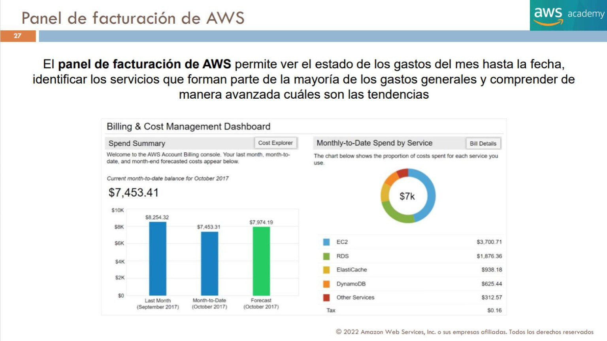
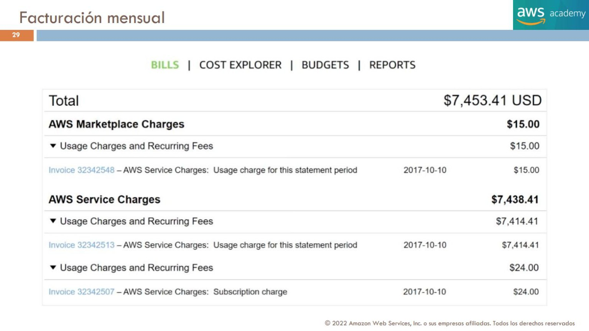
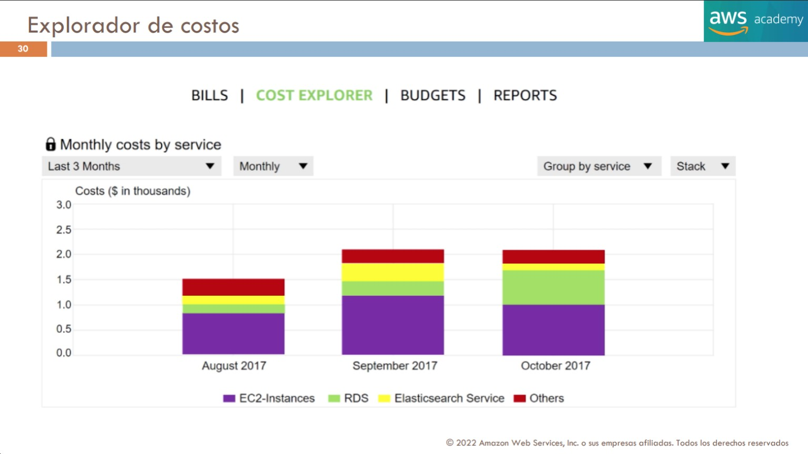
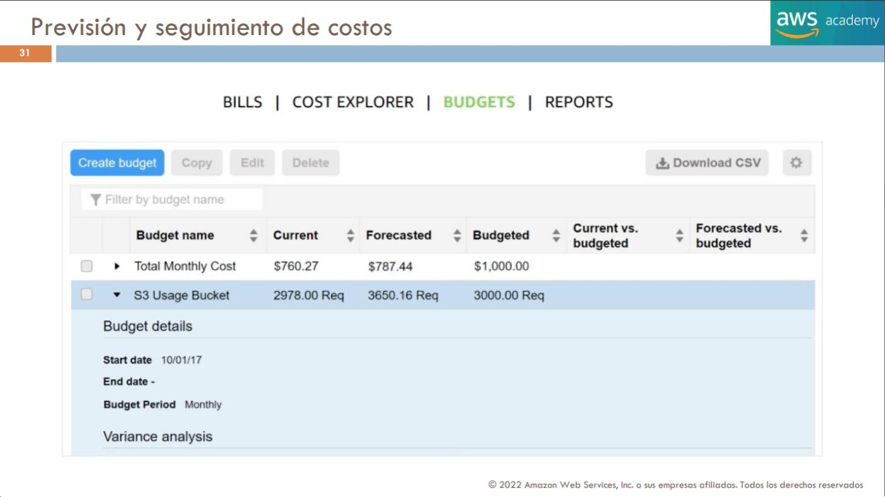
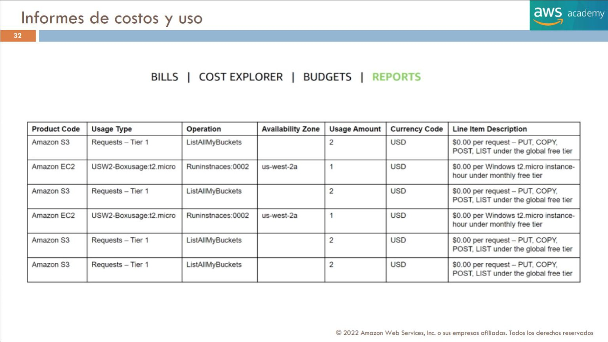

# 17. Facturación, presupuestos y administración de costes

[Índice](00_indice.md) · [TCO](16_tco_y_optimizacion_de_costes.md) · [Soporte](18_soporte_y_recursos_aws.md) · Objetivo principal: **4.2**.

Una organización necesita estimar antes de desplegar, observar durante la operación, atribuir responsabilidades y conciliar después la factura. AWS ofrece herramientas diferentes para cada fase. Conocer solo sus nombres no basta: se debe entender qué datos utilizan, qué pregunta resuelven y qué límites tienen. Este capítulo integra T4 pp.26–32 y T2 p.19 con documentación oficial consultada el **03-11-2026**.

## 17.1 Elegir la herramienta según la decisión

**[FUENTE DOCENTE]** T4 p.26 presenta Billing and Cost Management como un conjunto para pagar, supervisar, presupuestar y prever. T4 p.28 y T2 p.19 distinguen Cost Explorer, Budgets y el informe de coste y uso. La distinción debe mantenerse aunque todas estas funciones se encuentren dentro de una misma consola.

| Necesidad | Herramienta o recurso | Resultado esperado | No equivale a |
|---|---|---|---|
| Estimar una arquitectura propuesta | AWS Pricing Calculator y páginas de precios | Estimación con cantidades y supuestos | Una factura del consumo real |
| Consultar cargos y pagos | Billing, Bills, facturas y Payments | Información de facturación y liquidación | Una recomendación automática de diseño |
| Investigar evolución del gasto | AWS Cost Explorer | Filtros, agrupaciones, informes y previsión | Un bloqueo universal de consumo |
| Vigilar umbrales deseados | AWS Budgets | Seguimiento y avisos; acciones opcionales compatibles | Un límite instantáneo de toda la cuenta |
| Analizar líneas detalladas | AWS CUR y Data Exports/CUR 2.0 | Datos para conciliación y análisis | Un correo de alerta por cada operación |
| Asignar gasto a responsables | Cost allocation tags y Cost Categories | Dimensiones de imputación | Una política de autorización |
| Advertir cambios atípicos | Cost Anomaly Detection | Anomalías y posibles factores | Una protección que por sí sola detenga el recurso |
| Priorizar mejoras económicas | Cost Optimization Hub | Recomendaciones y ahorro estimado | Un ahorro realizado antes de cambiar nada |

**[EXPLICACIÓN EDITORIAL]** Una empresa que aún no ha desplegado veinte servidores utiliza Calculator. Otra que ya los ejecuta y ve una subida comienza con Cost Explorer. Si necesita saber qué operaciones explican la diferencia, baja al detalle de exportaciones. Si desea enterarse antes de superar un umbral, configura Budgets; no espera a que la factura mensual le avise. Las herramientas son complementarias porque observan momentos y niveles de detalle distintos.

## 17.2 Billing: gasto acumulado, factura y pago

**[FUENTE DOCENTE]** T4 p.27 muestra gasto del mes, servicios principales y previsión; p.29 desglosa cargos de Marketplace y de servicios AWS. Un acumulado provisional no es lo mismo que el importe final de una factura ni que un pago ya efectuado.

**Figura histórica — T4 p.27.** La interfaz corresponde a octubre de 2017 dentro del material de 2022. El importe destacado de 7.453,41 USD y las barras de pasado/acumulado/previsión son datos del ejemplo. No se usan sus menús como navegación actual. [Fuente](fuentes/02_CORPUS_DOCENTE_POR_PAGINA.md#t4-p27).

**[ACTUALIZACIÓN OFICIAL]** Billing and Cost Management permite obtener facturas, revisar cargos y administrar preferencias de facturación, impuestos y pagos. Los permisos de consulta y gestión se conceden a las identidades apropiadas; no es necesario convertir a todo analista de costes en administrador de infraestructura. Para dudas o reclamaciones de cargos se utiliza soporte de cuenta/facturación. [Descripción de Billing](https://docs.aws.amazon.com/awsaccountbilling/latest/aboutv2/billing-what-is.html), [acceso a Cost Management](https://docs.aws.amazon.com/cost-management/latest/userguide/billing-getting-started.html).

### Descomponer un total sin duplicar sus subtotales

| Partida de T4 p.29 | Importe histórico, USD |
|---|---:|
| Marketplace | 15,00 |
| Servicios AWS | 7.438,41 |
| Uso y cargos recurrentes dentro de servicios | 7.414,41 |
| Otra partida de suscripción dentro de servicios | 24,00 |
| **Total de la captura** | **7.453,41** |

**[EXPLICACIÓN EDITORIAL]** 7.414,41 + 24 = 7.438,41; al sumar Marketplace se llega a 7.453,41. No se suman todas las filas de la tabla como si fueran independientes: dos son componentes de un subtotal. Esta distinción es esencial al conciliar exportaciones, resúmenes e importes de factura.

**Figura histórica — T4 p.29.** El ejemplo muestra que software de terceros y servicios pueden coexistir en la administración de cargos. No implica que todo contrato moderno tenga un único emisor ni que la licencia incluya infraestructura. [Fuente](fuentes/02_CORPUS_DOCENTE_POR_PAGINA.md#t4-p29).

Los costes observados pueden revisarse cuando llega información de uso, se aplican créditos, descuentos o ajustes. Al comparar dos informes se fijan periodo, moneda, ámbito de cuentas, impuestos y métrica. Si difieren, primero se comprueba si están respondiendo a la misma pregunta antes de concluir que la factura está equivocada.

## 17.3 Cost Explorer: explicar composición y tendencia

**[ACTUALIZACIÓN OFICIAL]** Cost Explorer permite analizar costes y uso mediante gráficos e informes. Se filtra y agrupa por dimensiones disponibles, como servicio, cuenta, región o etiquetas activadas. Incluye previsiones basadas en historial y vistas de compromisos; los datos tienen latencia y no deben tratarse como telemetría instantánea. Su interfaz de análisis y el acceso API tienen condiciones de precio distintas. [Cost Explorer](https://docs.aws.amazon.com/cost-management/latest/userguide/ce-what-is.html).

**[EXPLICACIÓN EDITORIAL]** Si el gasto aumenta un 30 %, se empieza con el mismo periodo comparable: un mes de 31 días puede contener más horas que uno de 28. Después se agrupa por servicio para localizar el cambio; por cuenta y región para atribuirlo; y por tipo de uso u otra dimensión para encontrar la causa. Un aumento en EC2 puede venir de más horas o de recursos asociados, mientras un coste S3 puede crecer por solicitudes sin gran aumento de GB almacenados.

**Figura histórica — T4 p.30.** Las barras de agosto–octubre de 2017 están etiquetadas EC2-Instances, RDS, **Elasticsearch Service** y Others. Se utiliza la leyenda leída en la imagen; la mención genérica de ElastiCache en la ficha del corpus no es la leyenda de esta captura. La variación de color explica composición, no prueba por sí sola una causa técnica. [Fuente](fuentes/02_CORPUS_DOCENTE_POR_PAGINA.md#t4-p30).

### Coste no amortizado, amortizado y neto

**[ACTUALIZACIÓN OFICIAL]** Una compra anticipada puede aparecer como un pico cuando se factura. La vista amortizada distribuye el coste del compromiso a lo largo del periodo para analizar su consumo económico. La vista no amortizada conserva otra perspectiva del cargo. Las métricas netas incluyen descuentos pertinentes y la blended refleja promedios de la familia consolidada. No son monedas diferentes ni valores intercambiables. [Opciones avanzadas](https://docs.aws.amazon.com/cost-management/latest/userguide/ce-advanced.html).

**[EXPLICACIÓN EDITORIAL — ejemplo ficticio]** Se paga por adelantado 1.200 unidades por un compromiso de doce meses. Para explicar su distribución económica puede pensarse en 100 por mes en un modelo simplificado, aunque el desembolso se produzca al inicio. Si un equipo compara enero con febrero en una vista de cargos, verá un salto distinto del que muestra una vista amortizada. El reparto real del informe se rige por las reglas del producto; el ejemplo solo explica por qué hay perspectivas distintas.

Una previsión extrapola a partir de datos disponibles: no conoce automáticamente una campaña futura, una migración decidida ayer o un nuevo contrato. Calculator ayuda a modelar esos cambios explícitos. Por eso una previsión y una estimación de diseño pueden diferir sin que ninguna de las dos sea una factura equivocada.

## 17.4 AWS Budgets: seguimiento de objetivos y avisos

**[FUENTE DOCENTE]** T4 p.31 compara valor actual, previsto y presupuestado. Incluye un presupuesto monetario y otro de solicitudes S3. Es una diferencia importante: vigilar gasto y vigilar cantidad de uso no son exactamente lo mismo.

| Presupuesto de la captura | Actual histórico | Previsión histórica | Presupuestado |
|---|---:|---:|---:|
| Coste mensual total | 760,27 USD | 787,44 USD | 1.000,00 USD |
| Uso de bucket S3 | 2.978 solicitudes | 3.650,16 solicitudes | 3.000 solicitudes |

La previsión fraccionaria de solicitudes es resultado de un cálculo, no la afirmación de que una llamada pueda ejecutarse parcialmente. En el primer presupuesto, la previsión permanece bajo la cantidad objetivo; en el segundo, supera el límite aun cuando el valor actual todavía no lo ha hecho.

**Figura histórica — T4 p.31.** La tabla ilustra la distinción actual/previsto/presupuestado y no un mecanismo de corte automático. [Fuente](fuentes/02_CORPUS_DOCENTE_POR_PAGINA.md#t4-p31).

**[ACTUALIZACIÓN OFICIAL]** Budgets admite objetivos de costes, uso y métricas de compromisos. Los avisos pueden basarse en gasto real o previsto y enviarse a destinatarios o mediante SNS. Dependen de la actualización de facturación y, para previsiones, de historial suficiente. Los umbrales, inclusiones de cargos y periodicidad deben corresponder al objetivo del equipo. [Buenas prácticas](https://docs.aws.amazon.com/cost-management/latest/userguide/budgets-best-practices.html).

**[EXPLICACIÓN EDITORIAL — ejemplo]** Un presupuesto de 100 unidades con alerta real al 80 % avisa al alcanzarse el umbral en los datos procesados. Una alerta de previsión al 100 % puede advertir antes de haber gastado 100 si la proyección apunta a superarlo. No son señales duplicadas: una describe lo ya observado y otra una trayectoria probable. El equipo decide quién recibe el aviso y qué hace cuando llega; una dirección sin responsable no constituye control operativo.

### Acciones y límites de automatización

**[ACTUALIZACIÓN OFICIAL]** Budgets puede ejecutar acciones compatibles de forma automática o con aprobación, como aplicar políticas IAM/SCP o actuar sobre determinadas instancias EC2/RDS dentro de su alcance. Requiere permisos y configuración. Detener una instancia no elimina sus discos, un compromiso ni otros recursos; además, un grupo Auto Scaling puede intentar reemplazar capacidad detenida. [Acciones de Budgets](https://docs.aws.amazon.com/cost-management/latest/userguide/budgets-controls.html).

**[EXPLICACIÓN EDITORIAL]** Bloquear nuevos lanzamientos evita una clase de crecimiento, pero no impide solicitudes a recursos ya activos ni borra una suscripción. Existe latencia entre consumo, medición, evaluación y acción. Por tanto, un presupuesto de 100 no garantiza una factura máxima de 100.

La nueva experiencia de AWS Settings tiene **spend limits de proyecto**, que la documentación describe como un tipo de AWS Budgets, con controles y condiciones específicos. No deben confundirse con un presupuesto convencional que solo envía avisos: pueden pausar recursos del proyecto según sus reglas. Tampoco se traslada ese comportamiento a toda cuenta, servicio o presupuesto. Véanse [límites de gasto en AWS Settings](https://docs.aws.amazon.com/accounts/latest/reference/create-spend-limit.html). Este bloque no configura esos controles ni comprueba su eficacia con recursos reales.

## 17.5 CUR, Data Exports y CUR 2.0: detalle para análisis

**[FUENTE DOCENTE]** T4 p.32 muestra filas con producto, uso, operación, AZ, cantidad, moneda y descripción. El interés es poder bajar del total mensual a las unidades que lo forman. Los ejemplos visibles de coste cero están ligados al Free Tier histórico; no son una tarifa general vigente para esas operaciones.

| Columna docente | Qué permite investigar |
|---|---|
| Product Code | Servicio al que pertenece una línea |
| Usage Type | Dimensión o tipo de uso medido |
| Operation | Operación asociada, cuando corresponde |
| Availability Zone | Ubicación zonal disponible para esa línea |
| Usage Amount | Cantidad medida en su unidad |
| Currency Code | Moneda del registro |
| Line Item Description | Descripción del concepto aplicado |

**Figura histórica — T4 p.32.** Las filas S3 y EC2 contienen nomenclatura y franquicias de su momento. No se presenta este esquema reducido como la lista completa de columnas de CUR moderno. [Fuente](fuentes/02_CORPUS_DOCENTE_POR_PAGINA.md#t4-p32).

**[ACTUALIZACIÓN OFICIAL]** El CUR tradicional entrega información detallada a S3 para analizar uso y costes, con actualizaciones hasta la finalización de cargos y posibles ajustes. Puede consultarse con herramientas de datos; no debe sumarse indiscriminadamente cada versión acumulativa del mismo periodo. [Funcionamiento de CUR](https://docs.aws.amazon.com/cur/latest/userguide/what-is-cur.html).

AWS Data Exports permite seleccionar información y crear exportaciones recurrentes. **CUR 2.0** es la forma recomendada de obtener datos detallados dentro de esa oferta; no es un alias de todo Data Exports, que también publica otros conjuntos. Se pueden seleccionar columnas y filas y almacenar resultados en S3. [Data Exports](https://docs.aws.amazon.com/cur/latest/userguide/what-is-data-exports.html).

**[EXPLICACIÓN EDITORIAL]** Para conciliar una subida se identifica servicio, cuenta, periodo, tipo de línea y cantidad. Un registro de uso cubierto por descuento y un cargo de compromiso son piezas de una misma facturación, no dos recursos independientes. Una exportación filtrada puede omitir costes: al compartir solo datos de un proyecto no se llama a su suma «factura total de la organización».

Los informes requieren controlar acceso y almacenamiento como cualquier conjunto de datos de negocio. Exportar a S3 no convierte la consulta posterior en gratuita: almacenamiento y herramientas analíticas tienen sus condiciones. Athena permite consultas y herramientas de visualización pueden construir paneles, pero el detalle tabular, la consulta y la presentación son capas diferentes. No hace falta montar un almacén analítico para responder una consulta sencilla que Cost Explorer ya resuelve.

## 17.6 Etiquetas de asignación: identificar quién consume

**[ACTUALIZACIÓN OFICIAL]** Una etiqueta tiene clave y valor. Las de asignación de costes pueden ser definidas por el usuario o generadas por AWS; deben activarse según las reglas de Billing para aparecer en los informes correspondientes. Aplicar etiquetas a recursos y activarlas para imputación son pasos distintos. La presencia de una etiqueta no cambia la tarifa ni otorga permisos por sí sola. [Cost allocation tags](https://docs.aws.amazon.com/awsaccountbilling/latest/aboutv2/cost-alloc-tags.html).

**[EXPLICACIÓN EDITORIAL]** Un conjunto coherente puede usar `proyecto=tienda`, `entorno=produccion` y `responsable=equipo-web`. Así se relaciona gasto de instancias, discos u otros recursos compatibles con una aplicación. Si cada equipo escribe valores diferentes para el mismo proyecto, el informe lo fragmentará. Se acuerdan convenciones, responsables y tratamiento de costes sin etiqueta.

No todos los cargos se asignan limpiamente a un recurso etiquetable. Soporte, compromisos o infraestructura compartida pueden necesitar reglas adicionales. Tampoco debe suponerse una reconstrucción retroactiva completa por añadir hoy una etiqueta: se comprueban disponibilidad temporal y funciones de backfill aplicables. El capítulo no promete un resultado histórico que no se haya consultado en la cuenta.

Una etiqueta puesta en el **objeto presupuesto** para controlar acceso a él no es automáticamente una etiqueta de asignación de todos los recursos supervisados. Es importante distinguir el recurso etiquetado, el objetivo del tag y el informe donde se desea verlo. El campo «sin asignar» representa un problema de gobierno que debe resolverse, no gasto que pueda desaparecer del total.

## 17.7 Cost Categories y reparto de costes compartidos

**[ACTUALIZACIÓN OFICIAL]** Cost Categories organiza costes con reglas que reflejan estructuras de negocio, utilizando dimensiones como cuentas, servicios y etiquetas. Puede crear agrupaciones utilizables en herramientas de coste. No requiere renombrar todos los recursos físicos para representar, por ejemplo, una unidad de negocio. [Cost Categories](https://docs.aws.amazon.com/awsaccountbilling/latest/aboutv2/manage-cost-categories.html).

**[EXPLICACIÓN EDITORIAL]** Una unidad puede usar tres cuentas; otra, una cuenta y recursos de una plataforma compartida. Las etiquetas identifican atributos de recursos y las categorías expresan reglas de imputación. Una OU de Organizations agrupa cuentas para gobierno, pero no debe tratarse como si trasladara automáticamente dinero entre presupuestos. La regla financiera debe estar definida y comprobada.

**Caso ficticio de reparto.** Dos equipos consumen 600 y 300 unidades directas y comparten una plataforma de 100. Si la organización decide asignar el coste común en proporción 2:1, imputa aproximadamente 66,67 y 33,33, dando 666,67 y 333,33. El total permanece en 1.000. Si también se suma la plataforma de 100 al informe final, se contaría dos veces. Otra organización puede repartir por usuarios, peticiones o cuota fija; es una decisión de contabilidad interna, no una tarifa que AWS haya fijado para esos equipos.

Mostrar el reparto para informar se denomina habitualmente **showback**; repercutirlo internamente como cargo, **chargeback**. Cambiar la imputación no cambia necesariamente la factura que paga la cuenta de administración. Para evaluar eficiencia se mantienen reglas estables y se explica cualquier cambio de criterio entre meses.

## 17.8 Facturación consolidada con Organizations

**[ACTUALIZACIÓN OFICIAL]** La cuenta de administración paga cargos de cuentas miembro y obtiene una visión agregada, con desglose por cuenta. La consolidación puede agregar uso elegible para descuentos y no añade una cuota propia por consolidar. «Una factura» tiene matices: la documentación distingue emisores o **seller of record (SOR)**; con varios puede haber una por emisor. No se fusionan recursos ni se abren permisos técnicos entre miembros por pagar juntos. [Facturación consolidada](https://docs.aws.amazon.com/awsaccountbilling/latest/aboutv2/consolidated-billing.html).

**[EXPLICACIÓN EDITORIAL]** Cinco proyectos mantienen cuentas separadas para aislar recursos y responsabilidades. Finanzas centraliza pagos; cada equipo ve el ámbito permitido. El detalle de costes por cuenta no desaparece. Si todos usan una misma familia de servicios con niveles de volumen compatibles, agregar uso puede mejorar condiciones, pero no significa que todas las tarifas de todos los servicios se mezclen en una única escala.

Las OU y SCP se estudian en el [Bloque II](../bloque-2/06_identidad_y_acceso.md). Una SCP establece límites de autorización; no es un motor para repartir descuentos. Consolidación, acceso a informes y política de imputación son funciones diferentes y requieren configuración apropiada.

### Beneficios RI y Savings Plans compartidos

**[ACTUALIZACIÓN OFICIAL]** La cuenta de administración controla las preferencias de compartición. La documentación contempla organización completa, controles por cuenta y grupos, con modos de prioridad o restricción. El beneficio favorece primero el uso compatible de la cuenta propietaria y después se distribuye según reglas y elegibilidad. No se promete que compartir ocurra siempre. [Compartición de descuentos](https://docs.aws.amazon.com/awsaccountbilling/latest/aboutv2/ri-turn-off.html).

**[EXPLICACIÓN EDITORIAL]** Si una cuenta compró descuento para una demanda que baja y otra tiene uso compatible, compartir puede mejorar utilización. Si una política restringe el beneficio a un grupo, puede quedar compromiso sin utilizar mientras otro grupo paga On-Demand. Esa elección puede obedecer a separación financiera, pero tiene consecuencias de coste. No se confunde compartir un descuento con compartir automáticamente capacidad zonal o acceso a un servidor.

## 17.9 Anomalías y recomendaciones: dos señales diferentes

**[ACTUALIZACIÓN OFICIAL]** Cost Anomaly Detection utiliza patrones de gasto para detectar desviaciones y alertar. Analiza datos de costes procesados y puede tener demora; no es un detector de seguridad en tiempo real. Cost Optimization Hub agrega y prioriza oportunidades, incorporando condiciones económicas y evitando sumar propuestas relacionadas como ahorros independientes. [Anomalías](https://docs.aws.amazon.com/cost-management/latest/userguide/manage-ad.html), [Hub](https://docs.aws.amazon.com/cost-management/latest/userguide/cost-optimization-hub.html).

**[EXPLICACIÓN EDITORIAL]** Una anomalía dice «este patrón de gasto merece investigación». Un presupuesto dice «este valor supera el objetivo definido». Una recomendación dice «hay una alternativa potencialmente más eficiente». Pueden aparecer juntas o por separado. Un gasto inesperado de 40 puede ser anómalo sin superar un presupuesto de 500; un crecimiento previsto puede superar un presupuesto y no resultar anómalo.

Si se sospecha uso indebido, se investiga la causa y se aplican procedimientos de seguridad; no se considera resuelto porque el gasto vuelva a bajar. Si la causa es un despliegue legítimo, se actualiza estimación y presupuesto con autorización del responsable. El proceso convierte una notificación en una decisión, con evidencia de qué cambió y por qué.

## 17.10 Caso integrado: de la previsión a la conciliación

**[EXPLICACIÓN EDITORIAL — actividad desarrollada]** Una organización lanza un portal en tres cuentas: producción, desarrollo y plataforma. Antes de construir prepara Calculator con horas, datos, peticiones, región y compra prevista. Se guarda una versión y se añade el trabajo operativo para TCO. Una estimación de consumo no se reutiliza como saldo real del mes.

Al desplegar aplica etiquetas de proyecto y entorno donde corresponde, activa su uso en costes y establece categorías para cuentas y plataforma. Define presupuestos por responsable con avisos reales y previstos y confirma quién atenderá cada notificación. Conserva una regla explícita para soporte, compromisos y gastos comunes sin recursos etiquetados.

Una semana después aparece un aumento. Cost Explorer localiza la cuenta, servicio y tipo de uso; una exportación detallada permite revisar los componentes que no explica el gráfico. Se descubre que una tarea de desarrollo dejó recursos activos. Antes de apagarlos se confirma su función, se conserva lo necesario y se corrige la política de horario. Si había compromiso de compra, se revisa su utilización: reducir horas no cancela la obligación.

En el cierre mensual se concilian cargos con la misma moneda, ámbito y métrica. Se separan licencia Marketplace, uso AWS, créditos, impuestos y reparto interno. La suma de proyectos y costes compartidos debe reconciliarse con el total correspondiente sin duplicar subtotales. Finalmente se compara lo observado con los supuestos iniciales y se actualiza el próximo periodo.

Este flujo permite explicar **qué se estimó, qué se consumió, quién lo causó, qué se pagó y qué se corregirá**. Cada herramienta aporta una parte, y ninguna sustituye por sí sola toda la administración económica.
