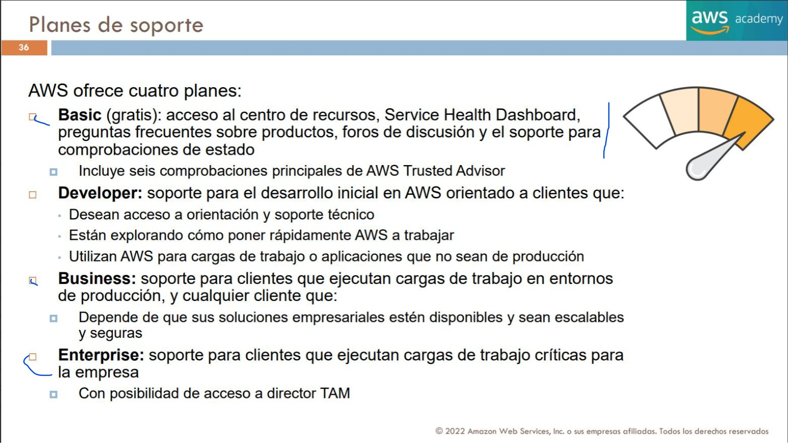
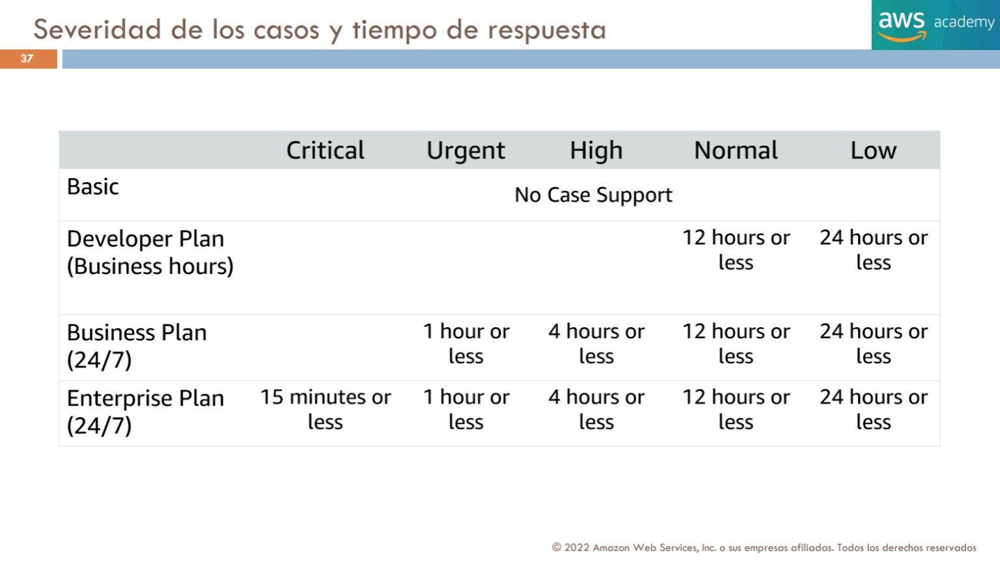
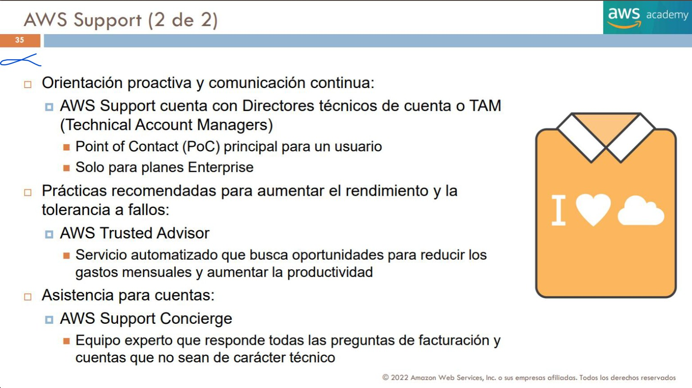

# 18. Soporte, recursos técnicos y ecosistema AWS

[Índice](00_indice.md) · [Facturación](17_facturacion_presupuestos_y_costes.md) · Objetivo principal: **4.3**.

La asistencia de AWS incluye recursos públicos de aprendizaje, atención a cuentas y facturación, soporte técnico, acompañamiento especializado y un ecosistema de socios. Elegir correctamente requiere identificar el problema y el tipo de relación que se necesita. Este capítulo desarrolla T4 pp.34–37 y las ampliaciones oficiales, separando la oferta histórica de 2022 de la publicada el **3 de noviembre de 2026**.

## 18.1 Qué necesidad se intenta resolver

**[FUENTE DOCENTE]** T4 p.34 presenta soporte para experimentar, operar producción y mantener cargas críticas. La asistencia combina herramientas y personas; la profundidad y prioridad dependen de la necesidad y del plan. T4 p.35 introduce TAM, Trusted Advisor y Concierge, que no son nombres intercambiables para un mismo equipo.

**[EXPLICACIÓN EDITORIAL]** Una duda sobre una factura necesita atención de cuenta/facturación. Un fallo productivo requiere un caso técnico con severidad y contexto. Un proyecto de migración con entregables puede requerir Professional Services o un integrador. Un diseño aún no construido puede beneficiarse de documentación y orientación arquitectónica. Enviar todos esos asuntos a un foro o a un único canal no es una estrategia de soporte.

La selección forma parte del TCO: se consideran criticidad, horario, conocimientos internos, acompañamiento y coste del plan. Pagar soporte no sustituye una arquitectura con redundancia y recuperación. Tampoco transforma a AWS en administrador ilimitado de cualquier aplicación del cliente; se consulta alcance y responsabilidades del servicio contratado.

## 18.2 Planes publicados actualmente

**[ACTUALIZACIÓN OFICIAL — 03-11-2026]** La documentación identifica **Basic, AWS Business Support+, AWS Enterprise Support y AWS Unified Operations**. Los planes técnicos añaden prestaciones sobre la base de atención a cuentas y recursos. Las condiciones comerciales, idioma y región deben comprobarse; la tabla siguiente explica su orientación sin prometer prestaciones idénticas en cualquier contrato. [Planes oficiales](https://docs.aws.amazon.com/awssupport/latest/user/aws-support-plans.html).

| Plan | Necesidad que ayuda a cubrir | Distinción para estudiarlo |
|---|---|---|
| Basic | Cuenta/facturación y recursos de autoservicio | Incluido para clientes; no equivale a casos técnicos de producción con los plazos de planes superiores |
| Business Support+ | Asistencia técnica 24/7 y herramientas para operar cargas | Acceso a expertos y asistencia contextual; no incluye por esa sola razón un TAM designado |
| Enterprise Support | Cargas críticas con orientación estratégica | TAM designado y acompañamiento empresarial, además de soporte técnico |
| Unified Operations | Operación de cargas de máxima criticidad con conocimiento específico | Especialistas designados, revisiones y procedimientos operativos de mayor alcance |

Basic ofrece recursos como documentación, comunidades, salud de servicios y atención a cuenta/facturación. Decir «Basic no tiene casos técnicos» no debe convertirse en «AWS no me ayudará con una factura». Business Support+ incorpora acceso técnico por canales publicados y un conjunto ampliado de herramientas; Enterprise añade relación estratégica con TAM. Las prestaciones se verifican en la oferta vigente, no mediante el número de comprobaciones de una lámina antigua.

**[ACTUALIZACIÓN OFICIAL]** Unified Operations combina especialistas y conocimiento contextual de cargas, monitorización y gestión de incidentes. La preparación incluye incorporar información y alarmas de las cargas; no es simplemente cambiar el nombre a Enterprise. El equipo puede incluir TAM, Domain Specialist Engineer e Incident Management Engineer con funciones diferentes. [Descripción de Unified Operations](https://docs.aws.amazon.com/awssupport/latest/user/unified-operations-intro.html).

**[EXPLICACIÓN EDITORIAL]** El TAM mantiene conocimiento y seguimiento de necesidades; un especialista de dominio profundiza en áreas técnicas concretas; un ingeniero de incidentes coordina actuación en situaciones pertinentes. No son tres alias de «agente de soporte». Una empresa que busca atención técnica ocasional tiene una necesidad distinta de otra que necesita acompañamiento continuo para cargas críticas.

### Cómo interpretar el precio del soporte

El plan se evalúa junto con su forma de cálculo: cuota mínima, base de cargos elegibles, porcentajes o condiciones de contratación y servicios adicionales, según oferta. No se calcula todo soporte con la antigua tabla de cuatro niveles ni se supone que toda organización pague una única cuota por estar consolidada. Se consulta [la comparación comercial](https://aws.amazon.com/premiumsupport/plans/) y la página de precios enlazada por AWS antes de contratar. En estos apuntes no se fijan cuotas como si fueran constantes del examen.

## 18.3 La tabla de 2022 y la transición de planes legados

**[FUENTE DOCENTE — HISTÓRICA]** T4 p.36 describe Basic para recursos y consultas de cuenta, Developer para desarrollo no productivo, Business para producción y Enterprise para cargas críticas con TAM. La lámina menciona seis comprobaciones principales de Trusted Advisor en Basic. Ese número pertenece a la fuente y no se usa como recuento actual.

**Figura histórica — T4 p.36.** Los cuatro nombres se conservan para interpretar la docencia de 2022. La oferta publicada actualmente se estudia en 18.2; Business no se trata como alias exacto de Business Support+. [Fuente](fuentes/02_CORPUS_DOCENTE_POR_PAGINA.md#t4-p36).

**[ACTUALIZACIÓN OFICIAL]** AWS anuncia final de soporte de **Developer, Business y Enterprise On-Ramp el 1 de enero de 2027** en el ámbito comercial indicado. En 2026 pueden persistir planes legados y procesos de transición. La documentación especifica continuidad de esos planes en **AWS GovCloud (US)**; no se presenta la retirada como idéntica para todas las regiones y clientes. Enterprise Support sigue siendo parte de la oferta: no debe confundirse con Enterprise On-Ramp. [Aviso de transición](https://docs.aws.amazon.com/awssupport/latest/user/support-plans-eos.html).

**[EXPLICACIÓN EDITORIAL]** Al estudiar una pregunta o una práctica antigua se identifica su fecha. Si el ejercicio usa Developer y Business, hay que comprender qué pretendía comparar y anotar su carácter histórico. Si pregunta por opciones publicadas actualmente, se usa la lista actual. La guía del examen puede actualizarse con un margen de aplicación: no se afirma que una fecha permita conocer preguntas concretas.

## 18.4 Severidad y primera respuesta no son resolución

**[FUENTE DOCENTE — HISTÓRICA]** T4 p.37 cruza severidad y plan. Se reconstruyen sus valores para conservar la tabla original sin convertirla en catálogo vigente.

| Plan de la lámina | Critical | Urgent | High | Normal | Low |
|---|---|---|---|---|---|
| Basic | Sin casos técnicos | Sin casos técnicos | Sin casos técnicos | Sin casos técnicos | Sin casos técnicos |
| Developer, horario empresarial | — | — | — | Hasta 12 h | Hasta 24 h |
| Business, 24/7 | — | Hasta 1 h | Hasta 4 h | Hasta 12 h | Hasta 24 h |
| Enterprise, 24/7 | Hasta 15 min | Hasta 1 h | Hasta 4 h | Hasta 12 h | Hasta 24 h |

Los guiones indican ausencia de valor en la celda del material; no «respuesta inmediata». En ese cuadro Developer no comparte el mismo alcance de severidad y horario que Business/Enterprise.

**Figura histórica — T4 p.37.** Permite leer las diferencias de acceso y urgencia. Sus plazos no se extrapolan a nuevos planes. [Fuente](fuentes/02_CORPUS_DOCENTE_POR_PAGINA.md#t4-p37).

**[ACTUALIZACIÓN OFICIAL]** Como contraste, la [comparación actual](https://aws.amazon.com/premiumsupport/plans/) publica para la categoría empresarial/de misión crítica caída objetivos de respuesta humana inferiores a 30 minutos en Business Support+, 15 en Enterprise y 5 desde Incident Management Engineer en Unified Operations. Las notas especifican esfuerzo razonable y condiciones de contexto/incorporación de cargas; estos valores no son tiempos garantizados de resolución.

**[EXPLICACIÓN EDITORIAL]** La primera respuesta inicia la interacción: confirma, pide datos o comienza investigación. La resolución puede requerir diagnóstico, corrección del cliente, cambio de configuración o recuperación. Un objetivo de respuesta de quince minutos no significa que el servicio esté operativo en quince minutos. Un SLA de disponibilidad de un servicio es otra cosa y tiene sus propios criterios y compensaciones.

La severidad se elige por impacto real: un fallo completo de producción es distinto de una duda general o una degradación sin interrupción. Describir correctamente impacto, inicio, región, recursos y cambios recientes ayuda a encaminar el caso. El cliente mantiene procedimientos de continuidad mientras se investiga; no espera pasivamente a un plazo de respuesta como si fuera una orden de restauración.

## 18.5 Support Center, TAM y atención de facturación

**[ACTUALIZACIÓN OFICIAL]** AWS Support Center permite abrir y seguir casos bajo los permisos y plan correspondientes. Se distinguen casos técnicos, cuestiones de cuenta/facturación y solicitudes pertinentes. La existencia del portal no significa que todas las cuentas puedan abrir cualquier clase de caso. Su documentación está en la [guía de AWS Support](https://docs.aws.amazon.com/awssupport/latest/user/).

**[FUENTE DOCENTE]** T4 p.35 presenta tres funciones: TAM como contacto y orientación proactiva en Enterprise, Trusted Advisor como revisión automatizada y Concierge como asistencia de cuenta/facturación. Mantener esa distinción evita recurrir al TAM para toda gestión o considerar una recomendación automática como un ingeniero asignado.

**Figura histórica — T4 p.35.** La referencia al TAM y Concierge se interpreta dentro de los planes y condiciones de la lámina. El alcance actual se comprueba por oferta. [Fuente](fuentes/02_CORPUS_DOCENTE_POR_PAGINA.md#t4-p35).

**[EXPLICACIÓN EDITORIAL]** Un caso técnico útil contiene síntoma, impacto, región, identificadores necesarios, hora con zona horaria, pruebas realizadas y cambios relacionados. No tiene que ser una transcripción de todo el sistema: se selecciona evidencia que permita reproducir o delimitar el problema. Durante el seguimiento se conserva la referencia del caso y se actualiza el impacto si cambia.

Support Concierge es una función de asistencia sobre cuenta y facturación bajo prestaciones pertinentes; no debe definirse como un servicio que parchea servidores. TAM mantiene una relación de orientación técnica y de negocio; no equivale a una suscripción Marketplace ni a un contratado que desarrolla toda la aplicación. Los nombres históricos ayudan a identificar papeles, pero no sustituyen revisar qué equipo incluye el plan actual.

## 18.6 Trusted Advisor, Health y observabilidad propia

La teoría de seguridad y supervisión se conserva en los [Bloques II](../bloque-2/07_seguridad_datos_y_cumplimiento.md) y [III](../bloque-3/14_integracion_y_otros_servicios.md). Aquí interesa cómo elegir el recurso de ayuda.

| Recurso | Pregunta a la que ayuda a responder | Alcance que se debe distinguir |
|---|---|---|
| Trusted Advisor | ¿Qué comprobaciones señalan oportunidades o riesgos de configuración? | Recomendaciones basadas en comprobaciones disponibles, no auditoría universal |
| AWS Health Dashboard | ¿Qué eventos de AWS afectan a servicios o recursos? | Estado, incidencias y cambios previstos; no todas las métricas de una aplicación |
| AWS Health API | ¿Cómo integrar esos eventos programáticamente? | Acceso sujeto a plan, permisos y endpoints |
| CloudWatch | ¿Qué muestran métricas, logs y alarmas de mi operación? | Observabilidad configurada del entorno, no catálogo de planes de soporte |
| Cost Explorer | ¿Cómo se distribuye y evoluciona el gasto? | Datos económicos, con latencia propia |

**[ACTUALIZACIÓN OFICIAL]** Trusted Advisor inspecciona condiciones y recomienda mejoras de coste, disponibilidad, rendimiento y seguridad, entre otras categorías del conjunto vigente. Basic tiene un subconjunto publicado; los planes superiores indicados acceden al conjunto ampliado. No se memoriza «seis checks» de la diapositiva como cifra actual ni se interpreta una comprobación satisfactoria como certificación de toda la arquitectura. [Trusted Advisor](https://docs.aws.amazon.com/awssupport/latest/user/trusted-advisor.html).

AWS Health Dashboard está disponible para los clientes y muestra eventos relevantes, incluidos cambios planificados. Los eventos públicos generales y los asociados a recursos/cuenta no son la misma vista. [Qué es AWS Health](https://docs.aws.amazon.com/health/latest/ug/what-is-aws-health.html).

La **Health API** permite integrar información con sistemas internos. La documentación exige Business Support+, Enterprise o Unified Operations, con excepciones para planes legados en ámbitos/transiciones indicados. Que el dashboard sea accesible no habilita automáticamente cualquier llamada API desde Basic. [Condiciones de Health API](https://docs.aws.amazon.com/health/latest/ug/health-api.html).

**[EXPLICACIÓN EDITORIAL]** Si una instancia consume mucha CPU, se mira observabilidad y contexto de aplicación. Si AWS comunica mantenimiento de un recurso, se revisa Health y se planifica respuesta. Si se busca una recomendación sobre recursos poco aprovechados, Trusted Advisor u otras herramientas de optimización pueden ayudar. Puede haber varias señales relacionadas, pero ninguna de ellas debe renombrarse como otra herramienta por ofrecer «monitorización» en un sentido amplio.

## 18.7 Localizar documentación, prácticas y ayuda técnica

**[ACTUALIZACIÓN OFICIAL]** La guía 4.3 exige identificar recursos oficiales y su uso. Los siguientes destinos cumplen funciones diferentes; una búsqueda eficaz empieza por el tipo de información que se necesita.

| Recurso oficial | Para qué resulta útil | Cómo interpretar lo encontrado |
|---|---|---|
| [AWS Documentation](https://docs.aws.amazon.com/) | Guías de usuario, operaciones API, conceptos y requisitos | Comprobar servicio, versión, región y condiciones |
| [Whitepapers](https://aws.amazon.com/whitepapers/) | Marcos y razonamiento de arquitectura, seguridad y operación | Orientación de diseño; no sustituyen cada parámetro de API |
| [AWS Blogs](https://aws.amazon.com/blogs/) | Anuncios, ejemplos y experiencias técnicas | Leer fecha y alcance; un lanzamiento no describe todo el estado posterior |
| [Prescriptive Guidance](https://aws.amazon.com/prescriptive-guidance/) | Patrones y recomendaciones para implementar cambios | Adaptar prerrequisitos, tareas y supuestos al entorno |
| [AWS re:Post](https://repost.aws/) | Preguntas y conocimiento de comunidad y expertos | Distinguir autoría y respuestas comunitarias de contenido oficial |
| Knowledge Center en re:Post | Artículos oficiales de resolución de problemas | Confirmar que el síntoma y escenario coinciden |
| [Architecture Center](https://aws.amazon.com/architecture/) | Diagramas y arquitecturas de referencia | Punto de partida que requiere dimensionamiento y revisión |

Desde 2023 AWS integró Knowledge Center en re:Post; no son dos bases completamente inconexas ni toda respuesta de re:Post es un artículo oficial. [Anuncio de integración](https://aws.amazon.com/about-aws/whats-new/2023/03/aws-re-post-includes-knowledge-center-articles/).

**[EXPLICACIÓN EDITORIAL]** Para configurar un parámetro se empieza por la guía y referencia del servicio. Para diseñar una estrategia de migración puede ayudar Prescriptive Guidance. Para investigar un error conocido se busca Knowledge Center y se cotejan condiciones. Si el problema sigue abierto y requiere asistencia contractual, se utiliza Support Center según plan. La comunidad amplía conocimiento, pero no ofrece por sí sola un compromiso de respuesta o resolución.

La validación de una afirmación necesita contenido que la respalde. Que una URL responda o pertenezca a AWS no demuestra que confirme cualquier frase que se le atribuya. Una tabla comercial antigua puede estar accesible y seguir siendo histórica; un blog puede describir condiciones de su fecha. Los apuntes conservan esa distinción también en su registro de fuentes.

## 18.8 Trust & Safety: reportar abuso de recursos

**[ACTUALIZACIÓN OFICIAL]** AWS Trust & Safety trata informes sobre uso abusivo de recursos AWS, por ejemplo spam, phishing o actividad de red maliciosa. El artículo oficial indica métodos de reporte y evidencia según el tipo de incidente. No es el equipo que presta consultoría arquitectónica ni el canal ordinario para aclarar una factura. [Cómo reportar abuso](https://www.repost.aws/knowledge-center/report-aws-abuse).

**[EXPLICACIÓN EDITORIAL]** Un informe útil identifica recursos o direcciones observadas, momento con zona horaria y evidencias pertinentes. El reporte no autoriza a investigar por cuenta propia sistemas ajenos ni garantiza un plazo exacto de retirada. Si el incidente afecta además a la operación de una cuenta propia, pueden existir acciones internas y casos de soporte con propósitos distintos. La clave del examen es reconocer el papel de Trust & Safety, no confundirlo con Health o una alarma CloudWatch.

## 18.9 Partners: fabricantes de software, integradores y servicios

**[ACTUALIZACIÓN OFICIAL]** AWS Partner Network —APN— reúne organizaciones que construyen productos o prestan servicios relacionados con AWS. Las rutas y programas reconocen actividades diferentes. Entre ellas están software e implantación/consultoría. La participación puede dar acceso a formación, certificación, apoyo comercial, eventos e incentivos según programa y elegibilidad. Los descuentos por volumen citados por la guía no son idénticos para todo partner ni se trasladan automáticamente a todos sus clientes. [Partner Paths](https://aws.amazon.com/partners/paths/), [programas de Partner Central](https://docs.aws.amazon.com/partner-central/latest/getting-started/partner-programs.html).

| Papel | Qué aporta | Ejemplo editorial |
|---|---|---|
| ISV, Independent Software Vendor | Desarrolla y comercializa software | Fabricante de una herramienta de seguridad o gestión |
| Integrador de sistemas | Conecta tecnologías, implanta y adapta soluciones | Empresa que une ERP, identidad, red y datos durante una migración |
| Consultoría o proveedor de servicios | Conocimiento, proyecto u operación según contrato | Equipo que diseña un plan de adopción o presta operación administrada |

**[EXPLICACIÓN EDITORIAL]** Los papeles pueden coexistir en la misma empresa: un ISV puede ofrecer servicios de implantación y un integrador vender un producto propio. Ser partner no implica que AWS haya construido su software ni que una solución tenga cumplimiento automático para cualquier cliente. Se evalúan capacidades, ámbito, soporte y condiciones de la oferta concreta.

Una empresa que necesita un producto busca su funcionalidad y licencia; otra que necesita migrar diez sistemas puede contratar a un integrador. Ambas pueden participar en el mismo proyecto, con responsabilidades diferentes. La cuota de AWS Support tampoco debe confundirse con lo que factura un proveedor de servicios por su trabajo.

## 18.10 Marketplace: adquisición, derechos de uso y gobierno

**[ACTUALIZACIÓN OFICIAL]** AWS Marketplace permite descubrir, comprar, desplegar y gestionar productos de terceros. Hay diferentes formatos, como software para instancias, contenedores o SaaS, y distintas formas de precio y contrato. El catálogo no significa que todo producto sea de AWS ni que una suscripción incluya los recursos necesarios para operarla. [FAQ de Marketplace](https://aws.amazon.com/marketplace/resources/faqs).

| Función | Qué se administra | Error que se evita |
|---|---|---|
| Descubrimiento y evaluación | Productos y condiciones que resuelven una necesidad | Elegir solo por pertenecer al catálogo |
| Adquisición | Suscripciones, acuerdos y ofertas aplicables | Confundir compra de licencia con toda la implantación |
| Cost management | Visibilidad de cargos y compromisos de terceros | Excluir software del TCO |
| Governance | Quién puede comprar y qué productos están aprobados | Suponer que cualquier usuario debe contratar cualquier oferta |
| Entitlement | Derecho contractual a utilizar prestaciones o cantidades | Confundir licencia adquirida con permiso IAM para operar recursos |

El gobierno puede utilizar catálogos privados aprobados y controles de acceso. La visibilidad de licencias ayuda a conocer qué software se posee y quién puede utilizarlo. La evaluación de proveedor y condiciones sigue siendo una responsabilidad del proceso de compra. [Gobierno y control en Marketplace](https://aws.amazon.com/marketplace/features/governance).

**[EXPLICACIÓN EDITORIAL]** Una AMI de tercero puede añadir licencia a horas EC2, almacenamiento y transferencia. Una suscripción SaaS puede facturarse de otra forma y tener límites por usuarios o capacidad. Una oferta privada es un acuerdo negociado, no un sinónimo de desplegar dentro de una subred privada. Cancelar o cambiar una suscripción exige revisar plazo, renovación y condiciones del contrato, además de terminar recursos que ya no se necesiten.

Si una empresa compra 100 puestos y solo asigna 40, puede tener un problema de aprovechamiento de licencia aunque EC2 esté bien dimensionado. Si el comprador no tiene permiso para desplegar, disponer del entitlement no reemplaza IAM. Esa separación entre dinero, derecho de uso y autorización técnica es el núcleo del gobierno de adquisiciones.

## 18.11 Professional Services y Solutions Architects

**[ACTUALIZACIÓN OFICIAL]** AWS Professional Services aporta conocimientos y trabajo profesional para iniciativas como adopción, migración y transformación, bajo una relación con alcance y condiciones. No es una extensión automática de Basic ni una promesa de que un caso técnico incluya un proyecto completo. [Professional Services](https://aws.amazon.com/professional-services/).

Los **Solutions Architects** ayudan a razonar sobre arquitectura y selección de servicios en los canales y relaciones disponibles. Su papel se diferencia del soporte de incidencias y de la ejecución contractual de un proyecto. La guía del examen los identifica como una opción de asistencia técnica, sin convertir toda consulta en una disponibilidad universal e ilimitada.

**[EXPLICACIÓN EDITORIAL]** Para resolver una incidencia de un recurso existente, el primer mecanismo puede ser un caso de soporte. Para revisar si una solución debe ser multirregión, puede servir orientación arquitectónica. Para ejecutar una migración con fechas, tareas y entregables, se evalúan Professional Services o partners. El cliente identifica responsable, alcance y resultados de cada relación antes de contar su coste y capacidad como parte de un plan operativo.

## 18.12 Casos de aplicación y selección de recursos

**[EXPLICACIÓN EDITORIAL — casos desarrollados, sin ampliar el banco de preguntas]** Un alumno quiere entender por qué una llamada falla. Consulta la documentación de la operación y un artículo oficial de Knowledge Center si coincide con el error. Puede contrastar dudas en re:Post, distinguiendo autoría. No necesita contratar una implantación profesional solo para leer una referencia API.

Un comercio detecta una caída crítica de producción. Reúne impacto y contexto, utiliza Support Center conforme a su plan y ejecuta sus procedimientos de continuidad. Revisa Health para saber si existen eventos relevantes y CloudWatch para observar su aplicación. La ausencia de un evento público no demuestra que el código del cliente esté bien, y la primera respuesta del caso no es el tiempo de recuperación.

Una empresa con muchas cargas críticas necesita acompañamiento y conocimiento continuo. Evalúa Enterprise o Unified Operations según criticidad, especialistas y alcance; un TAM es una función específica, no una etiqueta que todo soporte técnico incluya. El coste del plan se añade al TCO y se revisa junto con la capacidad del equipo interno.

Otro cliente quiere software de un tercero y su integración con sistemas existentes. Marketplace puede facilitar adquisición y gobierno; el ISV aporta producto y licencia; el integrador realiza trabajo de implantación acordado. Contratar uno de esos elementos no incluye implícitamente los otros. Si observa un sitio de phishing alojado en recursos AWS, recurre al procedimiento de Trust & Safety, no abre una consulta de diseño de arquitectura.

Saber escoger el recurso implica justificar **qué problema resuelve, qué evidencia necesita y qué no incluye**. Esa comprensión permite aplicar el objetivo 4.3 más allá de memorizar una tabla de nombres y plazos.
