# 02. Corpus docente de Economía y facturación: lectura visual desarrollada

> **Naturaleza:** notas docentes desarrolladas y estructuradas por página a partir de las diapositivas escaneadas, NO OCR corregido de cada carácter ni transcripción literal palabra por palabra. Se ha inspeccionado visualmente el material y se incluyen figuras para cotejo. Cada apartado diferencia contenido de la fuente y advertencias editoriales/de vigencia.

La fuente principal T4 corresponde a la presentación «Tema 4: Economía y facturación de la nube» (2022). Se registran también los apartados económicos de T6, T7, T8 y una lámina de T2. Para la teoría vigente debe leerse en paralelo `03_AMPLIACION_OFICIAL_DOMINIO_4.md`.

## T4: 37 diapositivas: eje docente completo sobre precio, TCO, herramientas de facturación y soporte

### T4 — página física 1: Portada

**[FUENTE DOCENTE — lectura visual desarrollada]** «Bloque de AWS. Tema 4: Economía y facturación de la nube». Es portada; no incorpora contenido técnico que memorizar.

**[NOTA DE VIGENCIA / CRITERIO EDITORIAL]** No atribuir conceptos de precios o planes a esta página.

PDF original: [`isT4.pdf`](../../../proceso/AWS_Bloque_IV_Para_Codex/pdf_originales/isT4.pdf).

### T4 — página física 2: Contenidos y secuencia

**[FUENTE DOCENTE — lectura visual desarrollada]** El temario se organiza en cuatro partes: aspectos básicos de los precios; costo total de propiedad; administración de facturación y costos de AWS; soporte técnico. Esta secuencia es la estructura docente que debe respetarse al redactar el Bloque IV.

**[NOTA DE VIGENCIA / CRITERIO EDITORIAL]** Es un índice, no una explicación de herramientas.

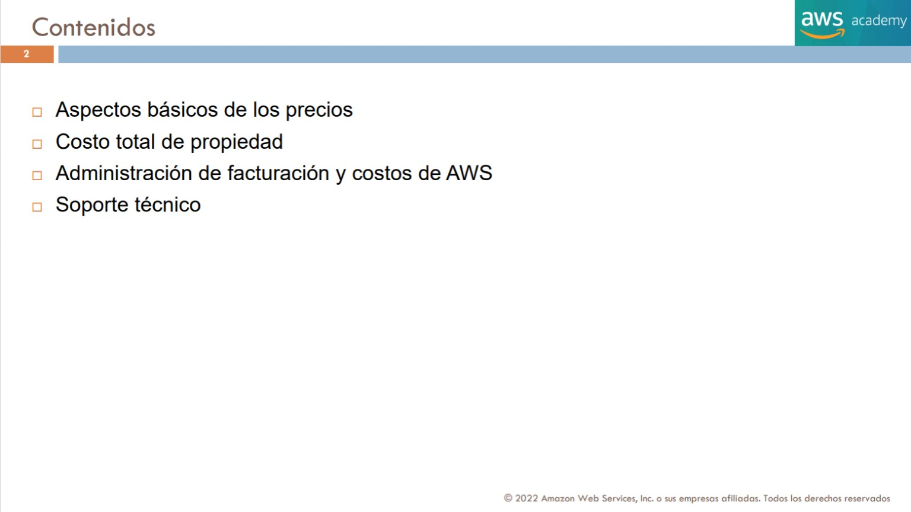

PDF original: [`isT4.pdf`](../../../proceso/AWS_Bloque_IV_Para_Codex/pdf_originales/isT4.pdf).

### T4 — página física 3: Separador: aspectos básicos de los precios

**[FUENTE DOCENTE — lectura visual desarrollada]** Introduce el bloque de precios. No aporta texto técnico adicional.

**[NOTA DE VIGENCIA / CRITERIO EDITORIAL]** Registrar como página administrativa.

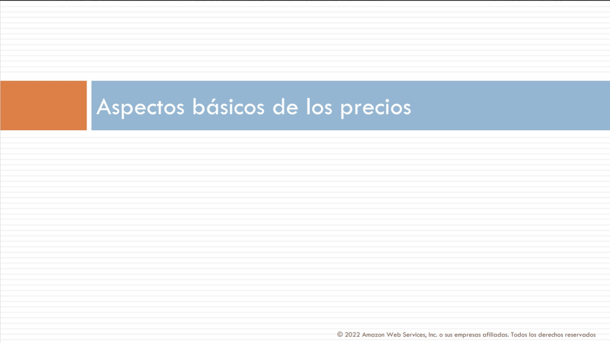

PDF original: [`isT4.pdf`](../../../proceso/AWS_Bloque_IV_Para_Codex/pdf_originales/isT4.pdf).

### T4 — página física 4: Modelo de precios: cómputo, almacenamiento y datos

**[FUENTE DOCENTE — lectura visual desarrollada]** La lámina enumera tres factores fundamentales: cómputo (facturación en función de tiempo y tipo de instancia), almacenamiento (normalmente según cantidad en GB) y transferencia de datos (por volumen transferido). Distingue tráfico de salida que puede generar cargo y entrada que no lo genera en muchos contextos del ejemplo. Añade la advertencia de que existen excepciones, incluso dentro de una misma región.

**[NOTA DE VIGENCIA / CRITERIO EDITORIAL]** El precio no depende exclusivamente de esos tres factores en todos los servicios; las tarifas y direcciones de transferencia requieren revisión por servicio, AZ y región. La mención histórica por hora/segundo no fija toda granularidad moderna.

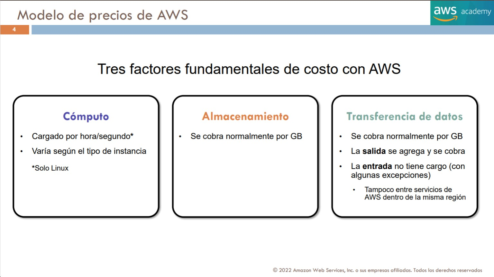

PDF original: [`isT4.pdf`](../../../proceso/AWS_Bloque_IV_Para_Codex/pdf_originales/isT4.pdf).

### T4 — página física 5: Tres maneras de pagar por AWS

**[FUENTE DOCENTE — lectura visual desarrollada]** El material ilustra «pague por lo que usa», «paga menos al reservar» y «paga menos cuando utiliza más y a medida que crece AWS». La idea es separar elasticidad de consumo, compromiso de capacidad/consumo y descuentos escalonados o economías de escala.

**[NOTA DE VIGENCIA / CRITERIO EDITORIAL]** No convertir «reservar» en una afirmación de que toda reserva implica capacidad física garantizada ni de que todas las familias se descuentan igual.

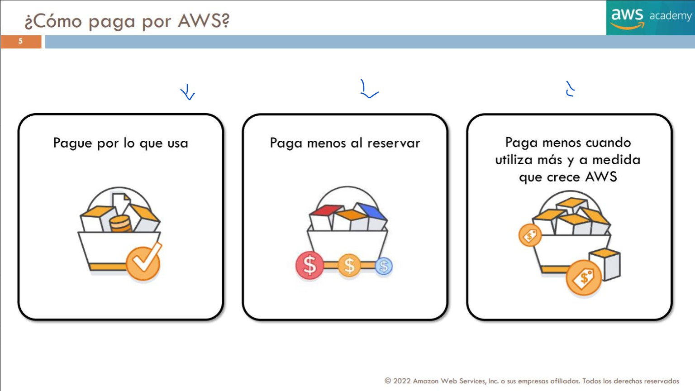

PDF original: [`isT4.pdf`](../../../proceso/AWS_Bloque_IV_Para_Codex/pdf_originales/isT4.pdf).

### T4 — página física 6: Pague por lo que usa: on-premises frente a nube

**[FUENTE DOCENTE — lectura visual desarrollada]** El gráfico compara un perfil de infraestructura tradicional con una inversión de capacidad anticipada frente a un perfil cloud ajustable a demanda. La idea de la fuente es evitar grandes desembolsos iniciales y adecuar la capacidad a necesidades fluctuantes.

**[NOTA DE VIGENCIA / CRITERIO EDITORIAL]** El dibujo es esquemático, no una prueba de que cada migración reduzca necesariamente su factura. AWS puede tener compromisos y costes fijos adicionales.

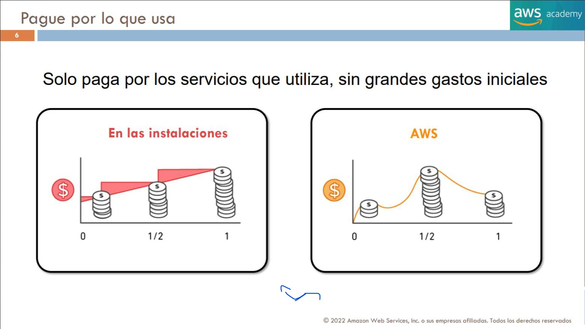

PDF original: [`isT4.pdf`](../../../proceso/AWS_Bloque_IV_Para_Codex/pdf_originales/isT4.pdf).

### T4 — página física 7: Pague menos al reservar: EC2 Reserved Instances

**[FUENTE DOCENTE — lectura visual desarrollada]** La diapositiva expone Reserved Instances en EC2, tres formas de pago: All Upfront (AURI), Partial Upfront (PURI) y No Upfront (NURI). Las relaciona con compromisos y distintos descuentos ilustrativos; el mayor adelanto suele tener condiciones de descuento diferentes.

**[NOTA DE VIGENCIA / CRITERIO EDITORIAL]** La cifra promocional «hasta un 75 %» es histórica. RI es principalmente un descuento de facturación, no una máquina física reservada automáticamente; distinguir de Capacity Reservations y Savings Plans.

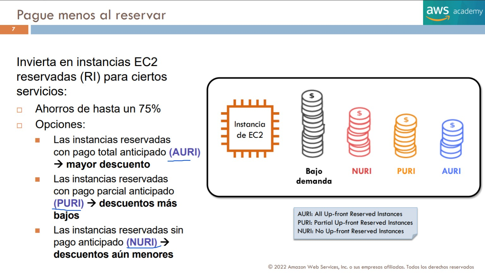

PDF original: [`isT4.pdf`](../../../proceso/AWS_Bloque_IV_Para_Codex/pdf_originales/isT4.pdf).

### T4 — página física 8: Pagar menos usando más: precios escalonados

**[FUENTE DOCENTE — lectura visual desarrollada]** La diapositiva menciona descuentos por volumen y niveles de precio en ejemplos de almacenamiento: S3, EBS y EFS. Su idea central es que, en dimensiones compatibles, el precio marginal por unidad puede variar con el volumen consumido.

**[NOTA DE VIGENCIA / CRITERIO EDITORIAL]** No inferir un descuento por GB en todas las clases de S3/EBS/EFS; comprobar las condiciones particulares. El menor coste de una clase de almacenamiento puede introducir costes de recuperación.

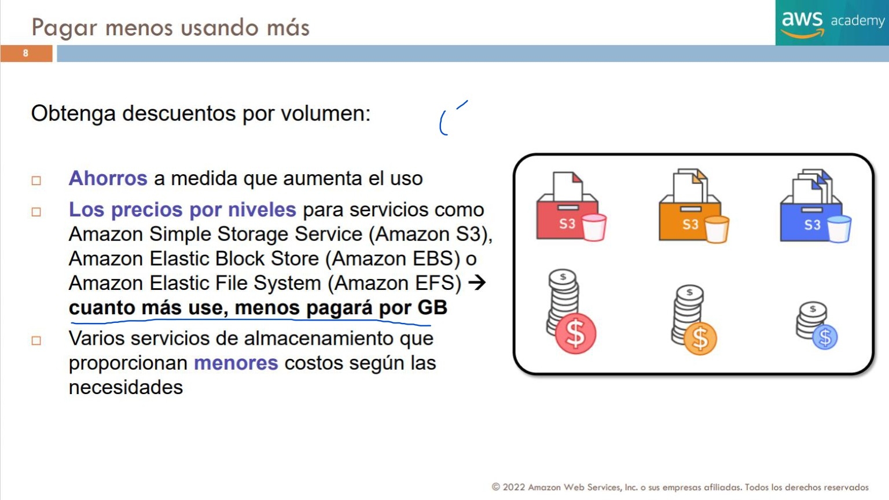

PDF original: [`isT4.pdf`](../../../proceso/AWS_Bloque_IV_Para_Codex/pdf_originales/isT4.pdf).

### T4 — página física 9: Economías de escala de AWS

**[FUENTE DOCENTE — lectura visual desarrollada]** Se explica que AWS puede optimizar hardware, eficiencia de CPD y operaciones y trasladar reducciones de costes a clientes. El material cita históricamente un número de bajadas de precios desde 2006 y sustitución por recursos de mejor rendimiento.

**[NOTA DE VIGENCIA / CRITERIO EDITORIAL]** Es argumento contextual de 2022; no usar «más de 75 bajadas» como dato actualizado a 2026 o garantía de que todos los precios bajarán.

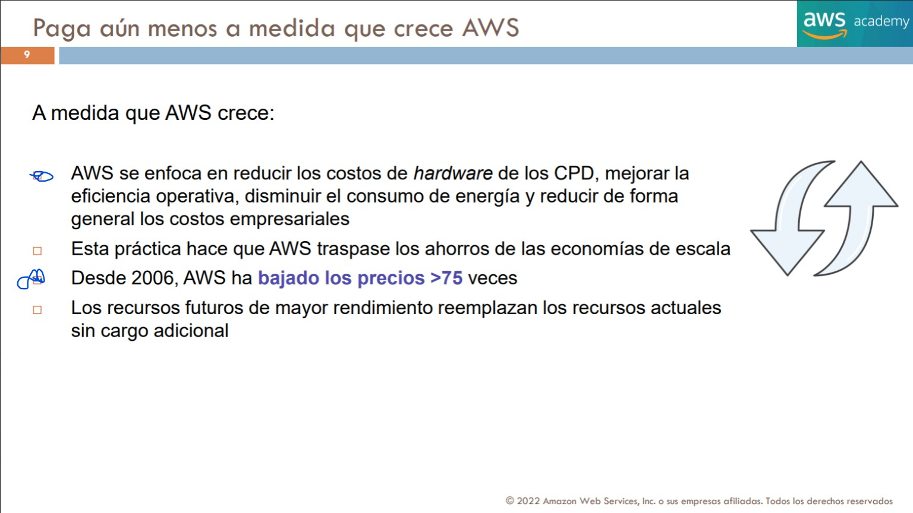

PDF original: [`isT4.pdf`](../../../proceso/AWS_Bloque_IV_Para_Codex/pdf_originales/isT4.pdf).

### T4 — página física 10: Nivel gratuito: inscripción y primeros pasos

**[FUENTE DOCENTE — lectura visual desarrollada]** La diapositiva de 2022 presenta una experiencia práctica gratuita y sugiere abrir cuenta, seguir tutoriales y empezar a crear. Expresa la idea introductoria de probar servicios con límites.

**[NOTA DE VIGENCIA / CRITERIO EDITORIAL]** ALERTA DE VIGENCIA: el mensaje de «gratis durante 1 año para clientes nuevos» no describe la totalidad de Free Tier en 2026. Ampliar con planes, créditos, límites y condiciones actuales, sin prometer coste cero para cualquier recurso.

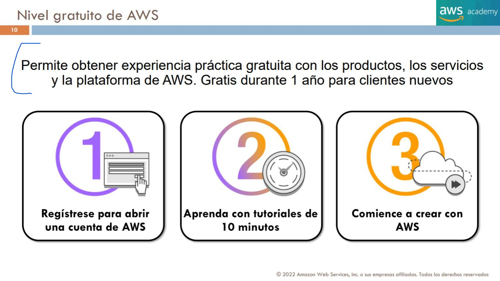

PDF original: [`isT4.pdf`](../../../proceso/AWS_Bloque_IV_Para_Codex/pdf_originales/isT4.pdf).

### T4 — página física 11: Servicios sin cargo adicional propio

**[FUENTE DOCENTE — lectura visual desarrollada]** La lámina lista Amazon VPC, Elastic Beanstalk, Auto Scaling, CloudFormation e IAM, con asteriscos que recuerdan posibles cargos de servicios subyacentes.

**[NOTA DE VIGENCIA / CRITERIO EDITORIAL]** «El servicio no tiene cargo adicional» no significa que VPC, IP públicas, NAT, EC2, volúmenes, capacidad gestionada, llamadas especiales, transferencias u otros recursos ligados a la arquitectura sean gratuitos. Debe revisarse cada componente.

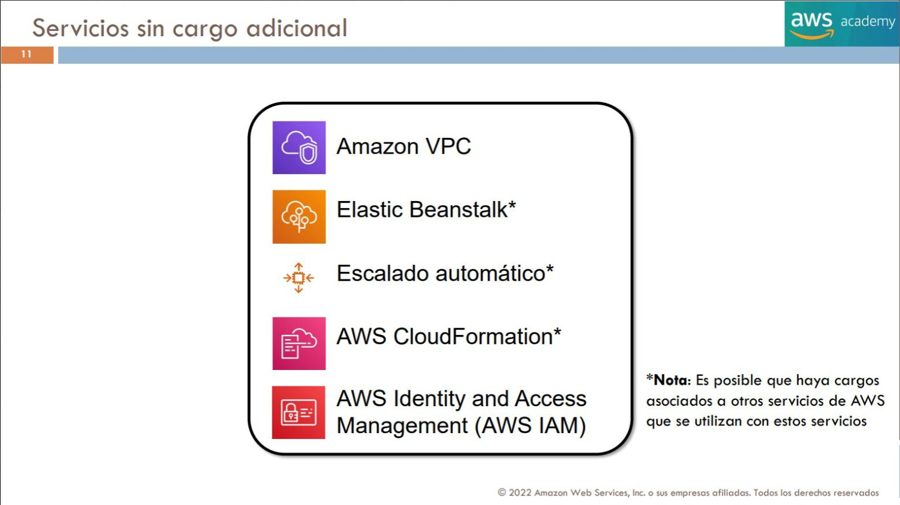

PDF original: [`isT4.pdf`](../../../proceso/AWS_Bloque_IV_Para_Codex/pdf_originales/isT4.pdf).

### T4 — página física 12: Separador: costo total de propiedad

**[FUENTE DOCENTE — lectura visual desarrollada]** Introduce la sección TCO. No aporta afirmaciones técnicas adicionales.

**[NOTA DE VIGENCIA / CRITERIO EDITORIAL]** Página administrativa.

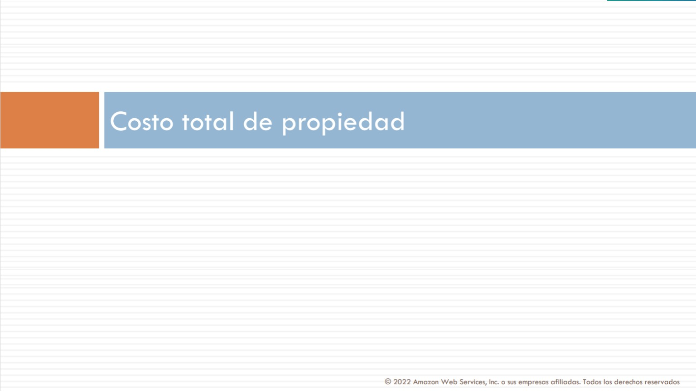

PDF original: [`isT4.pdf`](../../../proceso/AWS_Bloque_IV_Para_Codex/pdf_originales/isT4.pdf).

### T4 — página física 13: Infraestructura tradicional frente a AWS

**[FUENTE DOCENTE — lectura visual desarrollada]** Se contraponen categorías de costes on-premises (equipos, recursos y administración, contratos, optimización) con atributos de AWS (pago por uso, tiempo de comercialización, menos escalado vertical obligado e infraestructura de autoservicio).

**[NOTA DE VIGENCIA / CRITERIO EDITORIAL]** Es una comparación didáctica, no un dictamen de costes para todos los casos de uso.

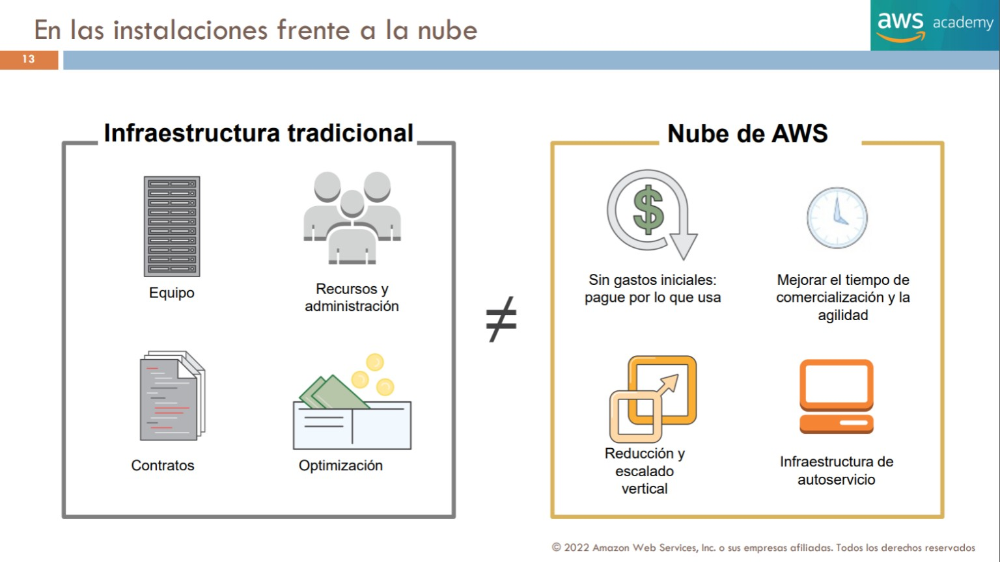

PDF original: [`isT4.pdf`](../../../proceso/AWS_Bloque_IV_Para_Codex/pdf_originales/isT4.pdf).

### T4 — página física 14: Definición y finalidad de TCO

**[FUENTE DOCENTE — lectura visual desarrollada]** TCO (Total Cost of Ownership) se define como una estimación financiera de costes directos e indirectos asociados a un producto o sistema durante su vida. Sirve para comparar infraestructura completa o una carga de trabajo específica y construir un caso empresarial de migración.

**[NOTA DE VIGENCIA / CRITERIO EDITORIAL]** No reducir TCO a precio de EC2 ni confundirlo con ROI: TCO es coste total; ROI relaciona beneficios y costes de una inversión.

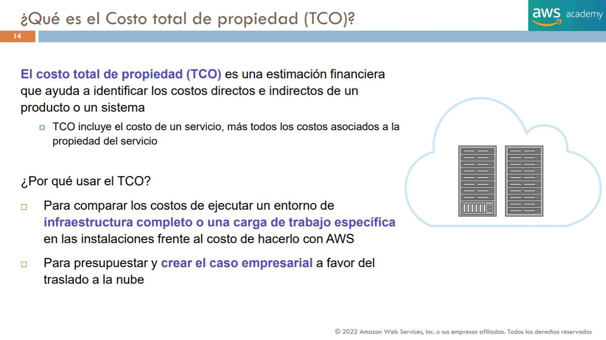

PDF original: [`isT4.pdf`](../../../proceso/AWS_Bloque_IV_Para_Codex/pdf_originales/isT4.pdf).

### T4 — página física 15: Desglose de TCO en CPD

**[FUENTE DOCENTE — lectura visual desarrollada]** Organiza los costes por servidores, almacenamiento, red y mano de obra de TI. En servidores aparecen hardware, software, mantenimiento, electricidad, refrigeración y espacio. En almacenamiento y red aparecen infraestructura física, administración y costes de instalaciones. La fila de TI señala trabajo de administración de servidores.

**[NOTA DE VIGENCIA / CRITERIO EDITORIAL]** No mezclar dos veces el mismo coste de energía o personal al calcular un escenario. Incluir costes de migración, operación y riesgo donde proceda.

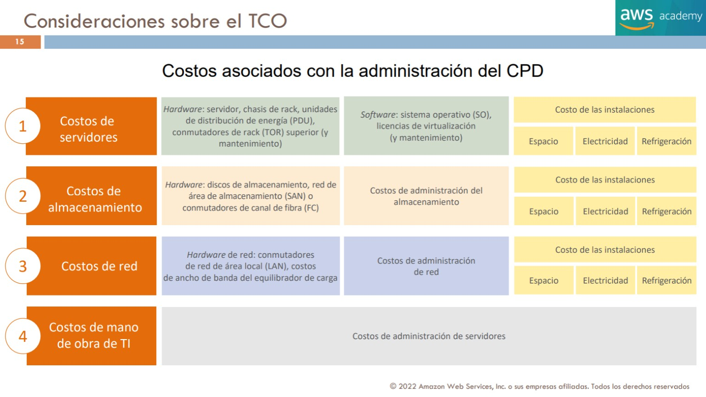

PDF original: [`isT4.pdf`](../../../proceso/AWS_Bloque_IV_Para_Codex/pdf_originales/isT4.pdf).

### T4 — página física 16: Ejemplo numérico de TCO — datos históricos

**[FUENTE DOCENTE — lectura visual desarrollada]** La captura compara un escenario ilustrativo de tres años de infraestructura on-premises frente a AWS mediante tabla y barras. El total visible es aproximadamente 167.422 USD en instalaciones frente a 7.509 USD en AWS, con una cifra promocional de ahorro de 159.913 USD; en el pie se menciona soporte empresarial y una RI parcial de EC2 a tres años.

**[NOTA DE VIGENCIA / CRITERIO EDITORIAL]** EJEMPLO ILUSTRATIVO HISTÓRICO, NO UNA PREDICCIÓN. Las partidas comparadas son muy asimétricas, algunas celdas aparecen con guiones y puede existir redondeo; jamás extrapolar el porcentaje a una migración real.

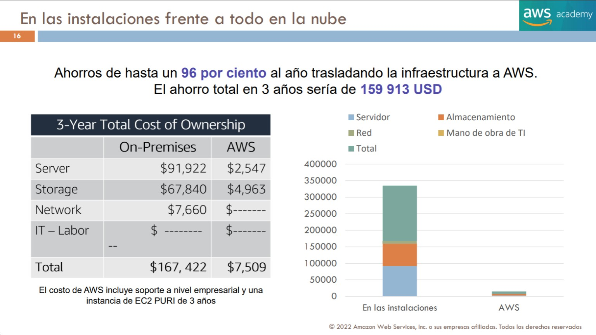

PDF original: [`isT4.pdf`](../../../proceso/AWS_Bloque_IV_Para_Codex/pdf_originales/isT4.pdf).

### T4 — página física 17: AWS Pricing Calculator: objetivo

**[FUENTE DOCENTE — lectura visual desarrollada]** La fuente propone usar la calculadora para estimar costes mensuales, modelar arquitecturas antes de construirlas, explorar puntos de precio y organizar estimaciones en grupos de servicios. La captura corresponde a una interfaz antigua.

**[NOTA DE VIGENCIA / CRITERIO EDITORIAL]** Una estimación no es factura ni garantía; deben declararse horas, región, uso, almacenamiento, red y compromisos. Consultar la interfaz oficial actual.

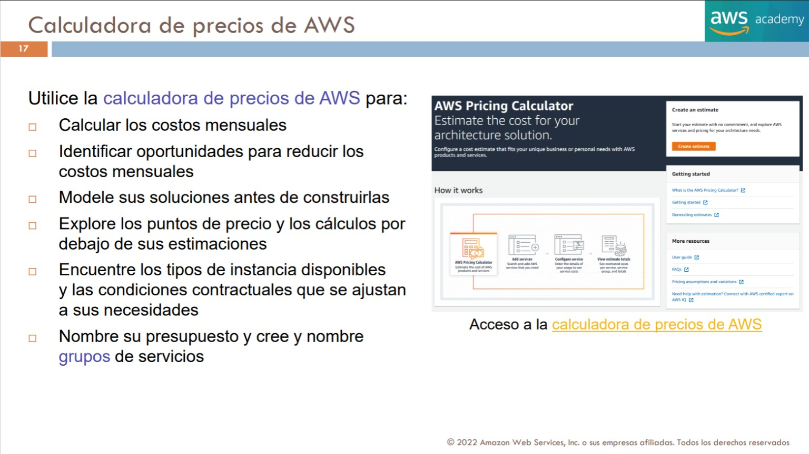

PDF original: [`isT4.pdf`](../../../proceso/AWS_Bloque_IV_Para_Codex/pdf_originales/isT4.pdf).

### T4 — página física 18: Interpretación de una estimación

**[FUENTE DOCENTE — lectura visual desarrollada]** La captura presenta partidas de servicios y totales desglosados: coste del primer periodo, importe anticipado y mensualidades. Un presupuesto depende de cantidades y supuestos introducidos.

**[NOTA DE VIGENCIA / CRITERIO EDITORIAL]** Las cifras concretas de la captura antigua no deben memorizarse, y no necesariamente incluyen todos los impuestos, variaciones, cargos de terceros o comportamiento posterior.

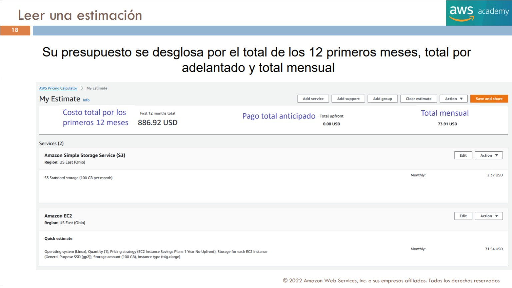

PDF original: [`isT4.pdf`](../../../proceso/AWS_Bloque_IV_Para_Codex/pdf_originales/isT4.pdf).

### T4 — página física 19: Caso Delaware North (1/6): contexto

**[FUENTE DOCENTE — lectura visual desarrollada]** Se identifica a Delaware North como empresa global con más de 200 sedes, centenares de millones de clientes e ingresos anuales multimillonarios, según el caso histórico.

**[NOTA DE VIGENCIA / CRITERIO EDITORIAL]** Son magnitudes del caso de la presentación, no datos actuales verificados de la empresa.

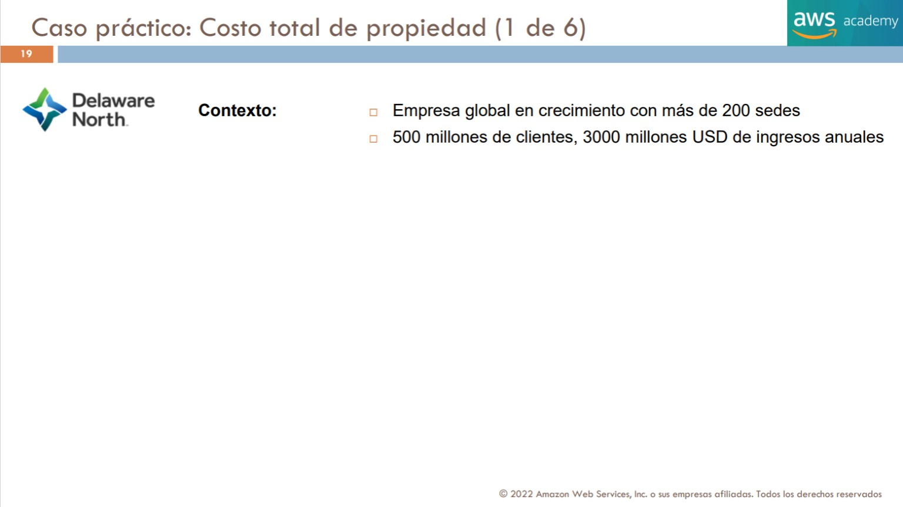

PDF original: [`isT4.pdf`](../../../proceso/AWS_Bloque_IV_Para_Codex/pdf_originales/isT4.pdf).

### T4 — página física 20: Caso Delaware North (2/6): desafío

**[FUENTE DOCENTE — lectura visual desarrollada]** Se indica la necesidad de implementar soluciones rápidamente para atender demanda y de actualizar equipos que envejecían.

**[NOTA DE VIGENCIA / CRITERIO EDITORIAL]** Conectar el problema con tiempo de aprovisionamiento, renovación de hardware y costes de mantenimiento.

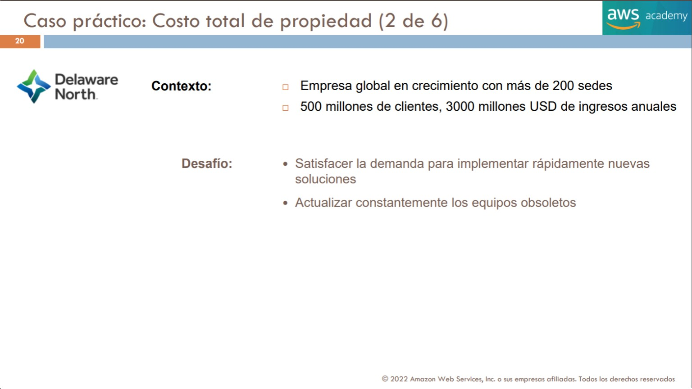

PDF original: [`isT4.pdf`](../../../proceso/AWS_Bloque_IV_Para_Codex/pdf_originales/isT4.pdf).

### T4 — página física 21: Caso Delaware North (3/6): criterios

**[FUENTE DOCENTE — lectura visual desarrollada]** Se busca una plataforma que gestione diversidad de cargas, permita modificar procesos para ser más eficientes, elimine trabajo pesado como parches y permita retorno de inversión favorable.

**[NOTA DE VIGENCIA / CRITERIO EDITORIAL]** Presentar criterios como requisitos del caso, no como beneficios universales garantizados.

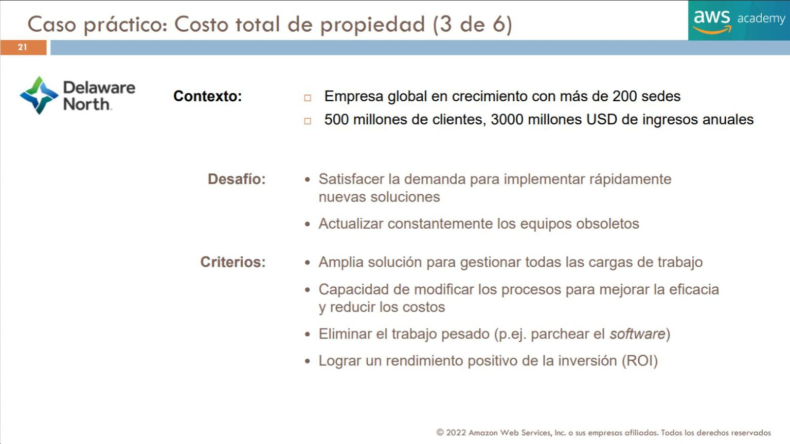

PDF original: [`isT4.pdf`](../../../proceso/AWS_Bloque_IV_Para_Codex/pdf_originales/isT4.pdf).

### T4 — página física 22: Caso Delaware North (4/6): solución

**[FUENTE DOCENTE — lectura visual desarrollada]** El material describe mover su centro de datos a AWS y la mayoría de aplicaciones, retirar gran parte de servidores existentes y utilizar reservas de EC2 a tres años. La cifra de 205 servidores y 90 % es parte del relato de la lámina.

**[NOTA DE VIGENCIA / CRITERIO EDITORIAL]** No inferir que la migración de cualquier aplicación admite el mismo modelo de compra ni que 90 % de reducción de servidores equivale a 90 % de ahorro.

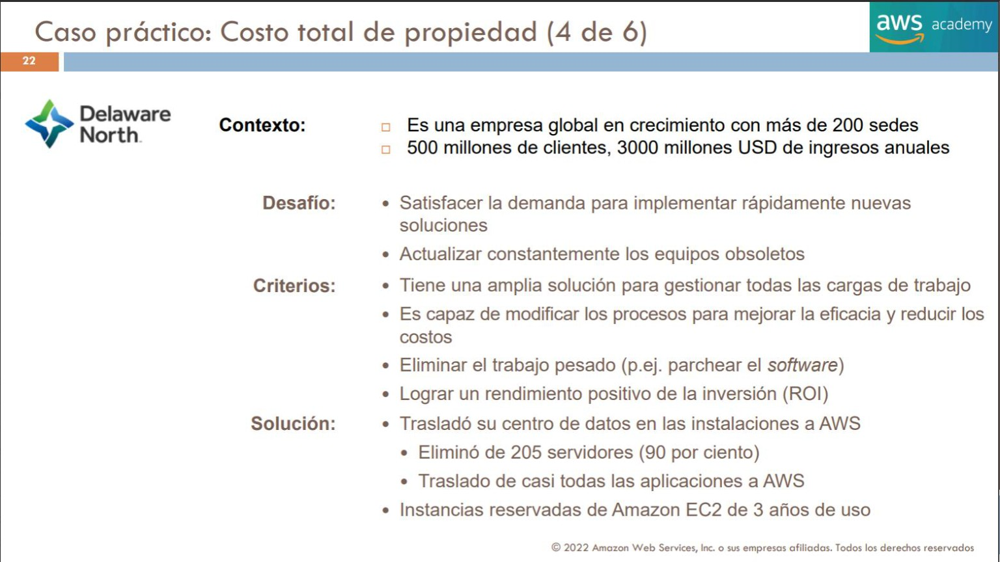

PDF original: [`isT4.pdf`](../../../proceso/AWS_Bloque_IV_Para_Codex/pdf_originales/isT4.pdf).

### T4 — página física 23: Caso Delaware North (5/6): gráfico de coste

**[FUENTE DOCENTE — lectura visual desarrollada]** Muestra barras de comparación on-premises frente a un entorno objetivo AWS a lo largo de varios años, con mayor desembolso inicial de infraestructura antigua. El gráfico está rotulado como resumen de flujo de caja histórico.

**[NOTA DE VIGENCIA / CRITERIO EDITORIAL]** No tratar el gráfico de 2015–2019 como ahorro actual, ni reutilizar valores ilegibles como medición demostrada.

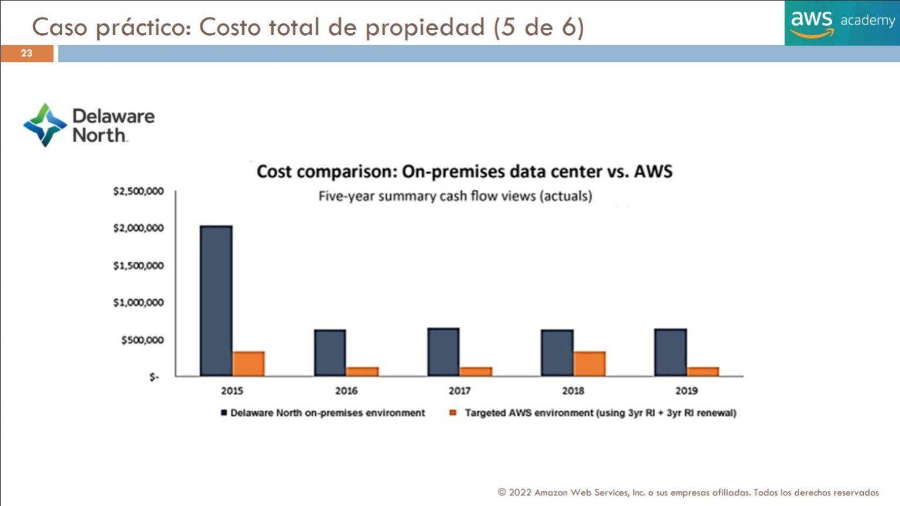

PDF original: [`isT4.pdf`](../../../proceso/AWS_Bloque_IV_Para_Codex/pdf_originales/isT4.pdf).

### T4 — página física 24: Caso Delaware North (6/6): resultados de negocio

**[FUENTE DOCENTE — lectura visual desarrollada]** Se destacan optimización de recursos, agilidad/rapidez de comercialización y eficiencia operativa. La lámina menciona aprovisionar nuevas empresas en un día y lanzar servicios en minutos como beneficios del caso.

**[NOTA DE VIGENCIA / CRITERIO EDITORIAL]** Resultados de un caso concreto; no constituyen SLA de AWS ni garantía universal de migración.

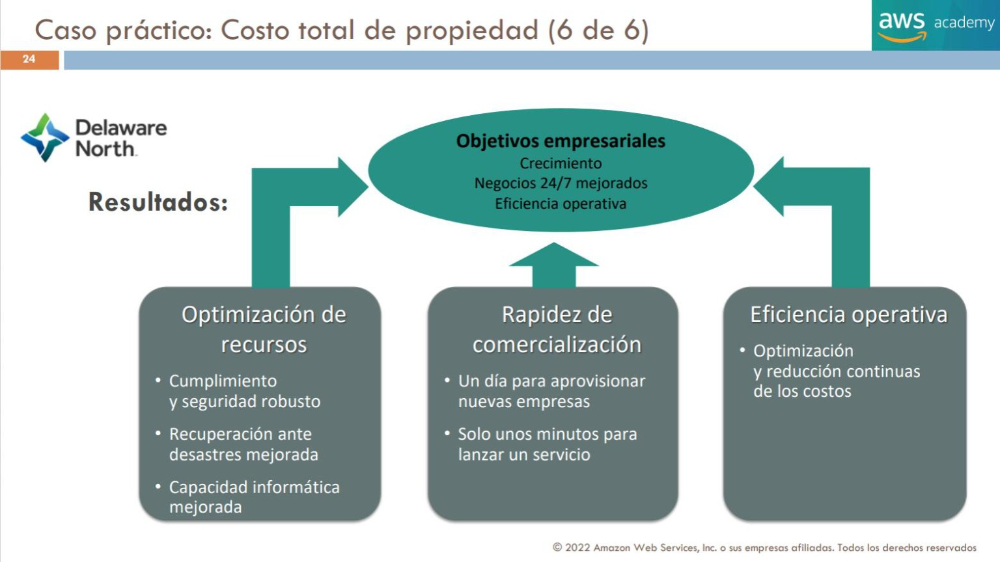

PDF original: [`isT4.pdf`](../../../proceso/AWS_Bloque_IV_Para_Codex/pdf_originales/isT4.pdf).

### T4 — página física 25: Separador: administración de facturación y costos

**[FUENTE DOCENTE — lectura visual desarrollada]** Introduce herramientas operativas de facturación y gestión.

**[NOTA DE VIGENCIA / CRITERIO EDITORIAL]** Página administrativa.

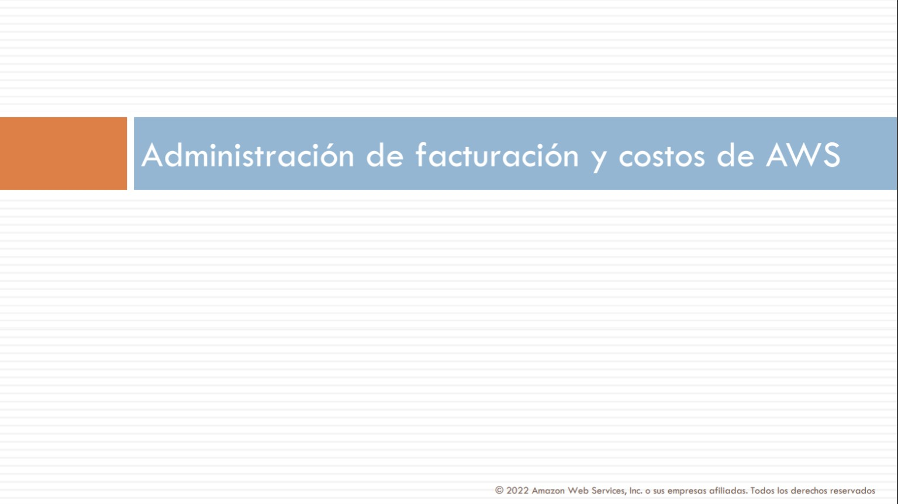

PDF original: [`isT4.pdf`](../../../proceso/AWS_Bloque_IV_Para_Codex/pdf_originales/isT4.pdf).

### T4 — página física 26: Introducción a AWS Billing and Cost Management

**[FUENTE DOCENTE — lectura visual desarrollada]** El material presenta administración de facturación y costes para pagar facturas, controlar uso y presupuestos, prever gasto futuro y planificar.

**[NOTA DE VIGENCIA / CRITERIO EDITORIAL]** No identificar todo el portal como una única métrica o una sola API. Separar factura, análisis, presupuesto y previsión.

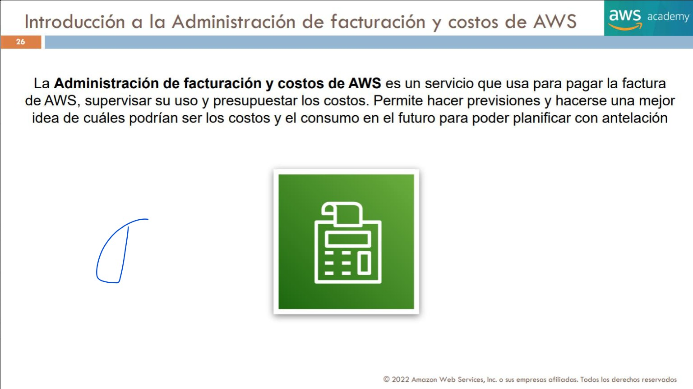

PDF original: [`isT4.pdf`](../../../proceso/AWS_Bloque_IV_Para_Codex/pdf_originales/isT4.pdf).

### T4 — página física 27: Panel de facturación

**[FUENTE DOCENTE — lectura visual desarrollada]** La captura presenta resumen mensual, gastos acumulados, estimaciones y servicios que representan mayor gasto. El propósito es localizar de un vistazo evolución general y partidas destacadas.

**[NOTA DE VIGENCIA / CRITERIO EDITORIAL]** La captura contiene un periodo de 2017 y una interfaz ya cambiada; no enseñar clics obsoletos como navegación actual.

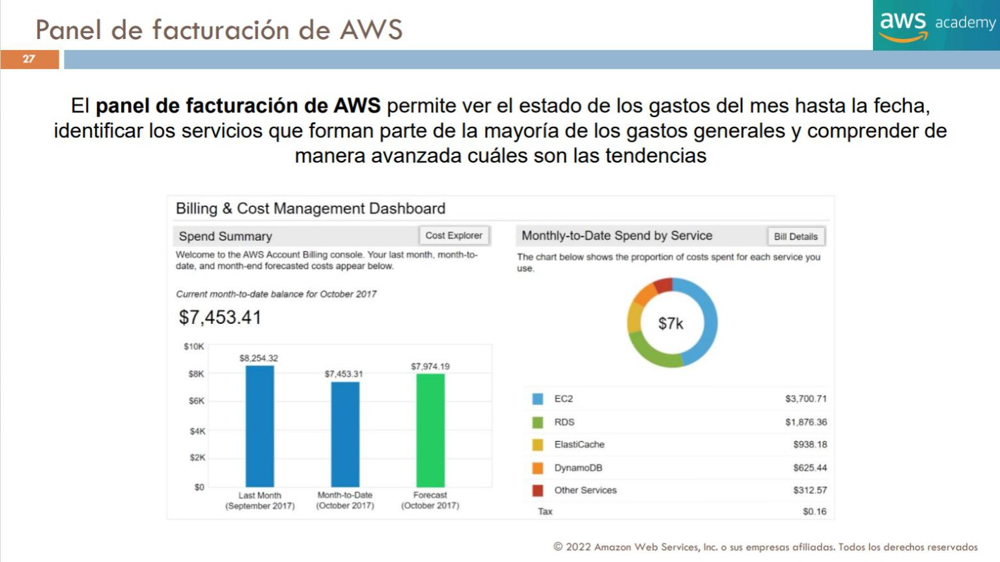

PDF original: [`isT4.pdf`](../../../proceso/AWS_Bloque_IV_Para_Codex/pdf_originales/isT4.pdf).

### T4 — página física 28: Tres herramientas de gestión de costes

**[FUENTE DOCENTE — lectura visual desarrollada]** La figura identifica AWS Budgets, el Informe de Coste y Uso (Cost and Usage Report, CUR) y Cost Explorer como herramientas distintas.

**[NOTA DE VIGENCIA / CRITERIO EDITORIAL]** Budgets fija umbrales y alertas; Cost Explorer explora tendencias; CUR/Data Exports ofrece registros detallados. No usarlas como sinónimos.

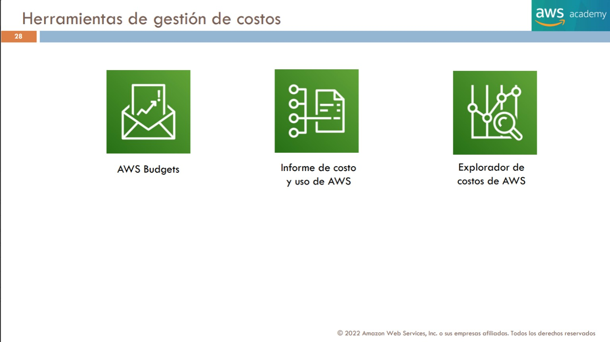

PDF original: [`isT4.pdf`](../../../proceso/AWS_Bloque_IV_Para_Codex/pdf_originales/isT4.pdf).

### T4 — página física 29: Facturación mensual

**[FUENTE DOCENTE — lectura visual desarrollada]** La captura separa gastos de AWS Marketplace y cargos por servicios AWS, junto con partidas recurrentes y uso. En el ejemplo histórico figura un total de 7.453,41 USD de octubre de 2017.

**[NOTA DE VIGENCIA / CRITERIO EDITORIAL]** El importe pertenece a la captura docente, no al proyecto del alumno. Facturas pueden incluir cargos de terceros, impuestos, descuentos y ajustes.

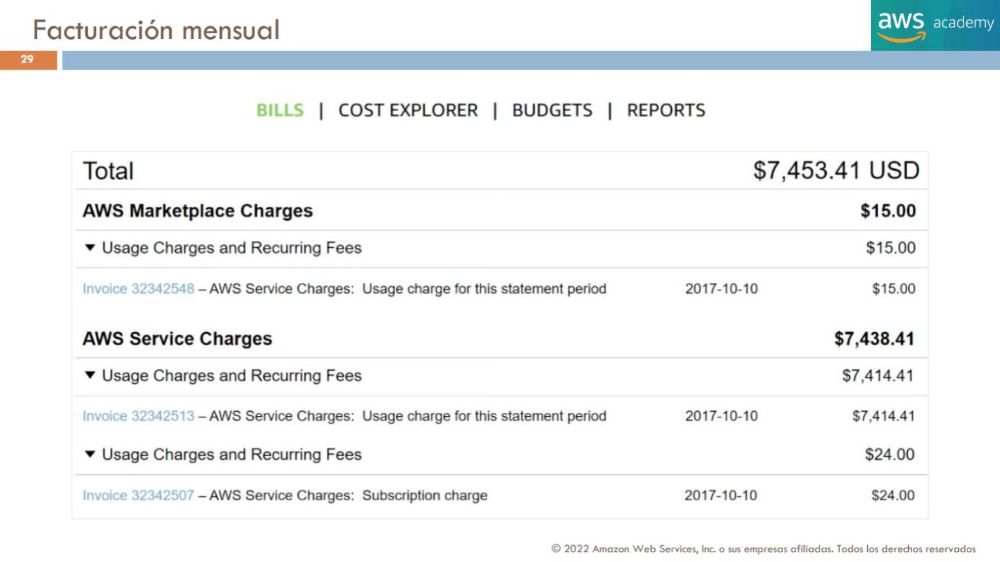

PDF original: [`isT4.pdf`](../../../proceso/AWS_Bloque_IV_Para_Codex/pdf_originales/isT4.pdf).

### T4 — página física 30: Explorador de costes

**[FUENTE DOCENTE — lectura visual desarrollada]** El gráfico de barras apiladas compara gasto mensual agrupado por servicio (por ejemplo EC2, RDS, ElastiCache y otros), facilitando ver composición y tendencias.

**[NOTA DE VIGENCIA / CRITERIO EDITORIAL]** No reemplazarlo por cálculo de precio futuro de una arquitectura aún no desplegada; para eso corresponde Pricing Calculator.

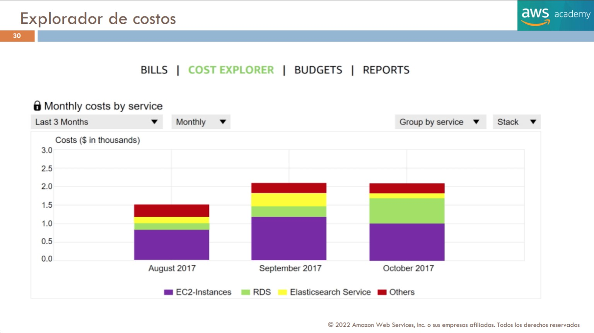

PDF original: [`isT4.pdf`](../../../proceso/AWS_Bloque_IV_Para_Codex/pdf_originales/isT4.pdf).

### T4 — página física 31: Previsión y seguimiento de costes mediante Budgets

**[FUENTE DOCENTE — lectura visual desarrollada]** La captura muestra presupuesto mensual, uso actual, pronóstico y comparación con importe presupuestado. Aparece un presupuesto de solicitudes S3 junto a un presupuesto de coste mensual.

**[NOTA DE VIGENCIA / CRITERIO EDITORIAL]** Permite ilustrar presupuestos por coste y uso; no prometer bloqueo automático universal al alcanzar una cantidad. La actualización y alertas no son instantáneas.

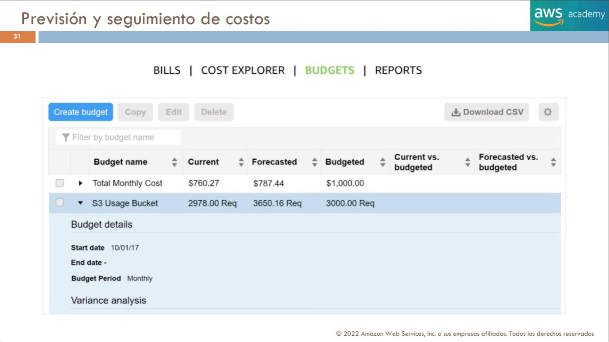

PDF original: [`isT4.pdf`](../../../proceso/AWS_Bloque_IV_Para_Codex/pdf_originales/isT4.pdf).

### T4 — página física 32: Cost and Usage Report: tabla detallada

**[FUENTE DOCENTE — lectura visual desarrollada]** La tabla incluye columnas de producto, tipo de uso, operación, AZ, cantidad, moneda y descripción de línea. Es el nivel de detalle necesario para atribuir costes, conciliar consumos e investigar conceptos.

**[NOTA DE VIGENCIA / CRITERIO EDITORIAL]** Los identificadores y columnas visibles son ejemplos de 2022; explicar también Data Exports y CUR 2.0 como opciones actuales de información detallada.

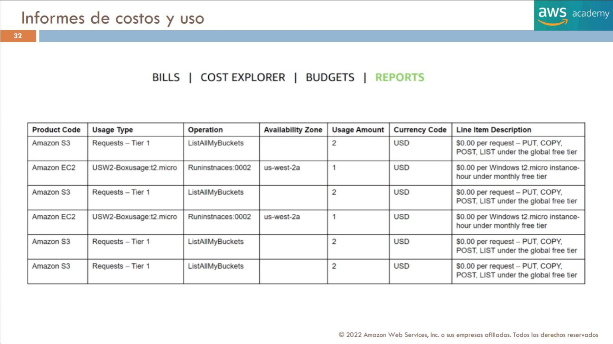

PDF original: [`isT4.pdf`](../../../proceso/AWS_Bloque_IV_Para_Codex/pdf_originales/isT4.pdf).

### T4 — página física 33: Separador: soporte técnico

**[FUENTE DOCENTE — lectura visual desarrollada]** Inicia soporte. No incorpora técnica adicional.

**[NOTA DE VIGENCIA / CRITERIO EDITORIAL]** Página administrativa.

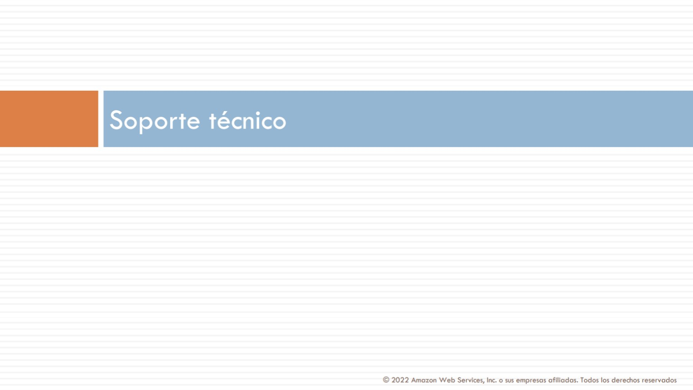

PDF original: [`isT4.pdf`](../../../proceso/AWS_Bloque_IV_Para_Codex/pdf_originales/isT4.pdf).

### T4 — página física 34: AWS Support: necesidades

**[FUENTE DOCENTE — lectura visual desarrollada]** La fuente asocia asistencia con experimentar con AWS, usar servicios en producción y operar cargas empresariales críticas. Explica la combinación de herramientas y personal especializado.

**[NOTA DE VIGENCIA / CRITERIO EDITORIAL]** La profundidad y tiempo de respuesta dependen de plan, gravedad y otras condiciones.

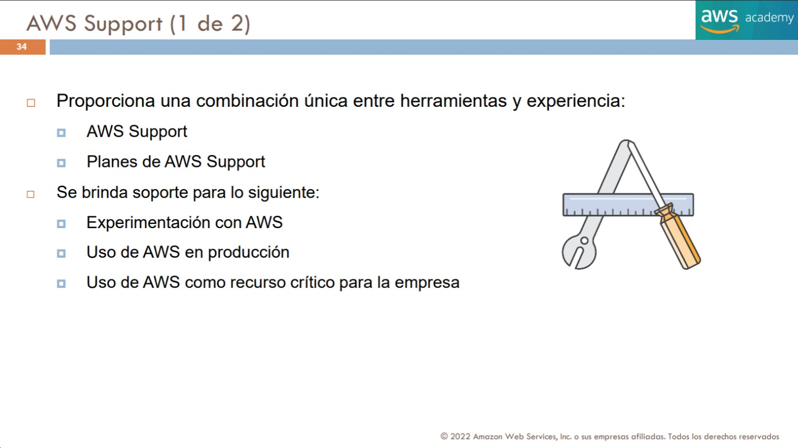

PDF original: [`isT4.pdf`](../../../proceso/AWS_Bloque_IV_Para_Codex/pdf_originales/isT4.pdf).

### T4 — página física 35: AWS Support: TAM, Trusted Advisor, Concierge

**[FUENTE DOCENTE — lectura visual desarrollada]** Presenta TAM como figura de contacto y asesoría (en su tabla histórica, Enterprise); Trusted Advisor para recomendaciones automáticas; y Support Concierge para consultas sobre cuentas y facturación bajo planes y condiciones pertinentes.

**[NOTA DE VIGENCIA / CRITERIO EDITORIAL]** Diferenciar consejo operativo de soporte técnico y facturación. No afirmar que TAM o Concierge pertenezcan a todos los planes actuales.

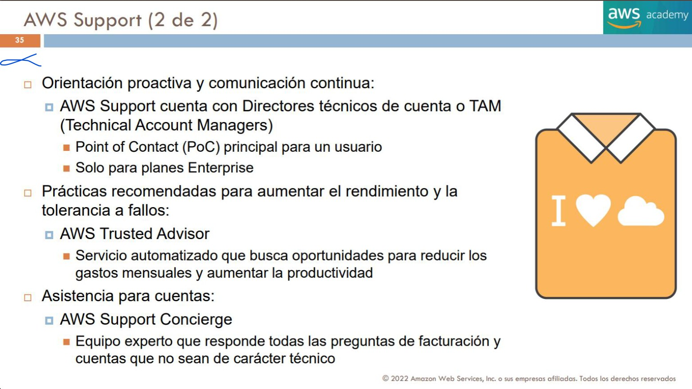

PDF original: [`isT4.pdf`](../../../proceso/AWS_Bloque_IV_Para_Codex/pdf_originales/isT4.pdf).

### T4 — página física 36: Planes históricos: Basic, Developer, Business y Enterprise

**[FUENTE DOCENTE — lectura visual desarrollada]** La figura de 2022 presenta cuatro planes: Basic (recursos y cuestiones frecuentes), Developer (desarrollo/pruebas), Business (producción) y Enterprise (cargas críticas, TAM).

**[NOTA DE VIGENCIA / CRITERIO EDITORIAL]** MUY OBSOLETO: en la documentación comercial 2026 figuran Basic, Business Support+, Enterprise Support y Unified Operations. Developer, Business y Enterprise On-Ramp quedan como legado con fin de soporte programado en 2027; contrastar guías actuales.

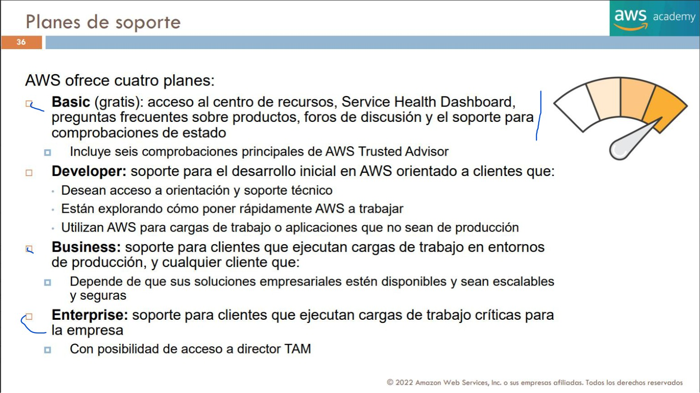

PDF original: [`isT4.pdf`](../../../proceso/AWS_Bloque_IV_Para_Codex/pdf_originales/isT4.pdf).

### T4 — página física 37: Tabla histórica de severidad y tiempos de respuesta

**[FUENTE DOCENTE — lectura visual desarrollada]** La matriz cruza Basic, Developer, Business y Enterprise con niveles Critical/Urgent/High/Normal/Low y plazos de ejemplo. Basic se presenta sin soporte de casos técnicos; Developer solo ofrece ciertos niveles en horario empresarial; Business/Enterprise incluyen atención 24/7 y respuestas más urgentes.

**[NOTA DE VIGENCIA / CRITERIO EDITORIAL]** No memorizar esta tabla como SLA vigente: categorías comerciales, plazos y planes cambiaron. Explicar que tiempo de primera respuesta no es tiempo de resolución ni garantía de restablecimiento del servicio.

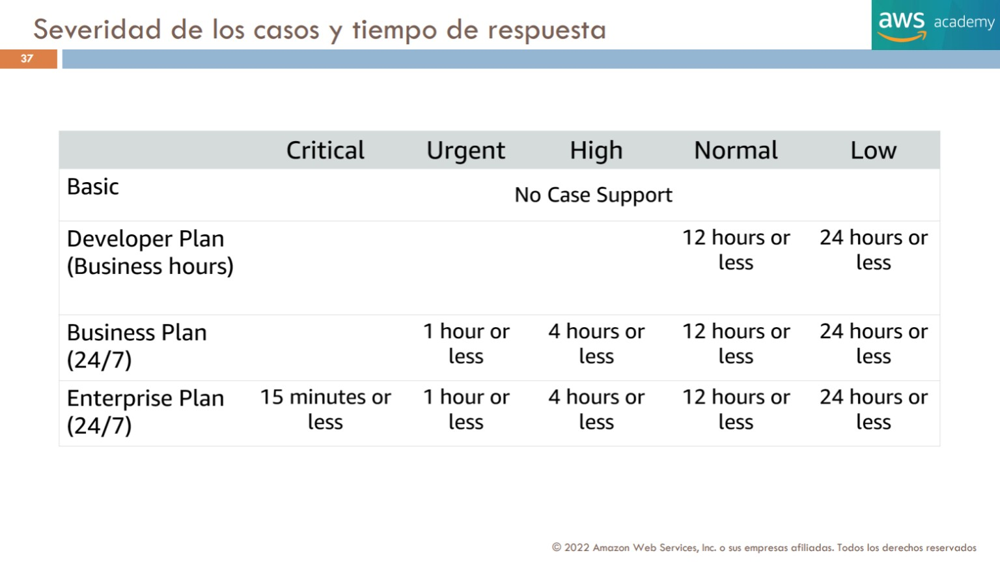

PDF original: [`isT4.pdf`](../../../proceso/AWS_Bloque_IV_Para_Codex/pdf_originales/isT4.pdf).

## T6: 10 diapositivas físicas (31–40): modelos de compra EC2 y cuatro pilares de optimización

### T6 — página física 31: Sección de optimización de costes EC2

**[FUENTE DOCENTE — lectura visual desarrollada]** Separador del bloque de optimización de costes. La docencia pasa del ciclo de vida de EC2 a la selección económica de modelos de compra.

**[NOTA DE VIGENCIA / CRITERIO EDITORIAL]** Página administrativa.

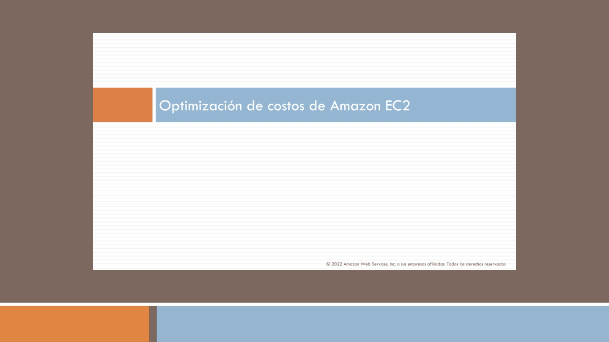

PDF original: [`isT6.pdf`](../../../proceso/AWS_Bloque_IV_Para_Codex/pdf_originales/isT6.pdf).

### T6 — página física 32: Opciones de compra de EC2

**[FUENTE DOCENTE — lectura visual desarrollada]** La tabla muestra On-Demand sin compromiso a largo plazo; RIs con descuento y pago anticipado completo/parcial/ninguno; Spot con capacidad sobrante interrumpible; Dedicated Hosts para uso dedicado de hardware físico; Dedicated Instances para aislamiento en hardware de un solo cliente; y Scheduled Reserved Instances como opción histórica.

**[NOTA DE VIGENCIA / CRITERIO EDITORIAL]** Las Scheduled Reserved Instances son referencia histórica retirada; no enseñarlas como opción moderna disponible. Distinguir RIs de reservas de capacidad. Añadir Savings Plans y Capacity Reservations desde fuente oficial.

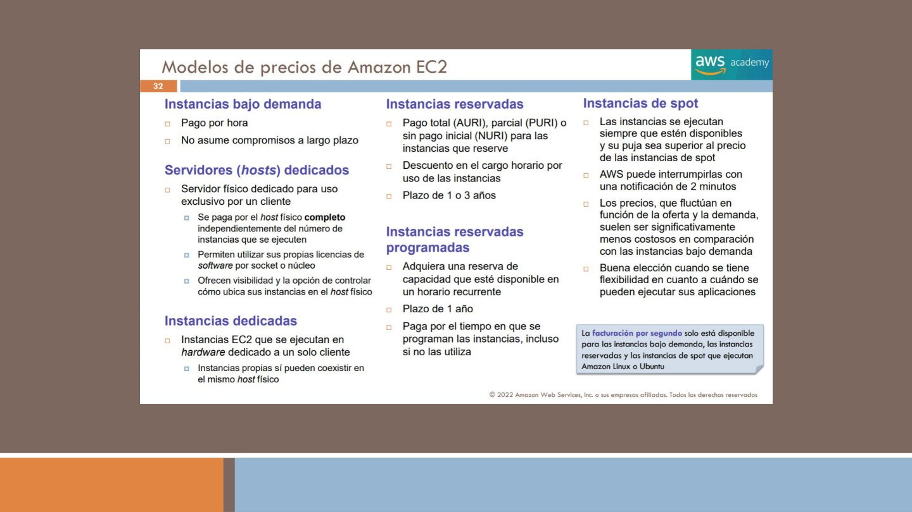

PDF original: [`isT6.pdf`](../../../proceso/AWS_Bloque_IV_Para_Codex/pdf_originales/isT6.pdf).

### T6 — página física 33: Beneficios de cada modalidad

**[FUENTE DOCENTE — lectura visual desarrollada]** La diapositiva resume bajo demanda para flexibilidad, Spot para cargas dinámicas y tolerantes a interrupción, RIs para previsibilidad, y Dedicated Hosts para licencias o requisitos de dedicación.

**[NOTA DE VIGENCIA / CRITERIO EDITORIAL]** No prometer ahorro igual en toda región, sistema o instancia. Compromiso y capacidad física son problemas distintos.

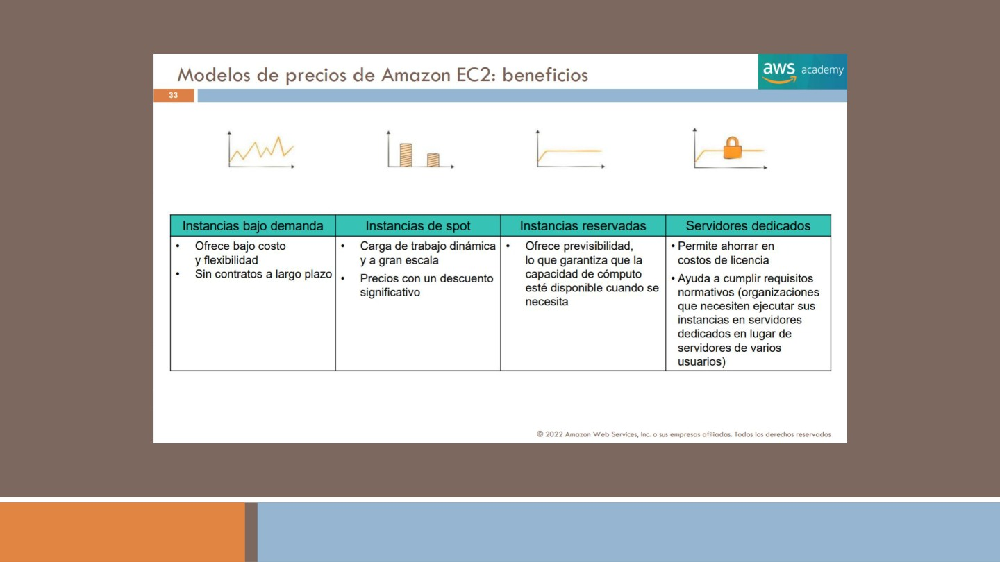

PDF original: [`isT6.pdf`](../../../proceso/AWS_Bloque_IV_Para_Codex/pdf_originales/isT6.pdf).

### T6 — página física 34: Casos de uso de modalidades EC2

**[FUENTE DOCENTE — lectura visual desarrollada]** Asocia uso breve/variable con On-Demand, cargas con ventanas flexibles con Spot, patrones estables con RIs y licencias o aislamiento específico con Dedicated Hosts. La tabla plantea «qué carga necesita qué modelo».

**[NOTA DE VIGENCIA / CRITERIO EDITORIAL]** Requiere matizar las condiciones de Spot y que el lanzamiento sobre hosts dedicados no elimina licencias y mantenimiento.

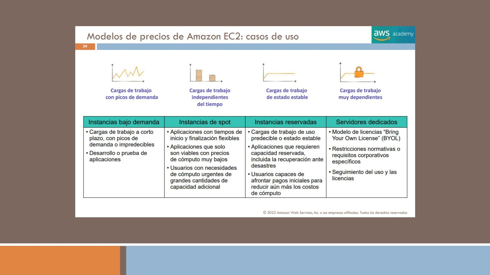

PDF original: [`isT6.pdf`](../../../proceso/AWS_Bloque_IV_Para_Codex/pdf_originales/isT6.pdf).

### T6 — página física 35: Casos de uso repetidos en la fuente

**[FUENTE DOCENTE — lectura visual desarrollada]** Segunda página muy similar a la anterior, con matriz de usos por modalidad. Se conserva para trazabilidad sin duplicar todo el texto en los futuros apuntes.

**[NOTA DE VIGENCIA / CRITERIO EDITORIAL]** La paginación visible dentro de esta captura no coincide necesariamente con el índice físico del PDF; usar nombres de archivo.

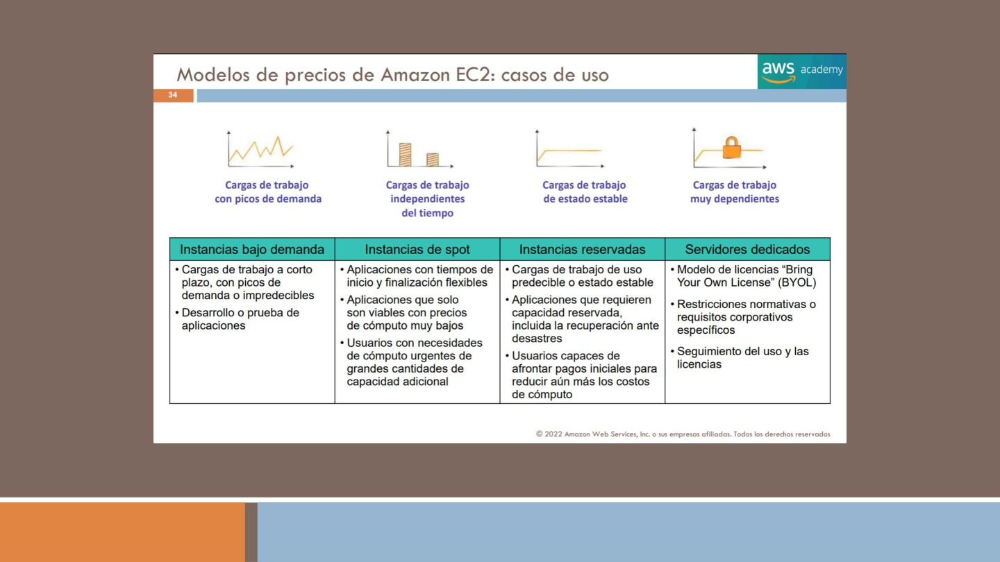

PDF original: [`isT6.pdf`](../../../proceso/AWS_Bloque_IV_Para_Codex/pdf_originales/isT6.pdf).

### T6 — página física 36: Cuatro pilares de optimización de coste de EC2

**[FUENTE DOCENTE — lectura visual desarrollada]** Organiza la estrategia en cuatro pilares: dimensionamiento adecuado, aumento de elasticidad, modelo de precios óptimo y optimización de opciones de almacenamiento.

**[NOTA DE VIGENCIA / CRITERIO EDITORIAL]** Es un modelo pedagógico de la diapositiva; no debe confundirse con los seis pilares del Well-Architected Framework.

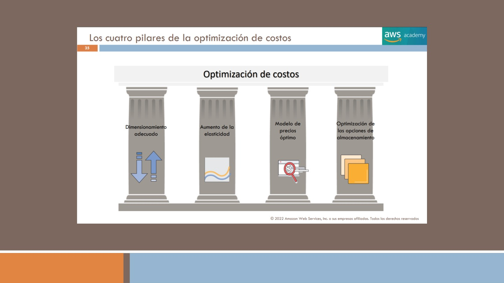

PDF original: [`isT6.pdf`](../../../proceso/AWS_Bloque_IV_Para_Codex/pdf_originales/isT6.pdf).

### T6 — página física 37: Pilar 1: dimensionamiento adecuado

**[FUENTE DOCENTE — lectura visual desarrollada]** Relaciona tamaño y familia de instancia con necesidades de CPU, RAM, almacenamiento y red; sugiere observar métricas y reducir recursos ociosos. El eslogan es elegir tamaño correcto antes de comprometer una reserva.

**[NOTA DE VIGENCIA / CRITERIO EDITORIAL]** Evitar recomendar reducir capacidad sin observar picos, resiliencia y seguridad.

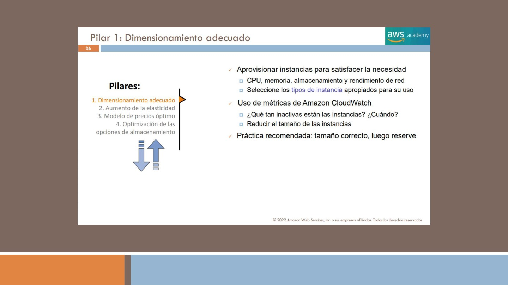

PDF original: [`isT6.pdf`](../../../proceso/AWS_Bloque_IV_Para_Codex/pdf_originales/isT6.pdf).

### T6 — página física 38: Pilar 2: elasticidad

**[FUENTE DOCENTE — lectura visual desarrollada]** Propone detener o hibernar instancias compatibles en periodos inactivos, especialmente laboratorios o pruebas, y usar escalado automático para satisfacer picos de demanda.

**[NOTA DE VIGENCIA / CRITERIO EDITORIAL]** Detener instancia EC2 no detiene todos los cargos: discos EBS, IP y otros recursos pueden continuar cobrando.

PDF original: [`isT6.pdf`](../../../proceso/AWS_Bloque_IV_Para_Codex/pdf_originales/isT6.pdf).

### T6 — página física 39: Pilar 3: modelo óptimo de precios

**[FUENTE DOCENTE — lectura visual desarrollada]** Plantea combinar modalidades en una arquitectura según patrones de uso: bajo demanda o Spot para variables, reservadas para estables y servicios serverless cuando corresponda.

**[NOTA DE VIGENCIA / CRITERIO EDITORIAL]** No recomendar seleccionar exclusivamente Spot para cargas de negocio que no toleran interrupciones.

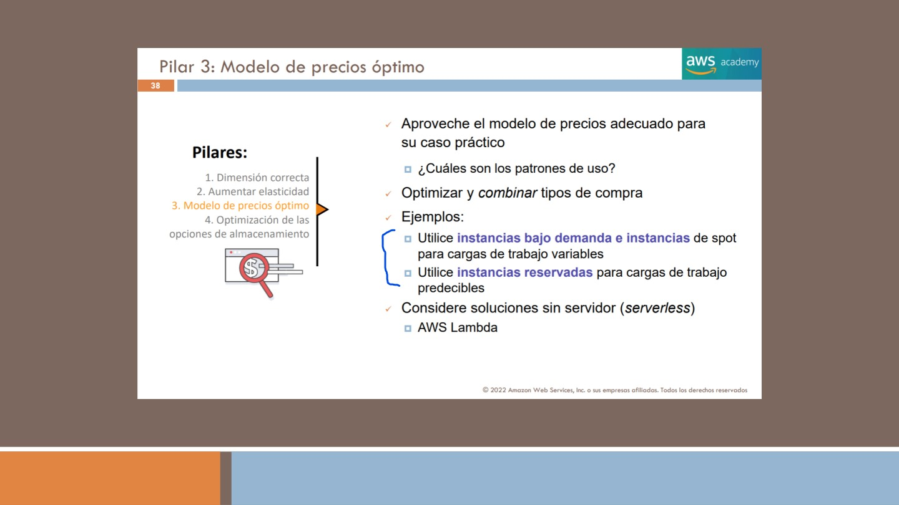

PDF original: [`isT6.pdf`](../../../proceso/AWS_Bloque_IV_Para_Codex/pdf_originales/isT6.pdf).

### T6 — página física 40: Pilar 4: opciones de almacenamiento

**[FUENTE DOCENTE — lectura visual desarrollada]** Considera reducir tamaño o tipo de EBS cuando sea adecuado, eliminar snapshots innecesarios y colocar datos en modalidades de S3 adecuadas a frecuencia y retención.

**[NOTA DE VIGENCIA / CRITERIO EDITORIAL]** Cambios a almacenamiento barato pueden introducir gastos de recuperación, restricciones y mayor latencia; revisar respaldo y política antes de borrar.

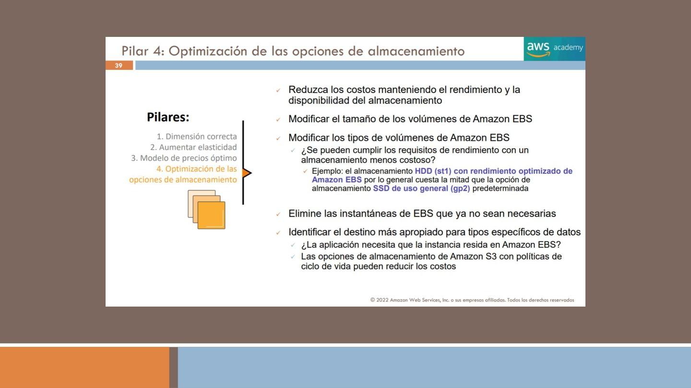

PDF original: [`isT6.pdf`](../../../proceso/AWS_Bloque_IV_Para_Codex/pdf_originales/isT6.pdf).

## T7: 3 diapositivas (12,27,34): factores de coste de EBS, S3 y comparación histórica Glacier

### T7 — página física 12: EBS: dimensiones de facturación

**[FUENTE DOCENTE — lectura visual desarrollada]** El material enumera volúmenes (capacidad en GB/mes), IOPS según tipo, snapshots de EBS y transferencia de datos. Un volumen puede seguir generando coste independientemente de que la instancia se ejecute.

**[NOTA DE VIGENCIA / CRITERIO EDITORIAL]** Los tipos SSD/HDD y detalles de IOPS evolucionan; no trasladar la antigua afirmación «SSD general incluye todo en el precio» a gp3 ni toda configuración vigente. Entradas y salidas de red dependen de dirección y ubicación.

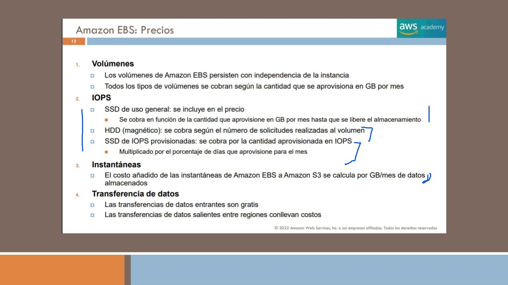

PDF original: [`isT7.pdf`](../../../proceso/AWS_Bloque_IV_Para_Codex/pdf_originales/isT7.pdf).

### T7 — página física 27: S3: dimensiones de facturación

**[FUENTE DOCENTE — lectura visual desarrollada]** La diapositiva enumera almacenamiento en GB/mes, solicitudes (PUT, COPY, POST, LIST, GET) y transferencia de datos salientes. Distingue tipos de petición y algunos supuestos históricos de transferencias sin cargo.

**[NOTA DE VIGENCIA / CRITERIO EDITORIAL]** No sostener que todas las transferencias entre S3 y CloudFront, EC2 y otras ubicaciones son gratuitas por norma universal; verificar combinación concreta, origen, destino y clase.

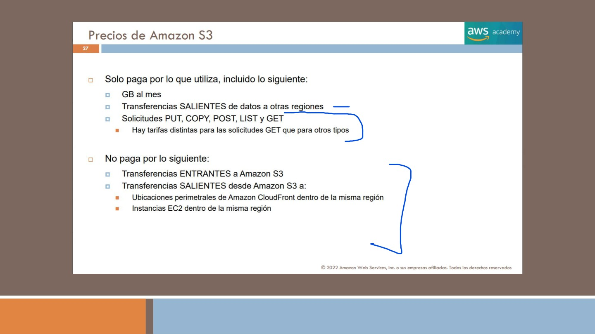

PDF original: [`isT7.pdf`](../../../proceso/AWS_Bloque_IV_Para_Codex/pdf_originales/isT7.pdf).

### T7 — página física 34: Comparación histórica S3 y Glacier

**[FUENTE DOCENTE — lectura visual desarrollada]** La matriz contrasta latencia de milisegundos de S3 con restauraciones de minutos u horas en el Glacier histórico, y diferentes tamaños y costes. Introduce la idea de compensación entre coste de archivo y plazo/operación de recuperación.

**[NOTA DE VIGENCIA / CRITERIO EDITORIAL]** Las clases actuales incluyen Glacier Instant Retrieval y cambian límites, API, costes y opciones de recuperación. Vaults del legado no equivalen a buckets S3.

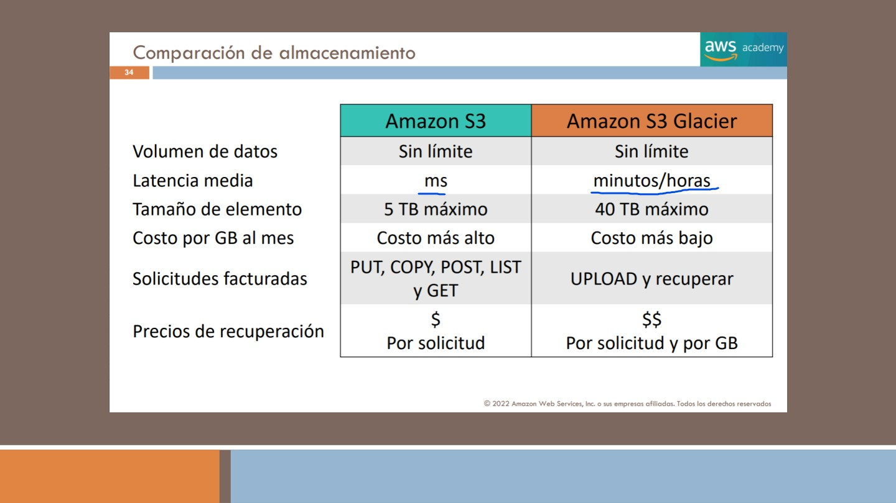

PDF original: [`isT7.pdf`](../../../proceso/AWS_Bloque_IV_Para_Codex/pdf_originales/isT7.pdf).

## T8: 4 diapositivas (17–20): factores de coste de RDS

### T8 — página física 17: RDS: cómputo y características de base

**[FUENTE DOCENTE — lectura visual desarrollada]** Relaciona coste de instancia con horas de ejecución, capacidad asignada, motor de base de datos, tamaño y perfil de memoria.

**[NOTA DE VIGENCIA / CRITERIO EDITORIAL]** Motores/licencias y formas de facturación no son uniformes; parar o disponer de recursos respaldados puede seguir generando cargos.

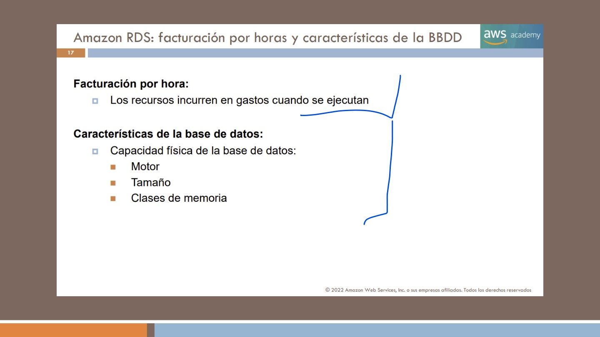

PDF original: [`isT8.pdf`](../../../proceso/AWS_Bloque_IV_Para_Codex/pdf_originales/isT8.pdf).

### T8 — página física 18: RDS: modelos de compra y número de instancias

**[FUENTE DOCENTE — lectura visual desarrollada]** Distingue On-Demand para bases y Reserved DB Instances de uno o tres años con modalidades de pago; recuerda que varias instancias pueden atender cargas, pero generan varias dimensiones de coste.

**[NOTA DE VIGENCIA / CRITERIO EDITORIAL]** Las instancias reservadas de base son descuentos con alcance y restricciones del servicio; no importan de forma idéntica las reglas exactas de RI de EC2.

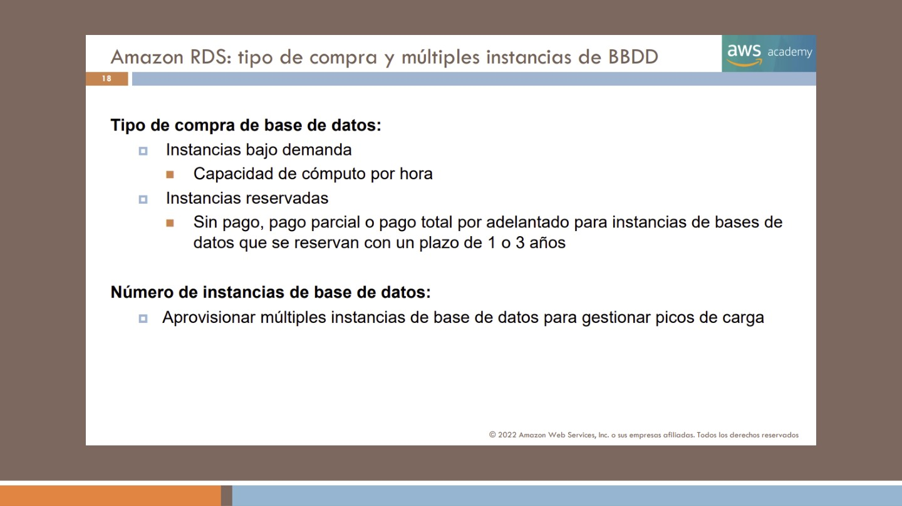

PDF original: [`isT8.pdf`](../../../proceso/AWS_Bloque_IV_Para_Codex/pdf_originales/isT8.pdf).

### T8 — página física 19: RDS: almacenamiento y backups

**[FUENTE DOCENTE — lectura visual desarrollada]** Describe almacenamiento aprovisionado y copias de seguridad bajo determinado límite incluido en el ejemplo; el almacenamiento adicional y copias de instancias eliminadas pueden generar cargo.

**[NOTA DE VIGENCIA / CRITERIO EDITORIAL]** El porcentaje de backup libre del material no es promesa general en 2026; depende de motor, modalidad, región y reglas de retención.

PDF original: [`isT8.pdf`](../../../proceso/AWS_Bloque_IV_Para_Codex/pdf_originales/isT8.pdf).

### T8 — página física 20: RDS: I/O, Multi-AZ y transferencias

**[FUENTE DOCENTE — lectura visual desarrollada]** Relaciona operaciones I/O, modalidad Single-AZ o Multi-AZ y transferencia de datos con factura. Muestra exenciones o tratamientos específicos de transferencia entre instancias en escenarios del curso.

**[NOTA DE VIGENCIA / CRITERIO EDITORIAL]** No generalizar sin considerar RDS moderno, tipo de almacenamiento, clúster y situación de red. La replicación Multi-AZ no debe contarse automáticamente como tarifa regular de una conexión entre AZ sin verificar documentación.

PDF original: [`isT8.pdf`](../../../proceso/AWS_Bloque_IV_Para_Codex/pdf_originales/isT8.pdf).

## T2: 1 diapositiva (19): catálogo de administración de costes

### T2 — página física 19: Catálogo de herramientas de administración de costes

**[FUENTE DOCENTE — lectura visual desarrollada]** Lámina de servicios de costes de AWS con herramientas para analizar gasto, presupuestar y administrar uso. Es un índice de familia de servicios, no desarrollo de precios. Se aprovecha como puente con Cost Explorer, Budgets, CUR, Billing y Calculator del T4.

**[NOTA DE VIGENCIA / CRITERIO EDITORIAL]** La interfaz, nombres, servicios y condiciones de 2022 deben contrastarse con la documentación de 2026.

PDF original: [`isT2.pdf`](../../../proceso/AWS_Bloque_IV_Para_Codex/pdf_originales/isT2.pdf).
